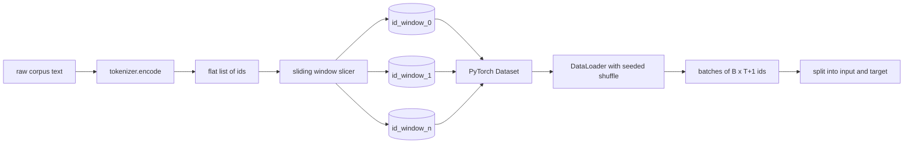
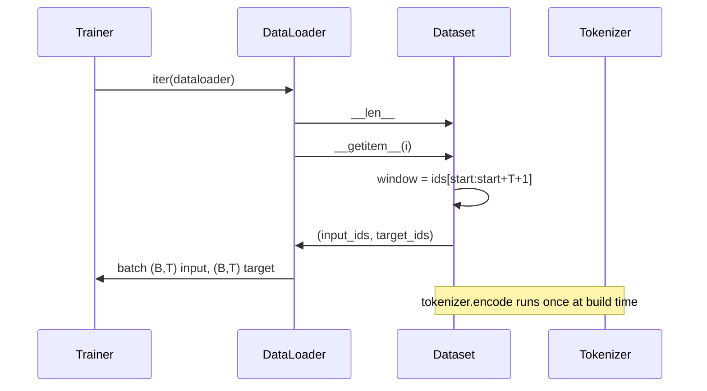

# 带滑动窗口的 tokenized 数据集

> 一次预训练就是一个从 token id 到梯度的函数。本课构建把 id 送进去的传送带。

**Type:** Build
**Languages:** Python
**Prerequisites:** 第 04 阶段课程、第 07 阶段 transformer 课程、本阶段第 30 课
**Time:** ~90 分钟

## Learning Objectives
- 通过调用一次 tokenizer，把原始语料转换成 token id 流。
- 用可配置的重叠步长，把 id 流切成固定长度的窗口。
- 构建一个 PyTorch Dataset，为下一 token 预测返回 input 与 target 张量。
- 把数据集包进一个 DataLoader，使用按 epoch 播种的确定性打乱。
- 推理步长、冗余与有效数据集大小之间的权衡。

```figure
cap-sliding-window
```

## 背景框架

一次预训练每次读取一个 token id batch 并更新模型。每个 batch 的形状由训练契约固定。对因果语言模型而言，batch 持有 `(B, T)` 的 input id 与 `(B, T)` 的 target id，其中 target 是 input 左移一位。数据流水线的职责，是从一份可能有好几 GB 原始文本的语料中，按需、确定且可复现地产出这一契约。

本课构建这条流水线。上一课的 tokenizer 把文本变成长长的扁平 id 列表。滑动窗口把该列表切成训练样本。自定义 Dataset 把样本以张量形式暴露出来。DataLoader 对它们分批，并用已知种子打乱。

## 形状契约

因果 LM 消费形状为 `(B, T)` 的 id，其中 `B` 是批大小，`T` 是 context 长度。位置 `t` 的 target 是位置 `t+1` 的 input。这意味着每个训练样本覆盖 `T+1` 个原始 id。窗口步长控制相邻样本之间重叠多少。



切片器从不越过语料边界去重叠。如果最后一个窗口没有足够 id 填满 `T+1` 个位置，切片器就丢弃它。用 `<|pad|>` 填充尾部也是可行选择，但会让 loss mask 复杂化。本课选择丢弃。

## 为什么要滑动窗口

预训练语料是一条长长的 id 流。如果模型只看到不重叠的窗口，每个训练样本都在教它相同的 `T` 个边界。调整步长会把这些边界挪动位置，让模型看到更多样的预测下一 token 任务。

步长为 `T` 时产生不重叠窗口。步长为 `T // 2` 时产生百分之五十重叠，使有效数据集翻倍。步长为 `1` 时重叠最大，数据集扩大为原来的 `T` 倍。代价是每个 epoch 计算更多。收益是边界更多样。大多数预训练运行采用等于 context 长度的步长，因为语料早已大到模型一个 epoch 跑不完，所以“边界多样性”这一论点也就变弱了。

## Dataset 类

PyTorch Dataset 有两个必需方法。`__len__` 返回样本数量。`__getitem__` 以一对张量的形式返回单个样本。我们的 Dataset 存储编码后的 id 流与步长。对它做索引时即时计算窗口起点，因此无论步长产出多少样本，内存开销都只有一份 id 流。



左移一位发生在 `__getitem__` 内部。Dataset 返回 `(input, target)`，其中 `input = window[:-1]`、`target = window[1:]`。两者都是 PyTorch long 张量。训练循环把它们当作 ground truth。

## 确定性打乱

`shuffle=True` 的 DataLoader 从 PyTorch 随机数生成器读取。通过传入一个按 epoch 播种的显式 `torch.Generator`，每次重新运行都能得到同样的打乱。当你想比较两个仅在某一个超参数上不同的运行时，这一性质很重要。没有种子时，两次运行以不同顺序看数据，loss 曲线会因为与改动无关的原因而分叉。

本课的种子契约很简单：`epoch_seed = base_seed + epoch_index`。base seed 在构造时传入。epoch index 由 trainer 在每个 epoch 开头自增。用同一个 base seed 重跑，每个 epoch 看到的顺序总是相同。

## 批采样器

PyTorch 的默认采样器在禁用放回的情况下均匀随机抽取索引。这正是预训练想要的。在小数据集上做微调时契约相同。DataLoader 通过调用 `__getitem__` `B` 次并堆叠结果来组装一个 batch。由于每个样本按构造都等长，不需要任何 padding 逻辑。

本课为简单起见保持 `num_workers=0`。在生产运行中，worker 会并行化 `__getitem__` 调用。对我们的流水线来说这基本是空操作，因为工作只是对内存中张量做一次切片，但同一套 Dataset API 能干净地支持 worker。

## 统计样本数

对于长度为 `N` 的 id 流、context 长度 `T` 与步长 `S`，样本数为 `max(0, 1 + (N - (T + 1)) // S)`。本课把该计算作为 Dataset 上的静态方法暴露出来，让 trainer 无需遍历即可算出每个 epoch 的总步数。

## 本课不做什么

它不从磁盘流式读取。语料被完整编码进内存，作为单个张量持有。对几百万 id 的语料而言，这远不到一百兆字节，也是本课合适的规模。磁盘流式是另一件独立的事，通过替换存储来接入，但保持 Dataset 契约不变。

它不处理多文档。语料被当作一条连续的 id 流。当语料由多份文档构建时，通过插入 `<|endoftext|>` id 来编码下一文档的边界。模型会学着在边界附近做预测。

## 如何阅读代码

`main.py` 定义了两个类和一个辅助函数。`SlidingWindowDataset` 是 PyTorch Dataset。`make_dataloader` 返回一个配置好的 DataLoader，带播种的生成器。`_encode_corpus_to_ids` 是一次性 tokenizer 调用。底部的 demo 在进程内构建一个小 tokenizer，编码内置语料，构造数据集与 dataloader，打印一个 batch，并断言形状契约。`code/tests/test_dataset.py` 里的测试钉住了窗口数量公式、左移一位性质、确定性打乱与步长权衡。

运行 demo。然后把 context 长度从 16 改成 32，观察每个 epoch 的样本数如何下降。那个数字就是你的每 epoch 步数预算。
