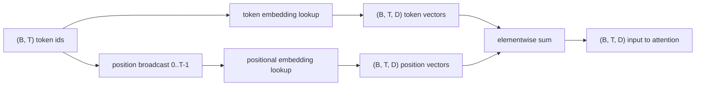
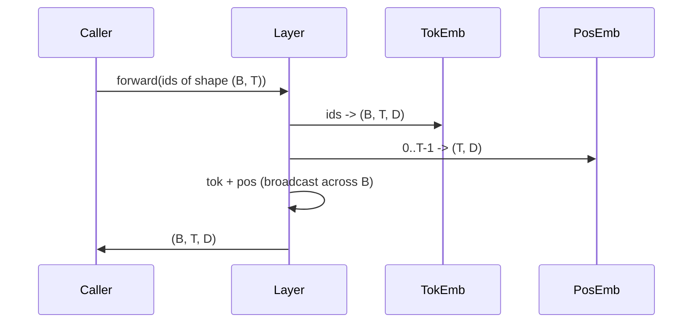

# Token 与位置 embedding

> id 是整数。模型要的是向量。两者之间隔着两张查找表，而位置那张的选择塑造了模型能学到什么。

**Type:** Build
**Languages:** Python
**Prerequisites:** 第 04 阶段课程、第 07 阶段 transformer 课程、本阶段第 30 课与第 31 课
**Time:** ~90 分钟

## Learning Objectives
- 构建一个 token embedding 查找表，把词表 id 映射到稠密向量。
- 构建一个以位置为索引的可学习位置 embedding 查找表。
- 构建一个以位置为索引、无参数的固定正弦位置 embedding。
- 把 token embedding 与位置 embedding 组合成 transformer block 的单一输入。
- 从长度泛化与参数数量两方面对比可学习与正弦 embedding。

```figure
cc-embedding-lookup
```

## 背景框架

模型与一个 token id 的第一次接触，是在 token embedding 矩阵里做一次行查找。该矩阵每个词表 id 一行、每个模型维度一列。查找返回一个向量，模型其余部分把这个向量当作该 id 的含义。反向传播更新前向过程中用到的那些行。训练过程中，这些行的几何结构学会了用方向来编码相似性。

光有 token id 没有顺序。模型需要第二个信号，告诉它位置一与位置十七是不同的。这个信号有两种主流选择：可学习位置 embedding（第二张查找表，每个位置一行），以及固定正弦位置 embedding（一条不含参数的数学公式）。这一选择有后果。可学习表是一个参数，且受限于模型训练时用的最大 context 长度。正弦表在理论上无参数，公式也能延伸到任意位置，但本课的 `SinusoidalPositionalEmbedding` 会在 `max_context_length` 处预计算一张固定表，其 `forward` 越过该边界就会抛错；因此这两个模块在这里都强制执行一个最大 context 长度。即使表的长度足以取索引，模型在超过训练长度后仍可能力不从心。

本课同时构建两者，并把它们与 token embedding 组合成下一课 attention block 的单一输入。

## 形状契约

embedding 阶段的输入是形状为 `(B, T)` 的 token id batch。输出是形状为 `(B, T, D)` 的张量，其中 `D` 是模型维度。每个 batch 元素有相同的 context 长度 `T`。每个位置有相同的向量维度 `D`。



组合是做加法，而不是拼接。相加使 `D` 在网络中保持不变，并让模型在每个特征维度上自行决定：在每一层，是 token 含义占主导还是位置占主导。

## token embedding 矩阵

token embedding 是形状为 `(V, D)` 的参数张量，其中 `V` 是词表大小。PyTorch 以 `nn.Embedding(V, D)` 暴露它。初始化时，各元素从一个小高斯分布中抽取，对 transformer 规模的模型来说，传统上均值取零、标准差约为 `0.02`。确切的初始化方式不如“在多次运行间保持一致”来得重要。

前向过程是一次索引操作。PyTorch 通过收集行，把 `(B, T)` 的 int64 id 映射为 `(B, T, D)` 的浮点数。反向过程只把梯度累加到前向过程中被触及的那些行。batch 中从未出现的两行在该步获得零梯度。

一个微妙的细节。token embedding 与模型末端的输出投影常常共享权重（weight tying）。一旦如此，每次反向过程都会通过输出侧触及 embedding 的每一行。本课把两者作为独立模块暴露，但在完整模型里，同一个矩阵可以同时扮演两个角色。

## 可学习位置 embedding

可学习位置 embedding 是第二个 `nn.Embedding`，形状为 `(max_context_length, D)`。查找以位置 id `0, 1, 2, ..., T-1` 为键。前向过程把该位置向量沿 batch 维度广播。

可学习表的缺点是：如果模型只训练到位置 `T-1`，就无法在位置 `T` 上查询。那一行不存在。采用此方案的生产级 decoder-only 模型把最大 context 长度固化进架构，并拒绝处理更长的输入。

## 正弦位置 embedding

正弦位置 embedding 是一个从位置到向量的函数。位置 `p` 与特征 `i` 产生

```python
angle = p / (10000 ** (2 * (i // 2) / D))
emb[p, 2k]     = sin(angle)
emb[p, 2k + 1] = cos(angle)
```

该函数没有参数。每个位置都有唯一的向量。波长沿特征维度按几何级数变化，因此低维编码粗粒度的位置，高维编码细粒度的位置。

同时选用 `sin` 与 `cos` 所带来的一条性质是：位置 `p + k` 处的向量是位置 `p` 处向量的线性函数。这给 attention 层提供了一条学习相对位置偏移的捷径。模型无需单独参数就能表达“往回看五个 token”。

本课在构造时一次性算好完整的正弦表，并在前向时对它取索引。

## 组合

输入流水线按顺序做三件事。读取 token id。查找 token 向量。加上位置向量。返回和。



相加步骤中的广播把 `(T, D)` 的位置张量沿 batch 维度复制。PyTorch 会自动处理，因为位置张量在 unsqueeze 之后形状为 `(1, T, D)`。

## 对比分析

本课在同一组输入上运行两种变体，并打印两项诊断。

第一项是参数数量。可学习变体在 token embedding 之上增加 `max_context_length * D` 个参数。正弦变体增加零个。

第二项是相邻位置 embedding 之间的余弦相似度。正弦变体因为函数连续，衰减平滑且可预测。可学习变体在初始化时相似度近乎随机，因为各行是独立抽取的。训练之后，可学习变体通常会长出类似的平滑结构，但它必须从数据中发现这一结构。

## 本课不做什么

它不构建旋转位置编码（RoPE）或 AliBi。那些是生产级 transformer 中的现代选择。它们都遵守与这里的 embedding 相同的形状契约（对形状为 `(B, T, D)` 的向量施加依赖位置的变换），但作用在 attention 投影步骤而非输入端。下一课构建 attention block，其中一个可选的扩展就是把旋转折叠进那里的 query-key 投影。

它不训练 embedding。训练需要 loss，loss 需要模型输出，模型输出需要 attention 与 LM head。那是下一课以及再下一课的事。

## 如何阅读代码

`main.py` 定义了三个模块。`TokenEmbedding` 包装 `nn.Embedding(V, D)`。`LearnedPositionalEmbedding` 包装 `nn.Embedding(L, D)`。`SinusoidalPositionalEmbedding` 预计算这张表并把它作为 buffer 暴露。`EmbeddingComposer` 把 token embedding 与位置 embedding 绑在一起。底部的 demo 打印形状、参数数量以及相邻位置相似度诊断。`code/tests/test_embeddings.py` 里的测试钉住了形状、广播行为、参数数量与正弦公式。

运行 demo。然后把模型维度 `D` 从 64 改成 32，观察正弦波长带如何变化。
