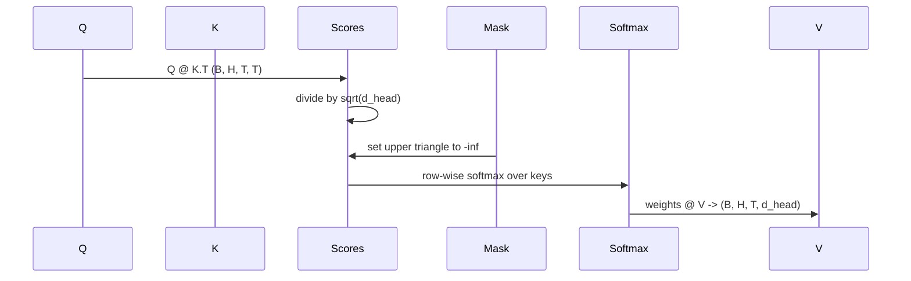

# Multi-head self-attention

> 一次线性投影、三个视图、H 个并行 head、一个 mask。这就是模型实际使用的 attention block。

**Type:** Build
**Languages:** Python
**Prerequisites:** 第 04 阶段课程、第 07 阶段 transformer 课程、本阶段第 30 至 32 课
**Time:** ~90 分钟

## Learning Objectives
- 把批量化的 Query/Key/Value 投影实现为单个线性层，再拆成 H 个 head。
- 用正确的归一化与 dtype 处理计算缩放点积 attention。
- 施加 causal mask，阻止某个位置注意到未来位置。
- 检查固定输入下每个 head 的 attention 权重，并推理每个 head 在看什么。
- 在一个玩具任务上训练一个小 attention block，观察随着各 head 走向专门化 loss 如何下降。

```figure
cap-multihead-attention
```

## 背景框架

attention 是一个函数，让某个 token 的表示能从同一序列中的其他 token 拉取信息。self-attention 意味着 query、key、value 都从同一输入导出。multi-head 意味着把投影拆成 H 个并行的 attention 问题，其输出被拼接后再投影回来。

高效的实现模式是用一个线性层把 `D` 投影到 `3 * D`，再切成三个视图，然后重塑成 H 个大小为 `D // H` 的 head。matmul、softmax 与加权求和都以批量化张量操作发生，于是各 head 在加速器上并行运行。

本课构建这个 block。它还加入 causal mask，让同一份代码能作为 decoder-only 语言模型里的 attention 层使用。下一课把该 block 堆叠成完整的 transformer，再下一课训练它。

## 形状契约

输入是 `(B, T, D)`。输出是 `(B, T, D)`。mask 是 `(T, T)` 或可广播到它。在 block 内部，中间张量形状为 `(B, H, T, d_head)`，其中 `d_head = D // H`。约束是 `D % H == 0`。

```mermaid
flowchart LR
    A["(B, T, D) input"] --> B[Linear D -> 3D]
    B --> C["split into Q, K, V"]
    C --> D["reshape to (B, H, T, d_head)"]
    D --> E["scores = Q @ K.T / sqrt(d_head)"]
    E --> F[apply causal mask]
    F --> G[softmax over keys]
    G --> H["context = weights @ V"]
    H --> I["reshape to (B, T, D)"]
    I --> J[output Linear D -> D]
    J --> K["(B, T, D) output"]
```



两层线性（QKV 投影与输出投影）是 block 中仅有的参数。mask、softmax、各次 matmul 与各次重塑都无参数。

## QKV 拆分

朴素实现有三个独立的线性层，Q、K、V 各一个。高效实现只有一个层，输出 `3 * D` 个特征再拆分结果。两者在数学上等价，因为三次分别乘以 `(D, D)` 权重的矩阵乘法，恰好等于一次乘以由它们堆叠成的 `(3D, D)` 权重。

高效版本更快，因为加速器只发起一次 matmul 而不是三次。它也更容易初始化，因为三个子矩阵住在同一个参数张量里，可以一起初始化。

## head 重塑

拆分之后，Q、K、V 各自的形状都是 `(B, T, D)`。要把它变成 H 个并行 attention 问题，我们重塑为 `(B, T, H, d_head)` 再转置为 `(B, H, T, d_head)`。此时 head 维度紧挨 batch 维度，于是 PyTorch 把逐 head 的 attention 当作跨 `B * H` 个独立实例的批量操作来处理。

d_head 维度留在最后，好让分数 matmul `Q @ K.transpose(-2, -1)` 对它做收缩。结果是 `(B, H, T, T)` 的逐 head attention 分数。

## 缩放

softmax 之前，分数会除以 `sqrt(d_head)`。没有这个缩放，点积会随 `d_head` 增大而增大，把 softmax 推进一个某个元素几乎占据全部质量、其余元素小到消逝的状态。该状态下的梯度极小，学习会停滞。除以 `sqrt(d_head)` 让分数的方差在不同 head 大小之间大致保持恒定。

## causal mask

decoder-only 语言模型在预测下一 token 时只能以过去为条件。mask 强制执行这一点。具体来说，在 softmax 之前，`(T, T)` 分数矩阵对角线以上的每个元素都被替换为负无穷。softmax 之后这些位置获得零权重。



我们在构造时把 mask 注册为 buffer，使它位于与模型相同的设备上，且不进入梯度图。mask 覆盖该 block 将见到的最大 context 长度。前向时我们切出左上角的 `(T, T)` 区域。

## 输出投影

得到逐 head 的 context 向量 `(B, H, T, d_head)` 后，我们转置回 `(B, T, H, d_head)`，重塑为 `(B, T, D)`，再做一次最终的 `(D, D)` 线性投影。输出投影让模型能够混合各 head。没有它，H 个 head 只能通过更后面的层重新组合，block 就会受到人为约束。

## attention 权重检查

本课在前向过程中暴露一个 `return_weights=True` 标志。置位时，block 会连同输出一起返回形状为 `(B, H, T, T)` 的逐 head attention 权重。demo 打印某个 head 在短输入上的权重热力图，好让你看到 causal 三角结构与逐位置的关注点。

在训练好的模型里，不同的 head 学到不同的模式。有些 head 关注紧邻的前一个 token。有些 head 关注序列开头。有些 head 几乎均匀地铺开 attention。检查钩子就是这类可解释性工作的入口。

## 训练 demo

`main.py` 底部的 demo 把 attention block 接到一个极小的 LM head 上，并让整个东西在一个重复任务上训练。输入的每一行是一个随机 id 在 context 上重复。target 是输入左移一位，因此模型必须学会下一 token 与前一个 token 相同。loss 是交叉熵。在 H=4、D=32、T=12、词表大小 64 的情况下，loss 在 CPU 上三个 epoch 内从随机水平（约 `log(64) ~ 4.16`）降到远低于 `1.0`。

这个 demo 的目的不是训练出有用的模型。目的是确认梯度流经 block 的每一部分，并确认在答案显而易见的问题上各 head 确实学到了东西。

## 本课不做什么

它不添加 feed-forward block。真实模型里的 transformer 层是 attention 之后接一个两层 MLP，每个子层都套有 residual 连接与 layer norm。下一课加上这些。

它不实现 rotary 或 AliBi 位置编码。两者都在同一 block 的 QKV 投影步骤作用，但属于另一个教学单元。这里构建的 block 通过在 matmul 之前变换 Q 与 K，与其中任一方案都兼容。

它不实现用于推理的 KV cache。跨前向过程缓存 key 与 value，是让自回归解码变快的优化。它改变了 K 与 V 张量的形状契约，但不改 Q 的。这属于推理课的内容。

## 如何阅读代码

`main.py` 定义了 `MultiHeadSelfAttention`。该类持有两层线性与一个已注册的 mask buffer。前向过程依次投影、重塑、打分、加 mask、softmax、加权、重塑、再投影。底部的 demo 构建一个小模型，用 token 与位置 embedding 以及一个 LM head 包住 attention，在复制任务上训练三个 epoch，并打印 loss 曲线与逐 head attention 热力图。`code/tests/test_attention.py` 里的测试钉住了形状契约、因果性、softmax 性质、head 拆分性质与梯度流动。

运行 demo。然后把 `n_heads` 从 4 增加到 8（保持 `d_model=32`，于是 `d_head=4`），观察热力图如何变化。
