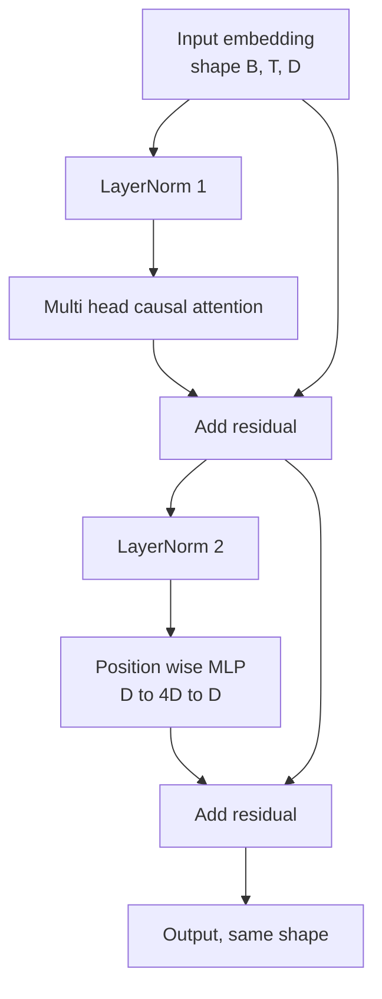
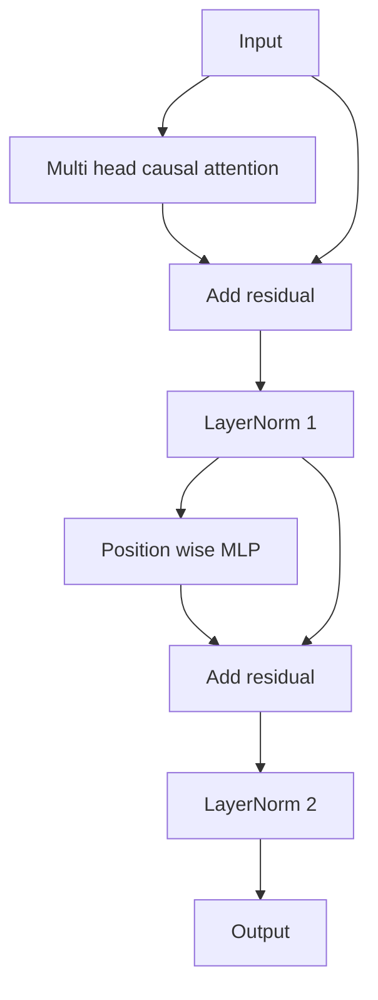

# 从零实现 Transformer Block

> 一个 block 就是每个现代 decoder LLM 的基本单元。layer norm、multi-head attention、residual、MLP、residual。pre-LN 变体无需 warmup 就能稳定训练。post-LN 变体是原始论文交付的版本。本课把两者并排实现，并展示在常见学习率下哪一个能挺过 12 层堆叠。

**Type:** Build
**Languages:** Python
**Prerequisites:** 第 19 阶段第 30 至 33 课（tokenizer、embeddings、attention 数学、批量数据加载器）
**Time:** ~90 分钟

## Learning Objectives

- 用 PyTorch 从四个组成部分构建一个 transformer block：LayerNorm、multi-head causal attention、residual 连接、position-wise MLP。
- 把 LayerNorm 放在两种配置里（pre-LN 与 post-LN），并解释为什么其中一种无需 warmup 就能稳定训练。
- 在 multi-head attention 内部实现 causal mask，使 token `i` 看不到 `j > i` 的 token。
- 在 12 层堆叠上追踪两种变体的梯度流动，并不过度简化地解读结果。
- 在下一课组装 124 million 参数的 GPT 时，把这个 block 作为可直接插入的单元复用。

## 问题场景

transformer 就是把一个 block 重复若干次。block 写错一处，再重复十二次，你交付的模型就会在第一个 epoch 发散，或者此后一路上都得靠 warmup 小技巧续命。本课会遇到的两种失败模式并不罕见。任何学习者第一次天真地堆叠 block 时都会撞上。其一是 attention 层看到了未来。其二是 LayerNorm 被放在了无法约束深层 residual 信号的位置。

一旦看明白，修法就是机械的。这个 block 恰好有两条 residual 路径和恰好两个归一化位置。把位置选对，剩下的堆叠工作只是记账。

## 核心概念

每个 decoder-only 的 transformer block 都是一个函数：接收形状为 `(batch, sequence, embedding)` 的张量，返回同形状的张量。内部由两个子层完成工作。



这就是 pre-LN 变体。LayerNorm 位于 residual 分支内部、子层之前。residual 连接把未归一化的信号向前传递。

post-LN 变体把 LayerNorm 移到 residual 相加之后。



形状完全相同，训练行为却不同。在 post-LN 中，沿 residual 路径回传的梯度必须穿过 LayerNorm。在十二层深度、学习率 `3e-4` 下，该梯度衰减得足够快，以至于需要 warmup 调度。pre-LN 让 residual 路径保持未归一化，因此梯度能干净地传播到 embedding 层。正因如此，GPT-2 及之后的模型都采用 pre-LN 配置。

### 带 causal mask 的 multi-head attention

attention 子层把输入通过三种投影变成 query、key、value 张量。每个张量都从 `(B, T, D)` 重塑为 `(B, H, T, D/H)`，其中 `H` 是 head 数。缩放点积 attention 对每个 head 计算 `softmax(Q K^T / sqrt(d_k))`，把上三角位置 mask 为负无穷，通过 softmax 应用该 mask，再乘以 `V`。各 head 被拼接回单个 `(B, T, D)` 张量并再做一次投影。mask 是让模型具备因果性的唯一部件。忘了 mask，你训练出的模型就是在作弊。

### MLP

position-wise MLP 对每个 token 独立地施加同一套两层网络。隐藏宽度是 embedding 宽度的四倍，激活函数是 GELU，第二个 linear 之后接 dropout。MLP 内部 token 之间互不交流，所有 token 混合都发生在 attention 中。

### Residual 连接做两件事

它们让梯度路径在深度方向上保持可加，从而使梯度范数在十二层中维持在同一量级。它们还让每个 block 学到的是对当前表示的加性更新，而不是整体替换。这两个效果正是该 block 能够扩展的原因。

```figure
cc-transformer-block
```

## Build It

`code/main.py` 实现了：

- `class LayerNorm`，带可学习的缩放与平移、带偏置的 eps，按每个 token 向量施加。
- `class MultiHeadAttention`，含 `num_heads`、`head_dim = d_model // num_heads`、融合 QKV 投影、注册的 causal mask、attention dropout 与 residual dropout。
- `class FeedForward`，含两个 linear 层、GELU 激活、dropout。
- `class TransformerBlock`，带一个 `pre_ln` 标志，用于在两种变体之间切换。
- 一个 demo：用相同输入分别构建 6 层 pre-LN 堆叠和 6 层 post-LN 堆叠，打印 (a) 输出形状、(b) 一次反向传播后 embedding 处的梯度范数。

运行方式：

```bash
python3 code/main.py
```

输出：两个堆叠的形状检查，以及并排的梯度范数。在相同学习率下，pre-LN 堆叠的 embedding 梯度比 post-LN 堆叠大一个数量级，这就是 pre-LN 无需 warmup 即可训练的经验信号。

## 技术栈

- `torch` 负责张量运算、自动求导和 `nn.Module` 管道。
- 不用 `transformers`，不用预训练权重。该 block 完全由基础组件实现。

## 生产环境中的实战模式

三个模式把教科书式的 block 变成可以交付的东西。

**融合 QKV 投影。** 三个独立的 linear 层要付出三次 kernel 启动和三次 matmul 的代价。一个宽度为 `3 * d_model` 的 linear 层在单次启动中完成同样的工作，然后沿最后一维切分输出。融合路径在每种加速器上都更快，也与 GPT-2、LLaMA、Mistral 的参考实现所交付的做法一致。

**注册 causal mask buffer。** mask 只依赖于最大上下文长度。在构造时用 `register_buffer` 分配一次，每次前向时切片出活动窗口，从而跳过每次调用的分配。忘了这一点，长上下文下 mask 就会变成分配器热点。

**dropout 放两处，不是三处。** dropout 属于 attention softmax 之后（attention dropout）以及 MLP 第二个 linear 之后（residual dropout）。对 residual 本身做 dropout 会破坏让梯度在深度方向流动的加性恒等关系。一些早期实现搞错了这一点，为此付出了训练脆弱的代价。

## Use It

- 本课的 block 无需修改即可直接插入第 35 课的 GPT 组装。
- pre-LN 变体是每个现代开放权重 LLM 都在用的。post-LN 变体是 2017 年那篇原始 attention 论文用的。两者都懂，就足以读懂你会遇到的任何 decoder 架构。
- 把 GELU 换成 SiLU 就得到 LLaMA 家族的激活。把 LayerNorm 换成 RMSNorm 就得到 LLaMA 家族的归一化。骨架相同。

## Exercises

1. 给 block 里的每个 linear 加一个 `bias=False` 标志。现代开放权重 LLM 的 linear 层都不带偏置。测量在 12 层、768 维模型中能省下多少参数。
2. 用自己手写的 RMSNorm 替换 `nn.LayerNorm`，验证输出形状不变。
3. 加一个标志，把第一个 head 的 attention 权重以 `(B, T, T)` 张量返回。画出上三角，确认 softmax 之后它为零。
4. 写一个健全性检查：把带 `H=6` 的 `(2, 16, 384)` 张量喂进两种变体，并断言在权重以相同方式初始化、dropout 设为零时，前向输出不同（例如 `not torch.allclose`）。

## Key Terms

| 术语 | 人们常怎么说 | 实际含义 |
|------|-----------------|------------------------|
| Pre-LN | “pre norm” | LayerNorm 位于 residual 分支内部、每个子层之前；residual 携带未归一化的信号 |
| Post-LN | “post norm” | LayerNorm 在 residual 相加之后；2017 年论文交付的版本，也是需要 warmup 的版本 |
| Causal mask | “triangle mask” | 把 attention logits 的上三角设为负无穷，使 token i 在 j 大于 i 时无法读取 token j |
| Fused QKV | “combined projection” | 一个宽度为 3D 的 linear 取代三个宽度为 D 的 linear；一次 kernel、一次 matmul |
| Residual stream | “skip connection” | 自上而下流经每个 block 的未归一化张量；每个 block 都在它之上做加性更新 |

## Further Reading

- 第 7 阶段第 02 课（从零实现 self attention），讲这个 block 底下的 attention 数学。
- 第 7 阶段第 05 课（完整 transformer），讲同一骨架的 encoder-decoder 版本。
- 第 10 阶段第 04 课（预训练 mini GPT），讲这个 block 所插入的训练流程。
- 第 19 阶段第 35 课（本系列），把十二个这样的 block 堆叠成一个 GPT 模型。
