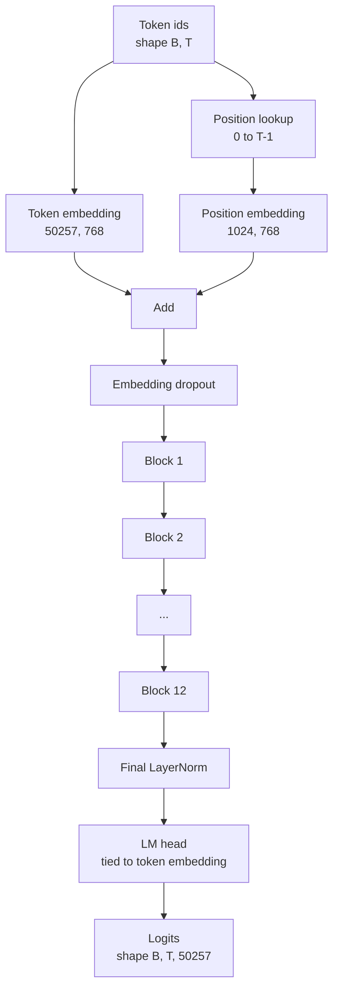
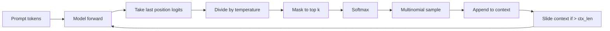

# GPT 模型组装

> 十二个 block 堆叠、一个 token embedding、一个可学习的 position embedding、一个最终的 LayerNorm，以及一个权重绑定的 language model head。这就是整个 124 million 参数的 GPT 模型。本课把这些部件组装成一个可运行的类，数一遍参数确认模型与参考的 124M 形状一致，并用多项式采样、temperature 和 top-k 生成文本。

**Type:** Build
**Languages:** Python
**Prerequisites:** 第 19 阶段第 30 至 34 课
**Time:** ~90 分钟

## Learning Objectives

- 把第 34 课的 transformer block 组装成完整的 GPT 模型：token embedding、position embedding、N 个 block、最终 LayerNorm、language model head。
- 复现 124 million 参数配置：vocab 50257、context 1024、embedding 768、十二个 head、十二层。
- 把 language model head 的权重与 token embedding 绑定，并解释为什么在这个规模下能省下约 38 million 参数。
- 用多项式采样、temperature 缩放和 top-k 截断从 prompt 生成文本，并用滑动窗口维持上下文长度。
- 对照 124M 目标测量参数数量和前向成本。

## 问题场景

transformer block 单独放着什么也做不了。你需要把 token id 变成向量、混入位置信息、让它们穿过堆叠、再投影回词表 logits。这四步里漏掉任何一步，模型要么前向失败，要么位置信息错乱，要么无法开口。

模型的形状同样重要。参考的 GPT-2 small 在上述配置下恰好是 124 million 参数。这些数字并不神奇。vocab 50257 乘以 embedding 768 是 token 表。position 1024 乘以 768 是 position 表。十二个 block 每个约 7 million 参数，合计 84 million。最终的 head 通过 weight tying 复用 token 表。把各部分相加，你就落在 124 million 上。如果搭出来的模型参数数量与参考不符，那就是某处接线接错了的信号。

## 核心概念



token id 变成 token 向量。position id 变成 position 向量。两者相加后送入堆叠。最终的 LayerNorm 是 block 之外唯一在每个现代变体中都保留的部件。LM head 复用 token embedding 矩阵，这就是 weight tying 的含义。

### 权重绑定（weight tying）

token embedding 的形状是 `(vocab, d_model)`。language model head 需要从 `d_model` 投影回 `vocab`。这两个矩阵互为转置。把两者绑定，就是字面上使用同一个参数张量两次。在 vocab 50257、d_model 768 下，这个矩阵是 38 million 参数。不绑定时你要为它付两份。绑定后你只付一份，而且还能得到略干净的梯度信号，因为 embedding 与 head 会一起更新。

### Position embedding 是学习得到的，不是正弦的

GPT-2 交付的是可学习的 position embedding。position 表是一个形状为 `(1024, 768)` 的参数张量。模型在每次前向时查找位置 0 到 T-1，并把查到的向量加到 token embedding 上。这是位置方案中最简单的一种（替代方案有 RoPE、ALiBi、T5 relative bias），也正是 124M 参考实现所用的。

### 生成：temperature、top-k、多项式采样

生成是自回归的。每一步模型都会在每个位置返回整个词表上的 logits。你只取最后一个位置，除以 temperature，可选地把 top k 之外的 logits 全部 mask 为负无穷，softmax 得到概率，然后从所得分布中采样一个 token。



三个旋钮，三种不同行为。temperature 接近零会塌缩成贪心。temperature 等于一是模型的自然分布。top-k 为一就是贪心。top-k 四十会滤掉长尾。组合方式很重要；下一课讲训练时会把生成当作定性评估信号。

```figure
cc-gpt-assembly
```

## Build It

`code/main.py` 实现了：

- `class GPTConfig` dataclass，带 124M 默认值：`vocab_size=50257`、`context_length=1024`、`d_model=768`、`num_heads=12`、`num_layers=12`、`mlp_expansion=4`、`dropout=0.1`、`use_bias=True`、`weight_tying=True`。
- `class GPTModel`，含 token embedding、position embedding、embedding dropout、十二个 `TransformerBlock`、最终 LayerNorm，以及一个在标志打开时与 token embedding 绑定的 `lm_head`。
- 一个 `count_parameters` 辅助函数，返回去重后的参数数量（因此计数会体现 weight tying）。
- 一个 `generate` 函数，实现 temperature、top-k、多项式采样和滑动窗口上下文。
- 一个 demo：构建模型，把参数数量打印在参考 124M 旁边，并从固定 prompt 生成一小段序列，端到端展示整条流水线。

运行方式：

```bash
python3 code/main.py
```

输出：与 124M 参考并列的参数数量、由随机 prompt 生成的 token id，以及在开启 tying 时确认 LM head 与 token embedding 共享存储的检查。

为了让 demo 保持快速，脚本还会端到端跑一个小配置（`d_model=64`、`num_layers=2`），并就地打印生成的 token 序列。124M 配置会被构建，但只用到它的参数数量和一次前向。

## 技术栈

- `torch` 负责张量运算、自动求导和模块管道。
- `code/main.py` 在本地重新实现了第 34 课的同一套 block 模式。

## 生产环境中的实战模式

三个模式决定了模型只是能跑，还是能交付。

**把 residual 投影初始化得小一些。** attention 的输出投影和 MLP 的第二个 linear 都直接进入 residual 相加。若用与其他 linear 相同的标准差初始化，residual stream 会随深度增长，并把最终 LayerNorm 推入热点区。对这两个投影把标准差缩放 `1 / sqrt(2 * num_layers)`；residual stream 在十二层中就会保持在合理范围。

**缓存 position id 张量，不要重复计算。** `torch.arange(T)` 每次前向都会分配新内存。在 `__init__` 中按最大上下文分配一次，每次调用时切片取前 T 项，从而跳过与分配器的一次往返。

**在参数层面绑定权重，而不是靠复制。** 设置 `lm_head.weight = token_embedding.weight` 才是共享张量；复制不是。优化器需要只更新一个参数，计算图需要只做一次累加。如果只是复制，head 会逐渐偏离 embedding，weight tying 就什么都换不来。

## Use It

- 本课的模型类与下一课要训练的那个形状相同。
- 用 RoPE 替换可学习 position embedding，就得到 LLaMA 家族，而无需改动 block 或 head。
- 把 GELU 换成 SiLU、把 LayerNorm 换成 RMSNorm，就得到 LLaMA 家族其余的改变。
- 生成函数适用于任何 logits 来源，不限于这个模型。你可以在第 37 课从预训练 GPT-2 文件里取出 logits，并复用同一个生成循环。

## Exercises

1. 解除 LM head 与 token embedding 的绑定并重新计数参数。验证差值为 50257 乘以 768 = 38 million。
2. 用构造时计算的正弦表替换可学习 position embedding。确认模型仍能前向，且参数数量减少 786,432。
3. 给生成加一个 `greedy=True` 标志，跳过采样直接取 argmax。确认多次运行序列确定。
4. 加一个 `repetition_penalty` 旋钮：在 softmax 之前，把 prompt 或已生成历史中出现过的任何 token 的 logit 除以一个常数。在固定 prompt 上展示大于一的值会降低输出中的重复次数。
5. 在 `top_k` 旁边加 `top_p`（nucleus）采样。用两行代码检查保留 token 的概率之和超过 `top_p`。

## Key Terms

| 术语 | 人们常怎么说 | 实际含义 |
|------|-----------------|------------------------|
| Weight tying | “tied embeddings” | LM head 与 token embedding 共享同一个参数张量；省下 vocab 乘以 d_model 个参数，并与 GPT-2 参考一致 |
| Position embedding | “learned positions” | 一张形状为 (context length, d_model) 的独立表，加到 token 向量上；端到端学习得到 |
| Sliding window context | “context cap” | 当 prompt 加上已生成 token 超过上下文长度时，丢弃最旧的 token，使活动窗口能放下 |
| Top-k sampling | “K truncation” | 保留数值最高的 K 个 logits，把其余 mask 为负无穷，在余下的部分上做 softmax |
| Temperature | “sampling temperature” | 在 softmax 之前把 logits 除以 T；T 小于 1 更尖锐，T 等于 1 保持自然分布，T 大于 1 更平坦 |

## Further Reading

- 第 19 阶段第 34 课，讲这个模型所堆叠的 block。
- 第 19 阶段第 36 课，讲用交叉熵损失驱动这个模型的训练循环。
- 第 19 阶段第 37 课，讲把预训练 GPT-2 权重加载进这套架构。
- 第 7 阶段第 07 课（GPT 因果语言建模），讲下一 token 预测的数学。
- 第 10 阶段第 04 课（预训练 mini GPT），讲同一架构上的原始训练流程。
