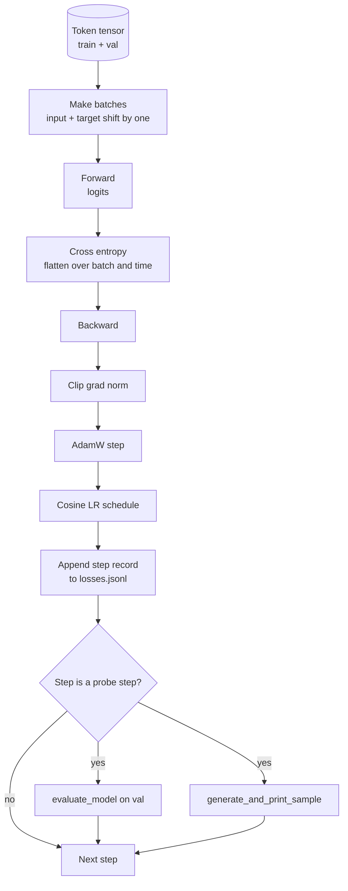

# 训练循环与评估

> 一个不做衡量的循环，是一个会撒谎的循环。本课构建驱动 GPT 模型的训练循环：带权重衰减分组的 AdamW、warmup 加余弦学习率调度、`calc_loss_batch` 辅助函数、在留出数据上执行的 `evaluate_model` 评估、每 K 步运行一次的 `generate_and_print_sample` 定性探针，以及一份事后可以绘图的损失 JSONL 日志。同一套骨架可以训练你今后构建的每一个 decoder LLM。

**Type:** Build
**Languages:** Python
**Prerequisites:** 第 19 阶段，第 30 至 35 课
**Time:** ~90 分钟

## Learning Objectives

- 构建一个训练循环，用正确的输入与目标对齐方式计算下一 token 预测的 cross-entropy 损失。
- 配置 AdamW，让 weight decay 施加于权重张量，而不施加于 LayerNorm 或 bias 张量。
- 实现线性 warmup 加余弦衰减的学习率调度，并读出随时间变化的 LR。
- 用 `evaluate_model` 在留出集上评估，使 eval loss 在多次运行之间可比。
- 每 K 步用 `generate_and_print_sample` 生成一个定性样本，在损失曲线之前就发现发散。
- 把每步损失持久化为 JSONL，这样你可以重新加载、绘图，并把训练日志作为交付物交付。

## 问题场景

一个只打印损失、别的什么都不做的训练脚本会以三种方式失败。它无法告诉你损失下降是否出于正确的原因（模型可能只是过拟合训练集，而从未学到东西）。它无法告诉你是否开始发散（损失可能尖峰一步后恢复，也可能尖峰一步后崩溃）。它无法告诉你模型学到了什么（损失是一个标量；生成的样本是一段话）。这三种失败都会被掩盖，除非循环做了衡量。

本课的循环从三个角度做衡量。每一步衡量训练批次上的损失。每 K 步衡量留出批次上的损失。每 K 步从固定 prompt 生成一段续写。训练日志落到 JSONL 里，于是这份产物就是循环的证词。

## 核心概念



两个不那么显然的部分是损失对齐和 AdamW 的衰减分组。

### 损失对齐

模型在每个位置预测下一个 token。如果输入批次是 token `[t0, t1, t2, t3]`，目标批次就必须是 `[t1, t2, t3, t4]`。Cross entropy 是在展平形状 `(batch * seq, vocab)` 与展平目标 `(batch * seq,)` 上计算的。忘了这个位移，你就是在训练模型预测它自己，这会收敛到零损失，却没学到任何有用的东西。

### AdamW 的衰减分组

Weight decay 正则化权重张量，但不正则化归一化尺度或 bias。把衰减加到 LayerNorm 的 scale 上，会慢慢把 scale 推向零，破坏归一化。把衰减加到 bias 上在数学上无害，但浪费算力。标准的分组是：矩阵形状的张量（线性层权重、embedding 表）施加衰减，任何看起来像 scale 或 shift 的都不加。

### Warmup 加余弦调度

Warmup 在最初几百步里把学习率从零抬升到目标值，让优化器状态有时间填充起来。余弦衰减在剩余步数里把学习率降回零附近，让最后阶段以很小的步长微调权重。这个组合是开放权重 LLM 训练中最常见的调度，因为它消除了前一千步和最后一千步里大多数脆弱的时刻。

### 留出集评估

`evaluate_model` 从验证集里跑固定数量的批次，累加损失，除以批次数，然后返回。不走梯度。不跑 dropout。给定相同的 seed 和相同的切分，这个数字在多次运行之间可复现。把留出损失与训练损失并列报告，就是你发现过拟合的方式。

### 把定性采样当作早期信号

一个训练损失下降得很漂亮、但生成样本全是同一个 token 的模型是坏的。一个损失曲线看起来平坦、但生成样本逐渐尖锐为连贯词语的模型是在学习的。定性探针比读完整条曲线跑得更快，能抓住标量遗漏的那些模式。

```figure
cap-training-loop
```

## Build It

`code/main.py` 实现了：

- `make_batches(token_ids, batch_size, context_length)`，把一个长 token 张量切成输入与目标对。
- `calc_loss_batch(model, inputs, targets)`，做前向、展平，并返回标量 cross entropy。
- `evaluate_model(model, val_loader, max_batches)`，在无梯度的情况下迭代固定数量的验证批次，返回平均损失。
- `generate_and_print_sample(model, prompt, max_new_tokens)`，在固定 prompt 上运行第 35 课的生成函数并打印结果。
- `build_param_groups(model, weight_decay)`，产出两组的 AdamW 参数列表。
- `cosine_with_warmup(step, warmup_steps, total_steps, max_lr, min_lr)`，返回给定步数处的 LR。
- `train(...)`，运行循环、持久化 `outputs/losses.jsonl`，并每隔 `eval_every` 步打印 eval loss 和一个样本。
- 一个演示：在合成数据上把一个小模型训练少量步数，写出 JSONL 日志，并在探针点打印 eval loss 和一个样本。演示在 CPU 上远不到一分钟就跑完。

运行它：

```bash
python3 code/main.py
```

输出：逐步骤的损失行、每个探针步的 eval loss、每个探针步生成的样本，以及最终的 `outputs/losses.jsonl`，你可以逐行用 `json.loads` 加载。

## 技术栈

- `torch` 用于 autograd、优化器和模块。
- `main.py` 在本地重新实现了第 35 课的 `GPTModel` 及其配套模块。

## 实战中的生产模式

有三种模式能把教科书式的循环变成可以整夜挂机运行的东西。

**梯度范数裁剪没有商量余地。** 一个坏批次（异常数据、LR 尖峰、数值边界情况）会产生巨大的梯度，抹掉数小时的训练。在 `backward` 之后、`step` 之前执行 `torch.nn.utils.clip_grad_norm_(params, max_norm=1.0)`，能让优化器留在安全范围内。裁剪值是一个自由参数；一是能扛住大多数配置的默认值。

**可续跑的 JSONL 日志，而非 pickle 状态。** 每步损失记录成 JSONL 里的 `{"step": int, "train_loss": float, "lr": float}` 行，是耐久的：任何崩溃都会留下可读的产物，你可以 grep，可以用三十行 Python 绘图，还可以读取最后一步来续跑训练。Pickle 状态把你绑定到产生该文件的确切模块布局上，跨重构就很脆弱。

**Eval 批次取自固定切片。** 验证 token 在脚本启动时就切成批次，而不是现场切。可复现性取决于 eval 批次在每次运行之间完全相同；否则比较两次运行的 eval loss 时，你衡量的既有模型也有批次洗牌。

## Use It

- 本课的循环就是那个在真实数据上训练 124M 模型的同一套骨架。把合成 token 张量换成 `datasets` 风格的 loader，循环无需改动即可运行。
- JSONL 日志是把一次训练运行变成证据的交付物。下一课用它来比较一个刚训练出的 checkpoint 与一个预训练的 checkpoint。
- 定性样本探针是标量损失无法替代的兜底手段。

## Exercises

1. 加上 `weight_decay_groups()` 单元测试，确认 scale 和 bias 参数落在无衰减组，而线性层和 embedding 权重落在衰减组。
2. 把合成的随机 token 换成一个小文本文件里的字节，让演示训练在有意义的内容上。验证生成的样本使用了文件中存在的字符。
3. 给余弦调度加上 `max_lr` 的 10% 这一 `min_lr` 下限，并重新绘图。
4. 除了 JSONL 日志，每 `eval_every` 步保存一个 checkpoint。加一个 `resume_from` 开关，用于重新加载模型状态和优化器状态。
5. 在损失旁边记录每步吞吐（每秒 token 数），并确认它保持在稳定区间。

## Key Terms

| 术语 | 人们常怎么说 | 实际含义 |
|------|-----------------|------------------------|
| Loss alignment | “移一位” | 位置 0..T-1 的输入 token 对应位置 1..T 的目标 token；cross entropy 在展平后的形状上计算 |
| Decay split | “分成两组” | AdamW 对矩阵形状的张量施加 weight decay，对 scale 或 bias 张量不施加 |
| Warmup | “爬坡” | 学习率在固定步数内从零攀升到目标值，好让优化器状态得以填充 |
| Eval batches | “留出批次” | 验证 token 张量的一个固定切片，在脚本启动时切一次，每次探针都相同地使用 |
| Qualitative probe | “打印样本” | 每 K 步从固定 prompt 打印一段短生成，用来抓住损失独自掩盖的失败模式 |

## Further Reading

- 第 19 阶段，第 35 课，了解这个循环所驱动的模型。
- 第 19 阶段，第 37 课，了解如何把预训练权重加载进同一个模型。
- 第 10 阶段，第 04 课（pre training mini GPT），了解在真实数据上的流程。
- 第 10 阶段，第 10 课（evaluation），了解超出 cross entropy 损失的更广泛评估面。
