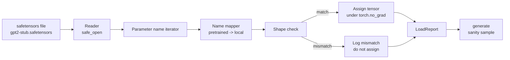

# 加载预训练权重

> 从头训练一个 1.24 亿参数的模型是一个预算决策；加载一个已发布的 checkpoint 只是某个星期二。本课把 GPT-2 风格的预训练权重从 safetensors 文件加载进第 35 课的确切架构，逐项走过参数名映射，并做一次健全性生成来证明加载确实生效。不联网、不用第三方 loader、没有不透明的魔法。

**Type:** Build
**Languages:** Python
**Prerequisites:** 第 19 阶段，第 30 至 36 课
**Time:** ~90 分钟

## Learning Objectives

- 用 `safetensors` Python 库读取 safetensors 文件，并检查张量名称与形状。
- 把每个预训练参数名映射到第 35 课 GPT 模型内的某个参数。
- 处理已发布 GPT-2 权重与本轨道模型之间的两套命名约定差异：`wte/wpe/h.N.attn.c_attn/c_proj` 与 `mlp.c_fc/c_proj`，对应本地命名的 `tok_embed/pos_embed/blocks.N.attn.qkv/out_proj` 与 `mlp.fc1/fc2`。
- 在任何权重赋值发生之前检测并拒绝形状不匹配，给出清晰的错误。
- 用加载后的权重生成一段短续写，确认 token 来自加载后的分布，而不是随机初始化的分布。

## 问题场景

已发布的权重并不是为你的架构打包的。它们带着原始实现使用的名字。预训练文件里有形状为 `(2304, 768)` 的 `transformer.h.0.attn.c_attn.weight`；你的模型期望的是形状为 `(2304, 768)` 的 `blocks.0.attn.qkv.weight`（这在不同的布局约定下是同一个矩阵），或者你的模型用 `nn.Linear`，它以转置形式存储矩阵。同一个参数以三种微妙不同的身份（名字、形状、字节布局）出现，loader 必须把三者都对齐。

一个盲目复制的 loader 会把正确的张量放到错误的位置，你得到的是一个生成胡话的模型。一个在形状不同时拒绝复制却不记录任何东西的 loader，让你只能猜哪个张量没落位。本课的 loader 是显式的：每次赋值都记录日志，每个形状都检查，一个 `LoadReport` 汇总命中、缺失和形状不匹配，让你能读到发生了什么。

## 核心概念



名称映射器只是一个从字符串到字符串的函数。形状检查只是一个 if。赋值在 `torch.no_grad()` 内发生，这样 autograd 不会追踪这次加载。报告保存每个名字的结果。

### GPT-2 的命名约定

已发布的 GPT-2 权重放在这样的名字下：

| Pretrained name | Shape | 含义 |
|-----------------|-------|---------|
| `wte.weight` | (50257, 768) | Token embedding |
| `wpe.weight` | (1024, 768) | Position embedding |
| `h.N.ln_1.weight` | (768,) | 第 N 个 block 的 LayerNorm 1 scale |
| `h.N.ln_1.bias` | (768,) | 第 N 个 block 的 LayerNorm 1 shift |
| `h.N.attn.c_attn.weight` | (768, 2304) | 融合的 QKV 线性层权重 |
| `h.N.attn.c_attn.bias` | (2304,) | 融合的 QKV 线性层 bias |
| `h.N.attn.c_proj.weight` | (768, 768) | 注意力输出投影 |
| `h.N.attn.c_proj.bias` | (768,) | 注意力输出投影 bias |
| `h.N.ln_2.weight` | (768,) | LayerNorm 2 scale |
| `h.N.ln_2.bias` | (768,) | LayerNorm 2 shift |
| `h.N.mlp.c_fc.weight` | (768, 3072) | MLP fc1 权重 |
| `h.N.mlp.c_fc.bias` | (3072,) | MLP fc1 bias |
| `h.N.mlp.c_proj.weight` | (3072, 768) | MLP fc2 权重 |
| `h.N.mlp.c_proj.bias` | (768,) | MLP fc2 bias |
| `ln_f.weight` | (768,) | 最终 LayerNorm scale |
| `ln_f.bias` | (768,) | 最终 LayerNorm shift |

有两个意外需要预先考虑。`c_attn`、`c_proj`、`c_fc` 这些线性层存储的矩阵是相对于 `nn.Linear.weight` 所期望的方向转置的。loader 在赋值时做转置。LM head 根本不在文件里；模型依赖与 `wte` 的权重绑定，所以一旦 `wte` 落位，head 就通过别名设置。

### 本地命名约定

本轨道的模型使用描述性的名字：

| Local name | 含义 |
|------------|---------|
| `tok_embed.weight` | Token embedding |
| `pos_embed.weight` | Position embedding |
| `blocks.N.ln1.scale` | 第 N 个 block 的 LayerNorm 1 scale |
| `blocks.N.ln1.shift` | LayerNorm 1 shift |
| `blocks.N.attn.qkv.weight` | 融合的 QKV |
| `blocks.N.attn.qkv.bias` | 融合的 QKV bias |
| `blocks.N.attn.out_proj.weight` | 注意力输出投影 |
| `blocks.N.attn.out_proj.bias` | 输出投影 bias |
| `blocks.N.ln2.scale` | LayerNorm 2 scale |
| `blocks.N.ln2.shift` | LayerNorm 2 shift |
| `blocks.N.mlp.fc1.weight` | MLP fc1 |
| `blocks.N.mlp.fc1.bias` | MLP fc1 bias |
| `blocks.N.mlp.fc2.weight` | MLP fc2 |
| `blocks.N.mlp.fc2.bias` | MLP fc2 bias |
| `final_ln.scale` | 最终 LayerNorm scale |
| `final_ln.shift` | 最终 LayerNorm shift |

这个映射是一个固定函数。本课以 dict 的形式交付它，由 loader 迭代。

### 桩 fixture

真实的 GPT-2 权重有 0.5 GB。演示不下载它们；它在首次运行时生成一个小的 safetensors fixture，使用确切的 GPT-2 命名约定，形状对应一个 12 个 block、d_model 为 192 而不是 768 的模型。这个 fixture 的结构足以跑遍 loader 的每一条代码路径。把 fixture 换成真实文件，loader 无需改动即可工作。

```figure
cc-weight-remap
```

## Build It

`code/main.py` 实现了：

- 第 35 课 `GPTModel` 的一个小型复刻，使本课自包含。
- `make_pretrained_to_local(num_layers)`，展开逐层的条目。
- `load_safetensors(model, path)`，迭代名字、映射它们、检查形状、转置 conv1d 风格的权重，并在 `torch.no_grad()` 下赋值。返回一个 `LoadReport`。
- `make_stub_safetensors(path, cfg)`，生成一个使用确切预训练命名约定的 fixture 文件。
- 一个演示：首次运行时创建 `outputs/gpt2-stub.safetensors`，构建一个新模型，从随机初始化捕获一段生成续写，加载桩文件，再捕获另一段续写，打印两者，并验证两者不同（加载确实改变了模型）。

运行它：

```bash
python3 code/main.py
```

输出：fixture 路径、逐名字的加载日志、`LoadReport` 汇总、加载前的续写、加载后的续写，以及一个注入到 fixture 中的故意损坏张量所触发的形状不匹配，好让失败路径也被走到。

## 技术栈

- `safetensors` 用于磁盘格式和流式读取器。
- `torch` 用于模型和赋值运算。
- 不用 `transformers`、不用 `huggingface_hub`、没有任何网络调用。

## 实战中的生产模式

有三种模式能让 loader 在与并非自己创建的权重打交道时活下来。

**在任何赋值之前先校验文件。** 打开文件，列出每个张量的名字、dtype 和形状，带着形状检查跑完整个映射，只有在全部成功后才开始赋值。半加载的模型是无声的失败机器。

**为每次赋值记录源名字和目标名字。** 当有东西看起来不对时，日志能告诉你是哪个张量落到了哪里；替代方案是去读十六进制转储。本课的 `LoadReport` dataclass 追踪 `loaded`、`missing`、`unexpected` 和 `shape_mismatch` 四个列表，并在最后打印汇总。

**LM head 是权重绑定的别名，不是单独的副本。** 在加载 `tok_embed` 之后设置 `model.lm_head.weight = model.tok_embed.weight` 是标准做法。把 embedding 矩阵复制进一个新的 `lm_head.weight` 参数会破坏权重绑定，并悄悄让你的参数数量翻倍。

## Use It

- 这个 loader 适用于任何使用该预训练命名约定的 safetensors 文件。真实的 GPT-2 文件（small / medium / large / xl）无需改动代码即可工作；只有模型配置不同。
- 一旦你更新名称映射，同样的模式可扩展到 LLaMA、Mistral、Qwen 权重。形状检查和报告保持完全一致。
- 加载后的健全性生成是一道快速闸门：如果加载后的样本看起来和加载前一样，说明加载没有改变模型，也就意味着映射悄悄漏掉了每一个张量。

## Exercises

1. 给 loader 加一个 `dtype` 参数，在赋值时把每个张量转换成目标 dtype（`bfloat16`、`float16`、`float32`）。确认一个 `float32` 模型可以降精度到 `bfloat16` 并仍能生成。
2. 加一个 `expected_layers` 参数，拒绝加载 `h.N` 索引与模型 `num_layers` 不匹配的 checkpoint。
3. 把 loader 接入第 35 课的生成函数，产出并排的两个样本：一个来自随机初始化，一个来自加载后的 fixture。
4. 加一条导出路径：用预训练命名约定把当前模型状态写进一个新的 safetensors 文件。把 loader 做一次往返，确认报告里零形状不匹配。
5. 扩展 `NAME_MAP` 以处理 LLaMA 的命名约定（无 bias、RMSNorm、融合 qkv 布局），并为你生成的桩 LLaMA fixture 重跑 loader。

## Key Terms

| 术语 | 人们常怎么说 | 实际含义 |
|------|-----------------|------------------------|
| Name map | “键重映射” | 从预训练张量名到本地参数名的函数；通常是一个字面 dict，逐层条目在循环里展开 |
| Shape mismatch | “形状不对” | 预训练张量在映射后的名字下存在，但维度与本地参数不符；loader 拒绝赋值并记录这一对 |
| Transpose-on-load | “Conv1d 布局” | 已发布的 GPT-2 把注意力和 MLP 投影存成 nn.Linear 所期望的转置；loader 在赋值时做转置 |
| Weight tying alias | “共享 LM head” | 设置 model.lm_head.weight = model.tok_embed.weight，让 head 与 embedding 共享存储；正因如此 head 不在文件里 |
| Load report | “覆盖率汇总” | 一个小 dataclass，追踪 loaded、missing、unexpected、shape_mismatch 四个列表；打印它就是判断加载是否成功的方式 |

## Further Reading

- 第 19 阶段，第 35 课，了解接收权重的架构。
- 第 19 阶段，第 36 课，了解产出同形状 checkpoint 的训练循环。
- 第 10 阶段，第 11 课（quantization），了解内存紧张时如何处置已加载的权重。
- 第 10 阶段，第 13 课（building a complete LLM pipeline），了解加载与推理周边的完整生命周期。
