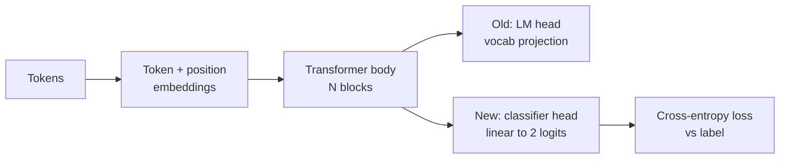
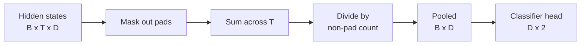
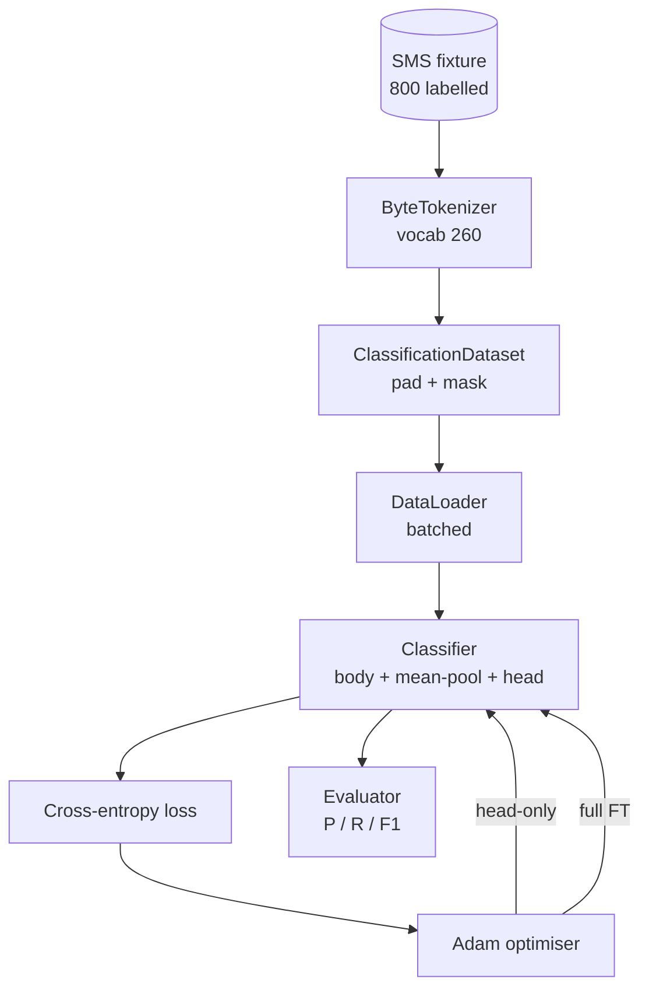

# 结业课第 38 课：通过 Head Swap 做分类器微调

> Track B 的第一个结业项目。一个预训练语言模型是一叠以 token 预测 head 收尾的自注意力 block。当你要区分 spam 和 ham 时，head 是错的，但 body 基本是对的。本课把 head 摘掉，把一个二分类线性层粘到池化后的表示上，并用两种不同方式训练分类器：只训最后一层，以及全量微调。评估是留出切分上的 precision、recall 和 F1。你会学到每种策略买来了什么，又付出了什么代价。

**Type:** Build
**Languages:** Python (torch, numpy)
**Prerequisites:** 第 19 阶段，第 30 至 37 课（NLP LLM 轨道：tokenizer、embedding table、attention block、transformer body、pre-training loop、checkpointing、generation、perplexity）
**Time:** ~90 分钟

## Learning Objectives

- 把一个语言模型 head 换成分类 head，同时不重新初始化 body。
- 实现两种训练机制：冻结 body（仅 head）和全量微调，共用同一个训练循环。
- 构建一个感知 tokenizer 的数据管道，负责填充、掩掉 padding，并对注意力输出做池化。
- 从原始 logits 计算 precision、recall、F1 和混淆矩阵。
- 权衡参数数量、训练时间与 headroom 之间的关系。

## 问题场景

你在一个通用语料上预训练了一个小 transformer。输出 head 把最后的隐状态投影到 1000 个 token 的词表上。你现在有 800 条标注为 spam 或 ham 的短信，想要一个二分类器。有三种选择。

错误的选择是在 800 个样本上从头训练一个全新的分类器。预训练模型的 body 已经编码了有用的结构：词的身份、位置、简单的共现关系。把它扔掉，等于浪费了构建它的那些算力。

两个正确的选择是：冻结 body 做 head swap，以及让 body 可训练做 head swap。只训 head 很快，内存上几乎免费，在这么少的数据下也很少过拟合。全量微调更慢，在小数据上可能过拟合，但当下游领域与预训练语料发生漂移时能到达更高的准确率。

本课把两者都建出来，让你能在同一个 fixture 上比较它们。

## 核心概念



模型是一个函数 `f_theta(tokens) -> hidden_states`。head 是一个函数 `g_phi(hidden) -> logits`。换 head 意味着保留 `theta` 并替换 `g_phi`。body 的参数是昂贵的那部分。head 只是一个线性层。

两组可训练参数值得关注：

- `theta`（body）：每个注意力 block 有数万个权重。
- `phi`（head）：`hidden_dim * num_classes` 个权重再加一个 bias。

在只训 head 的训练中，你针对 `phi` 计算梯度，而在 `theta` 上把它们置零。PyTorch 让你通过对 body 参数设置 `requires_grad=False` 做到这一点。优化器于是只看到 head，body 保持冻结。

在全量微调中，你让梯度回流穿过整个栈。body 的权重漂移以拟合分类目标。风险是在小数据上的灾难性遗忘：body 的预训练会被过拟合噪声冲掉。

## 池化方式的选择

分类器需要每个序列一个向量，而不是每个 token 一个向量。三种常见选择：

- **Mean pool**：在序列上对隐状态取平均，按 attention mask 加权。
- **CLS pool**：前置一个特殊 token，只使用它的输出。这是 BERT 的做法。
- **Last-token pool**：使用最后一个非 padding token。这是 GPT 类分类器的做法。

本课使用带显式 attention-mask 加权的 mean pooling。它最简单，在不同序列长度上给出稳定的信号，也不要求预训练一个 CLS token。



## 数据

八百条短信，400 条 spam 与 400 条 ham 均衡，在 `code/main.py` 中确定性地生成。生成器使用固定 seed，挑选模板并替换槽位填充项，产出长度在 5 到 25 个 token 之间的消息。真实数据集有噪声，这个 fixture 没有。fixture 的意义在于可复现。

数据按 80/20 切分：640 条训练、160 条测试。切分是分层的，因此测试集保持 50/50 的均衡。一个均衡已知的留出集，让 precision 和 recall 能被读作诚实的数字。

## 指标

以类别 1 为正类（spam）的二分类。计数为：

- `TP`：预测 spam，实际是 spam。
- `FP`：预测 spam，实际是 ham。
- `FN`：预测 ham，实际是 spam。
- `TN`：预测 ham，实际是 ham。

三个头条指标：

- `precision = TP / (TP + FP)`。在被标记为 spam 的消息里，实际有多少比例是？
- `recall = TP / (TP + FN)`。在实际的 spam 里，模型标出了多大比例？
- `F1 = 2 * P * R / (P + R)`。两者的调和平均。

混淆矩阵把四个计数打印成一个 2x2 网格。演示会针对两种训练机制都把它写到 stdout。

```figure
cap-classifier-head-swap
```

## 架构



body 是一个刻意做得很小的 transformer：词表 260、hidden 64、4 个 head、2 个 block、最大序列 32。它小到足以在 CPU 上九十秒内把两种机制都训到收敛。它并不是在课内预训练的；取而代之，`pretrain_quick` 辅助函数在同一个 fixture 的文本上跑五个 epoch 的 LM 训练，让 body 有一个非平凡的起点。这保持了本课的自包含性。

## 你将构建什么

实现是一个 `main.py` 加一个测试模块（`code/tests/test_main.py`）。

1. `ByteTokenizer`：把字节映射为 id，保留一个 pad id。
2. `Block`：带多头注意力和前馈层的 transformer block。Pre-norm。
3. `LMBody`：token + position embedding 加一叠 block。返回隐状态。
4. `MeanPool`：在序列轴上做 mask 加权平均。
5. `Classifier`：body、pool、线性 head。body 在两种机制之间是同一个实例。
6. `freeze_body` 和 `unfreeze_body`：切换 body 参数上的 `requires_grad`。
7. `train_classifier`：一个共享循环。接收模型，以及为当前可训练的那组参数配置好的优化器。
8. `evaluate`：跑测试集并返回 `Metrics(precision, recall, f1, confusion)`。
9. `run_demo`：先短暂预训练 body，然后以 head-only 训练并评估，再做全量微调，打印两份报告，并以零退出。

## 为什么这个对比重要

head-only 机制通常训练更快，过拟合得更体面。在这个 fixture 上，head-only 训练二十个 epoch 后你通常能看到 precision 接近 0.9、recall 接近 0.85。全量微调耗时约三倍，最终结果在几个百分点内浮动，取决于随机 seed。

本课不选赢家。它教你读懂数字和代价。在 800 个样本和一个很小的 body 上，head-only 是正确的选择。在 80,000 个样本和一个更大的 body 上，全量微调开始划算。你从本课取走的契约是 API：同一个 `train_classifier` 函数处理两者，切换只需一次调用。

## 进阶目标

- 加第三种机制，只解冻最后一个 block。这有时被称为部分微调。它的代价低于全量微调，学到的又多于 head-only。
- 加一个学习率调度器。head 上用余弦调度、body 上用一个更小的恒定学习率，是常见的生产配置。
- 把 mean pooling 换成学习式 attention pool：一个带单个 learned query 的小注意力层。在更长的序列上，这常常优于 mean pool。

实现给了你挂钩。测试钉住契约。数字留给你去推。
