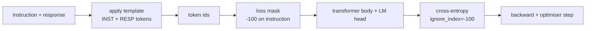
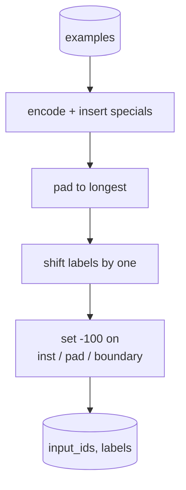
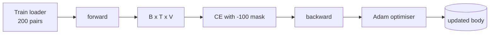

# 结业课第 39 课：用监督微调做指令调优

> 一个预训练的 base 模型能延续一段序列，却无法遵循指令。监督微调是修复这一点的最小改动：把「指令 + 期望回答」的成对样本喂给模型，训练 body 去预测回答的 token。诀窍在于你只想让损失计入回答，而不计入指令。本课构建一个 Alpaca 风格的 SFT 循环，用一个自定义 collate 函数以 `ignore_index=-100` 掩掉指令 token，在 200 个指令-回答对上训练，并用 exact-match 在留出切分上评估。

**Type:** Build
**Languages:** Python (torch, numpy)
**Prerequisites:** 第 19 阶段，第 30 至 37 课（NLP LLM 轨道：tokenizer、embedding table、attention block、transformer body、pre-training loop、checkpointing、generation、perplexity）
**Time:** ~90 分钟

## Learning Objectives

- 把成对的指令-回答数据格式化成一条带显式边界 token 的单一因果序列。
- 构建一个 collate 函数，掩掉指令 token，使 cross-entropy 只计入回答 token。
- 在 SFT 目标下训练一个小 transformer body，并观察 eval 指标的变化。
- 实现尊重回答起始边界的贪心生成和温度采样生成。
- 在生成的补全上计算留出集的 exact-match。

## 问题场景

一个在下一 token 预测上训练的 base 模型完全不知道指令是什么。把字符串 `"What is the capital of France?"` 给它看，它会续写这个问题，或者另造一个新句子。模型有语言能力，但没有格式契约。

SFT 契约是一个字符串模板。每个训练样本变成一条包含三个区域的单一序列：

```text
<INST> What is the capital of France? <RESP> The capital of France is Paris.
```

边界 token 是训练时保留的特殊 token。模型学到 `<RESP>` 之后的一切就是回答，而回答才是被打分的内容。base 模型的下一 token 目标依然适用；只是训练语料里每个样本都是这种形状。

但有个陷阱。如果你把整条序列喂给一个普通的 cross-entropy 损失，你就是在训练模型同时预测指令 token。指令是给定的。你想让这些位置上的梯度为零。修法就是 mask。

## 核心概念



`ignore_index` 是 `torch.nn.functional.cross_entropy` 的一个特性。任何等于 `ignore_index` 的目标位置贡献零损失、零梯度。PyTorch 里的惯例值是 `-100`。collate 函数为每个样本构建两个张量：`input_ids`（完整序列）和 `labels`（`input_ids` 的副本，但指令位置被覆写成 `-100`）。

前向传播时模型看到整条序列；注意力可以关注到指令。损失只计入回答 token。这正是你要的：以指令为条件，预测回答。

## 数据

两百个指令-回答对在 `main.py` 中确定性地生成。它们覆盖六种任务类型：

- 事实性单轮问答（X 的首都）
- 算术
- 列表抽取
- 一句话摘要
- 代码（打印、排序）
- 定义

每个任务都有一个模板化的指令和一个确定性的回答。这是刻意保持简单的。Exact-match 很脆弱，本课使用的 fixture 里正确答案是一个特定字符串。真实的 SFT 数据集需要模糊指标；原理完全相同。

切分是 160 条训练、40 条测试。测试集覆盖全部六种任务类型，因此可以报告按类别的 exact-match。

## 分词与填充

tokenizer 是字节级的，保留三个特殊 token：

- `INST_ID = 256`：标记指令区域的开始。
- `RESP_ID = 257`：标记指令与回答之间的边界。
- `PAD_ID = 258`：用于变长批次的填充。

序列是 `[INST] inst_bytes [RESP] resp_bytes [PAD]*`。collate 函数：

1. 对每个样本分词。
2. 把批次里每个样本填充到该批次中最长的序列长度。
3. 构建 `labels` = 位移一位后的 `input_ids`（因果 LM 的目标），其中：
   - 指令区域替换为 `-100`。
   - 填充区域替换为 `-100`。
   - `RESP_ID` 边界位置本身替换为 `-100`（你不训练模型预测边界 token；它预测边界之后的内容）。



位移是标准的因果技巧：`input_ids` 的第 `i` 个位置预测第 `i+1` 个位置，所以 `labels[i] = input_ids[i+1]`（末位从输入中丢弃，首位从目标中丢弃）。mask 在位移之后施加，以落在正确的位置上。

## 训练



这个循环是标准的 PyTorch SFT 循环。Adam，学习率在 3e-4 到 1e-3 左右，在这个 fixture 上训十到二十个 epoch，不用调度器。模型足够小（hidden 96、2 个 block、最大长度 64），可以在 CPU 上两分钟内训到收敛。

每五个 epoch，循环会在留出集上跑一次微型评估并打印 exact-match。看着 exact-match 从第 1 个 epoch 的 0.0 走到第 15 个 epoch 的 0.85 左右，就是本课的回报：你能看到模型同时学会格式和答案。

## 生成

评估时模型拿到指令前缀 `[INST] inst_bytes [RESP]`，并生成 token，直到满足以下任一条件：

- 序列达到 `max_len`，或者
- 模型触发一个特殊的停止启发式：连续两个句末字节（`.`、`!`、`?`）。

本课交付贪心解码加一个可选的温度采样器。exact-match 使用贪心，因为温度会让指标变得随机。真实系统常常先采样、再模糊评判；那条管道是第 41 课。

## Exact-Match 评估

Exact-match 是最严格的文本指标。预测的回答字符串会被规范化（转小写、去掉首尾空白、折叠连续空格），并与以同样方式规范化的参考答案比较。指标对每个样本取 1 或 0。聚合值是均值。

真实的 SFT 管道会用 token 级 F1（第 41 课）和一个 judge 模型来补充 exact-match。exact-match 依然有用，因为它没有歧义；如果它说 0.7，那就是恰好 70% 的测试指令逐字符地产生了 gold 回答。

```figure
cc-sft-loss-mask
```

## 你将构建什么

实现是一个 `main.py` 加测试。

1. `InstructionTokenizer`：带保留特殊 token 的字节级编码器。既能编码指令前缀，也能编码完整的一对。
2. `make_dataset`：用固定 seed 在六种任务类型上生成 200 对。
3. `SFTDataset`：每个样本返回 `(input_ids, labels)`，mask 已预先处理好。
4. `sft_collate`：动态填充，构建批次张量，在指令和 pad 位置设置 `-100`。
5. `TinyGPT`：transformer body 加绑定或未绑定的 LM head。
6. `train_sft`：SFT 循环，带逐 epoch 的评估钩子。
7. `generate`：从前缀做因果解码，贪心或采样，带停止启发式。
8. `exact_match`：规范化字符串比较，返回 `[0, 1]` 内的浮点数。
9. `run_demo`：构建数据、训练二十个 epoch、评估、打印按类别的明细，成功时以零退出。

## 为什么 mask 很重要

没有 mask 时，损失会把指令 token 当作目标。模型学会预测指令。这是一个不同的目标，会以两种方式产生更差的模型。第一，模型容量被浪费在重建用户总会提供的输入上。第二，回答的损失在梯度总和里占比更小，因为在大多数批次里指令 token 的数量超过回答 token；优化器在你真正关心的那部分上的有效学习率比你预期的低。mask 不是打磨，它就是目标本身。

## 进阶目标

- 加一个先 warmup 再余弦衰减的学习率调度。SFT 对 LR 比预训练更敏感。
- 加逐 token 的损失日志，并画出训练过程中的损失曲线。注意早期 epoch 由模板 token（`<RESP>`、常见前缀）主导，后期 epoch 由真正的答案 token 主导。
- 把评估扩展到 BLEU-1 或 chrF。exact-match 会低估那些给出同义改写的模型。
- 加一个多轮格式的 chat 模板，并在包含追问的 fixture 上训练。

实现给了你格式契约、mask 和循环。从 base 模型到指令跟随者的目标变化，只在一个 collate 函数里。
