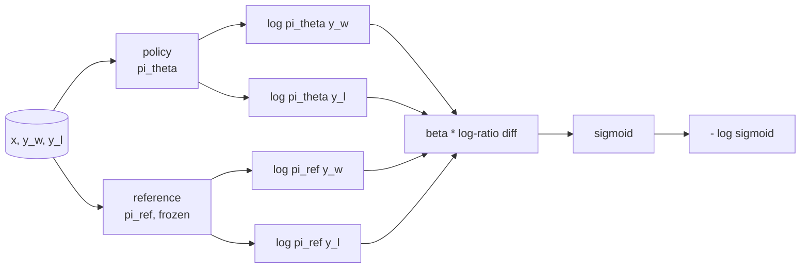
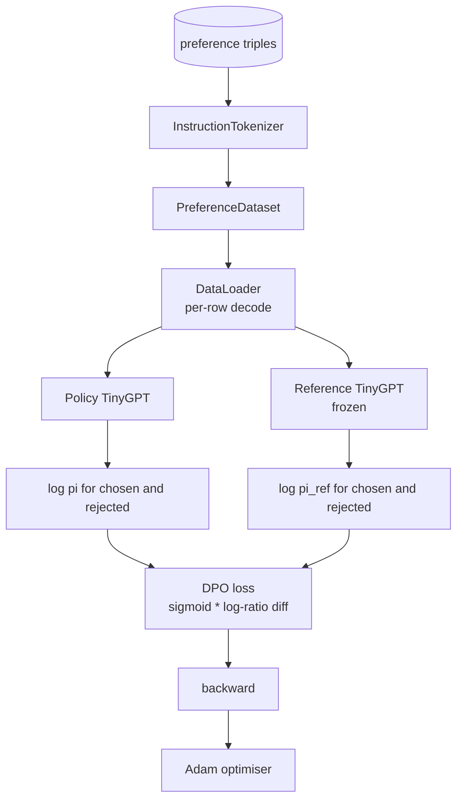

# 结业课第 40 课：从头实现 Direct Preference Optimization

> 奖励模型加 PPO 是经典的 RLHF 技术栈。DPO 把这一整套塌缩成一个监督损失，直接对照偏好对拟合策略。本课从奖励差恒等式推导 DPO 损失，交付一个可用的参考模型加策略模型，计算逐 token 的对数概率，并在一个由 chosen 与 rejected 补全组成的偏好 fixture 上训练一个小 transformer。测试钉住损失数学和梯度方向，让你知道实现与论文一致。

**Type:** Build
**Languages:** Python (torch, numpy)
**Prerequisites:** 第 19 阶段，第 30 至 37 课（NLP LLM 轨道：tokenizer、embedding table、attention block、transformer body、pre-training loop、checkpointing、generation、perplexity）
**Time:** ~90 分钟

## Learning Objectives

- 把 DPO 损失推导为对一个缩放后的对数比差值取 sigmoid，并把它与隐式奖励联系起来。
- 构建参考模型加策略模型的一对，参考模型冻结、策略可训练。
- 在两个模型下计算序列级对数概率，并掩掉 prompt 的 token。
- 在 `(prompt, chosen, rejected)` 三元组上训练策略，观察 chosen 的对数概率相对 rejected 上升。
- 用测试钉住损失数学、梯度符号和参考模型不变性。

## 问题场景

你有一个 SFT 模型。它能遵循指令，但输出参差不齐；有些补全清晰，有些啰嗦或错误。你还有一个小的偏好对数据集：对同一个 prompt，人工标出了其中一个补全为 chosen，另一个为 rejected。

经典的 RLHF 答案是两阶段管道。先在偏好上训练一个奖励模型。再用 PPO 对照奖励优化策略。这能奏效，但很贵：PPO 期间内存里有两个模型，需要 KL 控制让策略靠近参考模型，奖励模型脆弱时还会出现 reward hacking。

DPO 用单个监督损失取代这两个阶段。奖励模型从不显式存在。策略直接在偏好对上训练，带一个朝 SFT 参考模型的显式 KL 惩罚。在 Bradley-Terry 偏好模型下最优解相同，代码量少得多。

## 核心概念

从 Bradley-Terry 模型出发。给定一个 prompt `x` 和两个补全 `y_w`（chosen）与 `y_l`（rejected），人类偏好 `y_w` 的概率为

```text
P(y_w > y_l | x) = sigmoid( r(x, y_w) - r(x, y_l) )
```

其中 `r` 是某个潜在奖励函数。RLHF 先从偏好中拟合 `r`，再训练策略 `pi`，带一个 KL 锚点去最大化 `r`：

```text
max_pi   E_{x, y~pi} [ r(x, y) ] - beta * KL(pi || pi_ref)
```

DPO 的推导注意到：在该目标下的最优策略 `pi*` 关于 `r` 有闭式解：

```text
pi*(y | x) = (1/Z(x)) * pi_ref(y | x) * exp( r(x, y) / beta )
```

对 `r` 重新整理：

```text
r(x, y) = beta * ( log pi*(y | x) - log pi_ref(y | x) ) + beta * log Z(x)
```

`log Z(x)` 这一项对 `y_w` 和 `y_l` 是相同的（它只依赖 `x`，不依赖 `y`），所以在计算偏好差时会消掉：

```text
r(x, y_w) - r(x, y_l) = beta * ( log pi_theta(y_w|x) - log pi_ref(y_w|x)
                                - log pi_theta(y_l|x) + log pi_ref(y_l|x) )
```

代入 Bradley-Terry 的 sigmoid，并在偏好对上取负对数似然：

```text
L_DPO(theta) = - E_{(x, y_w, y_l)} [
  log sigmoid( beta * ( log pi_theta(y_w|x) - log pi_ref(y_w|x)
                       - log pi_theta(y_l|x) + log pi_ref(y_l|x) ) )
]
```

这就是损失。它是对每个样本一个标量取 sigmoid，由四个对数概率算出。没有单独的奖励模型。没有 PPO。损失里没有 KL 项；KL 约束已经烘进了闭式推导。



## 梯度的符号

任何训练运行之前的一个有用健全性检查。对 `log pi_theta(y_w | x)` 求梯度：

```text
d L_DPO / d log pi_theta(y_w | x) = - beta * (1 - sigmoid(z))
```

其中 `z` 是 sigmoid 的输入。这对所有 `z` 都是负的，意思是：提高策略对 chosen 补全的对数概率会降低损失。对称地，对 `log pi_theta(y_l | x)` 的梯度是正的：提高 rejected 的对数概率会增大损失。训练把 chosen 推高、把 rejected 压低。参考模型是冻结的；它不动。

## 数据

本课附带十二个偏好三元组。每个都是 `(prompt, chosen, rejected)`。chosen 补全简短而精确。rejected 啰嗦、跑题或错误。这些对覆盖与第 39 课相同的任务族（首都、算术、列表），因此一个从 SFT 基础出发的策略有合理的起点。

fixture 是刻意做小的。生产环境中 DPO 在数万个对上工作；这里的要点是损失数学和循环能在一个极小的数据集上端到端跑通，而且 chosen 与 rejected 之间的对数概率差肉眼可见地拉大。

## 参考模型的不变性

DPO 实现必须小心处理参考模型。参考模型是原地冻结的 SFT 模型。三个性质必须成立：

- 参考模型的参数永远不接收梯度。
- 参考模型的对数概率在 epoch 之间永不变化。
- 策略从与参考模型相同的权重出发。（最优的 `theta` 是参考模型加上一个学到的更新；把策略初始化为参考模型的副本是定义良好的起点。）

实现通过以下方式强制这些性质：

- 在前向传播时把参考模型包在 `torch.no_grad()` 里。
- 对每个参考参数设置 `requires_grad=False`。
- 在参考模型构建完成后，通过 `policy.load_state_dict(reference.state_dict())` 构造策略。

```figure
cap-dpo-preference
```

## 架构



模型是与第 39 课相同的 TinyGPT（decoder-only、因果、字节 tokenizer）。参考模型和策略共享架构；训练中策略的权重从参考模型漂移，而参考模型保持不动。

## 你将构建什么

实现是一个 `main.py` 加测试。

1. `InstructionTokenizer`：带 `INST` 和 `RESP` 特殊 token 的字节 tokenizer。形状与第 39 课相同。
2. `TinyGPT`：decoder-only transformer。形状与第 39 课相同，因此即使你跳过了第 39 课，本课也自包含。
3. `make_preferences`：返回十二个 `(prompt, chosen, rejected)` 三元组。
4. `sequence_log_prob`：给定模型、一个 prompt 前缀和一个补全，返回该补全上下一 token 对数概率之和（prompt 位置不贡献）。
5. `dpo_loss`：接收四个对数概率和 `beta`，返回逐样本的损失张量以及用于记录的隐式奖励差。
6. `train_dpo`：逐 epoch 循环，在策略和参考模型下计算 chosen 与 rejected 的对数概率，施加损失，并走一步 Adam。
7. `evaluate_margins`：在任意时刻返回策略下 chosen 减 rejected 的平均对数概率差。
8. `run_demo`：通过一次小型预热预训练构建参考模型和策略，复制权重，训练三十步，打印逐步骤的损失和 margin，成功时以零退出。

## 为什么 DPO 有效

在 Bradley-Terry 偏好模型下，DPO 在数学上等价于 RLHF，直到奖励的参数化方式为止。隐式奖励 `r(x, y) = beta * (log pi(y|x) - log pi_ref(y|x))` 在偏好下可识别到 `x` 的某个函数为止，而该函数在差值中消掉。闭式策略让你跳过显式奖励模型。KL 约束在结构上被强制执行：`pi` 对 `pi_ref` 的任何偏离都会让对数比变大，sigmoid 随之饱和，从而在策略走得太远时抑制梯度。参考模型是你的安全网。

## 进阶目标

- 给对数概率之和加长度归一化：除以补全长度。长度偏置是已知的 DPO 失败模式，模型会优先选择更短的补全，因为它们的对数概率在绝对值上更大。
- 加上 IPO 变体的损失：把 sigmoid + log 换成 `(z - 1)^2`。在 fixture 上比较收敛情况。
- 加一个 label smoothing 参数，在硬性的 chosen-rejected 标签和均匀的 0.5 之间插值。
- 把参考模型换成一个更小更便宜的模型（知识蒸馏的风格）。

实现给了你损失、参考模型不变性和训练循环。数学才是本课。代码让数学变得具体。
