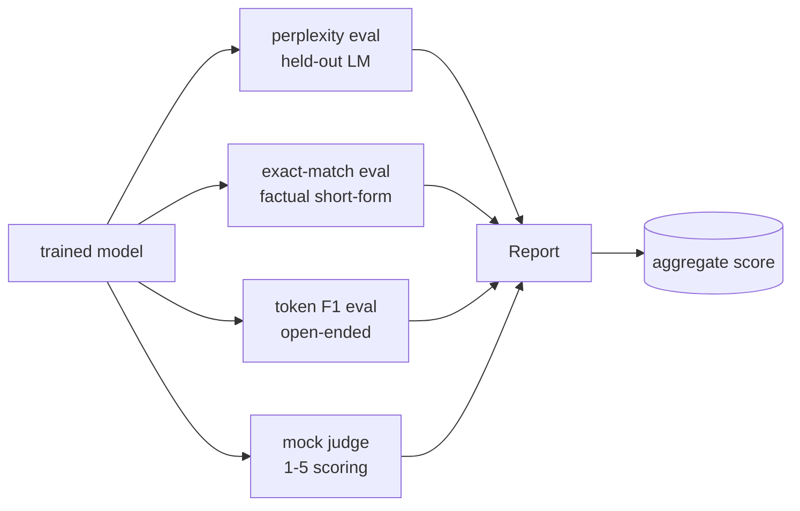
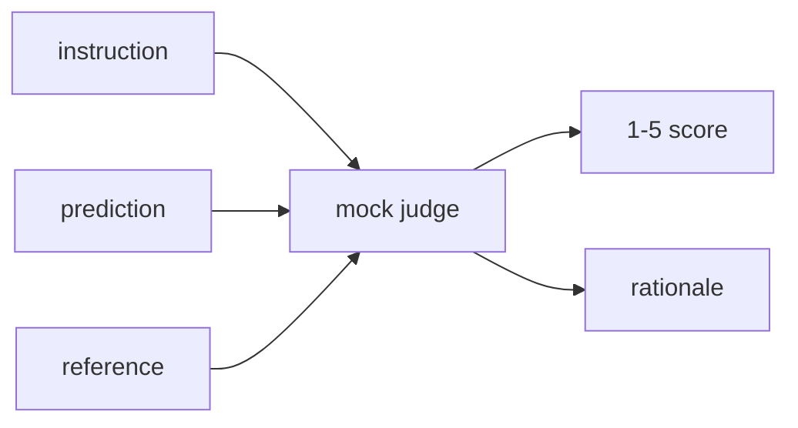
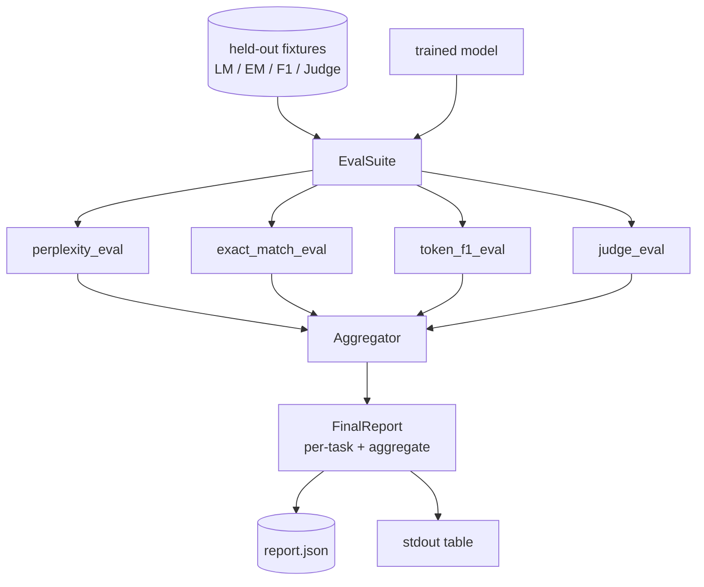

# 结业课第 41 课：完整的评估管道

> 训练是你能用损失曲线监控的那部分。评估是你必须自己设计的那部分。本课构建一个统一的评估管道：它接收任意一个训练好的语言模型，在其上运行四种异构评估，把结果聚合为一份按任务划分的报告，并交付一个本地 mock 的 LLM-as-judge，让整个循环无需网络即可运行。这四种评估覆盖每个上线模型都需要的维度：语言建模（perplexity）、短答案正确性（exact-match）、开放式相似度（token F1）和定性打分（judge）。

**Type:** Build
**Languages:** Python (torch, numpy)
**Prerequisites:** 第 19 阶段，第 30 至 37 课（NLP LLM 轨道：tokenizer、embedding table、attention block、transformer body、pre-training loop、checkpointing、generation、perplexity）
**Time:** ~90 分钟

## Learning Objectives

- 在一个小 transformer 上，用计入掩码 token 的方式计算留出集 perplexity。
- 在短答案事实性 prompt 上运行 exact-match 评估。
- 在预测字符串与参考字符串之间计算带规范化的 token 级 F1。
- 构建一个本地 mock LLM-as-judge，以 1-5 分制给模型输出打分。
- 把四种评估聚合进一份带逐任务明细的加权报告。

## 问题场景

单一指标永远无法描述一个语言模型。Perplexity 说明模型对语言分布的拟合程度，但对它是否回答问题一无所知。Exact-match 说明模型是否产出了 gold 字符串，却会惩罚正确的同义改写。Token F1 宽容改写，却会被措辞重叠而内容错误的情况骗过。LLM-as-judge 能捕捉定性维度，但昂贵且随机。

你真正想要的管道拥有全部四种。每种评估覆盖其他评估遗漏的一个维度。每种都在为它而塑形的、不同的留出数据子集上运行。最终报告把逐任务的数字并排显示，再加一个汇总，让评审者一眼就能看出模型在做哪些取舍。

本课在一个文件里端到端地构建这条管道。

## 核心概念



每种评估都是一个从 `(model, dataset) -> EvalResult` 的函数。结果携带指标值、用于检视的逐样本细节，以及一个用于聚合的名字。管道用一个配置把它们组合起来，配置说明运行哪些评估、如何加权。

## 正确计数的 Perplexity

Perplexity 是 `exp(mean negative log-likelihood per token)`。实现里有两个陷阱：

- 均值必须是对实际 token 位置求的，而不是对 batch * sequence 求的。padding token 必须从分母中排除，否则 perplexity 会看起来比实际更好。
- 模型预测下一个 token，所以第 `i` 个位置的 logits 预测第 `i+1` 个位置的 token。这里的差一错误是无声的：损失照样训练，但指标变得没有意义。

评估先在非 pad 位置上按批次累加 `-log p(token)` 之和与每批次的 token 计数，最后再做除法。这比对各批次的 perplexity 取平均（会给短序列偏低权重）在数值上更安全，也与教科书的定义一致。

## 带规范化的 Exact-match

harness 在比较前对预测和参考都做规范化：

- 转小写。
- 去掉首尾空白。
- 把内部的连续空白折叠成单个空格。
- 若两侧仅标点不同，则去掉末尾的终止标点（`.`、`!`、`?`）。

规范化让 exact-match 在实践中变得有用。说 `"Paris"` 的模型是对的；说 `"Paris."` 的也是对的；说 `"  paris  "` 的也是对的。这个指标仍然要求答案在规范化之后是同一个字符串。

## 正确的 Token F1 做法

Token F1 是在 token 袋上计算的 precision 与 recall 的调和平均。步骤：

1. 规范化预测与参考（与 exact-match 相同的规则）。
2. 把各自切成 token 列表（按空白分词）。
3. 统计多重集交集。
4. Precision = `intersection_count / len(pred_tokens)`。Recall = `intersection_count / len(ref_tokens)`。F1 = 调和平均。

如果预测和参考都为空，F1 为 1（空匹配）。如果只有一个为空，F1 为 0。这个模式与 SQuAD 的评估参考实现一致，在同义改写之间给出稳定的数字。

## 本地 Mock LLM-as-Judge

真实的 judge 是 API 背后的前沿模型。对本课而言，judge 必须离线运行。mock judge 是一个确定性打分器：接收一条指令、模型的预测和参考，返回 `{1, 2, 3, 4, 5}` 中的分数外加一句理由。打分规则是显式的：

- 若规范化后的预测等于规范化后的参考，得 5。
- 若预测与参考之间的 token F1 至少为 0.8，得 4。
- 若 token F1 在 `[0.5, 0.8)` 内，得 3。
- 若 token F1 在 `[0.2, 0.5)` 内，得 2。
- 其他情况得 1。

这不是真正的 judge，但它的接口是对的。以后换入真实模型只需改一个函数。管道不关心。



## 聚合

聚合值是各评估规范化分数的加权平均。每种评估以 `[0, 1]` 报告自己的数字：

- Perplexity：用 `1 / (1 + log(perplexity))` 规范化。perplexity 为 1 映射到 1，无穷大映射到 0。
- Exact-match：本来就在 `[0, 1]` 内。
- Token F1：本来就在 `[0, 1]` 内。
- Judge：除以 5。

权重可配置。默认配比是 0.2 perplexity、0.3 exact-match、0.3 token F1、0.2 judge。权重的选择是一个产品决策；本课把这个旋钮暴露出来，供你实验。

```figure
cg-eval-quadrant
```

## 架构



`EvalSuite` 是一个很薄的外层编排器。每个单独的评估都是一个自由函数，接收 `(model, tokenizer, dataset, config)` 并返回一个 `EvalResult`。`Aggregator` 收集结果并产出最终报告。演示打印表格，并写出一份 JSON 副本供下游 CI 摄取。

## 你将构建什么

实现是一个 `main.py` 加测试。

1. `TinyGPT`：与第 38-40 课相同的 decoder-only 架构，包含在此以便本课独立成立。
2. `InstructionTokenizer`：带 INST / RESP / PAD 特殊 token 的字节 tokenizer。
3. 四个 fixture：一个 LM 语料、一个 EM 集、一个 F1 集和一个 judge 集。各二十个样本，确定性生成。
4. `perplexity_eval`：返回带 perplexity 值和逐 token 损失直方图的 `EvalResult`。
5. `exact_match_eval`：返回平均 EM 和逐样本记录。
6. `token_f1_eval`：返回平均 token F1 和逐样本记录。
7. `mock_judge` 和 `judge_eval`：逐样本的分数与理由，以及整个集合的平均分。
8. `Aggregator.normalise`：逐评估的规范化规则。
9. `Aggregator.aggregate`：加权平均和组装好的报告。
10. `run_demo`：短暂训练一个小模型，运行全部四种评估，打印报告表格并写出 JSON，成功时以零退出。

## 如何阅读报告

报告有三层。最上面是汇总分。其下是四个逐评估的数字。再往下是用于诊断的逐样本明细。一次失败的 CI 运行通常只关心汇总分，但追查回归的评审者想要逐样本明细，看清模型在哪些输入上出了错。

JSON 转储使用稳定的键，让 CI 仪表盘能跨版本绘制趋势线。漂亮打印的表格是给训练结束后盯着终端的人看的。

## 进阶目标

- 加一个校准评估：模型的 softmax 概率与它的准确率对得上吗？按置信度把预测分桶，报告每个桶的经验准确率。
- 加一个鲁棒性评估：给每个样本打上一个扰动标签（拼写错误、同义改写、干扰项），报告每种扰动下的指标下降。
- 把 mock judge 换成 HTTP 调用背后的真实模型。函数签名不变。
- 加逐任务权重学习：不用固定权重，而是对一组目标模型偏好顺序拟合权重。

实现给了你四种评估、聚合器和报告。真实的评估管道会在上面再叠很多维度；模式保持不变：每个评估一个函数，一个聚合器，一份报告。
