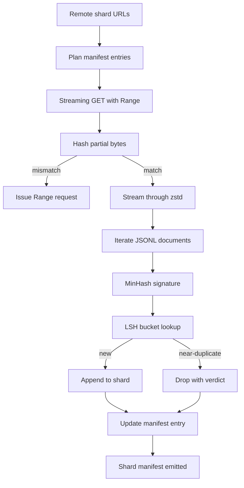

# 大型语料下载器

> 训练语言模型远在第一次前向传播之前就开始了。语料必须先落盘、解压、去重、可寻址，而且续传方案得在 4% 处网络断掉之前就想清楚。本课构建一个流式下载器：拉取压缩分片，用 Zstandard 边下边解压，通过 MinHash 加局部敏感哈希给近重复文档打指纹，并写出一份管道其余部分可以信任的分片清单。

**Type:** Build
**Languages:** Python
**Prerequisites:** 第 19 阶段，第 30 至 37 课
**Time:** ~90 分钟

## Learning Objectives

- 用 `urllib` 流式拉取远程分片，并用 `zstandard` 解压，全程不在内存里缓冲整个文件。
- 通过对已验证的字节偏移发起 HTTP `Range` 请求，续传部分下载。
- 为每个文档构建一个 MinHash 签名，并用 LSH 分桶，让近重复文档碰撞到一起。
- 输出一份分片清单，包含内容哈希、字节大小、文档数和去重结论。

## 问题场景

你第一次在一个 200 GB 的语料上训练时，网络在 41% 处断掉，脚本带着一个 `urllib` 异常退出。第二次它在 78% 处断掉。到 99% 时你已经把循环重写了三遍。你必须从第一分钟就为两种失败做设计：部分下载的续传，以及重复文档的移除。两者都有成熟解法；两者也常被跳过，因为管道最初只是一个一行的 `requests.get` 调用，后来才长出牙齿。

续传是一个 HTTP 问题。服务端必须支持 `Range`，客户端必须把已验证的偏移与一份磁盘记录对上，而这个已验证的偏移必须能挺过进程死亡。如果偏移与文件哪怕差一个字节，续传就会写入垃圾，语料以某种只在分词时才暴露的方式被损坏。

去重是一个签名问题。精确哈希去重会漏掉近重复：同一篇维基百科文章带着三种不同的样板页脚出现，同一个代码文件带着不同的 license 头，同一篇博客文章每个链接都带跟踪参数。MinHash 加 LSH 以次线性的代价抓住这些。代价是每个文档一个签名，每个签名一次分桶查找。

## 核心概念



### 用 `urllib` 流式读取

标准库的 `urllib.request.urlopen` 返回一个类文件对象。把它包进 `zstandard.ZstdDecompressor().stream_reader`，字节就从网络流经解压器进入文档迭代器，压缩分片和解压分片都不会在内存里实体化。唯一的内存开销是行缓冲、当前文档的 MinHash 签名，以及 LSH 索引。

### 用 `Range` 续传

下载器为每个分片写两个文件：分片本身和一个 `.partial.json` checkpoint。checkpoint 记录 `verified_bytes`、`expected_size`、`sha256_prefix`（在前 `verified_bytes` 字节上计算）以及源 URL。启动时下载器读取 checkpoint，对磁盘上的字节重新计算 `sha256_prefix`，只有重算出的哈希匹配时才续传。若哈希不对，部分文件被丢弃，下载从第零个字节重新开始。静默损坏不可能发生，因为已验证的字节是被检查过的，而不是被假定的。

### MinHash 加 LSH

MinHash 在固定空间里估计两个集合的 Jaccard 相似度。对一个文档而言，集合是它文本的 shingle（重叠的 n-gram）。签名是 `k` 个最小哈希值，每个独立哈希函数贡献一个。Jaccard 相似度为 `s` 的两个文档，在签名的任意单个分量上一致的概率是 `s`。

LSH 随后把这 `k` 个分量分成 `b` 个 band、每个 `r` 行，其中 `k = b * r`。两个文档至少在一个 band 上碰撞的概率是 `1 - (1 - s^r)^b`，这在你用它调 `(b, r)` 的那个 `s` 值附近形成一个陡峭的阈值。典型语料去重的阈值是 `s = 0.8`，LSH 研究文献用 `k = 128`、`b = 32`、`r = 4` 达到它。

### 把分片清单当作契约

下载器唯一的耐久输出是清单。清单按分片记录 URL、解压后的字节数、文档数、去重后的唯一文档数，以及最终分片文件的 sha256。下游分词读取清单，而不是目录列表。如果某个分片缺失或它的 sha256 不对，清单会告诉下一阶段拒绝启动。清单是「数据已下载」与「数据已下载且可验证」之间的那条决定性边界。

```figure
cap-corpus-downloader
```

## Build It

`code/main.py` 实现了：

- `ShardPlanner` - 读取一组分片 URL 并产出计划好的清单条目。
- `StreamingDownloader` - 打开一个带可选 `Range` 的 `urllib` 流，写入临时文件，每收到一个 chunk 就更新 `.partial.json` checkpoint，并在续传时校验 sha256 前缀。
- `ZstdDocIterator` - 把类文件流包进 `zstandard.ZstdDecompressor`，每行产出一个文档。
- `MinHasher` - 用一组固定的哈希 seed 为一个字符串产出 `k` 个分量的签名。
- `LSHIndex` - 按 band 给签名分桶，并报告碰撞。
- `Dedup` - 组合哈希器和索引，把每个文档标为 `keep` 或 `near_duplicate`，并附上匹配的分片 id。
- `ManifestWriter` - 收集逐分片统计并写出 `manifest.json`。

文件底部的演示会在磁盘上构建一个小型合成语料，用 `zstandard` 压缩，通过 `file://` URL 下载，去重，并打印清单。

运行它：

```bash
python3 code/main.py
```

脚本以零退出并打印一份清单汇总。

## 生产模式

有四种模式能把本课扩展到真实语料。

**先写 checkpoint，再写数据。** `.partial.json` 必须在字节追加到分片之前 `fsync`。否则断电会颠倒顺序：分片字节已在盘上，checkpoint 里却没有它们，下次续传以为自己验证过的字节比实际少，重复的后缀字节会损坏文件。先 checkpoint，再写入。这与预写日志是同一条纪律。

**分片的 LSH 索引。** 在 200 GB 规模下，整个语料上的单一 LSH 索引放不进 RAM。按第一个 band 哈希把 LSH 索引分区，把分区存在磁盘上，只查询新签名会落入的那个分区。代价是每个文档多一次磁盘读取；收益是 LSH 索引不再是硬性的内存天花板。

**打墓碑标记，而不是删除。** 被丢弃的重复文档以结论 `near_duplicate` 和与它碰撞的那个文档的分片 id 记录在清单里。删除它们会丢失重复与保留者之间的关联。打墓碑保留了审计轨迹，也让下游的一轮处理可以改变它对阈值的看法。

**清单里带逐分片 sha256，外加清单自身的 sha256。** 清单本身也获得一个内容哈希。下游阶段在信任逐分片条目之前先校验清单哈希。没有这一层，清单就是静默的攻击面：能编辑单个文件的攻击者就能损坏整条管道。

## Use It

生产模式：

- **每次 CI 运行都续传。** CI runner 是临时的。下载器必须假定每次运行都是一块新磁盘，并从缓存或远程恢复。`--cache-dir` 是一等公民的参数。
- **在分词之前去重。** 分词很昂贵。对同一文档跑两遍，就是为同一条损失曲线付双倍代价。去重位于分词的上游，而不是下游。
- **把清单当作合并闸门。** 训练运行从一个固定 commit 里读取清单 sha256。新的数据集版本要求新的清单 commit。代码与数据之间的链接是 git，而不是口口相传。

## Ship It

`outputs/skill-corpus-downloader.md` 在真实项目里会描述哪些 URL 喂给下载器、checkpoint 目录如何布局、去重使用多大的 shingle 宽度和哪个 `(k, b, r)` 三元组，以及清单位于版本控制的何处。本课交付的是引擎。

## Exercises

1. 加一个 `--shingle-width` 参数，测量宽度为 3、5、9 时去重结论如何变化。为所选的默认值给出理由。
2. 在 zstd 旁边加上 gzip 支持，通过嗅探 magic bytes 判断。下载器不应要求调用方指定 codec。
3. 加一个 `--resume-only` 模式，找不到 checkpoint 时拒绝启动全新下载。在 CI 里有用，避免某次运行意外重新拉取 200 GB。
4. 把 LSH 索引迁移到 shelf 或 sqlite 文件，并比较吞吐与内存版本的差异。
5. 在启动时加上清单 sha256 校验。如果磁盘上的清单与 `manifest.lock` 中的清单哈希不一致，下载器应失败关闭。

## Key Terms

| 术语 | 人们常怎么说 | 实际含义 |
|------|-----------------|------------------------|
| Shard | “一个文件” | 语料的一个自包含切片，带自己的 sha256，作为续传与去重的单位 |
| MinHash signature | “指纹” | 一个集合的 `k` 分量速写，每个分量是某个独立哈希在集合上的最小值 |
| LSH band | “桶” | 由 `r` 个签名分量组成的一组，用作碰撞检测的单个桶键 |
| Verified bytes | “续传偏移” | 磁盘上 sha256 前缀与 checkpoint 匹配的字节；唯一安全的续传起点 |
| Manifest | “索引” | 下载器产物的唯一耐久记录，包含内容哈希 |

## Further Reading

- [RFC 7233](https://datatracker.ietf.org/doc/html/rfc7233) - HTTP Range 请求，即续传协议
- [Zstandard format specification](https://datatracker.ietf.org/doc/html/rfc8478) - 让流式解压安全的帧格式
- [MinHash](https://en.wikipedia.org/wiki/MinHash) - 本课使用的签名族
- [Locality-sensitive hashing](https://en.wikipedia.org/wiki/Locality-sensitive_hashing) - 去重阈值背后的分带方案
- 第 19 阶段，第 43 课 - 下载器所供给的 HDF5 tokenized corpus
- 第 19 阶段，第 44 课 - 在该语料上训练的余弦调度
- 第 19 阶段，第 45 课 - 消费该调度的 AMP 循环
