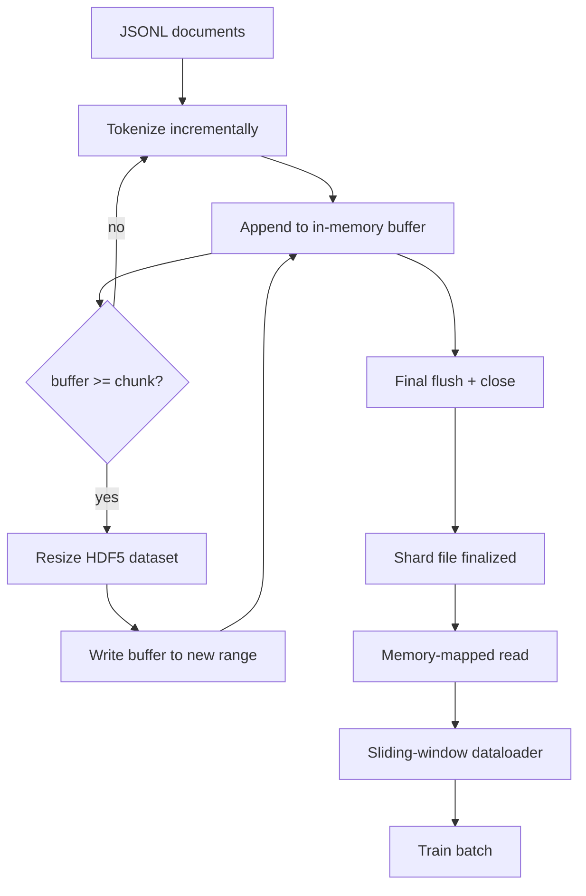

# HDF5 分词语料

> 下载下来的语料必须落成一种训练器能以行速流式读取的布局。磁盘上的 JSONL 撑不住 16 个 dataloader worker。带可扩容、分块整数数据集的 HDF5 可以。本课构建流式分词写入可扩容的 HDF5 数据集、跨多个文件的分片写入、训练时的内存映射读取，以及一个产出定长序列且打包规则正确的滑动窗口 dataloader。

**Type:** Build
**Languages:** Python
**Prerequisites:** 第 19 阶段，第 30 至 37 课
**Time:** ~90 分钟

## Learning Objectives

- 用确定性的分块方式，把文档流式写入一个可扩容的 HDF5 整数数据集。
- 跨多个 HDF5 文件分片写入，让失败范围有界，并使并行成为可能。
- 通过 HDF5 由 page cache 支撑的分块布局读回 token，使 dataloader 只在组批时才复制进批次缓冲。
- 实现一个滑动窗口 dataloader，按显式的打包规则产出定长的训练序列。

## 问题场景

现代语言模型训练在几十个 worker 上每秒读取数十万个样本的 token。磁盘上的 JSONL 在第一次冷缓存缺页时就会垮掉：JSON 解析器很慢，文档边界不可寻址，而要 seek 到「第 4,217,884 个样本」需要扫描整个文件。即便是压缩效果很好的 Parquet 也不合适，因为训练器不想要列；它想要一条支持 O(1) 随机访问的扁平 token 流。

HDF5 合适，因为它提供一个分块、可扩容、纯整数的数据集，其分块在读取时对 page cache 友好。训练器请求 `tokens[3,200,000 : 3,200,8192]` 的一个切片，HDF5 就把请求的 hyperslab 从 page cache 复制进一个新分配的 NumPy 数组。代价是每个 worker 一个打开的文件句柄和一份 chunk 大小的 page cache 占用，相比解码 JSONL 的代价可以忽略。

构建层面的问题在于让写入端保持诚实。可扩容数据集很容易被误用：一次写一个文档，HDF5 文件会碎片化到不可用；在一次 resize 里写完所有文档，一次进程死亡就丢掉整个分片。正确的纪律是先缓冲再扩容，缓冲区大小与 chunk 大小匹配，并用分片写入把负载拆到多个文件上，使崩溃最多只丢一个分片。

## 核心概念



### 正确使用可扩容的 HDF5

token 数据集以 `maxshape=(None,)` 和固定的 `chunks=(chunk_size,)` 创建。写入时先把 token 缓冲在一个长度为 `chunk_size` 的 NumPy 数组里。缓冲满了，数据集就恰好扩容 `chunk_size`，再把缓冲区写进新的区间。分片结束时，残余的缓冲区写进最后一个不完整的区间。除最后一次之外，每次写入都是连续的且按 chunk 对齐，而读取方被告知按分片 HDF5 属性里记录的 `token_count` 截断。

### 分片写入

单个 HDF5 文件是单点故障。管道并行写分片：来自第 19 阶段第 42 课的每个输入分片产出一个 HDF5 输出分片。一个 `shards.json` 索引按分片记录文件路径、token 数、文档数，以及一个覆盖 token 的 sha256。训练器读取 `shards.json` 来计算全局偏移并校验语料。

### 内存映射读取

训练时每个 worker 以 `swmr=True` 模式打开它负责的那部分 HDF5 文件，并请求 `tokens[start:stop]`。HDF5 的分块布局让这在 chunk 变热之后成为由 page cache 支撑的读取。worker 从不实体化整个文件：切片被复制进 dataloader 的批次缓冲，dataloader 再在组批时把它复制进固定的（pinned）训练张量。热路径上每跨越一次 chunk 只有一次系统调用；其余都是 RAM 访问。

### 滑动窗口 dataloader

dataloader 是唯一知道训练序列长度的阶段。它在全局 token 流里挑一个随机起始索引，读取 `window_size + 1` 个 token，并返回 `(input, target) = (tokens[:-1], tokens[1:])`。文档边界不被强制：一个窗口可以横跨两个文档，中间用一个显式的 `boundary_token_id` 隔开，让模型学会使用这个分隔符。这是标准的打包规则；也是初学者常忘的规则，结果得到一个 8% 是训练边界 token、92% 是自然文本的语料。

```figure
cc-hdf5-corpus
```

## Build It

`code/main.py` 实现了：

- `Tokenizer` - 一个字节级确定性 tokenizer，对演示而言足够好用。接口是 `encode(text) -> list[int]` 和 `vocab_size`。
- `HDF5ShardWriter` - 打开一个可扩容的整数数据集，把 token 缓冲到 chunk 大小，按固定大小的步长扩容并写入，关闭时把 `token_count` 和 `sha256` 记为 HDF5 属性。
- `ShardedTokenizationPipeline` - 迭代输入文档，把它们路由给 writer，并产出 `shards.json` 索引。
- `MmapTokenStore` - 打开分片文件做内存映射读取，计算全局偏移，暴露单一的 `get_slice(start, stop)` API。
- `SlidingWindowDataloader` - 从全局流里挑选随机窗口，产出 `(input_ids, target_ids)` NumPy 数组。

文件底部的演示会在内存里构建一个小语料，分词成两个分片，通过内存映射打开它们，让 dataloader 跑 10 个批次，并打印每批的形状和一个校验和。

运行它：

```bash
python3 code/main.py
```

脚本以零退出并打印批次校验和。

## 生产模式

有四种模式能把本课扩展成真实的训练运行。

**chunk 大小等于典型读取量。** 训练器每个样本读取 `window_size + 1` 个 token。把 HDF5 chunk 设为 `window_size` 的整数倍，读取就与 page cache 对齐。chunk 不匹配会让吞吐减半，因为每个样本都会触碰到两个 chunk。

**token 数放在属性里，而不是数据集里。** 数据集的尾部切片可能只有部分填充，因为 chunk 大小不能整除文档边界。把真实的 `token_count` 存为数据集上的 HDF5 属性，让读取方在该值处截断。没有这一条，读取方会走出末尾进入零填充的 token，模型于是学会预测零。

**分片 sha256 与并行校验。** 每个分片都有覆盖其 token 字节的 sha256。训练器可以在训练开始前并行校验所有分片。错误的 sha256 会让运行尽早失败，而不是在十六小时之后的第三个 epoch 才失败。

**两端都用 `swmr=True`，写入端带 `libver="latest"`。** Single-Writer-Multiple-Reader 模式要求写入端以 `libver="latest"` 打开文件，预先创建每个数据集，然后设置 `file.swmr_mode = True`。此后写入端必须在每次 resize 后调用 `dataset.flush()`，让以 `swmr=True` 打开的读取 worker 看到一致的数据。跳过 `libver="latest"` 或在结构变更之后才启用 SWMR，是「文件被锁」失败的常见来源。

## Use It

生产模式：

- **每个源分片一个 HDF5。** 下载器（第 42 课）每个 URL 产出一个分片；分词（本课）每个源分片产出一个 HDF5。1:1 的映射让续传和部分失败恢复变得轻而易举。
- **边界 token id。** 边界 token 是 tokenizer 词表的一部分，也是 dataloader 唯一注入的 token。如果模型应当忽略它，训练损失会掩掉边界 token；否则模型会学会把它当作序列分隔符使用。
- **把 `shards.json` 当作真相来源。** 增加一个新分片意味着写出 HDF5、计算它的 sha256、追加一个条目。训练器启动时读一次该文件，之后从不碰目录列表。

## Ship It

`outputs/skill-hdf5-tokenized-corpus.md` 在真实项目里会描述哪个 tokenizer 喂给管道、什么 chunk 大小与训练器的窗口匹配、`shards.json` 位于版本控制的何处，以及 dataloader worker 如何跨文件分片。本课交付的是引擎。

## Exercises

1. 给 HDF5 writer 加一个 `--compression gzip` 参数，测量演示语料上的吞吐代价。为所选的默认值给出理由。
2. 给滑动窗口 dataloader 加一个确定性 seed，验证相同 seed 的两次运行产出完全相同的批次。
3. 加一个 `--validate` 模式，读取每个分片、对其 token 重新计算 sha256，并与 `shards.json` 比较。CI 应在训练开始前运行它。
4. 比较 chunk 大小等于、一半于和两倍于窗口大小时 dataloader 的吞吐。报告 page cache 的影响。
5. 加一个 `--max-document-tokens` 参数，在写入时截断很长的文档。为这一取舍相对于在读取时决定给出理由。

## Key Terms

| 术语 | 人们常怎么说 | 实际含义 |
|------|-----------------|------------------------|
| Resizable dataset | “只追加” | 一个 `maxshape=(None,)` 的 HDF5 数据集，通过 `resize` 调用按 chunk 大小的步长增长 |
| Chunked layout | “HDF5 的存储方式” | 固定大小的磁盘页，内核可以内存映射，dataloader 可以连续读取 |
| `swmr` mode | “边读边写” | Single-Writer-Multiple-Reader 模式，让 dataloader worker 安全共享文件 |
| Shard index | “shards.json” | 所有 token 分片的耐久索引，带偏移与内容哈希 |
| Sliding window | “训练样本” | 全局 token 流中一个定长切片，训练器为它配上移一位的目标 |

## Further Reading

- [HDF5 chunking documentation](https://support.hdfgroup.org/documentation/hdf5/latest/hdf5_chunking.html) - 本课使用的分块、可扩容数据集布局
- [h5py user guide](https://docs.h5py.org/en/stable/) - HDF5 的 Python 绑定
- [NumPy memory mapping](https://numpy.org/doc/stable/reference/generated/numpy.memmap.html) - HDF5 通过 h5py 暴露的读取侧原语
- 第 19 阶段，第 42 课 - 本课对其输出做分词的下载器
- 第 19 阶段，第 44 课 - 消费这个 dataloader 的余弦调度
- 第 19 阶段，第 45 课 - 包裹训练步骤的 AMP 循环
