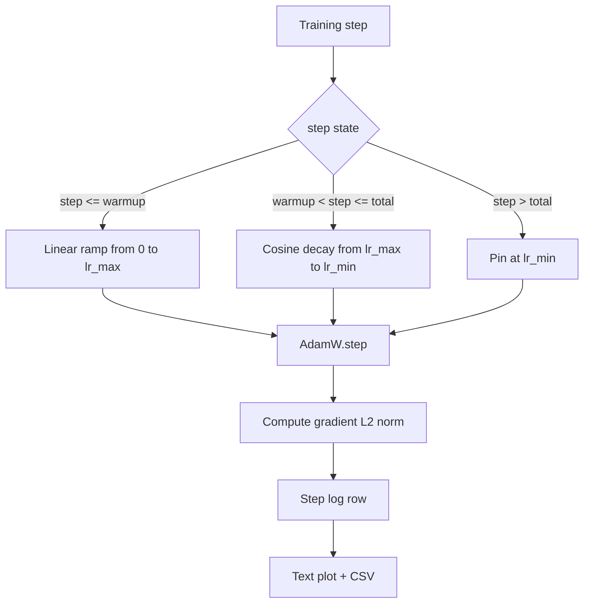

# 带线性 warmup 的 cosine 学习率

> 学习率调度是仅次于损失函数的第二重要决策。带 cosine 衰减与线性 warmup 的 AdamW 是语言模型训练的现代默认做法：它让模型在脆弱的最初一千次更新中看到较小的有效步长，随后爬升到配置的峰值，再平滑地衰减回零附近。本课构建该调度，按训练步绘制曲线，把梯度范数与调度并排记录，并证明调度遵守 warmup、峰值与衰减的边界。

**Type:** Build
**Languages:** Python
**Prerequisites:** 第 19 阶段，第 30 至 37 课
**Time:** ~90 分钟

## Learning Objectives

- 实现一个 AdamW 优化器，接入带线性 warmup 的 cosine 学习率调度。
- 在任意步精确计算调度的取值，且跨多次运行不产生浮点漂移。
- 把梯度 L2 范数与学习率并排记录，使训练健康状况可观测。
- 把调度渲染成肉眼可读的文本图，以及任何工具都能消费的 CSV。

## 问题场景

最初一千次训练更新是噪声最大的阶段。模型权重仍接近初始化值。优化器的运行二阶矩估计尚未稳定。梯度范数又大又噪。如果学习率在这些更新期间处于峰值，模型要么直接发散，要么陷入再也爬不出来的损失平台。两个众所周知的补救措施是梯度裁剪——即第 19 阶段第 45 课的主题——以及一个从小开始、逐步爬升的学习率调度。

带 warmup 的 cosine 调度有三个区间。从第 0 步到第 `warmup_steps` 步，学习率从零线性缩放到配置的峰值 `lr_max`。从第 `warmup_steps` 步到第 `total_steps` 步，学习率沿 cosine 曲线的上半段，从 `lr_max` 衰减到 `lr_min`。超过 `total_steps` 后，学习率被钉在 `lr_min`，这样即使配置错误的 trainer 冲过了头，也不会悄悄脱离调度。

构建层面的问题在于，调度很容易出现差一（off-by-one）。这个差一会在训练进行到第六个小时时表现为：在模型开始过拟合的那一刻，学习率高了或低了 1 个百分点——除非在边界上做穷尽测试，否则这是看不见的。

## 核心概念



### Warmup 公式

对于 `[0, warmup_steps]` 内的 `step` 且 `warmup_steps > 0`，学习率是 `lr_max * step / warmup_steps`。退化的 `warmup_steps = 0` 情况按“无 warmup”处理：调度在第零步直接从 `lr_max` 开始，并立即进入 cosine 衰减。有些测试 harness 会传入 `warmup_steps = 0`，以验证调度仍能产出可用的曲线。

### Cosine 公式

对于 `(warmup_steps, total_steps]` 内的 `step`，学习率是 `lr_min + 0.5 * (lr_max - lr_min) * (1 + cos(pi * progress))`，其中 `progress = (step - warmup_steps) / max(1, total_steps - warmup_steps)`。在 `step = warmup_steps` 处，cosine 求值为 `cos(0) = 1`，得到 `lr_max`，与 warmup 端点精确吻合。在 `step = total_steps` 处，cosine 求值为 `cos(pi) = -1`，得到 `lr_min`，与衰减端点精确吻合。

两个端点处的连续并非偶然。这正是调度被实现为关于 `step` 的单一函数、而非三个不同函数拼接的原因。拼接的调度在第一次改动 `lr_max` 时就会丢掉一个边界。

### 超过 total_steps 之后的下限

对于 `step > total_steps`，学习率保持在 `lr_min`。契约是明确的：调度不报错，也不外推；它钉在下限上，让 trainer 记录一条警告。需要延长训练的 trainer 应修改调度的 `total_steps`，而不是改循环。

### 在学习率之外同时记录梯度范数

调度是训练健康的一半，梯度范数是另一半。训练循环逐步记录两者。发散的训练会在损失尖峰之前先出现梯度范数尖峰；调得好的 warmup 会让范数随学习率线性上升；过于激进的峰值则表现为 warmup 之后范数仍居高不下。磁盘上的数据集是 `step, lr, grad_l2_norm, loss`。CSV 是唯一持久化的记录。

```figure
cap-cosine-warmup
```

## Build It

`code/main.py` 实现了：

- `CosineWithWarmup`：一个无状态函数 `lr(step) -> float`，作用在配置好的调度上。
- `TrainState`：把模型、`AdamW` 优化器与调度封装成单一的 step 函数。
- `TrainState.step`：执行一次前向、一次反向，记录梯度 L2 范数，并把 `lr(step)` 应用到优化器。
- `plot_schedule_ascii`：把调度渲染成肉眼可读的文本图。
- `write_schedule_csv`：每步输出一行，包含学习率。

文件底部的 demo 构建一个很小的 `nn.Linear` 模型，在固定输入批次上训练 20 步，并打印每步的学习率、梯度范数与损失。调度还会渲染成文本图，用于目视检查。

运行它：

```bash
python3 code/main.py
```

脚本以零退出码结束，并打印逐步训练日志以及调度图。

## 生产级模式

有四种模式可以把调度提升为生产级产物。

**调度住在配置里，而不是代码里。** trainer 从提交到 git 的 YAML 或 JSON 配置中读取 `warmup_steps`、`total_steps`、`lr_max`、`lr_min`。调度可复现，因为配置是内容寻址的；调度可审计，因为配置是 PR diff 的一部分。

**步数计数器单调递增，且与 epoch 解耦。** 当数据集被 sharding 或 dataloader 重启时，一些框架会把 step 和 epoch 搞混。调度从 trainer 的 checkpoint 读取 `global_step`，而不是从本地计数器读取。恢复的运行能在正确的调度位置上继续，因为步数计数器是持久化的轴。

**把调度图写进 run 目录。** 每次训练运行都会把 `outputs/lr_schedule.png`（在本课中是文本图）写入其 run 目录。粗略浏览目录的 reviewer 无需重跑任何东西，就能对调度做基本检查。这能在 PR 阶段抓住调度配置错误这一类 bug。

**日志行 schema 是固定的。** `step, lr, grad_l2_norm, loss`，顺序如此。下游 notebook 或 dashboard 会读取该 schema；不改版本号就重命名列，会让所有现存 dashboard 失效。

## Use It

生产中的做法：

- **先扫峰值，再扫其他一切。** `lr_max` 是最敏感的旋钮。先在小模型上扫它；最优 `lr_max` 随模型规模变化很弱，因此小模型的扫描结果是强先验。
- **warmup 是总步数的一个比例，而不是绝对计数。** 一次 2 亿步、warmup 2000 步的运行几乎立刻就从峰值开始；一次 20,000 步、同样 warmup 步数的运行则要 warmup 10%。把 warmup 配置成比例（典型值：1-3%），调度就会随训练时长伸缩。
- **`lr_min` 故意非零。** 位于 `lr_max` 10% 的下限能让优化器在长尾阶段继续学习。`lr_min = 0` 的调度会产生一条在图上看起来很棒、而模型其实并未真正训练完成的训练曲线。

## Ship It

`outputs/skill-cosine-warmup.md` 在真实项目中会说明哪个配置承载调度、全局计数器从 trainer 的哪一步读取、以及哪次 `lr_max` 扫描产出了部署值。本课交付的是引擎。

## Exercises

1. 为调度添加一个反平方根变体，并在 200 步的玩具训练运行上比较。哪条曲线产生更低的最终损失？
2. 添加 `--restart` 参数，在 `total_steps / 2` 处再加一次 warmup。论证在玩具运行中 warm restart 是改善还是损害。
3. 添加一个单元测试，验证调度连续：对 `[0, total_steps]` 中的每个 step，差值 `|lr(step+1) - lr(step)|` 都以 `lr_max / warmup_steps` 为界。
4. 把调度接入 `torch.optim.lr_scheduler.LambdaLR`，使其能与框架代码组合。本课用的是普通 step 函数；这个包装器改变了什么？
5. 添加 `--plot-png` 参数，通过 `matplotlib` 写出真正的图。论证对于 CI 运行，本课的文本图还是 PNG 是更好的默认值。

## Key Terms

| 术语 | 人们常怎么说 | 实际含义 |
|------|-----------------|------------------------|
| Warmup | “慢启动” | 在前 `warmup_steps` 次更新中从零线性爬升到 `lr_max` |
| Cosine decay | “平滑下降” | 在剩余步数中从 `lr_max` 到 `lr_min` 的上半段 cosine 曲线 |
| Floor | “训练之后” | 调度在超过 `total_steps` 后钉住的固定 `lr_min` 值 |
| Gradient norm | “梯度的 L2” | 拼接后梯度向量的欧几里得范数，逐 step 记录 |
| Global step | “调度轴” | 能跨重启存活并驱动调度的单调步数计数器 |

## Further Reading

- [Loshchilov and Hutter, SGDR: Stochastic Gradient Descent with Warm Restarts (arXiv 1608.03983)](https://arxiv.org/abs/1608.03983) —— cosine 调度的参考论文
- [Loshchilov and Hutter, Decoupled Weight Decay Regularization (arXiv 1711.05101)](https://arxiv.org/abs/1711.05101) —— AdamW 的参考论文
- [PyTorch torch.optim.lr_scheduler](https://docs.pytorch.org/docs/stable/optim.html#how-to-adjust-learning-rate) —— step 函数如何与框架调度器组合
- 第 19 阶段，第 42 课 —— 本调度消费其语料的下载器
- 第 19 阶段，第 43 课 —— 与调度共同演进的 data loader
- 第 19 阶段，第 45 课 —— 梯度裁剪与 AMP，循环里的下一层
