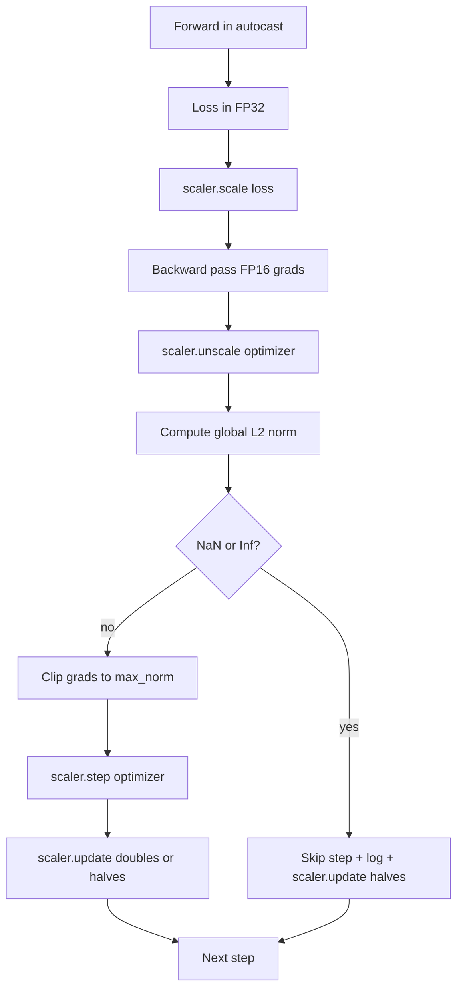

# 梯度裁剪与混合精度

> 上一课的优化器与调度假设梯度是正常的。它们通常并不正常。单个坏批次可以把梯度范数抬高三个数量级。混合精度训练又通过在损失一侧引入 FP16 溢出放大了这一点。本课构建生产训练离不开的两条安全带：把梯度裁剪到配置的全局 L2 范数，以及一个带 autocast 与 GradScaler 的混合精度循环——它检测 NaN 与 Inf，干净地跳过该步，并记录缩放因子用于事后取证。

**Type:** Build
**Languages:** Python
**Prerequisites:** 第 19 阶段，第 30 至 37 课
**Time:** ~90 分钟

## Learning Objectives

- 计算所有参数梯度的全局 L2 范数，并在其超过配置阈值时原地裁剪。
- 把训练步包进 autocast 加 GradScaler，使 FP16 前向与反向能承受溢出。
- 在损失或梯度中检测 NaN 与 Inf，跳过优化器步，并记录这次跳过。
- 每步上报 GradScaler 的缩放因子，使一长串跳过立即可见。

## 问题场景

一次昨天还跑得好好的训练运行，今天在损失曲线上于第 8,217 步垂直上升。罪魁祸首是一个梯度范数为 4,200 的批次——是此前峰值的二十倍。不做裁剪，优化器就会应用一步，把模型在过去一小时学到的东西全部重置。若用范数 1.0 的全局 L2 裁剪，同一批次只贡献一次单位范数的更新；损失保持在趋势线上；运行得以存活。

混合精度训练通过以 FP16 计算前向和大部分反向，把吞吐提升 2-3 倍。代价是 FP16 的指数范围很窄。一个在 FP16 中溢出的典型梯度会求值为 Inf，随后逐层传播为 NaN，并在下一次优化器步把每个权重都设为 NaN。PyTorch 的 GradScaler 的解法是：在反向前把损失乘以一个大的缩放因子，在优化器步前把梯度除以同一因子。如果在 unscale 时任何梯度是 Inf 或 NaN，scaler 就跳过该步并把缩放因子减半；如果此前 N 步都是干净的，scaler 就把因子翻倍。训练过程中，因子会找到 FP16 范围允许的最高值。

构建层面的问题在于把两者正确接线。在 unscale 之前裁剪，阈值作用在缩放后的梯度上；在 unscale 之后裁剪，GradScaler 的操作顺序就很重要。正确顺序是：`scaler.scale(loss).backward()`，然后 `scaler.unscale_(optimizer)`，然后 `clip_grad_norm_`，然后 `scaler.step(optimizer)`，然后 `scaler.update()`。任何其他顺序都会产出静默损坏的循环。

## 核心概念



### 全局 L2 范数

全局 L2 范数是拼接后梯度向量的欧几里得范数，而不是逐参数范数。PyTorch 将其实现为 `torch.nn.utils.clip_grad_norm_(parameters, max_norm)`。该函数返回裁剪前的范数，因此本课可以同时记录自然值与裁剪后的值——这对于“我们每一步都在裁剪”的诊断是必要的。

### autocast 与 GradScaler

`torch.amp.autocast(device_type)` 是上下文管理器，它选择性地以 FP16 运行符合条件的操作（多数 matmul 类操作）。`torch.amp.GradScaler(device_type)` 是一个辅助工具，在反向前缩放损失，并在优化器步前对梯度做反缩放。两者是配套设计的；只用其一而不用其二，是测试应当抓到的配置错误。

本课使用 CPU autocast，因为 CI 里运行的就是它；把 `device_type="cpu"` 改成 `device_type="cuda"`，同一模式就能原样迁移到 CUDA。CPU 上的 GradScaler 是一个存根（CPU autocast 默认已用 BF16 运行，不需要损失缩放），但本课仍然保留了调用点，使接线与 GPU 循环完全一致。

### NaN 与 Inf 检测

检测发生在两处。首先，损失本身在反向前用 `torch.isfinite` 检查；Inf 或 NaN 的损失不会产生有用的梯度，因此直接跳过，不进入优化器。其次，在 `scaler.unscale_(optimizer)` 之后，本课用 `has_non_finite_grad(...)` 扫描未缩放的梯度，并把任何 Inf 或 NaN 视为跳过。两项检查合起来，覆盖了前向与反向两种失败模式。

### 缩放因子诊断

缩放因子是 GradScaler 的内部状态。每一步本课都读取 `scaler.get_scale()`，并把它与学习率、梯度范数并排记录。健康的运行会显示缩放因子以 2 的幂次攀升，直到在 `2^17` 或 `2^18` 附近饱和。表现异常的运行会显示因子在高值与低值之间振荡，这是模型梯度有时在范围内、有时不在范围内的信号。不做记录，这个诊断就是隐形的。

```figure
grad-clip-monitor
```

## Build It

`code/main.py` 实现了：

- `clip_global_l2_norm`：对 `torch.nn.utils.clip_grad_norm_` 的包装，同时返回裁剪前与裁剪后的范数。
- `has_non_finite_grad`：扫描梯度中 NaN 与 Inf 的辅助函数。
- `AmpTrainState`：封装模型、`AdamW` 优化器、GradScaler 与 autocast device。暴露 `step(inputs, targets)`，执行完整的裁剪、缩放与遇 NaN 跳过流程。
- `StepLog` 与 `SkipLog`：结构化的逐步记录。
- 一个 demo：训练一个很小的 `nn.Linear` 模型 20 步，在第 5 步向梯度注入 Inf 以演练跳过路径，并打印结果日志。

运行它：

```bash
python3 code/main.py
```

脚本以零退出码结束，并打印逐步日志，每行标记为 `STEP` 或 `SKIP`；至少有一行是 `SKIP`。

## 生产级模式

有四种模式可以把该循环提升为生产级训练步。

**把跳过计数器当作告警，而不是日志行。** 每次训练运行中有少量跳过的步是健康的。每个 epoch 数百次跳过则是硬告警：模型处于 FP16 无法承载的区间，循环正在静默失败。本课跟踪 1,000 步的滚动跳过率，在生产中会对超过 5% 的比率值班呼叫。

**裁剪阈值住在配置里。** 对语言模型训练而言，`max_norm = 1.0` 是现代默认值。先在小模型上扫它；较大的阈值让模型能从真正困难的批次中恢复；较小的阈值约束最坏情况，代价是更嘈杂的损失曲线。该阈值应与第 44 课的调度一起放在同一份 YAML 或 JSON 配置中。

**范数日志与调度一起进 CSV。** CSV 的列是 `step, lr, grad_l2_pre_clip, grad_l2_post_clip, loss, skipped, skip_reason, scaler_scale`。打开文件的 reviewer 能在同一行看到调度、梯度状况、缩放因子以及跳过结果（含原因）。把列拆到不同文件是分析错位的配方。

**`scaler.update()` 每步都运行，即使在跳过时。** 在干净的步上，scaler 读取其 no-inf 计数器，递增它，并可能把因子翻倍。在跳过的步上，scaler 把因子减半并重置计数器。在跳过路径上忘记 `update()`，正是产生“缩放因子从未变化”的 bug。

## Use It

生产中的做法：

- **autocast 的 device 与优化器的 device 一致。** GPU 训练用 `torch.amp.autocast(device_type="cuda")`；CPU 用 `torch.amp.autocast(device_type="cpu")`。混用 device 会产生静默的类型错误，其表现是损失曲线看起来正常、但模型没有在学习。
- **反向前检查损失。** `torch.isfinite(loss).all()` 是一次张量归约；代价可忽略，而在 NaN 损失上省下的是整整一个训练步。永远要跑它。
- **`zero_grad` 中的 `set_to_none=True`。** 把梯度设为 `None` 而不是零，让优化器可以跳过不受影响的参数组的计算。该设置是免费的吞吐提升，也略微缩小了 bug 面。

## Ship It

`outputs/skill-clip-amp.md` 在真实项目中会说明训练步使用哪个裁剪阈值与 autocast device、逐步 CSV 在版本控制中的位置、以及生产中的跳过率告警阈值是多少。本课交付的是引擎。

## Exercises

1. 把合成的 Inf 注入换成真实的损失尖峰（把某个批次的目标乘以 1e8），验证跳过路径会触发。
2. 添加 `--bf16` 模式，把 autocast 切换到 BF16 而不是 FP16。BF16 的指数范围比 FP16 更宽，很少需要损失缩放；验证在同一个 demo 上跳过率降到零。
3. 添加一个单元测试，验证梯度裁剪包装器在不发生裁剪时正确返回裁剪前与裁剪后的范数。
4. 添加滚动窗口跳过率计算，以及一个 CLI 参数：当比率连续 100 步超过配置阈值时让运行失败。
5. 把循环接上写出规范 CSV（`step, lr, grad_l2_pre_clip, grad_l2_post_clip, loss, skipped, skip_reason, scaler_scale`），并通过每行之后 flush 来确认文件能挺过 Ctrl-C。

## Key Terms

| 术语 | 人们常怎么说 | 实际含义 |
|------|-----------------|------------------------|
| Global L2 norm | “裁剪目标” | 所有可训练参数上拼接后梯度向量的欧几里得范数 |
| autocast | “混合精度” | 在 `with` 块内选择性地以 FP16（或 BF16）执行符合条件的操作 |
| GradScaler | “损失缩放器” | 在反向前把损失乘以因子、在优化器步前对梯度做反缩放的辅助工具 |
| Skip | “坏步” | 因为梯度或损失非有限而被拒绝的优化器步；scaler 会把因子减半 |
| Scaling factor | “scaler 状态” | GradScaler 当前的乘数；干净的一段之后翻倍，每次跳过时减半 |

## Further Reading

- [Micikevicius et al., Mixed Precision Training (arXiv 1710.03740)](https://arxiv.org/abs/1710.03740) —— 最初的损失缩放方案
- [Pascanu, Mikolov, Bengio, On the difficulty of training recurrent neural networks (arXiv 1211.5063)](https://arxiv.org/abs/1211.5063) —— 梯度裁剪的参考论文
- [PyTorch torch.amp.GradScaler](https://docs.pytorch.org/docs/stable/amp.html) —— 本课所包装的 scaler API
- [PyTorch torch.nn.utils.clip_grad_norm_](https://docs.pytorch.org/docs/stable/generated/torch.nn.utils.clip_grad_norm_.html) —— 本课使用的裁剪原语
- 第 19 阶段，第 42 课 —— 为循环供给语料的下载器
- 第 19 阶段，第 43 课 —— 循环所消费的 data loader
- 第 19 阶段，第 44 课 —— 本循环与之组合的调度
