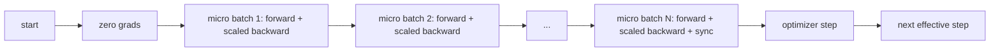
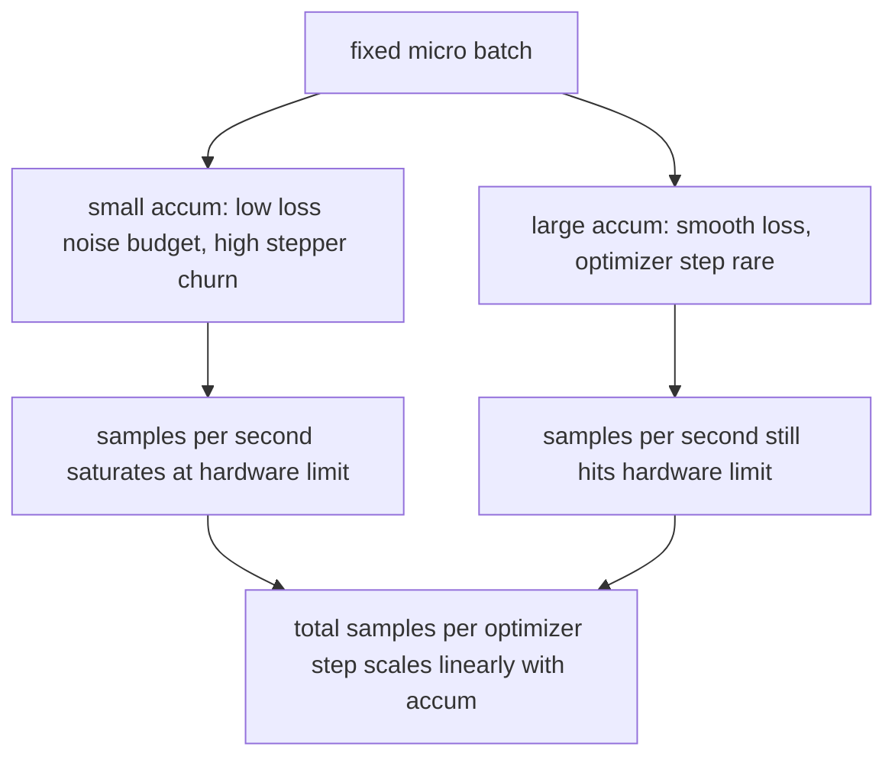

# 梯度累加（Gradient Accumulation）

> 一次一个 micro-batch，训练出你负担不起的 effective batch。缩放损失、暂缓 optimizer step，让梯度不断累积。

**Type:** Build
**Languages:** Python
**Prerequisites:** 第 19 阶段，第 42 至 45 课
**Time:** ~90 分钟

## Learning Objectives

- 推导 effective batch 的恒等式：`effective_batch = micro_batch * accum_steps`。
- 实现逐 micro-batch 的损失缩放，使累加得到的梯度与一次性 full-batch backward 一致。
- 在最后一个 micro-batch 之前跳过 optimizer 同步（sync-on-last-step）。
- 读懂吞吐量对 effective batch 的曲线，并解释收益为何递减。

## 问题场景

你希望以 effective batch 512 进行训练，因为在这种规模下损失曲线更平滑、optimizer step 也更有意义。可桌上的加速器只能装下 32 个样本就会耗尽内存。把 batch 翻倍不是选项，把模型减半也不是选项。这个领域在 2017 年想到、此后从未停止使用的技巧是：跑 16 次 backward，让梯度累积在参数缓冲区里，只有计数达到目标时才 step 一次 optimizer。

风险在于，损失不再是更大 batch 下的那个数值。16 个 mini-batch 的交叉熵若朴素相加，会是一次 full batch 损失的 16 倍。不做缩放，梯度方向是对的但幅度错了，optimizer step 会大 16 倍。修复只需一次除法。而这次除法也很容易忘记。

## 核心概念



约定很简短：

- 每个 micro-batch 的损失在 `backward()` 之前除以 `accum_steps`。PyTorch 默认把梯度累加进 `param.grad`；这次除法把不断累加的和拉回正确的尺度。
- optimizer step 每个 effective batch 触发一次，在最后一个 micro-batch 的 backward 之后。在累加中途 step 会扰乱后续整个训练所依赖的每一个参数。
- optimizer 的状态（momentum 缓冲区、Adam moments）每个 effective step 前进一步，而不是每个 micro-batch。否则指数滑动平均会看到错误的频率，白白烧掉调度。
- 在单设备上这只是一些记账。在多 rank 集群上，同一模式用 `no_sync` 上下文包住非最后的 micro-batch，从而跳过梯度 all-reduce；最后一个 micro-batch 一次性归约完整的累加梯度，而不是付出 N 次网络代价。

### 代码中的等价性证明

```python
loss = criterion(model(x_full), y_full)
loss.backward()
opt.step()
```

等价于

```python
for x, y in chunks(x_full, y_full, n):
    scaled = criterion(model(x), y) / n
    scaled.backward()
opt.step()
```

只差浮点求和顺序。循环结束时累积的梯度缓冲区，与一次性 full-batch backward 产生的张量相同。课程代码在 `equivalence_check` 中用小于 1e-4 的最大绝对差断言了这一点。

### 代价花在哪里

每个 micro-batch 花一次 forward 和一次 backward。用累加，你是用时间换内存。`outputs/accum-curve.json` 中的吞吐曲线展示了在固定 micro-batch 下、随着 effective batch 增大发生的事情：



没有免费的午餐。`accum_steps` 翻倍，每个 optimizer step 的墙钟时间也翻倍。改变的是梯度估计的方差：在同样的墙钟预算下，你的 optimizer step 更少，但每一步都平均了更多样本。文献把大 batch 和小 batch 当作不同的优化问题；本课是机械层面的，不是统计层面的。

```figure
cc-grad-accumulation
```

## Build It

`code/main.py` 是可运行的产物。它做三件事。

### 第 1 步：等价性检查

`equivalence_check()` 用相同 seed 构建两份相同的网络。一份在一次 forward 中看到 16 个样本的 batch。另一份看到四个 4 样本的 chunk，损失除以四。函数在 optimizer step 之前比较梯度缓冲区、在之后比较参数。断言是 `max_abs_diff < 1e-4`。

### 第 2 步：sync-on-last-step 模式

`train_one_optimizer_step` 逐个遍历 micro-batch。对除最后一个之外的每个 micro-batch，它进入 `no_sync_context(model)`。在单进程上这个上下文是空操作；在 DDP 上这里正是跳过梯度 all-reduce 的地方。无论哪种情况，记账方式都一样。一个 `sync_counter` 记录我们离开 no_sync 作用域的次数；N 个 micro-batch 的情况下，每个 effective step 计数为一，而不是 N。

### 第 3 步：吞吐曲线

`sweep_effective_batches` 用固定的 micro-batch 和一列累加步数运行同一个模型。对每种设置它记录：

- `samples_per_sec`：看到的总样本数除以墙钟时间
- `median_step_ms`：每个 effective step 的第 50 百分位
- `sync_calls`：触发的集合通信点数量
- `avg_loss`：整轮扫描中各 optimizer step 的平均值

输出落在 `outputs/accum-curve.json`，可被 notebook 复用。

运行：

```bash
python3 code/main.py
```

脚本打印等价性差值，然后是扫描表，最后是 JSON 路径。退出码为零。

## Use It

在生产训练中，gradient accumulation 藏在一个旋钮后面。PyTorch 的模式是 `accumulation_steps = effective_batch // (micro_batch * world_size)`。这里不允许你使用的框架包装了同一个循环，但步骤是相同的：缩放损失、在非最后的 micro 上跳过同步、累加、step 一次。

实际中的三种模式：

- micro-batch 的大小选到刚好塞满设备内存。更小会浪费加速器周期。更大则会崩溃。
- effective batch 由学习率调度决定。大的 effective batch 需要缩放学习率和 warmup；这就是自 2017 年以来一直被讨论的线性缩放规则。
- 累加次数是两者之间的桥梁，也是唯一可以在运行时自由调节、而无需重写 data loader 的旋钮。

## Ship It

`outputs/skill-gradient-accumulation.md` 把配方记下来，让同事可以直接放进新仓库：按 `accum_steps` 缩放损失，在非最后的 micro 上跳过 optimizer 同步，每个 effective batch 只 step 一次 optimizer，把吞吐量对 effective batch 记成 JSON，让这种权衡可见。

## Exercises

1. 用 `--num-steps 100` 重新跑扫描，并把每秒样本数对 effective batch 作图。曲线在哪里变平？
2. 加一个缩放错误的变体（不做除法），展示第 1 步时与参考相比的参数差异。
3. 把 SGD 换成 AdamW，确认 optimizer 状态每个 effective step 前进一步，而不是每个 micro-batch。
4. 引入真正的 `DistributedDataParallel` 包装器，并把 `no_sync_context` 指向它的方法。确认每个 effective batch 的 sync_calls 下降 N-1。
5. 修改等价性检查，比较两种不同的 micro 切分（2 个 8 vs 4 个 4），并解释你需要放宽多少容差。

## Key Terms

| 术语 | 人们常怎么说 | 实际含义 |
|------|-----------------|------------------------|
| Micro batch | “前向的那一批” | 单次 forward pass 中能装进内存的那一片数据 |
| Accum steps | “每步的 backward 次数” | 在一次 optimizer step 之前累加的 backward 次数 |
| Effective batch | “那个 batch” | micro batch 乘以 accum steps，再乘以数据并行的 world size |
| Loss scaling | “除以 N” | 逐 micro-batch 的除法，使累加梯度匹配 full batch |
| Sync on last | “其余的跳过” | 只在该窗口最后一次 backward 上执行梯度集合通信 |

## Further Reading

- PyTorch 关于 `DistributedDataParallel.no_sync` 的文档 —— sync-on-last-step 技巧的生产版本。
- Goyal 等，2017 —— 大 batch 训练的线性缩放，关心 effective batch 的经典理由。
- PyTorch issue tracker 上关于 gradient accumulation 与 mixed precision unscaling 交互的问题。
- 第 19 阶段，第 42 至 45 课 —— 覆盖本课所假设的模型、data loader、optimizer 和 trainer 脚手架。
- 第 19 阶段，第 47 课 —— 覆盖 checkpoint 与恢复，让长时间的累加训练能挺过墙钟上限。
