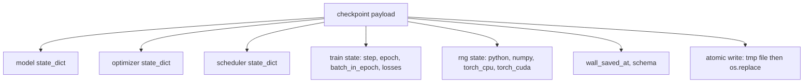
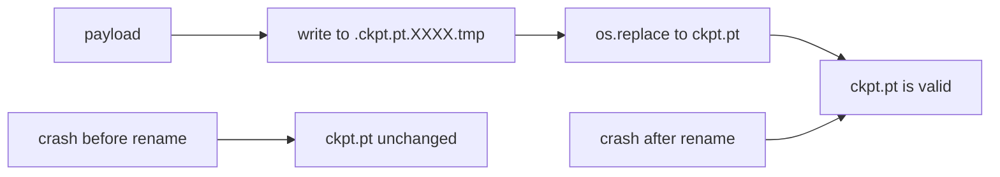
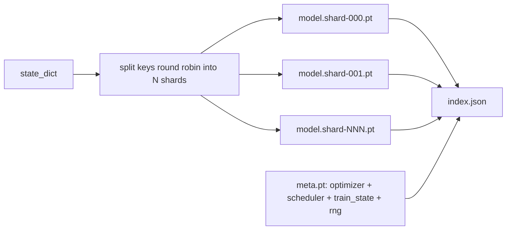

# Checkpoint 的保存与恢复

> 训练中断会杀死整个 run；checkpoint 让它得以继续。把模型、optimizer、scheduler、损失历史、step 计数器和 RNG 状态原子地保存下来，这样任意时刻被杀，磁盘上都留着一个有效的文件。

**Type:** Build
**Languages:** Python
**Prerequisites:** 第 19 阶段，第 42 至 45 课
**Time:** ~90 分钟

## Learning Objectives

- 把完整的训练状态捕获进一个可重新加载到全新进程的 payload。
- 实现原子保存：先写临时文件再 rename，使崩溃永远不会留下写了一半的文件。
- 恢复 Python、NumPy 与 PyTorch 的 RNG 状态，使恢复后的损失与不中断的基线一致。
- 为再也装不进单个文件的模型构建分片 checkpoint 布局，分片带哈希校验并配一个 JSON 索引。

## 问题场景

你设了一个 18 小时的训练任务。墙钟上限是 4 小时。集群在第 11 小时重启，因为某个级别比你高的人批准了一次内核升级。没有 checkpoint，你只能从头开始。没有 resume，你还会丢掉前 11 小时才学到的 optimizer 状态，所以即使模型权重幸存下来，AdamW moments 也没了，下一步会朝着训练轨迹早已走过的方向猛冲。

正确的产物是一个文件，装下继续训练所需的一切：模型参数、optimizer 状态、scheduler 状态、用于绘图的损失历史、当前的 step 和 epoch 以及 batch-in-epoch 计数器，还有每一个随机源的 RNG 状态。没有 RNG 状态，恢复后的损失曲线就是另一条曲线。同样的模型、同样的数据，却有不同的 shuffle、不同的 dropout mask、仪表盘上不同的数字。

原子保存是契约的另一半。直接写入最终文件名意味着写到一半崩溃会留下损坏的文件；resume 读到的是垃圾。写入同目录下的临时文件再 rename，则意味着写到一半崩溃时上一个好文件原封不动。在 POSIX 文件系统上 rename 是原子的。

## 核心概念



### 五个状态桶

| 桶 | 为什么重要 |
|--------|----------------|
| Model | 权重和缓冲区；模型本身是什么。 |
| Optimizer | momentum 与自适应矩；没有它们，下一步就成了另一个优化问题。 |
| Scheduler | 学习率在其曲线上的位置；cosine 调度尤其在意这一点。 |
| Train counters | step、epoch、batch-in-epoch，以及绘制仪表盘的损失历史。 |
| RNG state | dropout、数据打乱以及模型内部任何采样的确定性。 |

### 原子写入



两条规则。第一，临时文件与目标位于同一目录，这样 rename 才留在同一个文件系统内；跨设备 rename 不是原子的。第二，临时文件名每次尝试都唯一，这样两个写入者不会互相覆盖。

### 分片 checkpoint

当模型变大，单文件 payload 会大到加载不快、大到难以检查，而且当网络共享在读取中途卡顿时会格外痛苦。修复办法是把参数状态切成分片，并写一个小索引把它们串起来。



索引记录分片数量、每个分片的 sha256，以及 meta 文件的 sha256。任何哈希不匹配时，loader 都会大声失败。分片可以落在不同的物理磁盘上；meta 很小，会先被读取。

### 恢复在中途 epoch 继续

恢复到下一个 epoch 起点的 resume 会浪费从几分钟到一天不等的时间。修复办法是 `(epoch, batch_in_epoch)` 加上 RNG 状态。加载之后，训练循环把随机数生成器快进过当前 epoch 中已经消费的 batch，并从 `batch_in_epoch` 继续。课程代码正是这样做的；断言是恢复后的损失轨迹与不中断的基线在 1e-4 以内一致。

```figure
cc-atomic-checkpoint
```

## Build It

`code/main.py` 提供四个基础函数和一个 demo driver。

### 第 1 步：捕获与恢复 RNG 状态

`capture_rng_state` 返回一个 dict，包含 Python 的 `random.getstate`、NumPy 的 `np.random.get_state`，以及 PyTorch CPU 和 CUDA RNG 的字节。每一部分都以普通 Python 数字、元组和列表存储（NumPy 的 key 数组经过 `tolist()`），这样第 3 步的 loader 无需反序列化任意对象就能读回。`restore_rng_state` 做反向操作。CPU 张量是一个 uint8 字节缓冲区，PyTorch 的 RNG 知道如何使用它。

### 第 2 步：原子保存

`atomic_save` 把 payload 写到目标目录中的临时文件，然后由 `os.replace` 换到最终文件名。`atomic_write_json` 对分片索引做同样的事。

### 第 3 步：完整的 checkpoint 往返

`save_checkpoint` 把 model、optimizer、scheduler、train state 和 RNG 打包进一个 dict。`load_checkpoint` 做反向操作并返回一个 `TrainState`。schema 字段是升级钩子：未来的格式变化会提升版本字符串，由 loader 分发。

`load_checkpoint` 调用 `torch.load(..., weights_only=True)`。`.pt` 文件是一个 pickle，而用 `weights_only=False` 反序列化不可信文件会执行该文件指定的任意代码。weights-only loader 接受张量和基本容器，拒绝其他一切，这正是第 1 步把 RNG 状态保持为普通列表的原因。完整性检查抛出 `ValueError` 而不是使用 `assert`，因为 `python -O` 会剥离 assert。请使用 torch 2.6 或更新版本：在该版本之前 `weights_only=True` 存在已知绕过（CVE-2025-32434），因此本课依赖的保证只在 2.6 及以后成立。

### 第 4 步：分片变体

`save_sharded_checkpoint` 把参数键轮转分配到 N 个分片，用各自的原子保存写出每个分片，写一个包含 optimizer、scheduler 和 train state 的 meta 文件，并写出带各分片 sha256 的 JSON 索引。`load_sharded_checkpoint` 在合并之前校验每个分片，并拒绝任何解析到 checkpoint 目录之外的分片路径。

### 第 5 步：恢复 demo

`run_resume_demo` 训练一个小模型 `total_steps` 步，在 `interrupt_at` 处保存 checkpoint，然后继续。第二个进程恢复该 checkpoint 并跑完剩余步骤。函数返回中断点之后两条损失轨迹之间的最大绝对差。RNG 恢复后，差值为零或浮点噪声。

运行：

```bash
python3 code/main.py
```

单文件与分片两种 demo 都断言 max-diff 小于 1e-4。摘要落在 `outputs/resume-demo.json`。

## Use It

生产训练栈把 checkpointing 作为 trainer 的一部分交付。形态是一样的：model + optimizer + scheduler + counters + RNG，原子地写出，按 step 命名以便轻松找到最新的那个。分片布局以并行读取支撑大模型加载；`index.json` 正是让这一切成立的东西。

要落实的四种模式：

- **用 `weights_only=True` 加载。** 从共享盘或下载得到的 checkpoint 是不可信输入。weights-only loader 能阻止恶意文件在恢复的机器上执行代码。
- **schema 是 payload 中的一个字符串。** 迁移逻辑依据它分支。没有它，你就无法在不破坏旧 run 的情况下演进格式。
- **为每个分片记录 sha256。** 静默截断的下载是最糟糕的一类 bug；loader 要么快速失败，要么很晚才失败。
- **让 checkpoint 的节奏诚实。** 每 N 步以及每个墙钟分钟都保存，取更短的那个。否则崩溃时那个很长的 step 会浪费掉整整一个窗口的工作。

## Ship It

`outputs/skill-checkpoint-save-resume.md` 是任何新训练脚本的配方：payload 形态、原子写入、RNG 捕获、分片索引。把这个 skill 放进仓库，在周期性保存点接上 `save_checkpoint`，在启动时接上 `load_checkpoint`，run 就能挺过被杀的命运。

## Exercises

1. 把轮转分片改成按参数组分片（以 `.weight` 结尾的层 vs `.bias`）。每种布局在什么时候更可取？
2. 扩展保存循环，保留最近 K 个 checkpoint 并修剪更旧的。磁盘很小时，合适的 K 是多少？
3. 添加 `--ckpt-every-seconds` 标志，按墙钟间隔触发保存，而不只是按 step 计数。
4. 增加一条校验和验证路径，在启动时运行，扫描目录中的每个 checkpoint，并报告哪些已损坏。
5. 实现一个 `migrate_v1_to_v2` 函数，向 payload 添加一个新字段并提升 schema 字符串。让 load 同时兼容两个版本。

## Key Terms

| 术语 | 人们常怎么说 | 实际含义 |
|------|-----------------|------------------------|
| Atomic save | “写就完事了” | 先写到同目录下的临时文件，再用 os.replace 换到目标文件名 |
| State dict | “那些权重” | 以参数名为键的模型参数和缓冲区 |
| Sharded checkpoint | “大模型文件” | 多个文件，每个分片一个，外加一个 meta 文件和一个带 sha256 的 JSON 索引 |
| RNG state | “随机种子” | 捕获的 python random、numpy、torch CPU、torch CUDA 状态；不只是种子 |
| Mid-epoch resume | “重启” | 快进 RNG，并从同一 epoch 的下一个 batch 继续 |

## Further Reading

- POSIX `rename` 语义 —— `os.replace` 所依赖的原子性主张的基础。
- PyTorch 关于 `torch.save` 和 `torch.load` 的文档 —— 包括跨设备恢复用的 `map_location`，以及加载不可信文件用的 `weights_only`。
- 第 19 阶段，第 46 课 —— 覆盖本课 checkpoint payload 所跨过的 gradient accumulation。
- 第 19 阶段，第 48 课 —— 覆盖本方案所适配其 state dict 格式的分布式包装器。
- Linux 内核 `fsync` 文档 —— 原子 rename 背后持久性保证的依据。
