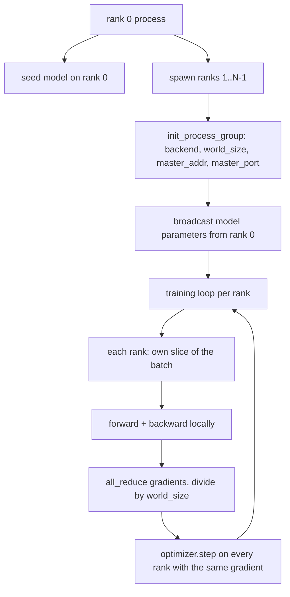
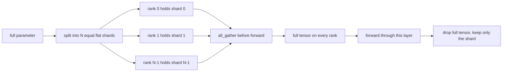

# 从零实现 Distributed Data Parallel 与 FSDP

> 多 rank 训练就是两个集合通信加一条规则。启动时广播参数，backward 之后平均梯度，绝不让各 rank 对当前进行到哪一步产生分歧。

**Type:** Build
**Languages:** Python
**Prerequisites:** 第 19 阶段，第 42 至 45 课
**Time:** ~90 分钟

## Learning Objectives

- 用 `gloo` 后端跨 N 个 rank 拉起一个 process group，无需特殊硬件。
- 实现一个最小的 DDP 包装器：构造时广播参数，backward 之后 all-reduce 梯度。
- 证明各 rank 梯度的 all-reduce 与单进程在拼接输入上的梯度一致。
- 勾画 FSDP 参数分片：每个 rank 持有一个切片，forward pass 时把完整张量 gather 出来，之后丢弃。

## 问题场景

模型能装进一块设备。数据集不行。优化预算要求你每秒看到 N 倍的样本。第一个杠杆是数据并行：每个 rank 在 batch 的不同切片上运行同一个模型，然后在 optimizer step 之前平均梯度。第二个杠杆是 FSDP：模型也装不进一块设备，于是每个 rank 持有每个参数的一部分，并在 forward pass 中逐层重建完整张量。

痛苦在于记账。如果参数在各 rank 之间漂移，run 会被静默地污染。如果你平均了梯度却没有平均损失，仪表盘会说谎。如果集合通信后端无法就拓扑达成一致，run 会永远挂起。修复办法是亲手把集合通信写一次，并且永远不要信任你无法复现的包装器。

本课在 CPU 上运行。不假设有 CUDA。`gloo` 后端随每个 PyTorch 构建一起发布，并接受 `torch.multiprocessing` worker；同一份代码在多 GPU 节点上切换到 `nccl`，结构无需改变。

## 核心概念



### 两个关键的集合通信

| 集合通信 | 做什么 | 何时使用 |
|------------|--------------|------|
| `broadcast` | 把一个张量从一个 rank 复制到所有其他 rank | 参数初始化、scheduler 状态、任何一对多的同步 |
| `all_reduce` | 跨所有 rank 对一个张量求和（或求平均、求最大值），每个 rank 都得到结果 | backward 之后的梯度平均 |
| `all_gather` | 每个 rank 贡献一个张量，每个 rank 得到拼接结果 | logits 收集、FSDP 参数 unshard |

DDP 的契约是构造时 `broadcast`、backward 之后 `all_reduce`。FSDP 草图则在每一层 forward pass 之前增加 `all_gather`。

### 梯度平均与单进程梯度一致

在 N 个 rank 上、用 B 个样本的 batch 训练的模型，必须产生与单进程用 N*B 的 batch 训练相同的梯度。诀窍在于：把各 rank 梯度求和再除以 N，得到的是平均损失梯度，这正是带 mean reduction 的交叉熵在完整 batch 上会产生的结果。课程代码用 `max-abs-diff < 1e-3` 断言手动 all-reduce 梯度与参考的单进程梯度一致。

### FSDP 草图



内存收益是精确的：每个 rank 的参数内存降到 1/N。代价是 gather，每次 forward pass 都要付。生产级 FSDP 把 gather 与上一层的计算重叠，因此墙钟代价远小于朴素记账所预测的。本课对每个参数做一次往返，并断言重建结果与原始张量逐位相等。

### CPU 与 gloo 后端

CUDA 是生产目标，但同样的代码路径在 CPU 上也存在。`gloo` 是 CPU 的集合通信后端。在 GPU 上它比 `nccl` 慢几个数量级，但 API 表面完全相同。本课的 process group 用 `backend="gloo"` 初始化，rank 用 `torch.multiprocessing` 而非 `torchrun` 拉起；两者最终都落到相同的 `torch.distributed` 调用。在多 GPU 节点上，唯一的改动是 `backend="nccl"`、设备张量，以及用 `torchrun` 启动。

```figure
cg-allreduce-ring
```

## Build It

`code/main.py` 是可运行的产物。

### 第 1 步：拉起进程组

```python
os.environ["MASTER_ADDR"] = "127.0.0.1"
os.environ["MASTER_PORT"] = str(port)
dist.init_process_group(backend="gloo", rank=rank, world_size=world_size)
```

`MASTER_ADDR` 和 `MASTER_PORT` 是汇合点：每个 rank 拨同一个主机上的同一个端口。本课用 bind-and-close 的技巧挑一个空闲端口，避免多个 run 共享一台机器时发生冲突。

### 第 2 步：构造时广播

`MinimalDDP.__init__` 遍历每个参数和缓冲区，调用 `dist.broadcast(tensor, src=0)`。rank 0 的值成为规范初始化。没有这一步，每个 rank 用自己的 seed 初始化，各 rank 从第一步就开始分叉。

### 第 3 步：backward 之后 all-reduce 梯度

```python
def all_reduce_grads_(module, world_size):
    for p in module.parameters():
        if p.grad is None:
            p.grad = torch.zeros_like(p.data)
        dist.all_reduce(p.grad.data, op=dist.ReduceOp.SUM)
        p.grad.data.div_(world_size)
```

每个 rank 最终得到相同的平均梯度。optimizer step 现在是每个 rank 上相同输入的函数，这就是参数在整个 run 中保持同步的原因。

### 第 4 步：证明等价性

`manual_all_reduce_matches_single_process` 在 rank 0 上构建同一个模型，把 all-reduce 之后的梯度与单进程在拼接输入上计算出的梯度相比较。max-abs-diff 约为 1e-8。

### 第 5 步：FSDP 往返

`fsdp_round_trip_sketch` 把每个参数展平，填充到 `world_size` 的倍数，切片、all-gather，再去掉填充。每个 rank 的重建结果都等于原始值。这就是 unshard 步骤；它的逆操作（forward 之后重新分片）就是从 gather 到的张量上切一片。

运行：

```bash
python3 code/main.py
```

默认 world size 是 2。两个 CPU 进程被拉起，通过 `gloo` 互相通信，并以零退出。输出 `outputs/ddp-demo.json` 记录每个 rank 的参数和、all-reduce 之后的梯度范数、FSDP 往返结果，以及手动梯度与参考梯度的差值。

## Use It

生产训练栈调用同样的基础函数。PyTorch 的 `DistributedDataParallel` 增加了：backward 之后的梯度钩子，把 all-reduce 与 backward 重叠；分桶 all-reduce，把若干小梯度合并成一次集合通信；以及第 46 课用过的 `no_sync` 上下文。

PyTorch 的 FSDP 增加了：每层一个扁平参数视图，使每个 rank 持有一个连续缓冲区；下一层 unshard 与当前层计算的重叠；以及可选的 CPU offload 用于分片。

形态保持不变：启动时广播，backward 之后归约，参数装不下时就分片。

## Ship It

`outputs/skill-distributed-fsdp-ddp.md` 承载新训练脚本的配方：CPU 用 `gloo`、GPU 用 `nccl` 拉起 process group，用 DDP 外壳包裹模型，使其在构造时广播、在 backward 之后归约，并可选地用 FSDP 草图中的 all_gather 模式对参数分片。

## Exercises

1. 用 `--world-size 4` 运行，确认整个 run 中参数离散度保持在 1e-3 以下。
2. 用 `dist.all_reduce(op=dist.ReduceOp.AVG)` 替换手动平均，并给两者的差异计时。
3. 给 DDP 包装器加一个 post-backward 钩子，使 all-reduce 与 backward 的其余部分重叠；测量墙钟时间的改善。
4. 实现 FSDP 的重新分片步骤：forward pass 之后，再次用本地分片替换完整张量。确认每 rank 内存下降。
5. 在 CUDA 机器上把后端切换到 `nccl`。记下哪些环境变量改变、哪些保持不变。

## Key Terms

| 术语 | 人们常怎么说 | 实际含义 |
|------|-----------------|------------------------|
| Backend | “gloo 或 nccl” | 实现集合通信操作的库；gloo 用于 CPU，nccl 用于 GPU |
| World size | “总 rank 数” | 组内进程数量；组是集合通信操作的单元 |
| Rank | “worker id” | 组内的进程标识符，从零开始 |
| All-reduce | “把梯度加起来” | 跨所有 rank 对一个张量求和，每个 rank 最终得到相同结果 |
| Unshard | “把参数 gather 起来” | 通过 all_gather 从各 rank 的切片重建完整张量 |

## Further Reading

- PyTorch `torch.distributed` 文档 —— 本课所依赖的集合通信语义。
- `gloo` 库的集合通信列表 —— 形态与 CUDA 后端的 `nccl` 原语完全相同。
- 第 19 阶段，第 46 课 —— 覆盖 gradient accumulation 模式，它在 `no_sync` 中包裹 DDP 的 all-reduce。
- 第 19 阶段，第 47 课 —— 覆盖能在 DDP 和 FSDP run 中存活的 checkpoint 布局。
- PyTorch FSDP 文档 —— 本课草图的参数分片的生产实现。
