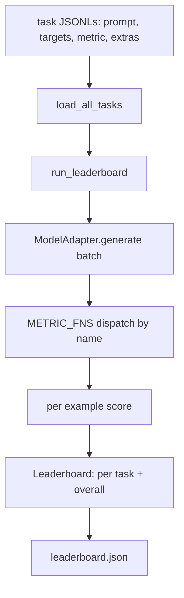
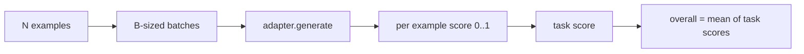

# 语言模型 eval harness

> 在一个你无法定义的任务上表现好的模型，是一个碰巧表现好的模型。harness 就是任务定义、指标、runner 和 leaderboard，全部收在一个简短、可替换的形态里。

**Type:** Build
**Languages:** Python
**Prerequisites:** 第 19 阶段，第 42 至 45 课
**Time:** ~90 分钟

## Learning Objectives

- 把任务定义为一个 JSONL 文件，每个样本含 `prompt`、`targets`、`metric`，以及可选的 `extras`。
- 实现五个指标：exact match、rouge-l F1、executable check、multiple choice 和 substring contains。
- 构建一个 runner，按任务对样本分批，并分派到可替换的模型 adapter。
- 输出一个 leaderboard JSON，包含各任务分数、延迟，以及可复现的总体平均分。

## 问题场景

每周都有新的语言模型发布。营销宣称是它表现很好。诚实的问题是：好在什么上？诚实的答案是：用你自己写的那个 leaderboard，因为厂商的 leaderboard 正是他们调优过的那个。

仓库里没有 harness，你就只能凭感觉比较两个模型。有了 harness，你就可以在固定任务集上用固定指标按分数比较它们，比较的是一份可以 diff 的 JSON 输出。harness 是昨天那次 run 与今天这次 run 之间的契约。没有它，回归就会发布出去。

陷阱是让 harness 过拟合到单个模型。修复办法是把这个陷阱反过来：harness 小到十五分钟能读完，任务小到能随仓库一起发布，指标从零写起以便同事审计，而 adapter 是唯一存放模型相关代码的地方。换 adapter，leaderboard 会变；换任务，leaderboard 会变。其他任何东西都不该变。

## 核心概念



### 任务规格

每个样本是一行 JSONL：

```json
{"id": "arith-00", "prompt": "compute: 2 + 2", "targets": ["4"], "metric": "exact_match"}
```

对于需要评分辅助数据的指标，`extras` 承载附带 payload：

```json
{
  "id": "code-00",
  "prompt": "python: write a function f that doubles its input",
  "targets": ["ok"],
  "metric": "code_exec",
  "extras": {"io_pairs": [[1, 2], [3, 6]]}
}
```

一个任务就是 `outputs/tasks/` 下的一个 `.jsonl` 文件。文件名就是任务名。一个文件里的所有样本共享同一个指标。

### 五个 fixture 任务

| 任务 | 指标 | 检验什么 |
|------|--------|---------------|
| arithmetic | exact_match | 确定性答案上的 token 级正确性 |
| summary | rouge_l | 相对一行参考摘要的最长公共子序列 F1 |
| code-exec | code_exec | 可执行测试：预测的函数必须满足一组输入-输出对 |
| multiple-choice | multiple_choice | 预测的第一个字母必须匹配允许的字母 |
| generation | substring_contains | 自由文本必须包含至少一个目标子串 |

### 指标契约

每个指标都是一个函数：`(prediction, targets, extras) -> float in [0.0, 1.0]`。harness 对逐样本分数取平均得到任务分数，再对任务分数取平均得到总体分数。指标函数都很小：

- `exact_match`：转小写、压缩空白、判断相等。
- `substring_contains`：同样的归一化，做子串判断。
- `multiple_choice`：第一个字符转大写。
- `rouge_l`：LCS 长度分别除以预测与参考的长度，取 precision 与 recall 的 F1。
- `code_exec`：在受限命名空间中执行预测，对每一对输入-输出调用 `f(x)`，统计匹配数。

code_exec 指标在一个剥离过的 builtins 命名空间中运行预测。本课的测试断言 `import os` 会报错，因为 `os` 不在命名空间里；你无法从一段代码预测里触达文件系统。

### 模型 adapter

```python
class ModelAdapter(Protocol):
    def generate(self, prompts: Sequence[str]) -> List[str]: ...
    @property
    def name(self) -> str: ...
```

adapter 是接缝。本课交付 `ToyAdapter`，一个确定性的模式匹配器，对五个 fixture 任务中的每个 prompt 都返回正确答案。真实 adapter 调用模型并返回其输出。harness 不在乎是哪一个。

### runner

`run_task` 每次对 `batch_size` 个 prompt 分批，并分派给指标函数。`run_leaderboard` 遍历每个任务并取平均。`write_leaderboard` 输出带 schema 字符串的 JSON，使未来的格式变化不会静默破坏仪表盘。



```figure
eval-harness-matrix
```

## Build It

`code/main.py` 是可运行的产物。

### 第 1 步：播种 fixture 任务

`seed_fixture_tasks(target_dir)` 写出五个 `.jsonl` 文件。目录为空时，`main.py` 的首次运行会把它们播种出来。

### 第 2 步：加载任务

`load_all_tasks(task_dir)` 读取每个 `.jsonl`，返回从任务名到 `Example` 记录列表的 dict。以 `#` 开头的注释行和空行会被跳过，以便贡献者给文件加注释。

### 第 3 步：实现指标

每个指标都是一个小函数，并配有单元测试。本课的测试套件包含 13 个用例，覆盖归一化、部分重叠、代码执行和不安全代码拒绝。

### 第 4 步：编写 runner

`run_task` 遍历各个 batch，产出一个 `TaskResult`，包含 score、correct count、total count 和 latency。`run_leaderboard` 遍历所有任务，产出一个带总体平均值的 `Leaderboard`。

### 第 5 步：输出 JSON

`write_leaderboard` 序列化 board。`--include-per-example` 标志会转储逐样本记录，这样当分数变动时，你可以把预测与上一次 run 做 diff。

运行：

```bash
python3 code/main.py
```

脚本首次运行时播种 fixture，用 toy adapter（它把每个 fixture 都答对）给它们打分，并写出 `outputs/leaderboard.json`。toy adapter 下的总体分数是 1.0；`test_main.py` 中的 stub adapter 测试表明，当 adapter 答不出来时，同一套 harness 会产出 0.0。

## Use It

要接入真实模型，写一个 adapter。形态如下：

```python
class HttpAdapter:
    name = "vendor.v1"

    def __init__(self, endpoint, api_key):
        self.endpoint = endpoint
        self.api_key = api_key

    def generate(self, prompts):
        out = []
        for prompt in prompts:
            response = http_post(self.endpoint, prompt, self.api_key)
            out.append(response["text"])
        return out
```

在 `main()` 顶部把 `ToyAdapter` 换成 `HttpAdapter`。harness、任务、指标和 leaderboard 都保持不变。

在真实项目中交付 harness 时要落实的三种模式：

- **固定任务文件。** leaderboard.json 要么携带经过哈希固定的任务内容，要么把 JSONL 放在旁边；否则任务文件一变分数就变，而你分不清是哪一个变了。
- **diff 预测，而不只是分数。** `--include-per-example` 标志让你看到分数下降那天模型说了什么。
- **限制 batch 大小。** 真实 adapter 有速率限制。较小的 batch 大小能让 harness 在各厂商之间保持兼容。

## Ship It

`outputs/skill-lm-eval-harness.md` 承载配方：JSONL 任务规格、五个指标、可替换 adapter、分批 runner、带 schema 字符串的 leaderboard JSON。`outputs/tasks/` 中的任务文件就是 fixture；把它们复制进真实项目作为起点。

## Exercises

1. 添加第六个任务，配一个你从零写的自定义指标（类 BLEU 重叠、类 BLEURT 参考打分，任何契约清晰的都行）。
2. 扩展 `code_exec` 以捕获 stdout，并接受一列期望的 stdout 作为 targets。
3. 添加一个 leaderboard diff 命令：给定两个 `leaderboard.json` 文件，打印哪些任务变动了、变动多少。
4. 限制每个样本的延迟。用超时包裹 adapter 调用；在 leaderboard 中单列一个 `timeouts` 列。
5. 用 sha256 在 leaderboard 中固定任务内容，使未来的读者能验证他们评的是同一批任务。

## Key Terms

| 术语 | 人们常怎么说 | 实际含义 |
|------|-----------------|------------------------|
| Task spec | “eval 格式” | 每样本含 prompt、targets、metric、可选 extras 的 JSONL 文件 |
| Metric | “你怎么打分” | 从 (prediction, targets, extras) 到 [0, 1] 中一个浮点数的函数 |
| Adapter | “模型客户端” | 带 generate(prompts) -> list[str] 方法的对象；唯一模型相关代码 |
| Leaderboard | “记分板” | 含各任务分数、总数、延迟和总体平均值的 JSON |
| Code exec metric | “跑一下看看” | 在受限命名空间中执行预测，与输入-输出对比较 |

## Further Reading

- 最初的 lm-evaluation-harness —— 生产参考，大得多但形态相同。
- HuggingFace 的 lighteval —— 同一契约的另一种实现。
- 第 19 阶段，第 46 课 —— 覆盖 harness 所评的训练栈中使用的 gradient accumulation 模式。
- 第 19 阶段，第 47 课 —— 覆盖你所评的 checkpoint 格式；在 leaderboard 中固定 checkpoint 哈希。
- 第 19 阶段，第 48 课 —— 覆盖产出被测模型的分布式训练栈。
