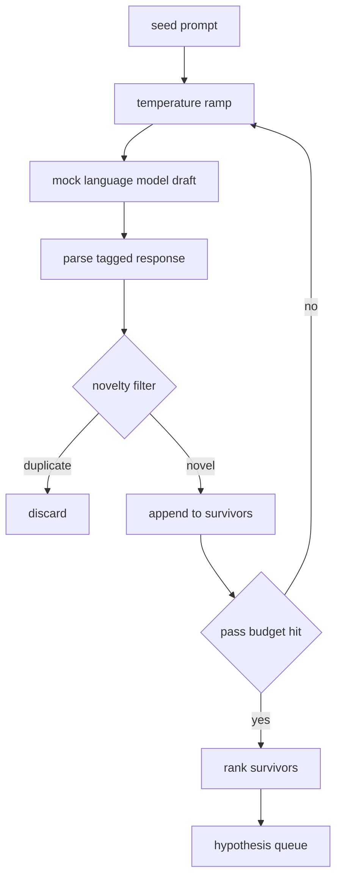

# Hypothesis 生成器

> 一个研究 agent 若把同一个问题问两遍，就是在浪费 token。诀窍在于迫使每一份草稿都落在新的位置上。

**Type:** Build
**Languages:** Python
**Prerequisites:** 第 19 阶段 Track A 第 20 至 29 课
**Time:** ~90 分钟

## Learning Objectives
- 以 seed prompt 驱动一个 sampler，并把它的输出转成带类型的 hypothesis 记录。
- 让 sampler 在每一轮提高温度，使下一份草稿比上一份漂移得更远。
- 用一个小型 embedding 模型配合余弦距离阈值过滤近似重复项。
- 用融合新颖性、具体性与可测试性的评分函数给幸存者排序。
- 让每一步都保持确定性，使同一个 seed 永远产出同一条队列。

## 为什么要先生成再过滤

只向一个模型问一次的 planner 只能得到一个 hypothesis。作为一个完整示例这没问题，但对研究循环而言这个形状是错的。循环想要的是一条有深度的排序队列，这样当第一个 hypothesis 失败时，runner 已经备好了下一个，而无需再为一整轮采样付一次费。

两个想法组合起来产出这条队列。第一个是温度爬升：sampler 每走一轮就把温度调高一档，于是后面的草稿被鼓励去漫游。第二个是新颖性过滤：每份草稿之后，generator 测量它与此前每一个幸存者的 embedding 距离，并拒掉任何落在簇内的候选。

本课附带一个 mock 语言模型，对固定 prompt 返回预先脚本化好的 token 序列。这个 mock 足以跑通整条路径：seed prompt 输入、温度爬升被应用、候选被解析、新颖性过滤被执行、排序队列输出。

## Hypothesis 结构

```text
Hypothesis
  id             : int           (monotonic within a run)
  text           : str           (the claim)
  variables      : list[str]     (what changes between conditions)
  metric         : str           (what the runner will measure)
  baseline_ref   : str | None    (which paper or run the comparison cites)
  draft_pass     : int           (which sampler pass produced this)
  temperature    : float         (the sampler setting at draft time)
  novelty_score  : float         (distance from prior survivors, 0..1)
  rank_score     : float         (weighted sum used for ordering)
```

`variables` 与 `metric` 不是自由文本。parser 从带标签的响应里把它们抽取出来。第五十二课的 runner 在构建实验配置时直接读取这些字段。

`baseline_ref` 是可选字段，但建议提供。第五十三课的 evaluator 需要一个 baseline 来对比。如果 hypothesis 省略了它，evaluator 会回退到同一 metric 上的上一次运行。

```figure
cg-novelty-ramp
```

## 架构



这个循环很直白。有意思的地方在于每个方框都有一份硬契约。

## 温度爬升

从 `t_min` 起步，到 `t_max` 收尾，步长为 `(t_max - t_min) / (n_passes - 1)`。每一轮都用当前温度调用 sampler，从 `GeneratorConfig.schedule()` 得到 `n_passes` 个等距取值。mock 模型这样兑现温度：在一小组按 `(prompt, temp_bucket)` 索引的脚本化响应之间切换。这些桶是开区间，所以温度的微小变化就会选中另一个桶，从而产出不同的草稿。在真实部署里，sampler 会是一个真实模型，并把 `temperature=t` 透传进去。

默认调度是从 `0.2` 到 `1.2` 的六轮。六轮足以填满队列，又不必为那些反正会被新颖性过滤器拒掉的样本付费。低于 `0.2` 时模型只会把 seed 原样学舌回来。高于 `1.2` 时响应往往跑题并让 parser 解析失败。

## 新颖性过滤

每份草稿被解析之后，generator 会为文本做 embedding，并与每一个已接受的 hypothesis 比较。这个 embedding 是一个小型的哈希词袋，归一化为单位长度。两个单位向量之间的余弦距离是 `1 - dot(a, b)`。一份草稿若它与任何先前幸存者的最小距离高于 `novelty_threshold`，就通过。默认值是 `0.25`。

这个哈希 embedding 并不精致。它是确定性的、零依赖，足以抓住最明显的情况：两份草稿共享了大部分名词。生产部署会换成一个小的句子模型，而接口保持不变。

## 排序分数

```text
rank_score = w_novelty * novelty_score
           + w_specificity * specificity_score
           + w_testability * testability_score
```

三个子分数。`novelty_score` 是与先前幸存者之间的最小 embedding 距离。`specificity_score` 是 hypothesis 中具体变量的数量除以目标数量。`testability_score` 在 hypothesis 同时指定了 metric 与 baseline 时为一，只有 metric 时为二分之一，其余情形为零。

默认权重是 `0.4`、`0.3`、`0.3`。权重存放在 generator 的配置里，这样下游课程可以在不为代码开分支的前提下调整它们。

## Mock 语言模型

```python
class MockLLM:
    def sample(self, prompt: str, temperature: float, seed: int) -> str:
        ...
```

给定一个 `(prompt, temperature, seed)` 三元组，sampler 是确定性的。mock 维护一张按 `(prompt_signature, temperature_bucket)` 索引的脚本化响应表。如果表里没有某个键的条目，sampler 就返回一个让 parser 失败的兜底响应。这条兜底路径由其中一个测试覆盖。

seed 被混入响应，因此相同的 `(prompt, temperature)` 搭配不同 seed 会产出不同草稿。在测试里我们固定 seed 以保持结果可复现。在真实部署里，seed 会来自系统时钟或一个计数器。

## 输出队列

输出是一个 `Hypothesis` 记录列表，按 `rank_score` 降序排列。第五十二课的 runner 弹出队首、跑实验，第五十三课的 evaluator 再把判决写回来。如果判决认为该 hypothesis 是错的，runner 就弹出下一个。

队列是有限的。当它为空时，orchestrator 要么放宽 seed prompt 重新运行 generator，要么停下并汇报预算耗尽。

## 如何阅读代码

`code/main.py` 定义了 `Hypothesis`、`MockLLM`、`HypothesisGenerator` 以及一个确定性 demo。generator 只暴露一个 `run(seed_prompt)` 方法，返回排好序的队列；轮数从 `GeneratorConfig.n_passes` 读取，而不是作为参数传入。embedding 是哈希词袋。新颖性过滤器是单个函数。排序分数也是单个函数。没有任何东西依赖 `numpy`；embedding 的数学是纯 stdlib，本课因此保持可移植。

`code/tests/test_generator.py` 覆盖了线性路径、重复拒绝路径、parser 失败路径、温度爬升的边界以及排序次序。

## 本课的位置

第五十课产出队列。第五十一课取队列的队首去跑文献检索，以确认或推翻它。第五十二课拿同一个队首去跑一轮真实实验。第五十三课读取这两份输出并写出判决。这四课组合成一个无需人工介入的研究循环；而人可以在任何一个边界处介入。
