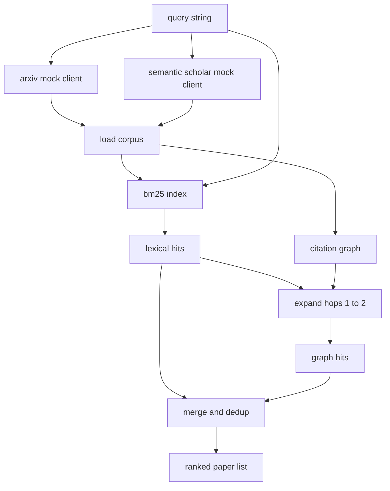

# 文献检索

> hypothesis 很便宜。知道是否已经有人证明过它，才是昂贵的那部分。构建检索层，在 runner 启动 sandbox 之前先回答这个问题。

**Type:** Build
**Languages:** Python
**Prerequisites:** 第 19 阶段 Track A 第 20 至 29 课
**Time:** ~90 分钟

## Learning Objectives
- 为一个小型 paper 记录建模，字段正是循环下游要读取的那些。
- 仅用 stdlib 数据结构，在 abstract 之上构建一个 BM25 索引。
- 遍历 citation graph，把词法检索漏掉的 paper 捞出来。
- 按稳定的 paper id 对词法路径与图路径的命中结果去重。
- 用单个 client 包住两个 mock 外部 API，这样真实端点落地时上游调用点保持不变。

## 为什么做两次检索

在 abstract 之上做关键词检索，返回的是与 query 共享词汇的 paper。这覆盖了大部分表面。它会漏掉两类情况。第一类是奠基性 paper 用了不同的词汇；例如检索 “sparse attention” 会漏掉一篇题为 “block selection in transformer routing” 的 paper。第二类是相关 paper 是一篇引用了某个已知 anchor 的后续工作；先找到 anchor 再向前走，比暴力扫描整个 abstract 池更高效。

本课两条路径都实现。abstract 上的 BM25 抓住词法命中。citation graph 遍历把种子集合向前向后各扩展一到两跳。两者的并集按 paper id 去重，并用一个小型组合分数排序。

## Paper 结构

```text
Paper
  id          : str           (stable identifier, "p001" for the mock corpus)
  title       : str
  abstract    : str
  year        : int
  authors     : list[str]
  references  : list[str]     (paper ids this paper cites)
  citations   : list[str]     (paper ids that cite this paper)
  source      : str           (which mock api supplied it, "arxiv" or "s2")
```

references 与 citations 两个字段构成有向 citation graph。两个 mock API 返回的字段有重叠但不完全相同，因此语料加载器按 `id` 取并集。

```figure
cg-citation-hops
```

## 架构



检索 client 同时拥有两条路径与合并逻辑。调用方交给它一个 query，拿回一个排序列表，其中每一项都带有解释排名的逐 paper 分数字段（`bm25_score`、`graph_distance`、`recency_score`、`final_score`）。

## 从零实现 BM25

实现是标准的 Okapi BM25，默认参数 `k1=1.5`、`b=0.75`。索引是两张字典：`term -> doc_frequency` 与 `term -> list of (doc_id, term_count)`。文档长度是 abstract 的 token 数。平均文档长度在建索引时计算一次。给 query 打分就是对 query 中各 term 的 `idf * tf_norm` 求和，其中 `tf_norm` 是标准的 BM25 长度归一化 term 频率。

分词器先 `lower`，再按非字母数字切分。它没有做词干化。生产系统会换入一个小型词干器。接口保持不变。

```text
idf(t)      = log((N - df + 0.5) / (df + 0.5) + 1.0)
tf_norm(t)  = (f * (k1 + 1)) / (f + k1 * (1 - b + b * dl / avgdl))
score(d, q) = sum over t in q of idf(t) * tf_norm(t)
```

## Citation graph 遍历

图从语料库构建一次。前向边从 paper 指向它的 references。后向边从 paper 指向它的 citations。遍历是以 BM25 头部命中为种子的广度优先搜索，最多两跳。

两跳是刻意的上限。一跳太浅；agent 往往想要直接的祖先或后代。三跳在连通图上会让结果规模爆炸，并且容易跑题。本课把跳数上限暴露为配置旋钮，下游循环可以把它收紧。

## 去重与排序

两条路径返回的集合有重叠。合并以 paper id 为键。对每篇 paper，最终分数是一个加权混合。

```text
final_score = w_bm25 * bm25_score_norm
            + w_graph * graph_score
            + w_recency * recency_score
```

`bm25_score_norm` 是 BM25 分数除以合并集合中的最大 BM25 分数（于是该字段落在 0 到 1 之间）。`graph_score` 对直接词法命中为 1，一跳为 `0.6`，两跳为 `0.3`，其余为零。`recency_score` 是从语料库最小年份处的 0 到最大年份处的 1 的线性斜坡。

默认权重是 `0.5`、`0.3`、`0.2`。权重属于配置；冷门话题可能把 recency 调低，而快速演进的话题会把它调高。

## Mock 语料库

语料库是一百篇 paper，由 `build_corpus()` 生成。每篇 paper 都有手写的标题与 abstract，覆盖五个话题之一：attention 稀疏性、检索增强、低秩适配器、数据集蒸馏、评测 harness。references 与 citations 的连线让每个话题形成一个连通子图，并带少量跨话题边。

两个 mock API client（`ArxivMockClient`、`SemanticScholarMockClient`）读同一个语料库，但暴露的字段不同。Arxiv 返回 title、abstract、year、authors。Semantic Scholar 额外给出 references 与 citations。检索 client 按 id 取并集；跨 client 的字段不一致处理留到后续课程。

## 第五十二课与第五十三课读取什么

第五十二课的 runner 读取 `paper.id`、`paper.title` 以及 abstract 的前三句，作为实验的上下文。第五十三课的 evaluator 读取 `paper.year` 与 `paper.references`，以便把 baseline 归因到具体的 paper。

检索 client 返回一个 `RetrievalResult`，其中同时包含排序列表与逐 query 指标：命中数、平均分、最高分、总 wall time。runner 会记录这些指标，好让下游的可观测性环节绘制质量随时间的变化。

## 如何阅读代码

`code/main.py` 定义了 `Paper`、`ArxivMockClient`、`SemanticScholarMockClient`、`BM25Index`、`CitationGraph`、`RetrievalClient` 以及一个确定性 demo。mock client 与语料库放在同一个文件里，让本课保持可移植。BM25 实现是一个类、六十行。图遍历是一个方法。

`code/tests/test_retrieval.py` 覆盖词法路径、图路径、合并、去重以及空 query。

## 本课的位置

第五十课产出 hypothesis。第五十一课检索文献，看这个 hypothesis 是否已经被解决。若没有，第五十二课就跑实验。第五十三课读取检索结果与实验指标，写出判决。检索 client 是四个阶段中最便宜的一个，在 orchestrator 中首先运行。
