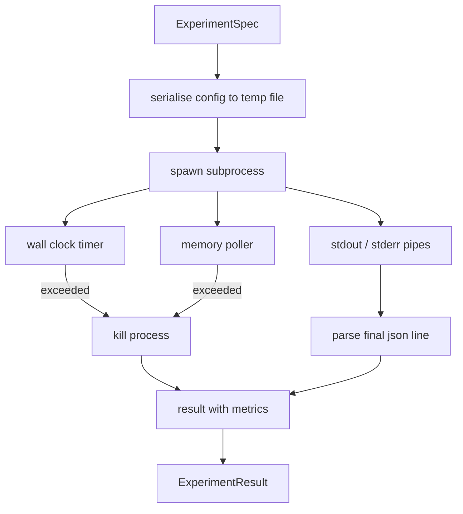

# 实验 runner

> 循环的诚实程度取决于它的测量。构建 runner：它接收一个 spec，在沙箱化子进程中执行它，并输出一个 evaluator 可以信任的 json 指标 blob。

**Type:** Build
**Languages:** Python
**Prerequisites:** 第 19 阶段 Track A 第 20 至 29 课
**Time:** ~90 分钟

## Learning Objectives
- 把实验编码为带类型的 spec，runner 能把它序列化后送给子进程。
- 启动子进程时带上硬性的 wall clock 超时与软性的内存上限，并把两者都呈现为终止条件。
- 把 stdout、stderr 与结构化指标 blob 捕获进单条 result 记录。
- 在固定的 base spec 上逐个扫描配置旋钮，构建一张 ablation 表。
- 在给定 seed 下保持每个结果都是确定性的，让 evaluator 跨多次运行看到同样的数字。

## 为什么用子进程

研究循环会运行不受信任的代码。hypothesis 来自 sampler，实验脚本来自同一条路径；把其中任何一个当作进程内安全代码，就是在请求一次把 orchestrator 拖垮的崩溃。子进程是这门语言自带的最简单隔离：独立进程、独立地址空间，父进程侧持有信号句柄。

这里的 runner 并没有实现完整沙箱。没有 cgroup，没有 seccomp 过滤器，没有 namespace 重映射。它真正拥有的是 wall clock 超时、一个监视内存增长的轮询循环，以及一条在任一限制触发时终止进程的 kill 路径。这就是每一个更精细的 sandbox 都要扩展的运行时契约。本课把这份契约控制得足够小，可以一口气读完。

## ExperimentSpec 结构

```text
ExperimentSpec
  spec_id        : str            (stable id, "exp_001")
  hypothesis_id  : int            (link back to the queue from lesson 50)
  script_path    : str            (path to the python script to run)
  config         : dict           (passed to the script as one json arg)
  seed           : int            (deterministic seed for the experiment)
  wall_timeout_s : float          (hard timeout, killed on exceed)
  memory_cap_mb  : int            (soft cap, polled; killed on exceed)
  metric_keys    : list[str]      (which fields the evaluator will read)
```

脚本存放在磁盘上；runner 把配置写到一个临时文件路径，由脚本去读。脚本应当在 stdout 打印一行 json，其键是 `metric_keys` 的超集。stdout 上的其他内容会被捕获，但被指标解析器忽略。

```figure
cg-runner-limits
```

## 架构



runner 是一个类、一个主方法。poller 是一个小线程，每隔一个轮询间隔醒来一次，在有 proc 文件系统时从中读取子进程的 `psutil` 等价信息，平台不暴露该信息时退化为空操作。

## 为什么用软内存上限

硬内存上限需要 `resource.setrlimit`，而且只在 POSIX 上有效。本课附带一种可移植做法：从平台轮询常驻集大小，若子进程超过上限就杀掉它。上限是软性的，因为轮询器间隔非零；进程可能在两次轮询之间冲高再回落。runner 记录观测到的最大 RSS，好让 evaluator 看到这次运行距离上限有多近。

在没有进程检查支持的系统上，poller 打一条一次性警告并禁用自己。wall clock 超时仍然生效。本课的测试覆盖两条路径。

## 捕获 stdout 与 stderr

runner 在结束时把两个管道都读空。stdout 逐行扫描；最后一行能解析为 json 且具备全部必需 `metric_keys` 的，被当作指标 blob。更早的 json 行作为 `intermediate_metrics` 保留在结果里；evaluator 可以用它们绘制学习曲线。

stderr 原样捕获进结果。runner 从不在非零退出码上抛异常，而是把退出码记录在结果里。任何非零退出都标记为 `"crash"`，即使脚本打印了指标，于是 evaluator 默认把部分运行当作失败。

## Ablation 表

```python
def ablate(base: ExperimentSpec, knob: str, values: list[Any]) -> list[ExperimentSpec]:
    ...
```

给定一个 base spec 与一个旋钮名，这个 helper 为每个取值返回一个 spec，并覆盖 `config[knob]`。每个 spec 得到派生的 `spec_id`（`f"{base.spec_id}_{knob}_{value}"`）。runner 附带一个 `AblationRunner`，按顺序运行它们并返回一张以旋钮取值为键的 `AblationTable`。

为什么一次只动一个旋钮。全因子扫描指数级膨胀，产出的结果 evaluator 无法解读。一次一个旋钮产出一条干净、可绘制的轴。本课只把多旋钮扫描支持为重复的单旋钮 ablation，由调用方组合。

## 确定性

每个 spec 都带一个 seed。runner 通过配置字典把 seed 转发给脚本（`config["__seed"] = spec.seed`）。`code/experiments/` 里的 mock 实验脚本遵守该 seed，跨运行产出完全相同的指标。第五十三课的 evaluator 依赖这一点；没有确定性，一次 “regression” 可能只是不同的随机初始化。

## Mock 实验脚本

本课附带一个实验脚本：`code/experiments/sparsity_experiment.py`。它是一个真实脚本，读取自己的配置文件，用一次 numpy 随机过程模拟一轮小型训练，并打印一个 json 指标 blob。脚本遵守 `sleep_s` 旋钮以测试超时，遵守 `allocate_mb` 旋钮以测试内存轮询器。

这个模拟并没有训练任何真实的东西。它是一次数值计算，模仿训练循环的形状：一条 loss 曲线、一个最终 perplexity、一个 wall time。本课的重点是 runner，不是模拟。真实的实验脚本会 import 一个模型。

## Result 结构

```text
ExperimentResult
  spec_id              : str
  hypothesis_id        : int
  exit_code            : int
  terminal             : "ok" | "timeout" | "oom" | "crash"
  wall_time_s          : float
  peak_rss_mb          : float | None
  metrics              : dict
  intermediate_metrics : list[dict]
  stdout_tail          : str
  stderr_tail          : str
```

evaluator 先读 `metrics` 与 `terminal`。若 terminal 不是 `"ok"`，这次实验就算作失败运行，evaluator 的判决是自动的。否则指标会进入显著性检验。

## 如何阅读代码

`code/main.py` 定义了 `ExperimentSpec`、`ExperimentResult`、`ExperimentRunner`、`AblationRunner` 以及一个确定性 demo。子进程管理是一个类。内存轮询器是一个小线程。ablation helper 是单个函数。

`code/experiments/sparsity_experiment.py` 是测试中使用的 mock 实验。它从 argv 读取配置文件路径，并在完成时写出一行 json 指标。

`code/tests/test_runner.py` 覆盖成功路径、超时路径、崩溃路径、ablation 表，以及跨两次运行的确定性检查。

## 本课的位置

第五十课生成 hypothesis。第五十一课过滤掉文献已经解决的任何内容。第五十二课对剩下的内容跑实验。第五十三课读取结果，运行显著性检验，并写出 orchestrator 针对该 hypothesis id 保存的判决。
