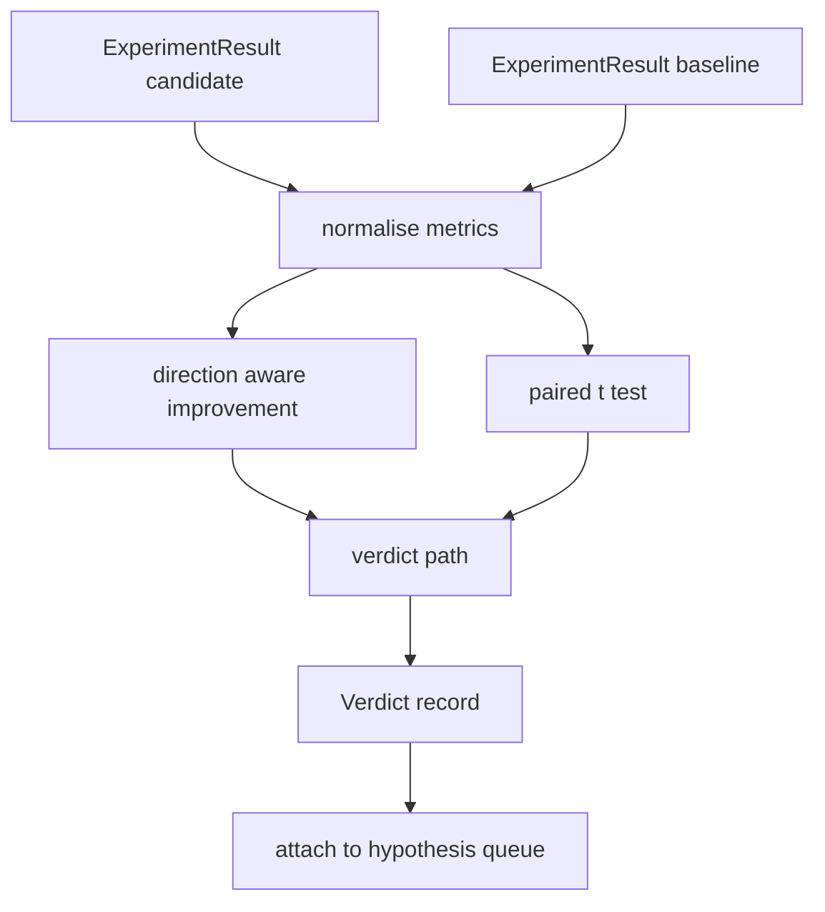

# 结果 evaluator

> runner 产出了数字。evaluator 决定这些数字是改进、回退还是噪声。构建判决路径，把指标变成一行结论。

**Type:** Build
**Languages:** Python
**Prerequisites:** 第 19 阶段 Track A 第 20 至 29 课
**Time:** ~90 分钟

## Learning Objectives
- 用方向感知的改进量与固定阈值，把 candidate 运行与 baseline 做比较。
- 在逐 seed 指标上从零实现 paired t test，并读出得到的 p 值。
- 归一化对数刻度的指标，让下游报告能把它们与线性指标混合。
- 输出逐 hypothesis 的 verdict，orchestrator 可以把它挂到第五十课的队列上。
- 让每一步都是纯函数，使相同的输入永远产出相同的 verdict。

## 为什么要用 paired test

runner 给出的单个数字并不能说明变化是否真实。同样的配置换个 seed 就会得到不同的 perplexity。变化可能只是噪声。正确的比较是配对的：相同的 seed、相同的数据，用 candidate 跑一次、用 baseline 跑一次。每个 seed 贡献一个差值。这些差值的均值就是效应。这些差值的标准误差就是噪声下限。

本课从零实现这个检验。没有用 `scipy.stats`。数学小到一屏就能读完。

```text
diffs    = [a_i - b_i for i in seeds]
mean     = sum(diffs) / n
variance = sum((d - mean) ** 2 for d in diffs) / (n - 1)
t_stat   = mean / sqrt(variance / n)
df       = n - 1
p_value  = two_sided_p(t_stat, df)
```

双侧 p 值使用正则化不完全 beta 函数。本课附带一个小实现，采用 Lentz 连分式。整套东西是六十行 stdlib 数学。

## 方向感知的改进

有些指标上升才是改进（准确率、吞吐量）。有些指标下降才是改进（loss、perplexity、wall time）。evaluator 在每个指标上带一个 `direction` 字段。

```text
if direction == "higher_is_better":
    improvement = (candidate - baseline) / abs(baseline)
elif direction == "lower_is_better":
    improvement = (baseline - candidate) / abs(baseline)
```

改进量是带符号的。在 higher-is-better 指标上为负的改进量意味着 candidate 更差。判决路径同时读取符号与量级。

一个固定阈值（`improvement_threshold=0.02`，即百分之二）决定变化是否大到值得下结论。低于它时无论 p 值如何 verdict 都是 “noise”；循环不关心用户无法测量的变化。

```figure
cg-paired-verdict
```

## 架构



evaluator 运行三项相互独立的计算，并在判决路径里把它们汇合。每项计算都是无共享状态的纯函数。

## 对数归一化

perplexity 相对 loss 是指数的。loss 下降 0.1，perplexity 的下降要大得多。在两种配置之间直接比较 perplexity 没问题，但要在单份报告里把它与线性指标混合就需要归一化。

本课对 `scale` 字段为 `"log"` 的任何指标，在计算改进量之前先取自然对数。阈值随后在对数空间里应用。在 lower-is-better 指标上，perplexity 从 32 降到 28 是 `log(28) - log(32) = -0.133`，远高于百分之二的阈值。

```text
if scale == "log":
    a = log(candidate)
    b = log(baseline)
else:
    a = candidate
    b = baseline
```

`scale="linear"`（默认）的指标跳过这个变换。同一条代码路径同时处理两种。

## 逐 seed 的 paired test

第五十二课的 runner 每次运行输出一个最终指标 blob。对于 paired test，evaluator 需要 candidate 每个 seed 一个 blob、baseline 每个 seed 一个 blob。orchestrator 在一串 seed 上用两种配置各跑同一个实验，并把两个 `ExperimentResult` 记录列表交给 evaluator。

evaluator 按 seed 配对（seed 存放在 `result.metrics["seed"]`），并沿请求的指标行走。若两个列表的 seed 不匹配，evaluator 抛出 `PairingError`。orchestrator 应当重跑。

## Verdict 结构

```text
Verdict
  hypothesis_id          : int
  metric                 : str
  direction              : "higher_is_better" | "lower_is_better"
  scale                  : "linear" | "log"
  candidate_mean         : float
  baseline_mean          : float
  improvement            : float       (signed, fraction; see direction rules)
  p_value                : float | None  (None if n < 2)
  significance_threshold : float
  improvement_threshold  : float
  verdict                : "improved" | "regressed" | "noise" | "failed"
  rationale              : str
```

判决路径是一张小决策表：

```text
1. If any candidate result has terminal != "ok": verdict = "failed"
2. else if |improvement| < improvement_threshold:  verdict = "noise"
3. else if p_value is None or p_value > significance: verdict = "noise"
4. else if improvement > 0:                          verdict = "improved"
5. else:                                             verdict = "regressed"
```

rationale 是一行人类可读的句子，orchestrator 可以针对 hypothesis id 记录它。

## 如何阅读代码

`code/main.py` 定义了 `MetricSpec`、`Verdict`、`Evaluator`、t 统计量与不完全 beta 的 helper，以及一个确定性 demo。t 检验用纯 stdlib 数学实现；numpy 只用来读取指标列表并计算均值与方差。

`code/tests/test_evaluator.py` 覆盖 improved 路径、regressed 路径、noise 路径（改进量太小）、noise 路径（n 太小）、failed terminal 路径、对数归一化路径、针对已知参考值的 t 检验，以及配对错误。

## 本课的位置

第五十课产出了 hypothesis 队列。第五十一课过滤掉文献已经解决的内容。第五十二课在 candidate 与 baseline 两种配置下跨 seed 运行实验。第五十三课读取这些运行并写出 verdict。orchestrator 把这四课缝合在一起：

```text
for hypothesis in queue:
    literature = retrieval.search(hypothesis.text)
    if literature_settles(hypothesis, literature):
        attach(hypothesis, verdict="settled")
        continue
    candidates = runner.run_all(specs_for(hypothesis))
    baselines  = runner.run_all(baseline_specs_for(hypothesis))
    metric_spec = MetricSpec("perplexity", direction=LOWER, scale=LOG)
    verdict = evaluator.evaluate(hypothesis.id, metric_spec, candidates, baselines)
    attach(hypothesis, verdict)
```

那个 orchestrator 不在本课里；这四课无需任何超出各自所定义 dataclass 的胶水就能组合成它。
