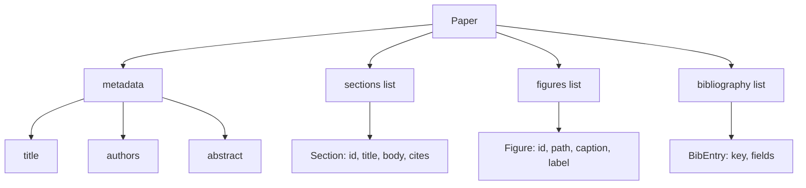
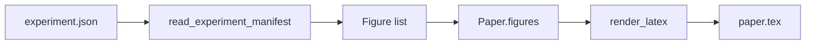
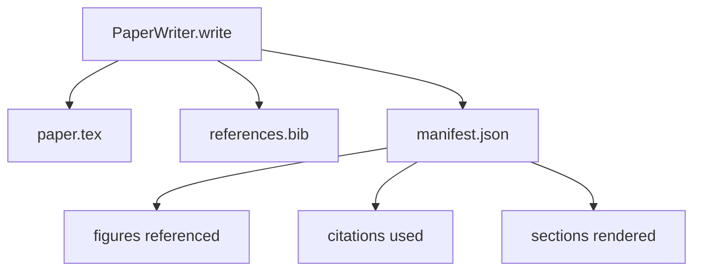

# Paper 写作器

> LaTeX 骨架是研究者与排版器之间的契约。契约一旦破坏，文档就无法编译，而且失败很响亮。先构建骨架，再填充它。

**Type:** Build
**Languages:** Python
**Prerequisites:** 第 19 阶段第 50 至 53 课
**Time:** ~90 分钟

## Learning Objectives

- 把研究 paper 当作带已知 section 图的结构化产物，而不是自由格式的文档。
- 在写下任何 prose 之前，先生成一份 LaTeX 骨架，声明它的 abstract、各 section、figure 槽位与 bibliography 键。
- 通过确定性的槽位机制，把实验输出里的 figure（路径与 caption）注入骨架。
- 接上一个 mocked prose 生成器，从结构化 outline 填充每个 section，让 harness 无需模型即可测试。
- 输出一个 `paper.tex`、一个 `references.bib`，再加一份 manifest，列出每一个被引用的 figure 与每一条被使用的 citation。

```figure
ch-paper-skeleton
```

## 为什么要先有骨架

从 prose 起步的草稿会累积结构性债务。引言里长出三段本该放进相关工作的小节。一个 figure 在被定义之前就被引用。bibliography 最终为同一篇 paper 留下三个键。等到作者察觉时，重写成本已经高于写作成本。

骨架把这件事反过来。结构在开头就作为数据声明。section 是带名字与顺序的槽位。figure 是带 id 与 caption 的槽位。bibliography 键在顶部连同它们指向的条目一起声明。prose 逐个生成到这些槽位里。harness 可以在写下任何 prose 之前就校验：每个 figure 都有槽位，每条 citation 都有条目，每个 section 都出现在目录中。

这与前面几课应用于 plan、tool call 与 trace 的是同一种纪律。结构就是契约。

## Paper 结构



每个字段都是普通 Python 数据。渲染器是从 `Paper` 到 LaTeX 字符串的纯函数。harness 可以在渲染前内省 paper：统计 section 数量、列出缺失的 figure 文件、检查每个 `\cite{key}` 都有匹配的 `BibEntry`。

## 渲染契约

渲染器保证三条性质。第一，骨架里的每个 figure 槽位都输出一个 `\begin{figure}` 块，带形如 `fig:<id>` 的稳定 label。第二，每个 section 都输出一个 `\section{}`，带形如 `sec:<id>` 的稳定 label，使交叉引用可用。第三，bibliography 输出一个 `\bibliography` 块，其 `references.bib` 恰好包含 paper 上声明的条目，不多不少。

违背任何一条都是渲染错误，而不是警告。骨架就是契约；一个悄悄丢掉 figure 的渲染就是契约破坏。

## 从实验注入 figure

本 track 的前面几课把实验输出产出为 JSON manifest。每份 manifest 带一个产物列表，含路径与简短 caption。paper 写作器读取那份 manifest 并产出 `Figure` 记录。



注入是确定性的。figure id 由实验名加一个单调计数器派生。caption 来自 manifest。路径相对于 paper 的输出目录归一化，这样即使实验输出存放在磁盘别处，LaTeX 也能编译。

## Mocked prose 生成器

本课不调用模型。`MockProseGenerator` 读取一个 outline 结构并确定性地输出 prose。outline 结构是每个 section 一个短字符串。生成器把该字符串扩展成两个短段落，并把 section 标题编织进去。生成出的 prose 恰好在 outline 声明它们的地方点名 figure 与 citation。

这足够测试 writer 的每一种行为。真实实现会把生成器换成一次模型调用。它周围的 harness 不变。这正是把 prose 生成器声明为 callable 的价值：测试替换成确定性的一个，生产替换成模型驱动的那个，pipeline 的其余部分完全相同。

## manifest 输出

writer 向输出目录写出三个文件。



下游的 evaluator 或 critic 循环读的是 manifest。它不解析 LaTeX，而是读 manifest。下一课 critic 循环把这份 manifest 作为输入，产出一份反馈列表。这就是为什么 manifest 属于契约，而 LaTeX 不属于。

## 校验闸门

writer 在写出任何文件之前先跑四道闸门。

1. 每个 figure id 在 paper 内唯一。
2. 每个 section 的 `cites` 字段引用的 bibliography 键都在 paper 上声明过。
3. abstract 非空。
4. title 非空。

任一闸门失败都会抛 `PaperValidationError`，并给出精确原因。harness 把该原因呈现为失败模式。没有部分写入：三个文件要么全部产出，要么一个都不产出。

## 如何阅读代码

`code/main.py` 定义了 `Paper`、`Section`、`Figure`、`BibEntry`、`PaperValidationError`、`MockProseGenerator`、`PaperWriter` 以及一个 `render_latex` 函数。`write` 方法接收一个输出目录，产出 `paper.tex`、`references.bib` 与 `manifest.json`。`read_experiment_manifest` helper 把一组实验 manifest 转换成 `Figure` 记录。

`code/tests/test_paper_writer.py` 覆盖：无 section 的骨架渲染、两个 section 加两个 figure 的完整渲染、缺失 citation 闸门、重复 figure id 闸门、manifest 内容，以及 LaTeX 字符串契约（每个 section 输出一个 `\section{}`，每个 figure 输出一个 `\begin{figure}`）。

## 更进一步

真实实现会想要两个扩展。第一，多格式渲染：同一个 `Paper` 结构能编译成用于博客文章的 Markdown 与用于预览的 HTML。渲染器成为 `Paper` 上的一个策略。第二，citation 补全：给定一份 DOI 的本地缓存，writer 从 citation 键抓取 BibTeX 条目。两者都有价值，也都能在不触动骨架契约的前提下加上。

骨架就是赌注。section、figure 与 citation 都声明为数据，prose 生成到槽位里，manifest 与 LaTeX 一同产出。其余每一处改进都在此之上叠加。
