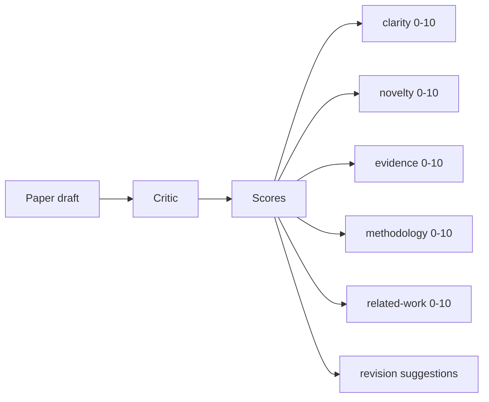
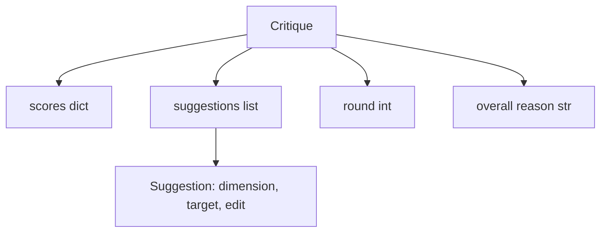
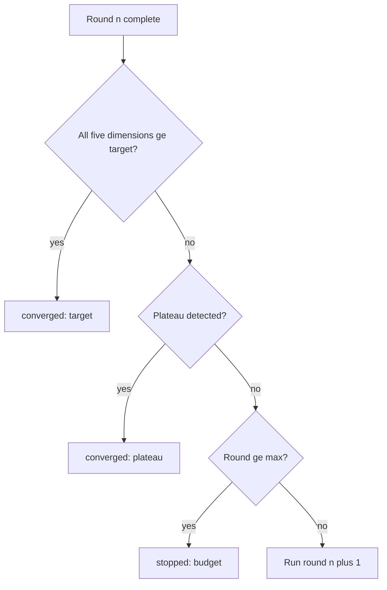
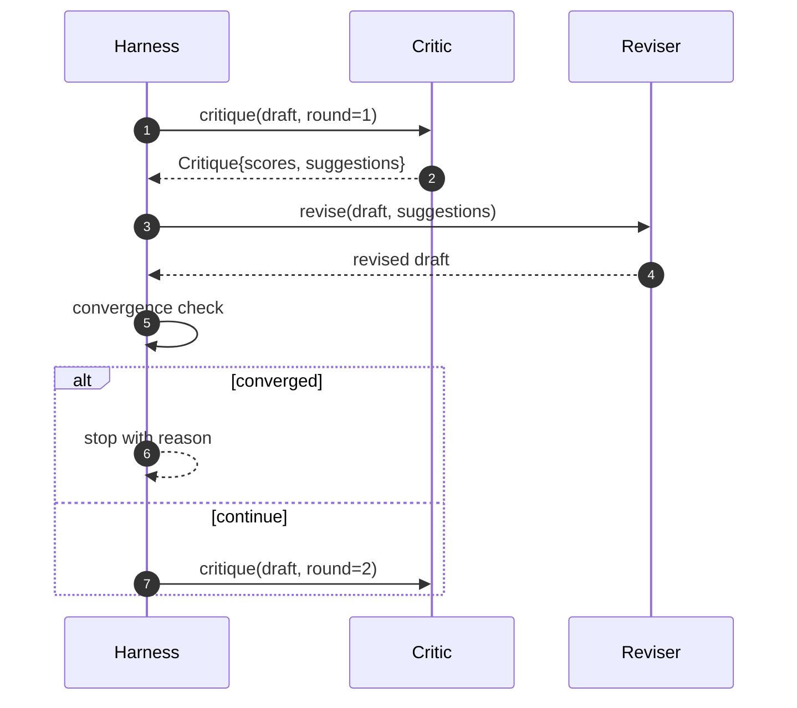

# Critic 循环

> 第一轮就回 “looks good” 的 critic 是坏的。永远回 “needs work” 的 critic 也是坏的。有意思的 critic 是那个会收敛的，而收敛需要你亲手设计。

**Type:** Build
**Languages:** Python
**Prerequisites:** 第 19 阶段第 50 至 53 课
**Time:** ~90 分钟

## Learning Objectives

- 在五个固定维度上给 paper 草稿打分：clarity、novelty、evidence、methodology、related-work。
- 把每一轮的 critique 当作结构化的修订 diff 来应用，而不是自由格式的重写。
- 通过比较跨轮分数来检测收敛；在 plateau、达到目标或预算耗尽时停止。
- 用最大迭代预算给轮数封顶，让不收敛的 critic 不会永远跑下去。
- 输出逐轮 trace，让 dashboard 或下一阶段能渲染分数轨迹。

```figure
ch-critic-converge
```

## 为什么用五个固定维度

自由格式的 critic 是一个返回一段建议的模型。下一轮的修订把这段文字当作环境上下文。重写是否回应了批评无从验证，因为批评从来没有结构。

五个维度给 harness 一个契约。



分数是一个向量。harness 跨轮观察每个维度。一次提升 clarity 却拖垮 evidence 的修订，在 evidence 上就是回退，收敛检查能看见它。纯模型 critic 给不了这种保证。

## Critique 结构



每条 suggestion 都带上它所改进的维度、所针对的 section，以及一条 reviser 可以应用的 `edit` 指令。reviser 同样是一个 callable。本课附带一个确定性 reviser，把 edit 指令解释为向 section 追加的操作。模型驱动的 reviser 会把同一个字段解释为 prompt。契约不变。

## 收敛规则，按顺序

critic 循环在三种条件中任一触发时终止。



目标是要求最严的情形：五个维度（clarity、novelty、evidence、methodology、related_work）中的每一个都必须在循环返回成功之前达到 `>= target_score`（默认 `8.0`）。均值很高但有一个维度偏弱是不够的。plateau 检测把本轮的均值与上一轮的均值比较。若改进量连续两轮低于 `plateau_epsilon`（默认 `0.1`），循环以 `plateau` 退出。预算是轮数的硬上限（默认 `5`），以 `budget` 退出。

顺序很重要。target 优先于 plateau，plateau 优先于 budget。如果第三轮在同样会触发 plateau 的那次迭代上达到了目标，结果是 `target`，而不是 `plateau`。

## 为什么 plateau 检测要跨两轮

单轮的 plateau 只是噪声。真实的 critic 即使在固定草稿上，每次迭代也会返回略微不同的分数，因为确定性评分仍然取决于应用了哪些 suggestion 以及应用的顺序。要求连续两轮达到 plateau 才能滤掉这种噪声。如果 harness 报告 plateau，那草稿是真的停止改进了。

## 本课的确定性 critic

本课不调用模型。附带的 critic 是一个 callable，基于三个信号给草稿打分：各 section 正文的平均长度（clarity）、figure 数与 citation 数（evidence），以及 paper 元数据上的 `originality_tag` 字段（novelty）。reviser 知道如何把每个分数往上推。

```text
clarity      grows when the average section body length increases
novelty      grows when originality_tag is set to "high"
evidence     grows when a section's figure_refs is non-empty
methodology  grows when a section titled "Method" exists with body
related-work grows when a section titled "Related Work" exists with body
```

reviser 把每条 suggestion 解释为一次有针对性的追加。第一轮之后，harness 就能观察到分数上升。测试利用这一性质断言循环缩小了差距。

## 完整循环契约



harness 拥有轮数计数器、trace 与收敛检查。critic 拥有分数。reviser 拥有 diff。三者都不触碰彼此的状态。

## Trace 输出

每一轮都输出一个 trace 事件，包含轮号、分数向量、suggestion 数量与收敛判定。完整 trace 与最终草稿一并返回。下游 dashboard 可以渲染逐轮分数图。下一课 iteration scheduler 读取 trace，以决定这个分支是否值得保留。

## 防范坏 critic 的预算

一个产出的 suggestion 永远提升不了分数的 critic，会把循环锁死在最大迭代上限。trace 让这件事可见：五轮、分数走平、判定 `budget`。用户会把它读成 critic 的 bug，而不是草稿的 bug。另一种做法只呈现最终草稿，会隐藏这项诊断。trace 优先的设计能把它呈现出来。

## 如何阅读代码

`code/main.py` 定义了 `Critique`、`Suggestion`、`Critic` protocol、`Reviser` protocol、`CriticLoop`，以及一个 `make_deterministic_critic_pair` 工厂，返回确定性 critic 与配套的 reviser。文件里包含一个最小的 `Paper` 结构，让本课可以独立成立。

`code/tests/test_critic_loop.py` 覆盖：第一轮之后的单调改进、调优草稿上的 target 收敛、两轮走平后的 plateau 检测、没有任何 suggestion 带来改进时的预算耗尽、reviser 对 suggestion 的应用，以及 trace 结构。

## 更进一步

真实实现会想要两个扩展。第一，维度权重：投向 workshop 的 paper 把 novelty 权重设得高于 methodology；期刊则相反。收敛检查变成一个加权均值。第二，成对 critic：一个 critic 打分，第二个 critic 在 reviser 看到 suggestion 之前先做裁决。两者都有价值，也都能在同一个 `Critique` 结构上组合。

赌注是分数向量。一旦 critique 结构化，其余每一处改进——收敛规则、dashboard、成对 critic——都能不改动循环就接入。
