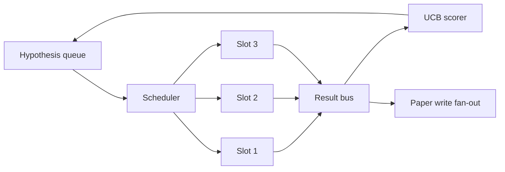
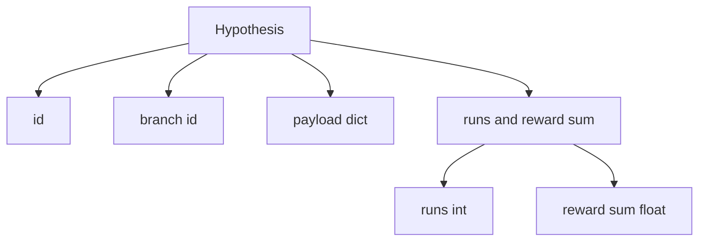
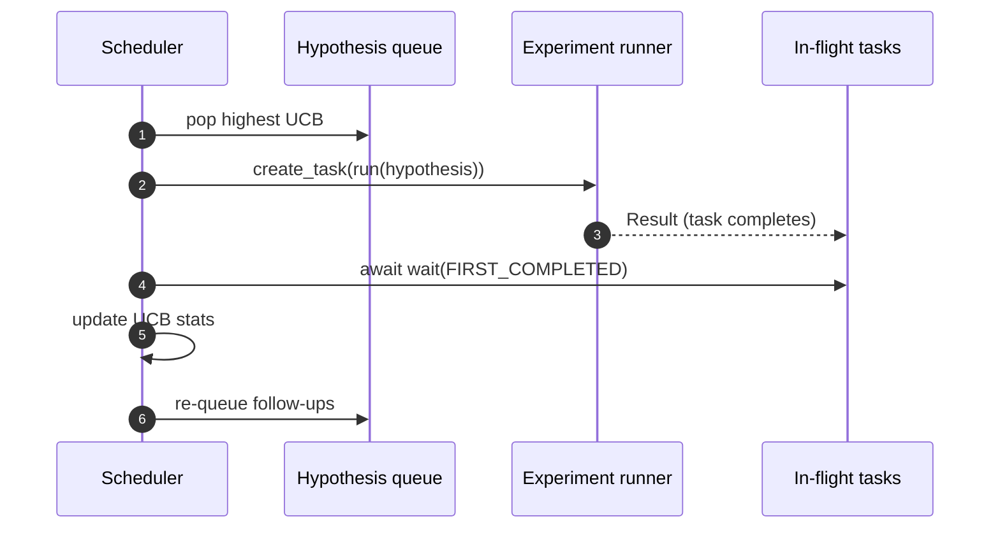

# 迭代 scheduler

> 没有 scheduler 的研究循环，只是一个自以为在研究的队列。循环正是在 scheduler 里决定要停止探索什么，而那个决定就是全部胜负所在。

**Type:** Build
**Languages:** Python
**Prerequisites:** 第 19 阶段第 50 至 53 课
**Time:** ~90 分钟

## Learning Objectives

- 把研究工作流建模为一条 hypothesis 队列：它向并行的实验槽位供给任务，而槽位的结果再扇回队列。
- 用 asyncio 并发运行多个实验，让 scheduler 始终把所有槽位占满。
- 用 UCB 给每个 hypothesis 分支打分，使 scheduler 能剪掉低产出的分支，同时不放弃探索。
- 把已完成的结果扇出到论文撰写阶段与重新入队阶段，让高产出的分支衍生出后续 hypothesis。
- 输出每轮迭代的 trace，包含分支分数、槽位占用情况与剪枝决定。

```figure
ch-ucb-scheduler
```

## 为什么需要 scheduler，而不是 worklist

一条扁平 worklist 按提交顺序运行作业。当每个作业彼此独立时这没问题。研究并不独立：第三个实验的发现会改变第四、第五个实验的优先级。一个读取结果扇入并重排队列的 scheduler，能在单位算力上完成更多有用的工作。

有趣的设计选择是打分规则。贪心打分器永远选中当前领先者，从不探索；均匀打分器从不利用。UCB（upper confidence bound，上置信界）是中间道路：利用领先者，同时为尝试次数较少的分支保留容量。

## 系统形态



队列持有 hypothesis。当某个槽位空出时，scheduler 挑出 UCB 最高的 hypothesis。每个槽位异步运行一个实验。实验完成后把结果扇出到总线上。总线更新来源分支的 UCB 统计，并在某个分支的产出越过阈值时扇出到论文撰写阶段。

## Hypothesis 的形状



`branch` 是 UCB 统计的键。多个 hypothesis 可以共享同一个分支（分支是研究方向，hypothesis 是其中一次试验）。`runs` 是该分支已完成实验的数量，`reward_sum` 是累计奖励。UCB 两者都读。

## UCB 打分

本课使用的 UCB 公式是经典的 UCB1。

```text
ucb(branch) = mean_reward(branch) + c * sqrt( ln(total_runs) / runs(branch) )
```

`total_runs` 是所有分支上已完成实验的总数。`c` 是探索权重，本课默认取 `sqrt(2)`。`runs` 为零的分支得分为 `+inf`，因此未尝试过的分支总是最先被调度。平均奖励高的分支会一直保持高分，直到其他分支追上；而一个跑了很多次却收获不大的分支，会被运行次数更少的候选盖过。

剪枝门与挑选器是分开的。当某个分支的平均奖励在至少 `prune_after_runs` 次试验（默认 `3`）之后跌破绝对下限（默认 `0.2`）时，剪枝会把该分支从未来的调度中移除。这样队列就能保持有界。

## 用 asyncio 实现并行槽位

scheduler 用 `asyncio.create_task` 驱动实验。每个 task 运行实验 runner（一个返回 `Result` 的 `async def` 可调用对象）。主循环用 `asyncio.wait(..., return_when=asyncio.FIRST_COMPLETED)` 等待在飞的 task 集合，并在每次完成时触发打分更新。



三个槽位并发运行。主循环从不在单个实验上阻塞。只要有槽位空出，scheduler 就会立刻启动新 task，直到队列为空且没有在飞的 task。

## 扇出：论文触发

当某个分支的平均奖励越过 `paper_threshold`（默认 `0.7`）且该分支尚未产出论文时，scheduler 会把一个 `paper.trigger` 事件扇出到一个输出列表。下游第五十四课的 paper writer 会接住它。在本课中，触发被收集成一个列表，方便测试断言。

## 扇出：后续 hypothesis

当一个高产出结果落地时，scheduler 可以调用用户提供的 `expander`，在同一分支上产出一个或多个后续 hypothesis。expander 是一个从 `Result` 到 `list[Hypothesis]` 的纯函数。本课附带一个确定性 expander，对任何奖励超过论文阈值的结果都产出两个后续 hypothesis。

## 预算

两条 budget 保护 scheduler 免于失控的循环。

```text
max_experiments    : total count of experiments run across all branches
max_seconds        : wall-clock cap (asyncio time)
```

任意一条触发时，scheduler 就停止调度新 task，等待在飞的 task 结束，并返回最终 trace。这个 trace 包含一个 `stop_reason`。

## Trace 与最终报告

每个调度决定（pick、dispatch、result、prune、fan-out）都发出一个事件。最终报告汇总各分支统计、总运行数、总墙钟时间以及已触发的 paper trigger。下一课（端到端 demo）读取这份报告来驱动 paper writer。

## 如何阅读代码

`code/main.py` 定义了 `Hypothesis`、`Result`、`BranchStats`、`IterationScheduler`，以及一个 `make_deterministic_runner` 工厂：它返回一个奖励可预测的 asyncio 实验 runner。该 runner 会固定休眠 `delay_ms`（默认 `5ms`），好让并发变得可观察。

`code/tests/test_scheduler.py` 覆盖：UCB 优先挑选未尝试的分支、并行槽位占用、越过阈值时的 paper trigger、低产出试验后的分支剪枝、扇出后续 hypothesis，以及 budget 退出（实验数与墙钟时间两者）。

## 更进一步

真正落地时会有三个想要的扩展。第一，跨会话持久的 UCB 统计：当前统计只活在内存里；真实的 scheduler 会把它们做 checkpoint，这样重启后已花掉的探索预算仍被保留。第二，多目标打分：结果不再给出标量奖励，而是输出一个向量，UCB 随之变成 Pareto 式的挑选器。第三，上下文 bandit：挑选器以 hypothesis 的特征（长度、复杂度）为条件，让相似的 hypothesis 共享探索。

scheduler 正是让研究不止于 worklist 的地方。一旦 UCB 接通、槽位并行运行，其他所有改进都可以叠加其上。
