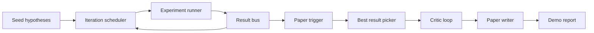
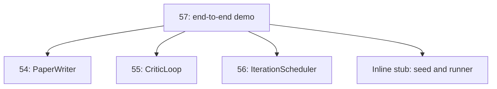
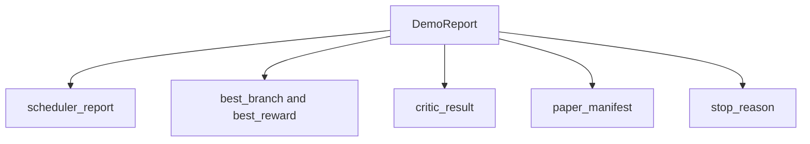

# 端到端研究 demo

> demo 是你此前写下的每一份契约都必须拼合起来的地方。任何一份契约漏了，demo 就是抓住它的那一课。

**Type:** Build
**Languages:** Python
**Prerequisites:** 第 19 阶段第 50 至 53 课
**Time:** ~90 分钟

## Learning Objectives

- 把自动研究循环端到端接通：hypothesis seed、实验 runner、scheduler、critic loop、paper writer。
- 用朴素的 Python import（而非框架）把此前四节 Track D 课程的原语拼合起来。
- 把循环跑到自行终止，并输出一份单一的 demo 报告，列出每个阶段的输出。
- 让 demo 保持确定性，使测试套件能够断言最终形态。
- 当任何阶段的契约破裂时，暴露出清晰的失败模式，使下一阶段不会带着坏输入去运行。

```figure
ch-research-pipeline
```

## 这里拼合了什么



五个阶段。seed 是一个含三条 hypothesis 的列表。scheduler 用三个并行槽位在它们之上跑六个实验。总线报告一个或多个 paper trigger。picker 选出唯一最好的结果。critic loop 在这个结果构建的草稿上迭代。paper writer 产出最终的 LaTeX、BibTeX 与 manifest。

## 为什么用 import，而不是复制

每一节更早的课都附带一个 `main.py`，其中是公开的 dataclass 与函数。demo 通过把 `sys.path` 调整到各课的父目录来 import 它们。这不是框架接线，而是更早那些课里的测试文件早就在用的同一种 import。



内联 stub 代表第五十至第五十三课：一个小型的 seed hypothesis 生成器，加上一个同步的奖励函数。用户只要调整两处 import，就能用那几课的真实原语替换内联 stub。

## 确定性保证

demo 从构造上就是确定性的。实验 runner 用的是固定 seed 的 numpy。critic loop 的 reviser 按固定顺序遍历固定维度。paper writer 的散文生成器是第五十四课那个 mock 版本。scheduler 的 UCB 挑选器按迭代顺序而非随机选择来打破平局。

给定同一个 seed，demo 输出同一份报告。测试通过运行两次 demo 并比较 manifest 来断言这一性质。

## demo 报告的形状



每个字段都原样来自上游阶段。demo 不转换任何输出，只做拼合。这就是 demo 这份测试的全部内容。

## 失败模式处理

每个阶段要么成功，要么抛出一个带类型的错误。

```text
Scheduler ........ returns SchedulerReport with stop_reason
                   in {queue_empty, max_experiments, deadline}
Best-result pick . raises NoTriggerError if no paper trigger fired
Critic loop ...... returns LoopResult with status converged or stopped
Paper writer ..... raises PaperValidationError on contract break
```

任何阶段的失败都会以带类型的异常短路整个 demo。测试钉住了这条契约：`test_no_triggers_raises_typed_error` 与 `test_best_picker_raises_when_no_triggers` 断言在没有分支触发 trigger 时 picker 会抛出 `NoTriggerError` / `BestResultError`，而 writer 从不被调用。

## 最佳结果挑选器

scheduler 按分支发出 paper trigger。picker 在全部 trigger 中选出平均奖励最高的分支。平局按分支 id 的字母序打破，以保证 demo 的确定性。picker 是一个小的纯函数；测试用一份固定的 scheduler 报告钉住它。

## 接通 critic loop

第五十五课的 critic loop 作用在一个 `MiniPaper` 上。demo 从被挑中的分支构建 `MiniPaper`：用分支 id 填充摘要，播种两个小节（Introduction 与 Results），并根据该分支的平均奖励设置 `originality_tag`（`>= 0.8` 为 high，`>= 0.6` 为 medium，其余为 low）。

随后 reviser 把草稿迭代到收敛。输出去到 paper writer。

## 接通 paper writer

第五十四课的 paper writer 作用在带图表与参考文献的完整 `Paper` 形态上。demo 通过 `mini_to_full_paper` 把收敛的 `MiniPaper` 升级：为选中的分支附加一张图，并基于 critic 建议过的 cite key 并集构建一份小型合成参考文献。demo 添加的每一条引用也会进入参考文献列表，因此校验得以通过。

## 如何阅读代码

`code/main.py` 定义了 `BestResultError`、`NoTriggerError`、`DemoReport`、`pick_best_branch`、`build_mini_paper`、`mini_to_full_paper` 与 `run_demo`。文件顶部的 import 一次性调整 `sys.path`，并从各自的课程中拉取 `PaperWriter`、`CriticLoop` 与 `IterationScheduler`。

`code/tests/test_e2e.py` 覆盖：demo 端到端跑通并输出一份五个字段全部填充的报告、两次运行之间的确定性、没有分支越过阈值时的 NoTriggerError、writer 契约破裂时的 PaperValidationError、paper manifest 包含被选中分支的图，以及 scheduler 的停止原因是预期取值之一。

## 更进一步

demo 通过之后，有三个值得接上的扩展。第一，持久状态：每个阶段的结果写入一个小型 JSON 存储，这样重启时可以直接续跑，而不必重跑那些廉价的阶段。第二，dashboard：scheduler 与 critic loop 的 trace 事件渲染成一条统一的时间线。第三，真实模型调用：把 mock 的散文生成器与确定性的 critic 换成模型驱动的版本；接线方式不变。

demo 的职责是证明「拼合即架构」。五节课，四处 import，一份报告。下次再加一个阶段，接线只多出一行。
