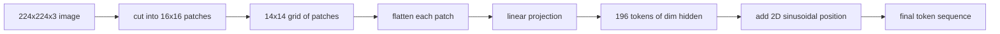

# Vision encoder 的 patch

> 一个直接读像素的视觉模型，需要一套给像素用的 tokenizer。patch embedding 就是那套 tokenizer：把图像切成方格网格，展平每个方格，用一个线性层投影，再叠加一个 2D 位置信号，好让 transformer 知道每个方格在原图中的位置。

**Type:** Build
**Languages:** Python
**Prerequisites:** 第 19 阶段第 30 至 37 课（Track B 基础）
**Time:** ~90 分钟

## Learning Objectives

- 把一张图像 token 化成定长的 patch embedding 序列。
- 实现一个基于 `Conv2d` 的 patch projection，使其与 unfold 再 linear 的数学一致。
- 构建确定性的 2D 正弦 position embedding，让 token 顺序编码空间位置。
- 在合成 fixture 上验证 patch 数量、embedding 形状，以及 `Conv2d` 与 unfold 的等价性。

## 问题场景

transformer 吃的是向量序列，而图像是一个三通道网格。把每个像素都当成 token 来读，会让序列长度爆炸：一张 224x224 的 RGB 图像就是 150,528 个 token，12 层 transformer 在注意力上负担不起。把图像当成一个巨大的扁平向量来读，又会丢掉局部性，而注意力层无法把它找回来。encoder 前端的工作，就是把像素网格压缩成几百个 token，每个 token 概括一个方形区域。

patch embedding 用一个线性投影解决这个问题。224x224 的图像切成 16x16 的 patch，得到 14x14 共 196 个 patch 的网格。每个 patch 从 `(3, 16, 16) = 768` 个像素值展平成一个向量，再由一个线性层映射到模型的隐藏维度。transformer 看到的是 196 个维度为 `hidden`（通常是 768）的 token，外加一个 CLS token。这就是后续网络可以消化的序列。

## 核心概念



### 为什么用 patch 而不是像素

注意力对序列长度是二次的。196 个 token 的序列，每层每个 head 要算 `196 * 196 = 38,416` 个注意力分数；150,528 个 token 的序列则要 `150,528 * 150,528 = 22.6 billion` 个。patch 化把注意力计算量降到原来的约五十九万分之一，而单个 16x16 区域承载的信号已足以支撑高层视觉任务。代价是每个 patch 内部丢失细粒度空间细节，这也是下游多模态栈在需要精细定位时常常再跑一条高分辨率分支的原因。

### 为什么一个线性投影就够了

每个 patch 都被当作一个独立向量。这个投影学出一组基：边缘检测器、颜色滤波器、简单纹理。单个线性层很小（ViT-Base 是 `768 * 768 = 589,824` 个参数），训练也快。更深的卷积 stem 确实存在（“hybrid” ViT），但扁平的线性投影才是标准做法，多数现代开放权重 encoder 都采用这一确切形态。

### `Conv2d` 的做法

无 padding 的 `Conv2d(in_channels=3, out_channels=hidden, kernel_size=patch_size, stride=patch_size)` 与 unfold 再 linear 给出相同的数值结果，因为每个输出位置都是 patch 像素与一个 filter 做点积。这个卷积就是 patch projection，多数生产代码库都这么发布，因为它在 GPU 上更快，而且少一次 reshape。

### 位置 embedding

从投影出来的 token 不携带任何顺序信息。2D 正弦 embedding 给每个 token 一个固定信号，编码它的 `(row, col)` 位置。embedding 维度的一半用多频率的 sin/cos 编码行位置，另一半编码列位置。这种编码是确定性的，因此换分辨率无需重新训练，而且能干净地插值到模型训练时从未见过的网格上。

| 组成 | 形状 | 参数 |
|-----------|-------|------------|
| Patch projection（`Conv2d`） | `(hidden, 3, patch, patch)` | `3 * P * P * hidden + hidden` |
| Position embedding（固定） | `(num_patches, hidden)` | 0（计算得到，非学习） |
| CLS token（学习得到） | `(1, hidden)` | `hidden` |

对于 224 分辨率的 ViT-Base/16：投影有 590,592 个参数，CLS token 有 768 个，正弦位置为 0 个。下一课（第 59 课）会在这个前端之上叠一个 12 层 transformer。

### 把等价性当作自检

patch 这一步有两种写法：`Conv2d` 投影，以及显式的 unfold 再 linear。给定相同的权重，它们必须产出相同的输出。若不相等，说明 unfold 的数学写错了，而 encoder 的其余部分就建立在沙上。本课的测试正是检验这种等价性。

```figure
ch-patch-tokenizer
```

## Build It

`code/main.py` 实现了：

- `PatchEmbed`：一个包装 `Conv2d` 做 patch projection 的 `nn.Module`。
- `sinusoidal_2d(grid_h, grid_w, dim)`：一个无状态函数，构建 2D 位置表。
- `VisionFrontEnd`：把 patch embedding、CLS 前置与位置相加组合进一次前向。
- 一个 `synthesize_image(seed)` 辅助函数，用 `numpy.random` 构建确定性的 224x224x3 fixture。
- 一个 demo：把一张 fixture 图像跑过前端，并打印输出形状、CLS token 范数以及位置 embedding 的一行。

运行它：

```bash
python3 code/main.py
```

输出：224x224 的 fixture 被 token 化成形状 `(1, 197, 768)` 的序列。第一个 token 是 CLS，随后 196 个是 patch token。位置 embedding 的范数在每一行内是一致的，这正是正弦编码的特征。

## Use It

同样的 patch 前端出现在每一个现代视觉语言模型里：CLIP ViT-L/14、SigLIP、DINOv2、Qwen-VL 家族与 InternVL 栈，全都从 `Conv2d` patch projection 加位置信号起步。各家族之间的差异在下游：CLS 池化还是无 CLS 池化、register token、patch 尺寸取 14 还是 16、通过插值位置实现动态分辨率。本课的前端是所有这些模型脚下共同的基底。

## 测试

`code/test_main.py` 覆盖：

- patch 数量等于 `(image_size / patch_size) ** 2`
- 输出形状等于 `(batch, num_patches + 1, hidden)`
- 在小 fixture 上，`Conv2d` 投影等于手写的 unfold 再 linear
- 正弦位置表在多次调用之间是确定性的
- CLS token 在 batch 维上广播且无泄漏

运行它们：

```bash
python3 -m unittest code/test_main.py
```

## Exercises

1. 把正弦位置换成学习的 `nn.Parameter`，在一个极小的合成分类任务上比较第一个 epoch 的损失。固定分辨率下学习位置更好；训练后更换分辨率时正弦位置更好。

2. 把 `Conv2d` 换成显式的 `nn.Unfold` 加 `nn.Linear`，并断言输出在浮点容差内一致。同一套数学，两种写法。

3. 增加对非方形 patch 尺寸的支持（例如宽高比输入用 32x16），并验证位置表能处理非方形网格。

4. 在 batch 1、8、64 下对 patch 这一步做 profile。patch projection 很少是瓶颈，下游的注意力层才是主导。

5. 把前端当作冻结的特征提取器，在一个 4 类合成形状数据集（圆形、正方形、三角形、星形）上训练。CLS token 的输出应当线性可分。

## Key Terms

| 术语 | 实际含义 |
|------|---------------|
| Patch | 图像中的一个方形子区域，通常是 14x14 或 16x16 |
| Patch embedding | 把一个展平的 patch 线性投影到隐藏维度 |
| Sequence length | patch token 化之后的 token 数，通常还要加上 CLS |
| Sinusoidal position | 编码 2D 网格坐标的固定 sin/cos 信号 |
| CLS token | 前置在序列前面的学习向量，用作池化头 |

## Further Reading

- An Image is Worth 16x16 Words（ViT, 2021）：patch-embed 框架的原始出处。
- Attention Is All You Need（2017）：本课改写到 2D 的正弦位置公式出处。
- DINOv2 论文：关于 register token，这是你可以作为练习 6 添加的扩展。
