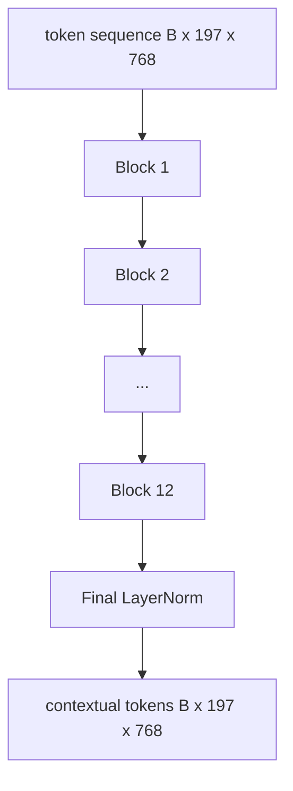
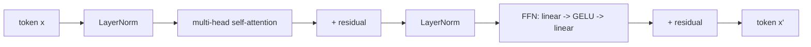

# Vision Transformer 编码器

> 仅有 patch 并不能“看见”。一个 12 层、12 个注意力头的 pre-LN Transformer 会把 patch token 序列变成上下文 token 序列，并由 CLS token 在其最终隐状态中池化出整图特征。本课是每一个现代视觉-语言模型的动力舱。

**Type:** Build
**Languages:** Python
**Prerequisites:** 第 19 阶段第 30 至 37 课（Track B 基础）
**Time:** ~90 分钟

## Learning Objectives

- 实现一个带多头自注意力与前馈子层的 pre-LN Transformer 块。
- 堆叠 12 个块、每块 12 个头，组成一个 ViT-Base 编码器。
- 把第 58 课的 patch 前端接入编码器，并跑一次前向传播。
- 验证 CLS token 会从每一个 patch 聚合信息。

## 问题场景

patch embedding 会产出 197 个 token 组成的序列，每个 token 都是一个对其余 patch 毫无所知的向量。一张猫的图片需要每个 patch 都知道哪些 patch 含胡须、哪些含背景、哪些含眼睛。Transformer 正是逐层构建这种感知的机制。没有它，patch 前端只是一个聪明却毫无理解的 tokenizer。

标准配方是 12 个块深、12 个头宽，配合 pre-LayerNorm 位置、GELU 激活与 4 倍的前馈扩展。这套配方是 CLIP ViT-L、SigLIP、DINOv2、Qwen-VL 系列、InternVL 以及 2025-2026 年其他所有开放权重 vision encoder 的脊梁。配方足够稳定，以至于你读上述任何一篇论文时，除非它们明确另有说明，都可以假定就是这个块形状。

## 核心概念





### Pre-LN 与 post-LN

原始 Transformer 把 LayerNorm 放在残差之后。pre-LN（在每个子层之前施加 LayerNorm）是每一个现代视觉-语言模型都采用的版本，因为它无需学习率 warm-up 技巧就能稳定训练。差别只是前向传播里的一行，但在 12 层以上的深度上，梯度流的差别是天壤之别。

### 多头自注意力

每个头把 token 向量投影到自己的一组 `(query, key, value)`，维度为 `head_dim = hidden / num_heads`。当 `hidden = 768`、`heads = 12` 时，每个头的 `dim = 64`。12 个头并行地做注意力，随后它们的输出拼接回 768 维，再经过一次输出投影。多头之要义在于：一个头可以学会“关注猫眼”，另一个头学会“关注背景渐变”，彼此互不干扰。

### 为何前馈扩展用 4 倍

FFN 走 `hidden -> 4 * hidden -> hidden`，中间是 GELU。因子 4 来自经验，自 2017 年起在语言与视觉 Transformer 上一路沿用。更小（2 倍）会欠拟合；更大（8 倍）在固定数据预算下会过拟合。MLP 是模型存放大部分学到的知识的地方，而更宽的中间层正是这些知识所在之处。

| 组件 | ViT-Base 规模下的参数量 |
|-----------|------------------------------|
| 每个块的 qkv projection | `3 * 768 * 768 = 1.77M` |
| 每个块的输出投影 | `768 * 768 = 590K` |
| 每个块的 FFN（4 倍扩展） | `2 * 768 * 4 * 768 = 4.72M` |
| 每个块的 LayerNorm | `4 * 768 = 3K` |
| 每个块合计 | 约 7.1M |
| 12 个块 | 约 85M |
| 加上前端 | 总计约 86M |

ViT-Base 是一个 86M 参数的编码器。以 2026 年的标准看这很小（SigLIP-So400M 是 400M，Qwen-VL 的 ViT 是 675M），但在宽度与深度之外，架构完全相同。

### 要不要因果掩码？

Vision Transformer 是纯编码器、双向的：token `i` 可以对任意 token `j` 做注意力。没有掩码。第 61 课解码器一侧的 cross-attention 会使用因果掩码，但在 vision encoder 内部，注意力是全连接的。

### CLS token 学到了什么

CLS token 以一个可学习参数起步，自身没有 patch 内容，通过各层的注意力不断累积信息。到最后一层时，CLS 这一行就是整幅图像的向量摘要；下游头把这个单向量投影成类别 logits、对比 embedding，或供文本解码器使用的 cross-attention key。

```figure
ch-cls-funnel
```

## Build It

`code/main.py` 实现了：

- `MultiHeadSelfAttention`，含 `qkv` 与输出投影、缩放点积注意力数学，以及形状断言。
- `FeedForward`，即 4 倍扩展的 GELU MLP。
- `Block`，组合注意力与前馈子层并带残差的 pre-LN 块。
- `ViT`，12 个块的堆叠加一个最终 LayerNorm。
- `VisionEncoder`，把第 58 课的 `VisionFrontEnd` 接到 `ViT` 堆栈上，并暴露一个 `forward()`，返回上下文序列与池化后的 CLS 向量。
- 一个演示：让一张合成的 224x224 fixture 图像跑过完整编码器，打印输入形状、输出形状、参数量，以及每隔一层的 CLS 范数。

运行它：

```bash
python3 code/main.py
```

输出：fixture 被编码成 `(1, 197, 768)` 张量。CLS 范数随各层复合而上升，最后在最终 LayerNorm 处稳定下来。总参数报告约为 86M。

## Use It

这里定义的编码器，在宽度与深度之外，与 2025-2026 年每一个开放权重 VLM 内部搭载的块堆栈相同。差异存在于：

- **宽度与深度。** ViT-Large 是 `hidden=1024, depth=24, heads=16`；SigLIP So400M 是 `hidden=1152, depth=27, heads=16`。同一个块。
- **池化头。** CLS 池化（本课）vs 平均池化（SigLIP）vs 注意力池化（后续 VLM）。
- **位置处理。** 固定正弦（第 58 课）vs 可学习 1D vs ALiBi vs 2D RoPE。块内数学不变。
- **Register token。** DINOv2 会在前面加 4 个额外的可学习 token。一行代码。

这个块堆栈就是基底。接下来的课程（60-63）都建立在它之上。

## 测试

`code/test_main.py` 覆盖：

- 单个块保持形状不变，且对输入 batch size 不变
- 注意力分数沿 key 轴求和为一（softmax 合理性检查）
- 残差路径已接通（零输入仍会经由 CLS token 产生非零输出）
- 4 层堆叠前向传播产生正确形状
- 梯度从 CLS 输出流向 patch 投影

运行它们：

```bash
python3 -m unittest code/test_main.py
```

## Exercises

1. 加入 register token（在 CLS 之后前置 4 个可学习向量）并重跑。用最后一层 softmax 分布的熵来比较注意力图的平滑度。

2. 把 pre-LN 换成 post-LN，在一个合成形状分类器上训练一个 epoch。观察哪一个无需 LR warm-up 也能稳定训练。

3. 把因果掩码实现为 `attn_mask` 参数，使同一个块可以被复用为 decoder 块。掩码形状为 `(seq, seq)`，下三角。

4. 用 `torch.profiler` 在 batch size 1、8、64 下剖析一次前向传播。占据实际耗时的是 MLP 层，而非注意力。

5. 把某一个注意力头的 q-k-v projection 换成一个低秩 LoRA adapter，冻结其余部分，并验证梯度只流向你预期的位置。

## Key Terms

| 术语 | 实际含义 |
|------|---------------|
| Pre-LN | 在每个子层之前而非之后施加 LayerNorm |
| Self-attention | 每个 token 都与同一序列中的其他所有 token 交互 |
| Multi-head | 隐维被拆分到 `H` 个独立的注意力头 |
| FFN expansion | 前馈层先拓宽到 `4 * hidden` 再收窄 |
| CLS pooling | 用第一个 token 的最终隐状态作为图像摘要 |

## Further Reading

- An Image is Worth 16x16 Words（ViT，2021），关于编码器配方。
- DINOv2（2023），关于 register token 与自监督预训练目标。
- SigLIP（2023），关于平均池化变体，以及第 62 课使用的 sigmoid 对比损失。
