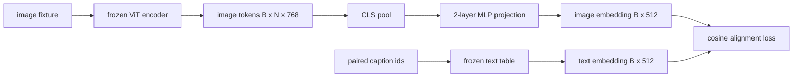

# 用于模态对齐的 projection layer

> vision encoder 产出图像 token。text decoder 消费文本 token。两者生活在不同的向量空间里。一个小的两层 MLP 把图像 token 投影进文本 embedding 空间，再配一个针对配对 caption 的余弦对齐损失，把两个空间拉到一致。这个 projection 是视觉-语言模型中最小的部件，也是对迁移最关键的那一个。

**Type:** Build
**Languages:** Python
**Prerequisites:** 第 19 阶段第 30 至 37 课（Track B 基础）
**Time:** ~90 分钟

## Learning Objectives

- 构建一个两层 MLP projection，把图像特征映射进文本 embedding 空间。
- 构造一张 mock 文本 embedding 表（不用预训练 tokenizer，不用真实语料）。
- 计算投影后的图像 token 与配对 caption embedding 之间的余弦对齐损失。
- 在冻结 vision encoder、冻结文本表的前提下，单独训练这个 projection。

## 问题场景

你有一个 vision encoder（第 58-59 课），在产出维度为 `vision_hidden = 768` 的 token。你还有一个想接在上面的 text decoder，其 embedding 维度为 `text_hidden = 512`（换成任何别的数字同样成立）。解码器期待的是文本形状的 token。图像 token 并不是文本形状的：它们生活在 encoder 于纯视觉预训练中学到的基里，与解码器的词向量没有任何关系。

两层 MLP projection（linear、GELU、linear）弥合了这个鸿沟。它足够小（约 `768 * 1024 + 1024 * 512 = 1.3M` 参数），在单张 GPU 上几分钟即可训练，而且它是对齐阶段唯一需要学习的部件。vision encoder 保持冻结。文本 embedding 表保持冻结。只有 projection 在动。这正是 LLaVA 在 2023 年交付的配方，也是 BLIP-2 以 Q-Former 重新表述、并为此后每一个开放权重 VLM 以某种形式采纳的配方。

## 核心概念



### 投影之前先池化

vision encoder 吐出 197 个 token。文本一侧只有一个 caption 级 embedding。要对齐它们，你需要每个样本一个图像级向量。CLS 池化最简单：取 encoder 的第一个 token 做投影。对全部 197 个 token 做平均池化是另一种选择，也是 SigLIP 的做法。两者都把 197 个向量池化成一个。

### 为何用两层而不是一层

单一线性投影可以旋转和缩放，但若两个空间存在曲率失配，它就无法校正基。两个线性层之间夹一个 GELU，给投影一次非线性弯折，经验上足以把 CLIP 风格特征对齐到语言模型 embedding。更深的投影（LLaVA-NeXT 用了 GLU；Qwen-VL 用了注意力层堆叠）只是扩展；两层 MLP 是典范基线，也是 BLIP-2 的 Q-Former 投影头在底层搭载的东西。

| 层 | 形状 | 参数量 |
|-------|-------|------------|
| fc1 | `(vision_hidden, projection_hidden)` | `768 * 1024 + 1024` |
| 激活 | GELU | 0 |
| fc2 | `(projection_hidden, text_hidden)` | `1024 * 512 + 512` |

一个 `768 -> 1024 -> 512` 的头约 1.3M 参数。

### 余弦对齐损失

对齐并不意味着 `image_emb == text_emb`。对齐意味着在联合空间里 `image_emb` 指向与 `text_emb` 相同的方向。余弦损失是 `1 - cos_sim(image, text)`，取值从 0（完全对齐）到 2（方向相反）。训练会把每一对的这个值推向零。第 62 课会推广到对比 batch（InfoNCE），其中每张图像都必须比 batch 中任何其他 caption 更接近自己的 caption；本课用逐对版本，便于看清动力学。

### 冻结编码器是关键

vision encoder 有 86M 参数。文本表又有几百万。用 mock 语料从头训练全部这些是不现实的。冻结两者意味着 projection 的 1.3M 参数是唯一在变化的东西，在合成对上跑几百步就足以把损失压下去。这正是每一个基于 adapter 的 VLM 的运行形态：沉重的部分保持冻结，轻量的桥在训练。

```figure
ch-projection-bridge
```

## Build It

`code/main.py` 实现了：

- `MLPProjector(in_dim, hidden_dim, out_dim)`，带 GELU 激活的两层线性 MLP。
- `MockTextEmbedding(vocab_size, dim)`，一张冻结的 embedding 表，初始化由 seed 确定。
- `make_pair(seed, vocab_size)`，合成一个配对的 (image, caption) 样本。caption 是短的 id 序列；caption embedding 是对 token embedding 做平均池化。
- `cosine_alignment_loss(image_emb, text_emb)`，逐对的 `1 - cos_sim` 目标。
- 一个训练循环，让 projection 在 32 个合成对（循环取用）上跑 200 步，vision encoder 与文本表保持冻结，每 25 步打印一次损失。

运行它：

```bash
python3 code/main.py
```

输出：训练报告显示，初始损失约 1.07，在 200 步内降到约 0.80，说明仅凭 projection 就能把图像 token 拉向文本空间。同时也会打印每一对最终的余弦相似度。

## Use It

同样的模式出现在每一个开放权重 VLM 中：

- **LLaVA 1.5。** 从 CLIP-ViT-L 隐层到 LLaMA embedding 维度的两层 GELU MLP projection。vision encoder 冻结，LLM 冻结，只训练 projection（然后在第二阶段解冻 LLM）。
- **BLIP-2。** Q-Former 让 32 个可学习 query token 通过对图像 token 的 cross-attention 走一遍，然后投影到 LLM 的 embedding 维度。Q-Former 最末端的那个投影头，就是本课 MLP 的对应物。
- **MiniGPT-4。** 从 BLIP-2 Q-Former 输出到 Vicuna embedding 维度的单层线性投影。
- **Qwen-VL。** 带若干层的 cross-attention adapter，但最后的部件仍然是一次到 LM embedding 维度的投影。

形状各异，角色完全相同：池化图像 token，投影到文本 embedding 维度，单独训练。

## 测试

`code/test_main.py` 覆盖：

- projector 输出形状与配置的 `out_dim` 相符
- 冻结的文本 embedding 表中 `requires_grad` 参数为零
- 余弦损失在相同向量上为 0，在反平行向量上为 2
- 一次反向传播后 projector 梯度正常流动
- 训练循环在第 0 步与第 200 步之间降低了损失

运行它们：

```bash
python3 -m unittest code/test_main.py
```

## Exercises

1. 把 CLS 池化换成对 196 个 patch token 的平均池化，比较 200 步后的最终损失。在合成数据上平均池化通常训练更快；在自然图像上 CLS 更省样本。

2. 给余弦损失加一个可学习的标量温度（`cos / tau`），观察 `tau` 过小（梯度噪声）或过大（损失在高位平台化）时会发生什么。

3. 把两层 MLP 换成单层线性，量化损失差距。非线性在自然图像特征上更重要，在合成特征上则没那么重要。

4. 给 projector 权重加一个小 L2 惩罚，观察它与余弦对齐如何交互（余弦是尺度不变的，因此惩罚主要是收缩未被使用的方向）。

5. 持久化 projector 权重，然后重新加载并在不跑 vision encoder 反向传播的情况下做推理，验证部署时只需要 projector。

## Key Terms

| 术语 | 实际含义 |
|------|---------------|
| Modality alignment | 让图像与文本 embedding 在同一个共享空间里可比较的动作 |
| Projection head | 把一个空间映射到另一个空间的小模块，通常是 2 层 MLP |
| Cosine similarity | 点积除以两个 L2 范数之积 |
| Frozen encoder | vision（或文本）模型的所有参数都是 `requires_grad=False` |
| Mock corpus | 合成的配对，使训练不依赖数据集下载 |

## Further Reading

- LLaVA 论文，关于两阶段训练（先投影，再解冻 LM）。
- BLIP-2 论文，关于作为可学习投影替代方案的 Q-Former。
- Qwen-VL 技术报告，关于作为更深投影头的 cross-attention adapter。
