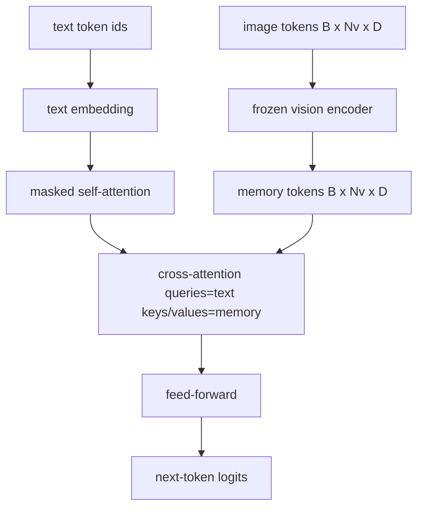
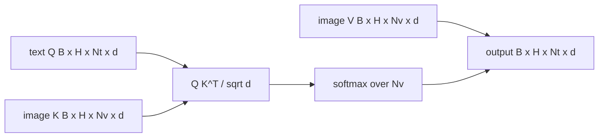

# Cross-Attention 融合

> projection layer 把一个图像向量与一个 caption 向量对齐。真正的视觉-语言解码器需要每个文本 token 都能对每个 patch token 做注意力，这样模型才能把每个词落到某个区域上。cross-attention 就是这种落地发生的方式。文本提出 query；视觉的 key 与 value 作答。本课构建 cross-attention 块、因果文本自注意力，以及让两者都合法的掩码形状。

**Type:** Build
**Languages:** Python
**Prerequisites:** 第 19 阶段第 30 至 37 课（Track B 基础）
**Time:** ~90 分钟

## Learning Objectives

- 实现多头 cross-attention，其中 query 流是文本，key/value 流是视觉。
- 组合一个解码器块：因果自注意力 + cross-attention + 前馈。
- 把掩码形状弄对：自注意力用因果掩码，cross-attention 不用掩码。
- 用批量的文本 token 与固定的图像 token 池跑一次前向传播。

## 问题场景

把图像 token 与文本 token 拼成一个序列是一种融合选项（early fusion，Chameleon 与 Emu3 走的路）。cross-attention 是另一种（late fusion，Flamingo 开创、此后每一个 Flamingo 形状的解码器都照抄的路）。在 late fusion 中，text decoder 只跑在纯文本 token 上，并在每一层通过 cross-attention 伸手进入图像流。

late fusion 有两个优势。第一，文本流保持干净，模型保留纯文本能力。第二，图像流每张图只计算一次，并在每个解码步复用，因此即便 caption 很长，生成也很便宜。代价是每个块多一个注意力子层。

## 核心概念





### 掩码形状

解码器块内的两种注意力需要不同的掩码：

| 注意力 | Query 长度 | Key 长度 | 掩码 | 原因 |
|-----------|--------------|------------|------|-----|
| 自注意力 | `Nt`（文本） | `Nt`（文本） | 因果：下三角 `(Nt, Nt)` | 自回归时文本 token 不得向前偷看 |
| Cross-attention | `Nt`（文本） | `Nv`（视觉） | 无掩码 | 每个文本位置都能看到整张图像 |

本课包含一个形状校验函数，使把两者搞混的错误以 `ValueError` 暴露出来，而不是静默地破坏损失曲线。

### 为何 cross-attention 不加掩码

在任何文本生成之前，图像已经被完整观测。caption 的 token `t` 可以对图像的任意 patch 做注意力；图像 patch 之间没有时间顺序。某些 Flamingo 变体在交错多图与多文本段时会加上逐样本的掩码模式，但对于一张图像加一段 caption 的情形，cross-attention 看到一切。

### key/value 缓存

图像 key 与 value 在解码开始时计算一次并保存在缓存中。每个新文本 token 都使用该缓存而无需重算。这正是 captioning 推理快的原因：沉重的 ViT 只跑一次，cross-attention 在每一步复用自己的 key 与 value。本课暴露该缓存并测试缓存命中路径。

### 块组合

一个解码器块依次执行：pre-LN -> self-attention -> residual -> pre-LN -> cross-attention -> residual -> pre-LN -> feed-forward -> residual。三个子层，各自带自己的 LayerNorm。Flamingo 论文在 cross-attention 上加了一个可学习门控，使模型可以在牺牲训练稳定性的前提下选择关掉图像路径；本课用的典范基线没有门控。

```python
class DecoderBlock:
  def forward(self, text_tokens, image_tokens, text_mask, cross_mask):
      text_tokens = text_tokens + self.self_attn(self.ln1(text_tokens),
                                                 mask=text_mask)
      text_tokens = text_tokens + self.cross_attn(self.ln2(text_tokens),
                                                  image_tokens,
                                                  mask=cross_mask)
      text_tokens = text_tokens + self.ffn(self.ln3(text_tokens))
      return text_tokens
```

```figure
ch-crossattn-fan
```

## Build It

`code/main.py` 实现了：

- `CrossAttention(hidden, heads)`，多头 cross-attention，带独立的 `q` 与 `kv` 投影。
- `CausalSelfAttention(hidden, heads)`，标准解码器中那种带掩码的自注意力。
- `DecoderBlock`，用 pre-LN 残差组合三个子层。
- `VisionLanguageDecoder`，四层解码器，由 mock vision encoder 输出与一张小文本 embedding 表供给。
- `causal_mask(length)`，返回一个 `(length, length)` 的下三角布尔张量。
- 一个演示：喂入两条长度为 10 的文本序列组成的 batch，图像 memory 长度为 197，打印输出形状、自注意力掩码形状，以及每个位置的 cross-attention 输出范数。

运行它：

```bash
python3 code/main.py
```

输出：解码器产出一个 `(2, 10, text_vocab)` 的 logits 张量。掩码形状为 `(10, 10)`。KV-cache 复用检查确认缓存路径与不缓存路径的 logits 完全一致。

## Use It

cross-attention 出现在两个生产系列中：

- **Flamingo 与 IDEFICS。** 每隔 K 个语言模型块插入一个 cross-attention 子层，LM 保持冻结。视觉-语言 adapter 就是这个 cross-attention 块加它的门控。
- **BLIP-2。** Q-Former 用固定 32 个 query token 对图像特征做 cross-attention，然后把这些 query 投影进 LM embedding 空间。

本课中这个块的形状可以直接映射到两者。掩码纪律（self 用因果、cross 不用）也相同。

## 测试

`code/test_main.py` 覆盖：

- 因果掩码是下三角，且布尔形状符合预期
- cross-attention 输出形状为 `(B, Nt, hidden)`，与 key 长度无关
- KV-cache 路径与不缓存路径在浮点容差内一致
- 文本流与图像流之间的形状不匹配会抛出清晰的 `ValueError`
- 完整的解码器前向传播产生正确的 batch 与序列形状

运行它们：

```bash
python3 -m unittest code/test_main.py
```

## Exercises

1. 给 cross-attention 残差加一个可学习的 tanh 门控（Flamingo 技巧），验证从接近零的初始门控开始训练也能收敛。门控从 0 起步；模型先恢复纯文本行为，再把图像流混进来。

2. 实现交错注意力，让同一个解码器消费多张图像加多个文本段。构造逐样本的 cross-attention 掩码，阻止文本段 2 注意到图像 1。

3. 在 `Nt=64, Nv=576`（更高分辨率下的 24x24 网格）下剖析 cross-attention 与 self-attention 层。cross-attention 的成本是 `Nt * Nv`，在高图像分辨率下占主导。

4. 在 cross-attention 图上加 query 侧 dropout，测量演示中的 caption 多样性（cross map 中的 dropout 越大，caption 样本方差越高）。

5. 把 cross-attention 层换成 Q-Former 风格的注意力块，让固定 32 个 token 的 query 池在每一层对图像特征做一次注意力。

## Key Terms

| 术语 | 实际含义 |
|------|---------------|
| Late fusion | 文本与视觉留在各自的流中；cross-attention 在每个块桥接两者 |
| Cross-attention | Q 来自一个流，K 与 V 来自另一个流 |
| Causal mask | 下三角布尔掩码，防止自回归时向前偷看 |
| KV cache | 图像 key 与 value 只存一次，每个解码步复用 |
| Memory tokens | 解码器伸手取用的冻结图像 token |

## Further Reading

- Flamingo（2022），关于带门控 cross-attention 的典范 late-fusion 设计。
- BLIP-2（2023），关于 Q-Former——一个被装扮成可学习 query 池的 cross-attention 块。
- IDEFICS（2023），关于 Flamingo 配方的开放权重复现。
