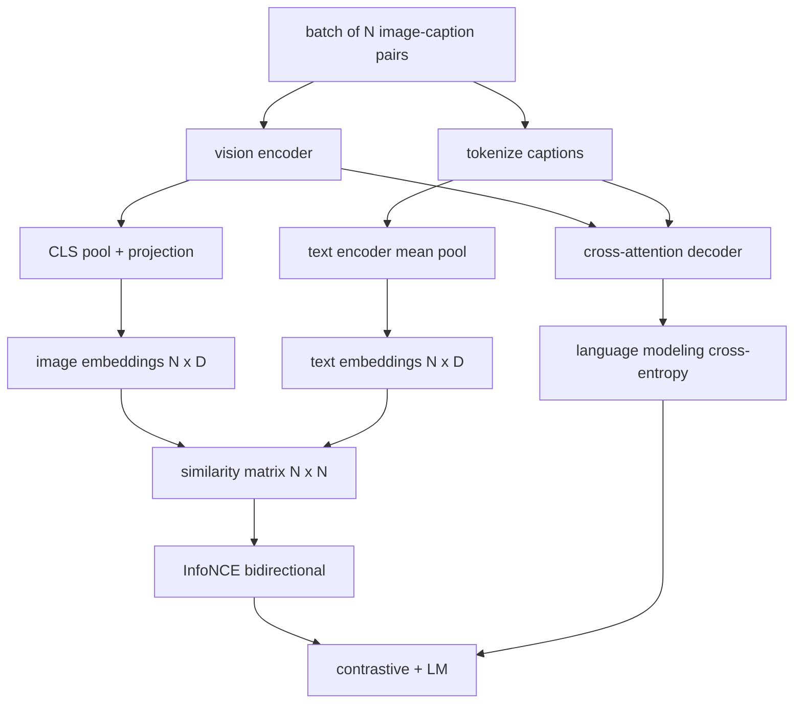

# 视觉-语言预训练

> encoder、projection 与 decoder 已经接好了。现在把它们放在一起训练。两个目标驱动学习：一个是对比式图文损失（InfoNCE），把匹配对在联合 embedding 空间里拉近；另一个是语言建模损失，要求解码器为每张图写 caption。二者结合，教网络既能为一句话找到正确的图像，又能为图像写出描述。

**Type:** Build
**Languages:** Python
**Prerequisites:** 第 19 阶段第 30 至 37 课（Track B 基础）
**Time:** ~90 分钟

## Learning Objectives

- 在一个图像-caption 对的 batch 上实现 InfoNCE 对比损失。
- 把对比损失与自回归语言建模损失组合起来。
- 合成一个 200 对的 mock 图文语料，无需下载任何真实数据集。
- 跑一个 50 步的演示训练循环，观察两个损失都在下降。

## 问题场景

一个视觉-语言模型需要两种技能。它必须会排序：给定一个 caption，在许多图像中找到正确的那张。它必须会生成：给定一张图像，写出一个 caption。只在一个技能上预训练模型，你只得到半个系统。CLIP 把排序做到了位却不会 caption。GPT-4V 会 caption 但排序要用单独的 retrieval 头。多目标预训练一口气拿下两者。

InfoNCE 负责排序那一半。对一个有 N 对的 batch，模型把 N 个匹配对当作正例，把 `N^2 - N` 个错配对当作负例，然后对得到的 `(N, N)` 相似度矩阵做交叉熵。LM 损失负责生成那一半：标准的、以图像为条件的下一 token 预测。两个损失都可微，并且可以共享 encoder、projector 与 decoder 的权重。

## 核心概念



### 一段话讲清 InfoNCE

把 N 个图像 embedding 与 N 个文本 embedding 分别按行堆叠。两者都做 L2 归一化。计算 `N x N` 矩阵 `S = I T^T / tau`，其中 `tau` 是学习的温度。对角元素是匹配对；非对角元素是负例。沿对角线向下取 `argmax` 作为目标做交叉熵：第 `i` 行应在第 `i` 列取得最大值。再沿列方向对称做一遍。总和取两者平均。这就是八行写出的 CLIP 损失。

### 温度很重要

温度 `tau` 控制 softmax 有多尖锐。太小（例如 `tau = 0.01`）时梯度只来自最难的那个负例，训练噪声大。太大则 softmax 变平、梯度消失。CLIP 把 `tau` 学成一个参数；这里的演示同样如此。

### 语言建模损失

解码器通过 cross-attention 消费图像 memory token，并在每个位置预测下一个文本 token。损失是以下一位置为目标的标准交叉熵。padding 位置被从损失中屏蔽掉。

### 组合损失

`total = contrastive + lm_weight * lm`，其中 `lm_weight` 是标量（常为 1.0）。两个损失都把梯度共享进 encoder 与 projection；只有解码器接收 LM 损失的梯度。这正是 CoCa、BLIP 与 SigLIP 风格模型都在用的多任务配方，只是权重各有不同。

| 组件 | 损失面 | 影响范围 |
|-----------|--------------|---------|
| InfoNCE | 联合空间中的配对排序 | Encoder + projection + 文本头 |
| LM | 以图像为条件的 token 预测 | Encoder + projection + decoder |
| 组合 | 多任务 | 整条堆栈 |

### 为何 50 步足够做演示

mock 语料是一个合成的 200 对集合，图像与 caption id 都是随机的。用 batch size 16 跑 50 步 SGD 后，两个损失都明显下降，即便绝对值仍高于真实数据模型能达到的水平。演示的目的在于确认梯度管道端到端接通，并确认加入 LM 损失不会让对比目标失稳。

```figure
ch-infonce-diagonal
```

## Build It

`code/main.py` 实现了：

- `MultimodalModel`，组合一个小 ViT encoder、MLP projector、一个极小的文本侧 encoder（对嵌入后的 id 做平均池化），以及第 61 课的 cross-attention 解码器。
- `info_nce_loss(image_emb, text_emb, temperature)`，双向 CLIP 风格对比损失。
- `lm_loss(logits, target_ids, padding_id)`，带掩码的下一 token 交叉熵。
- `make_mock_corpus(seed, n_pairs)`，返回 200 个确定性的 (image, caption_ids) 对。
- 一个训练循环，跑 50 步，batch size 16，Adam 优化器，并带一个可学习的 log 温度参数。每 5 步打印两个损失。

运行它：

```bash
python3 code/main.py
```

输出：对比损失从约 `ln(16) = 2.77` 降到约 2.4；LM 损失从随机均匀基线 `ln(512) ≈ 6.24` 降到约 4.7。两个下降都证明梯度接对了。真实模型会训练数百万步；动力学是一样的。

## Use It

这与下列模型交付的是同一套损失配方：

- **CLIP（2021）。** 只有图文对比，另配一个冻结编码器的 caption 探针。
- **CoCa（2022）。** 图文对比加图像 captioning 的 LM 损失，合于一个模型。正是本课构建的模式。
- **BLIP（2022）与 BLIP-2。** 对比 + LM + 图文匹配头。三个损失组合。
- **SigLIP（2023）。** 把 InfoNCE 换成 sigmoid 配对损失；相同的对比角色，不同的函数形式。
- **LLaVA 系列。** 两阶段训练，第一阶段是对齐（在冻结 LM 上用余弦），第二阶段在解冻的 LM 上再加 LM 损失。第 60 课对应第一阶段；本课对应第二阶段。

## 测试

`code/test_main.py` 覆盖：

- InfoNCE 损失在图像/文本两个行方向上对称
- 当相似度矩阵是一条由大正数构成的完美对角线时，InfoNCE 损失返回 0
- LM 损失正确屏蔽 padding 位置
- 模型前向传播能无错误地产出两个损失
- 5 步训练循环降低了组合损失

运行它们：

```bash
python3 -m unittest code/test_main.py
```

## Exercises

1. 把 InfoNCE 换成 SigLIP 风格的 sigmoid 配对损失，在 mock 语料上比较收敛。

2. 加入难负例挖掘步骤：每隔一个 batch，从前一个 batch 中挑出最难的非对角对并追加进来。训练后检查对比损失是否下降更快。

3. 在联合 embedding 之上加一个图文匹配二分类头（真/假：这两者匹配吗？）作为第三个损失，复现 BLIP 的三头设置。

4. 把 mock 语料换成从一个马尔可夫链中抽出的 caption id 序列，其转移矩阵以图像哈希为条件。captioning 损失应进一步下降，因为存在真正可学的信号。

5. 分别用 `lm_weight = 0` 与 `lm_weight = 1` 训练同一个模型。比较对比损失；LM 损失不应让排序目标退化。

## Key Terms

| 术语 | 实际含义 |
|------|---------------|
| InfoNCE | 噪声对比估计：在相似度矩阵上做交叉熵 |
| Temperature | 控制对比 softmax 尖锐程度的标量 |
| Hard negative | 模型觉得困惑的非对角对，适合用于采样 |
| LM loss | captioning 一侧标准的下一 token 交叉熵 |
| Joint embedding space | 投影之后图像与文本向量所在的共享空间 |

## Further Reading

- CLIP 论文，关于最初的对比配方。
- CoCa 论文，关于在一个模型中同时做对比与 captioning。
- SigLIP 论文，关于 sigmoid 配对损失变体，以及它为何扩展性更好。
