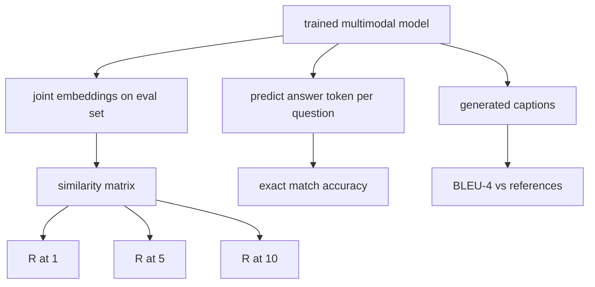

# 多模态评测

> 训练只是循环的一半。另一半是度量。本课从原语出发构建三个评测面：以 R@1、R@5、R@10 报告的图文检索；以精确匹配准确率报告的视觉问答；以及以 BLEU-4 报告的图像 captioning。每个指标都是模型输出之上的一个函数，外加一套几秒内就能跑完的合成评测套件。

**Type:** Build
**Languages:** Python
**Prerequisites:** 第 19 阶段第 58 至 62 课（Track E 基础：encoder、transformer、projection、cross-attention fusion、pretraining）
**Time:** ~90 分钟

## Learning Objectives

- 从图像与 caption embedding 之间的相似度矩阵计算 Recall@K。
- 从把 (image, question) 对映射到固定答案词表的模型计算精确匹配的 VQA 准确率。
- 不依赖任何外部库，从生成序列与参考 token 序列计算 BLEU-4。
- 在第 62 课训练好的模型之上构建合成套件，并对它跑全部三个评测。

## 问题场景

诱惑在于：训练损失一旦平台化，就宣布多模态模型完工。训练损失衡量对训练分布的拟合；它不衡量模型能否在留出 batch 里排出配对顺序、能否回答问题、能否写出人类愿意接受的 caption。三个评测面是标准做法：

- **Retrieval（R@1、R@5、R@10）。** 为查询 caption 构建联合 embedding；按余弦对 eval 池中每张图像排序；报告匹配图像是否落在前 1、前 5、前 10。对称的（图像到文本）形式同理。
- **视觉问答（exact match）。** 给定 (image, question)，模型输出一个 answer token。exact match 是逐样本的一比特：预测答案是否等于参考答案？在整个 eval 集上取平均。
- **Captioning（BLEU-4）。** 生成一个 caption。针对参考 caption 计算 1-gram 到 4-gram 精确率的几何平均，并带 brevity penalty。多参考是标准形式（一张图像，若干参考 caption）。

每个指标都是一个薄函数。本课把它们全部用代码构建，让数学变得具体，且评测面始终在你掌控之中。真实基准套件（MS-COCO、VQA v2、GQA、OK-VQA）可直接插入相同的函数形状。

## 核心概念



### 由相似度矩阵计算 Recall@K

在图像与 caption embedding 之间构建 `(N, N)` 余弦相似度矩阵。对每一行，按相似度降序排列各列。Recall@K 是对角列索引落在前 K 位置的行所占比例。对称的 Recall@K（caption 到 image）在转置矩阵上计算。两个数字都报告。对一个 N=100 的 eval，R@1 = 0.6 意味着 100 个 caption 中有 60 个把正确图像检索为最佳匹配。

### VQA 精确匹配

对每个 (image, question, answer)，编码图像、嵌入问题、经解码器融合，并读出下一个 token。把预测 token id 与参考 id 比较；相等则正确。在整个 eval 集上取平均。真实 VQA 数据集每个问题带多个人工标注答案，使用软准确率公式（10 个标注者中至少 3 个一致记 1.0，否则按比例缩放）；本课为清晰起见使用单答案 exact match。

### BLEU-4

```text
BLEU-4 = BP * exp(mean(log p1, log p2, log p3, log p4))
```

其中 `p_n` 是修正后的 n-gram 精确率（生成 n-gram 中出现在任一参考里的截断计数，除以生成 n-gram 总数），`BP` 是 brevity penalty：

```text
BP = 1                if generated length > reference length
   = exp(1 - r/g)     otherwise, where r is reference length and g is generated
```

小样本下某些 `p_n` 为零时需要平滑。实现使用 Chen 和 Cherry 的“method 1”（对任何零计数在分子与分母各加 1），这是低计数情形下最安全的默认。

### 合成评测集

一个 50 样本的评测集在内存中构建，沿用第 62 课相同的 mock 语料模式，但使用留出的 seed。套件由三个列表组成：

- `pairs`：用于检索的 50 个 (image, caption_ids) 对。
- `vqa`：50 个 (image, question_ids, answer_id) 三元组。
- `caps`：50 个 (image, [reference_caption_ids, ...]) 条目，每张图像最多 3 个参考。

套件由 seed 确定，并从训练语料中留出，因此指标是在模型从未见过的数据上计算的。把套件持久化为 JSON 留作练习（见下）。

| 指标 | 取值范围 | 随机基线（N=50） |
|--------|-------|------------------------|
| R@1 | 0 到 1 | 0.02（1 / N） |
| R@5 | 0 到 1 | 0.10 |
| R@10 | 0 到 1 | 0.20 |
| VQA EM | 0 到 1 | 1 / vocab |
| BLEU-4 | 0 到 1 | 小但非零 |

对合成数据只跑 50 步训练，这些指标不指望很高；只指望高于随机基线，而演示检查的正是这一点。

```figure
ch-recall-window
```

## Build It

`code/main.py` 实现了：

- `recall_at_k(sim_matrix, k)`，为两个方向分别返回 `[0, 1]` 内的浮点数。
- `vqa_exact_match(predictions, references)`，返回 `int` 相等性的平均值。
- `bleu4(generated, references, smoothing=True)`，支持多参考。
- `build_eval_suite(seed, n_samples, vocab_size, max_len)`，返回三个确定性的评测列表。
- `evaluate(model, suite)`，运行全部三个指标并返回一个数字 `dict`。
- 一个演示：加载第 62 课新初始化的多模态模型，评测它，然后训练 50 步再评测一次，打印前后指标。

运行它：

```bash
python3 code/main.py
```

输出：前后对比的指标表显示，retrieval 从接近随机提升到模型学到的信号，VQA 高于随机，BLEU-4 有提升（合成结构足以带来 4-gram 精确率的抬升）。

## Use It

每个指标都直接映射到一个生产基准：

- **Retrieval。** MS-COCO 5K val、Flickr30K、ImageNet zero-shot 都是同一个相似度矩阵上的 R@K 问题。把合成 eval 换成真实文件，函数签名不变。
- **VQA。** VQA v2、GQA、OK-VQA 使用相同的 exact-match 形状（VQA v2 用 soft-acc 而非单答案 EM）。
- **BLEU-4。** MS-COCO captioning、NoCaps、Flickr30K captioning 都用 BLEU-4 加上 CIDEr 与 METEOR。加入 CIDEr 只是再多一个函数。

对真实基准，把 `build_eval_suite` 换成一个真实 loader，并保留函数体。数学与具体基准无关。

## 测试

`code/test_main.py` 覆盖：

- recall@k 在完美单位相似度矩阵上返回 1.0，在翻转的矩阵上对 k < N 返回 0.0
- recall@k 遵守 `k <= N` 的上界
- 当生成结果与某个参考完全相等时，bleu4 返回 1.0
- bleu4 在词表不相交时返回 0.0
- vqa exact match 等于相等对所占比例
- build_eval_suite 返回预期数量的 pairs、vqa 项与 caption 条目

运行它们：

```bash
python3 -m unittest code/test_main.py
```

## Exercises

1. 给 captioning 指标加入 CIDEr。CIDEr 在 n-gram 上使用 TF-IDF 加权，奖励信息量大的 token。

2. 实现软准确率 VQA：每个问题多个人工答案，若任一匹配则准确率为 `min(human_count / 3, 1)`。复现 VQA v2。

3. 给 `bleu4` 加一个 NaN 安全变体，处理空生成序列而不崩溃。

4. 在 R@K 之外计算平均倒数排名（MRR）。MRR 对正确项落在前 K 之外的位置敏感；R@K 只关心它是否落在前 K。

5. 在训练期间的五个 checkpoint 上（第 0、10、20、30、40、50 步）评估模型并绘制学习曲线。确认指标轨迹与损失轨迹一致。

## Key Terms

| 术语 | 实际含义 |
|------|---------------|
| R@K | 查询中正确匹配落在前 K 结果的比例 |
| Exact match | 最简单的 VQA 评分：预测答案等于参考答案 |
| BLEU-4 | 1- 到 4-gram 精确率的几何平均，带 brevity penalty |
| Multi-reference | captioning 指标接受每张图像的多个参考 caption |
| Held-out | eval 集由与训练语料不相交的 seed 采样而来 |

## Further Reading

- VQA v2 论文，关于 soft-accuracy 公式与数据集统计。
- CIDEr 论文，关于 TF-IDF 加权的 n-gram captioning。
- BLEU 原始论文（Papineni 等，2002），关于各平滑变体。
- MS-COCO captioning 评测脚本，关于典范参考实现。
