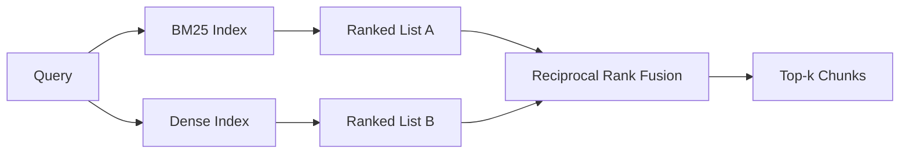

# 混合检索：BM25 与 dense embedding

> 词法检索与语义检索在不同的查询分布上各自失败。带 reciprocal rank fusion 的混合检索不做插值，它做的是投票 —— 而这个投票在每一类查询上都胜出。

**Type:** Build
**Languages:** Python
**Prerequisites:** 第 11 阶段第 04 课（embeddings）、第 06 课（RAG）；第 19 阶段 Track B 基础（第 20 至 29 课）；第 19 阶段第 64 课（chunking strategies）
**Time:** ~90 分钟

## Learning Objectives
- 从 Robertson 与 Sparck Jones 的公式出发从零实现 BM25，包含字段权重、文档长度归一化和可调的 k1 与 b。
- 在确定性的 mock embedding 之上构建 dense 检索器，让整个循环可以离线运行。
- 严格按照 Cormack、Clarke 和 Buettcher 于 2009 年发表的方式实现 reciprocal rank fusion，并解释它为何胜过按分数加权的插值。
- 调节 RRF 的 k 常数与各模态权重，并在小型 fixture 语料上读懂其中的权衡。

## 问题场景

当查询携带语料中逐字存在的字面标识符时，词法搜索胜出。查询 `AbortMultipartOnFail` 时，BM25 能在微秒级返回正确的 Go 函数。同一个查询一旦被 embedding，就落在三个相似度簇的边界上，dense 检索器会把错误的文件排在第一。

当查询被改写、偏离了语料中的字面 token 时，dense 搜索胜出。用户问 “how do we handle cancelled uploads” 时从未输入 abort 或 multipart 这两个词。BM25 会返回 “uploading large files” 的文档分块，因为那一页含有 uploads 这个词。dense 检索则能找到摘要中提到 cancellation 的 abort 函数。

两者之间的选择并非静态。真正的变量是查询分布。生产级 RAG 系统从同一个 endpoint 处理这两类查询，因此检索必须同时应对二者。这就是混合检索。而合并步骤正是必须做对的那一环。

## 核心概念



### 一段话讲清 BM25

BM25 对查询-文档对打分的方式是：对每个查询词，把逆文档频率因子乘以一个包含长度归一化修正的饱和词频因子，再求和。两个旋钮。`k1` 控制词频饱和速度；默认值 1.5 是论文给出的推荐值，没有基准测试就不要改动它。`b` 控制文档长度的影响程度；默认值 0.75 表示较长的文档会被惩罚，但不是线性惩罚。

IDF 公式采用平滑后的 Robertson 与 Sparck Jones 定义，即 `log((N - df + 0.5) / (df + 0.5) + 1)`。log 内加 1 保证某个词出现在超过半数语料中时 IDF 仍为正。这在停用词严格说来很少见的小型语料中很关键。

字段权重让你告诉 BM25：命中符号名的匹配比命中正文更有分量。实现方式是在建索引时对词计数施加乘数，而不是在打分时。这样数学形式保持不变，也避免了为每个字段单独计算分数。

### 一段话讲清 dense 检索

用 embedding 模型把每个分块编码成固定维度的向量。查询时，编码查询，按相似度对每个分块做余弦排序，返回 top-k。决定质量的是模型这个变量。检索算法本身只有两行：点积和排序。

本课使用基于哈希的确定性 embedding，让你无需网络调用就能读懂融合的数学。哈希把以 token 为键的偏移量累加进一个 96 维向量并归一化。余弦排名在多次运行之间保持确定性，这正是测试套件所要求的。

### reciprocal rank fusion 的发表公式

两个排好序的列表。对出现在任一列表中的每个候选，把它的倒数秩贡献相加。2009 年的论文使用 `1 / (k + rank)`，k 默认取 60。按总分排序。整个算法就这些。

论文给出的常数 k = 60 并非随意取值。当 k = 60 时，排名第 1 的贡献是 1 / 61，排名第 10 的贡献是 1 / 70。贡献衰减缓慢，因此靠后的候选仍然参与投票。较小的 k 让靠前结果占主导。较大的 k 让贡献曲线更平坦。

我们的实现有两个可调旋钮。一个是 `k` 常数。另一个是一对各模态权重，这样当你有先验证据表明 BM25 或 dense 在你的语料上更好时，可以给它加权。把排名贡献乘以权重是最简单且有原则的实现；它保留秩衰减的形状，并保持尺度无关。

### 为什么融合优于按分数加权的插值

BM25 分数无上界，且依赖语料。余弦相似度被限制在 -1 到 1 之间。线性组合 `alpha * bm25 + (1 - alpha) * cosine` 需要按语料调节 alpha，而且每次重建索引都会失效。基于排名的融合不会。两个排名在不同模态之间是可比的。自 2010 年以来，论文给出的 RRF 基线在所有公开的 TREC track 上都胜过分数插值。

这与你在 Vespa 和 Weaviate 文档中看到的 RankFusion 与 RRF 之争是同一个论证。它们得出了同样的结论：坚持基于排名，除非你有非常强的证据去插值分数。

```figure
rrf-fusion
```

## Build It

`code/main.py` 实现了：

- `tokenize(text)` —— 一个快速的正则分词器。
- `BM25Index` —— 带字段权重，提供 `add` 与 `search`，以及可调的 k1、b。
- `mock_embed`、`DenseIndex` —— 与第 64 课相同的确定性 embedding，使分块之间可以相互比较。
- `rrf(rankings, k, weights)` —— 论文给出的融合算法，支持多模态权重。
- `HybridRetriever` —— 组合 BM25 与 dense。
- 一个演示用的 `main()`，加载小型 fixture 语料，运行三个分别针对各检索器优势与弱点的查询，并打印每个模态产生的排名以及融合后的列表。

运行它：

```bash
python3 code/main.py
```

把演示输出并排来读。字面标识符查询落在 BM25 第 1 名、dense 第 4 名、RRF 第 1 名。改写后的查询落在 BM25 第 6 名、dense 第 1 名、RRF 第 1 名。有歧义的查询落在 BM25 第 3 名、dense 第 3 名、RRF 第 1 名。融合不是决胜局；它本身就是每一类查询上都胜出的系统。

## 调节旋钮

| 旋钮 | 默认值 | 何时调高 | 何时调低 |
|------|---------|----------------|------------------|
| BM25 k1 | 1.5 | 词在文档中重复出现，你想让词频更有分量 | 文档很短，词重复是噪声 |
| BM25 b | 0.75 | 长文档确实每个词承载的信息更少 | 文档长度与主题无关 |
| RRF k | 60 | 靠后的候选也应继续投票 | 希望 top-1 占主导 |
| BM25 权重 | 1.0 | 你的语料含字面标识符，且查询能匹配它们 | 你的查询是用户改写过的 |
| Dense 权重 | 1.0 | 查询是改写过的 | 查询是字面的 |

调参要靠在你留出的查询集上重跑第 68 课的 eval harness，而不是凭直觉。

## 演示会掩盖的失败模式

**词表外的 token。** BM25 的 IDF 从语料计算，因此只出现在查询中的词贡献为零。dense embedding 会为同一个词凭空生成一个向量。对语料外的标识符，dense 模态会返回看起来合理但错误的邻居。融合能吸收这一点，因为 BM25 不返回任何结果，排名贡献随之消失；但前提是你按文档而不是按分块去重。

**停用 token 主导。** 用 BM25 查 “the” 这个词会在整个语料上产生近似均匀的排名。要么在索引器中过滤停用 token，要么接受高 IDF 的词自然占主导。

**不同模态内容重合。** 如果你的语料小到 BM25 的 top-1 也是 dense 的 top-1，RRF 给出的就是相同的 top-1 和相同的邻居。这是正确行为，不是失败，但它让融合看起来毫无作用。在 eval 中加入一对对抗性查询，验证融合确实在起作用。

## Use It

生产实践：

- 在进程内为 BM25 建索引；瓶颈是词频字典，而不是向量。
- 把 dense 向量索引在独立存储中（本课用扁平列表；生产中你会用 HNSW）。
- 并行执行两个查询；融合是对并集的常数时间合并。
- 持久化每个检索命中来自哪个模态，以便下游 reranker 看到是哪个模态为它投了票。

## Ship It

第 66 课拿走本课的融合 top-k，用 cross-encoder 重排。第 68 课用 precision、recall、MRR 和 nDCG 评估整条流水线。本课的混合检索器是第 69 课端到端系统的第一阶段。

## Exercises

1. 用你的 provider 提供的真实模型替换 `mock_embed`。重跑演示，报告仅用 dense 的排名在改写查询上如何变化。
2. 加入第三个模态：单独索引分块摘要，作为第三个排名列表融合进来。测量收益。
3. 在 10、30、60、100、200 上扫描 RRF k。画出第 68 课的 recall@k 曲线。报告在你的语料上曲线达到峰值处的 k 值。
4. 正确实现 BM25F（按字段做长度归一化，而不是用乘数技巧），并在符号匹配最重要的语料上做对比。

## Key Terms

| 术语 | 人们常怎么说 | 实际含义 |
|------|-----------------|------------------------|
| BM25 | “词法搜索” | 用 idf x 饱和 tf x 长度归一化做概率排序 |
| RRF | “排名融合” | 各排名列表上 1 / (k + rank) 之和；k 默认 60 |
| k1 | “TF 饱和” | 控制重复词多快停止继续加分 |
| b | “长度惩罚” | 0 表示忽略文档长度，1 表示完全归一化 |
| Field weighting | “符号加权” | 建索引时重复 token，以提升该字段匹配的权重 |
| 基于排名 vs 基于分数的融合 | “为什么 RRF 胜过线性” | 排名在不同模态间可比；分数不可比 |

## Further Reading

- Cormack, Clarke, Buettcher, "Reciprocal Rank Fusion outperforms Condorcet and individual rank learning methods", SIGIR 2009
- Robertson, Walker, Beaulieu, Gatford, Payne, "Okapi at TREC-3"（BM25 的原始论文）
- [Vespa：用 BM25 与 Embeddings 做混合检索](https://docs.vespa.ai/en/tutorials/hybrid-search.html)
- [Weaviate：混合搜索](https://weaviate.io/developers/weaviate/search/hybrid)
- 第 11 阶段第 06 课 —— RAG 基础
- 第 19 阶段第 64 课 —— 其输出在此被索引的分块器
- 第 19 阶段第 66 课 —— 消费融合 top-k 的 cross-encoder reranker
