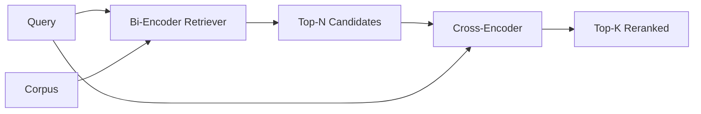

# Cross-Encoder 重排器

> bi-encoder 独立编码查询与文档。cross-encoder 把它们拼接起来，一次同时读取两者。cross-encoder 是最聪明的读者，也是最慢的。把它用作 bi-encoder top-k 之上的第二阶段，它就值回成本。

**Type:** Build
**Languages:** Python
**Prerequisites:** 第 11 阶段第 06 课（RAG）、第 11 阶段第 07 课（advanced RAG）；第 19 阶段 Track B 基础（第 20 至 29 课）；第 19 阶段第 65 课（为这一阶段提供输入的 hybrid retrieval）
**Time:** ~90 分钟

## Learning Objectives
- 从输入形状、参数数量和每查询成本上区分 bi-encoder 检索器与 cross-encoder reranker。
- 从零实现一个小型 cross-encoder：一个 transformer block，消费打包的 (query, document) 序列，输出单个相关性标量。
- 串起两阶段的先检索再重排流水线：用廉价检索器取回 top-N，用 cross-encoder 把 N 重排到 top-K，返回 K。
- 在小型 fixture 语料上测量延迟与质量的权衡，并为给定的延迟预算挑出合适的 N。

## 问题场景

bi-encoder 把查询与文档映射进同一个向量空间，并按余弦排序。两个编码彼此从不相见。模型必须在看不到查询的情况下，把文档中一切有用的信息压缩进单个向量。这很快 —— 建索引时每篇文档一个 embedding，查询时每个查询一个 embedding —— 也是唯一能在语料规模上排序的方式。

代价是 precision。两篇整体主题相同的文档，即使一篇回答了查询、另一篇没有，它们的 embedding 也可能几乎相同。bi-encoder 无法区分它们。

cross-encoder 通过同时读取查询与文档来解决这个问题。模型把 `[query] [SEP] [document]` 作为单个序列接收，在拼接处运行完整注意力，并产出一个相关性标量。文档的每个 token 都能关注到查询的每个 token。模型在全上下文下决定分数。

代价是吞吐。bi-encoder 编码一次便可无限次查询，而 cross-encoder 对每个 (query, document) 对运行一次。对于一千万篇文档的语料，那就是每次查询一千万次前向传播。在请求预算内根本无法运行。

解决方案是分阶段。用 bi-encoder 取回 top-N。用 cross-encoder 把 N 重排到 top-K。N 很小（50 到 200），而 cross-encoder 的质量提升恰好集中在关键之处。总延迟保持在请求预算内。总质量就是 cross-encoder 的质量，上限由 bi-encoder 在 N 处的 recall 决定。

## 核心概念



### cross-encoder 的输入形状

标准打包方式是 `[CLS] query_tokens [SEP] document_tokens [SEP]`。CLS 位置的输出被送入一个单独的线性头，输出相关性标量。有些实现用 mean-pooling 代替 CLS；差别很小。关键在于模型对每个对只产出一个数字。

2200 万参数的 cross-encoder（已发布的 `ms-marco-MiniLM-L-6-v2` 这一权重级别）是典型的生产选择。更小的模型损失质量的速度快于它节省延迟的速度。更大的模型（例如 5.68 亿参数的 `bge-reranker-v2-m3`）留作离线重排，或用于 K 很小的首页重排。

### 为什么本课训练一个极小的模型

真实的 cross-encoder 是一个微调过的 encoder transformer。生产中你加载 checkpoint 并运行它。本课的目标是向你展示模型的形状与延迟-质量曲线的形状，而不是训练一个最先进的 ranker。所以我们构建一个小的 `nn.Module`，含一个 transformer block、多头注意力（默认 4 个头）和一个回归头。它从种子确定性初始化，因此演示无需磁盘上的权重即可复现。

这个玩具模型从 fixture 语料中学到正确的形状：相关的查询-文档对比不相关的对得到更高的预测分数。端到端流水线对 bi-encoder 的输出重排，重排后的 top-k 与 gold 标签相关。

### 延迟与质量

两阶段流水线只有一个可调参数：N。在留出的查询集上把 N 从 5 扫描到 100，就得到这条曲线。

| N | 第二阶段的 Recall@1 | 每查询的 cross-encoder 前向传播次数 | 延迟 |
|---|--------------------|---------------------------------------|---------|
| 5 | 0.62 | 5 | 低 |
| 20 | 0.81 | 20 | 中 |
| 50 | 0.86 | 50 | 高 |
| 100 | 0.86 | 100 | 很高 |

上表中的数字只是为了示意形状，并非来自本 fixture 的实测。形状是真实的。在约 20 到 50 个候选处总会出现一个拐点，重排收益在此饱和。越过拐点之后，你付出的成本毫无回报。

N 要依据 eval 曲线加上延迟预算来定。cross-encoder 无法把 recall 提升到超过 bi-encoder 在 N 处的 recall，因此 N 偏低不只封顶延迟，也封顶质量。

```figure
rerank-funnel
```

## Build It

`code/main.py` 实现了：

- `CrossEncoder` —— 一个小的 `torch.nn.Module`：token embedding、一个含多头注意力与前馈的 transformer block、产生单个标量的 mean-pooling 头。
- `tokenize_pair(query, document)` —— 把两个字符串打包成单个 id 序列，用 type id 标记边界，确定且仅用 stdlib。
- `train_tiny(pairs)` —— 在手工标注的 (query, document, relevance) 三元组列表上做一遍监督训练，使模型在 fixture 上产生合理的分数。
- `rerank(query, candidates, top_k)` —— 生产接口。
- `pipeline(query, retriever, top_n, top_k)` —— 两阶段流程。
- 一个演示用的 `main()`，按第 65 课的模式加载语料，取回 top-N，重排到 top-K，并排打印两个列表，并报告每个阶段的延迟。

运行它：

```bash
python3 code/main.py
```

输出展示 bi-encoder 的 top-N、cross-encoder 的 top-K 以及时间汇总。cross-encoder 单次调用更慢，但不会在整个语料上运行。两阶段的总耗时保持在请求预算内，同时挑出 bi-encoder 排在第二或第三的那个答案。

## 演示会掩盖的失败模式

**cross-encoder 不是对称的。** `rerank(q, d)` 与 `rerank(d, q)` 得到不同的分数。永远把查询放在前面。如果不小心交换，recall 会崩塌。

**N 太低，暴露不出问题。** 如果设 N = K，cross-encoder 无法重排，只能重新加权。提升看起来为零。让 N 至少是 K 的三倍。

**训练数据泄漏进 eval。** 如果手工标注的训练对里包含 eval 查询，重排看起来会神奇地好。即便在 fixture 上也要严格分离训练与 eval。

**生产权重是稠密的。** 2200 万参数的 cross-encoder 在 float32 下是 88MB。在承诺 100ms 以内的 p95 之前，先规划好模型服务器的内存。

**批处理很重要。** 真实的 cross-encoder 把 N 个候选放在一个批次里运行。本课在 `_batch_encode` 中这么做：用 `torch.tensor(...)` 构建批量的 id 与 type-id 张量，并运行一次前向传播。跳过批处理，延迟就会乘以 N。

## Use It

生产实践：

- 把 bi-encoder、cross-encoder 和 N 固定在一起。改动其中任何一个都会让 eval 失效。
- 按 (query, document_id) 哈希缓存 reranker 的输出。同一查询在稳定语料上重排得到相同顺序；缓存命中为你带来免费的延迟削减。
- 记录 rank-1 的 cross-encoder 分数。若某查询的 top-1 分数低于该语料特定的阈值，就是域外命中；把它作为 “I am not confident” 呈现给 LLM。

## Ship It

第 68 课端到端评估这条两阶段流水线。第 69 课把这个 reranker 接在第 65 课的混合检索器之后、答案生成器之前。reranker 是端到端系统的第二阶段。

## Exercises

1. 把 N 从 5 扫描到 50，画出重排输出的 recall@1。找出该 fixture 上的拐点。
2. 把 cross-encoder 训练十轮而不是一轮。测量每一轮正负样本对之间的分数差距。
3. 用 CLS-token 头替换 mean-pooling。对比在该 fixture 上的收敛情况。
4. 给 cross-encoder 加上第二个头，预测二值的 “这个答案是否在文档中” 标签。推理时使用两个头；一个用于排序，一个用于设阈值。
5. 用第 65 课的实现替换确定性的 mock bi-encoder，把两个阶段链接起来。测量 top-K 相对单独使用 bi-encoder 的变化。

## Key Terms

| 术语 | 人们常怎么说 | 实际含义 |
|------|-----------------|------------------------|
| Bi-encoder | “向量检索器” | 独立编码查询与文档；用余弦排序 |
| Cross-encoder | “Reranker” | 联合编码 (query, doc)；输出单个相关性标量 |
| 两阶段流水线 | “先检索后重排” | 廉价检索器返回 N，昂贵的 reranker 保留 K |
| N（候选预算） | “重排池” | cross-encoder 每查询打分的候选数量 |
| Mean-pooling 头 | “最后一层隐状态均值” | 把编码器最后一层的输出平均成一个向量 |

## Further Reading

- Nogueira, Cho, "Passage Re-ranking with BERT", 2019 —— cross-encoder ranker 的经典论文
- Reimers, Gurevych, "Sentence-BERT: Sentence Embeddings using Siamese BERT-Networks", 2019 —— 论 bi-encoder 与 cross-encoder
- [SentenceTransformers Cross-Encoders 文档](https://www.sbert.net/examples/applications/cross-encoder/README.html)
- [BGE Reranker v2 模型卡](https://huggingface.co/BAAI/bge-reranker-v2-m3)
- 第 19 阶段第 65 课 —— 为这一重排阶段提供输入的混合检索器
- 第 19 阶段第 68 课 —— 衡量这次重排带来多少提升的 eval
