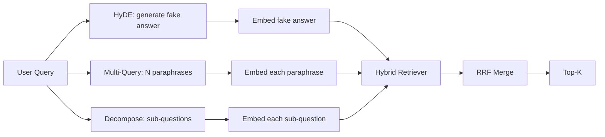

# 查询改写：HyDE、Multi-Query 与分解

> 用户输入的查询并不是检索器想要的查询。改写能在检索之前弥合这道鸿沟，让索引看到的东西更接近答案本身的样子。

**Type:** Build
**Languages:** Python
**Prerequisites:** 第 11 阶段第 04 课（embeddings）、第 06 课（RAG）；第 19 阶段 Track B 基础（第 20 至 29 课）；第 19 阶段第 64 与第 65 课
**Time:** ~90 分钟

## Learning Objectives
- 实现 Hypothetical Document Embeddings（HyDE）：生成一个假答案，对它做 embedding，用那个向量而不是查询向量去检索。
- 实现 multi-query 扩展：把一个查询改写成 N 个改写版本，各自检索，再用 reciprocal rank fusion 合并并集。
- 实现查询分解：把复杂问题拆成子问题，逐个子问题检索，再合并。
- 在一个 fixture 上正面对比这三种改写器，并解释每种策略何时胜出。
- 接一个 mock LLM，产出确定性的、贴合 fixture 的输出，让改写循环可以离线运行。

## 问题场景

用户输入 “what does our team do when uploads fail and the budget is gone?”。语料里有一篇文档写着 “AbortMultipartOnFail aborts an in-flight S3 multipart upload and decrements the per-bucket retry budget when the upload fails”。查询和文档没有共享任何名词短语。BM25 会漏掉。bi-encoder 把该文档排在第三或第四，因为查询向量落在 embedding 空间中偏好“已取消任务”文档而非“已中止上传”文档的那片区域。第 66 课的两阶段重排能在答案位于 top-N 时把它救回来，但如果它连 top-N 都没进，reranker 根本看不到它。

解决办法是在查询触达检索器之前先改写它。2023 年的论文 “Precise Zero-Shot Dense Retrieval without Relevance Labels”（Gao 等）提出了 HyDE：让 LLM 写出一个能回答该查询的文档，对这个假设文档做 embedding，并用它的 embedding 作为检索向量。假设文档落在 embedding 空间的正确区域，因为它是用语料的语气写成的。而查询向量没有。

还有两个近亲技术与 HyDE 搭配。multi-query 扩展（Microsoft 的 GraphRAG 使用的术语）为查询生成 N 个改写版本，各自检索后再合并。分解（在 2024 年 Stanford DSPy 的工作中以 “subquery decomposition” 之名流行起来）把 “what does our team do when uploads fail and the budget is gone” 拆成两个问题：“what happens when an upload fails” 和 “what happens when the retry budget is gone”。两次检索，一个合并结果，答案的两个部分都可达。

本课实现这三种技术，并让它们在同一个 fixture 语料上运行。

## 核心概念



### HyDE 详解

HyDE 用 LLM 写出的假设文档向量替换用户的查询向量。prompt 很短：

```
You are a domain expert. Write a one-paragraph passage that answers the question
below. Use the same vocabulary and phrasing the documentation in this domain would
use. Do not refuse. Do not say you do not know.

Question: {user_query}

Passage:
```

LLM 的答案作为事实性回答是错的，因为 LLM 不了解你的语料。这没关系。检索器不在乎事实正确性，只在乎 token 分布。假设段落含有 “abort”、“multipart”、“bucket”、“budget” 这些词，因为该主题的文档段落正会这么说。对那个段落做 embedding。向量就会落在真实段落附近。

生产中你会把假设文档限制在两三句话。更长的假设会收集更多噪声。更短的会丢掉 HyDE 所需的词法信号。

### multi-query 扩展详解

为用户查询生成 N 个改写版本。最简单的 prompt：

```
Rewrite the following question in {N} different ways. Each rewrite must preserve
the original intent. Number them 1 to {N}. Do not add explanations.
```

对每个改写版本检索 top-k。用 RRF 合并这 N 个排序列表（与第 65 课相同的算法）。廉价、可并行、确定。

当用户的措辞只是众多同样合理的问法之一、而任何一个改写都能把问题问得更好时，multi-query 胜出。当所有改写都同样糟糕、因为原查询本就以同样的方式糟糕时，它落败。

### 分解详解

单次检索无法满足多面的问题。分解让 LLM 把问题拆成子问题，系统再逐个子问题检索。prompt：

```
The following question may require information from multiple distinct topics.
Decompose it into a list of sub-questions. Each sub-question must be answerable
independently. If the question is already atomic, return it unchanged.

Question: {user_query}
```

逐个子问题检索。合并。对于含连词、多从句比较或两个不相关主题的问题，分解是正确的工具。对于原子问题则是错的工具；在那里分解器的职责是返回那一个单独的问题，而不是编造子问题。

### 为什么三种技术都存在

三者互补。HyDE 弥合查询与语料之间的 token 鸿沟。multi-query 覆盖改写差异。分解覆盖多主题查询。生产系统会把三者都跑一遍，并按查询选择策略（第 69 课的端到端系统展示了这个选择器）。

## mock LLM

本课离线运行。mock LLM 是一张小查找表，以用户查询为键，另加一个针对未见查询的兜底逻辑。查找表包含：

- 对每个 fixture 查询：一段写好的假设段落、三个改写版本和一次分解。
- 对未知查询：一个确定性的变换：取出查询的实词，通过同义词映射扩展，返回结果。

重要的是 mock 的形状，而不是其中的数据。生产中你把 mock 换成真实的模型调用。检索器不变。

```figure
cd-hyde-vector
```

## Build It

`code/main.py` 实现了：

- `MockLLM` —— 上文描述的确定性替身。
- `HyDERewriter` —— 调用 LLM 写出假设文档，把改写结果作为 `RewriteResult` 返回，含假设文本和检索器应使用的查询。
- `MultiQueryRewriter` —— 调用 LLM 生成 N 个改写版本，返回查询列表。
- `DecomposeRewriter` —— 调用 LLM 做分解，返回子问题。
- `retrieve_with_rewriter` —— 接收一个改写器和一个检索器，执行改写，融合结果。
- 一个演示，在 fixture 上运行三种改写器，并打印哪种策略最先返回 gold 答案文档。

检索器的形状复用了第 65 课（混合 BM25 + dense）。融合仍是同一个 RRF。唯一新增的形状是改写器接口，它很小。

运行它：

```bash
python3 code/main.py
```

输出是每种策略的排名和一份最终汇总。HyDE 在措辞不匹配的查询上胜出。multi-query 在改写差异大的查询上胜出。分解在多主题查询上胜出。兜底方案（不用改写器）在三者中至少一个上落败。

## 演示会掩盖的失败模式

**HyDE 把语料特有的标识符幻觉错。** 模型编造一个函数名。假设段落在正确文档上的 BM25 分数崩塌，因为编造的名字现在是索引中不存在的高权重 token。限制假设的长度，并在融合中把 BM25 的权重调低。

**multi-query 的改写全部收敛。** 弱模型产出的三个改写几乎相同。N 次检索返回相同的 top-k。RRF 合并并不比单次检索更好。在改写 prompt 中加入明确的多样性指令，并用 Jaccard 检测重复。

**分解过度拆分。** 分解器把原子问题变成列表。各次检索都返回同一篇文档，但排名下降。合并结果比原来更差。在展开之前加一道 “这些子问题是否足够互异” 的检查。

**延迟成倍增长。** HyDE 花一次 LLM 调用。multi-query 花一次 LLM 调用生成 N 个改写，然后 N 次检索。分解花一次 LLM 调用做分解，然后 M 次检索。检索并行执行；LLM 调用才是耗时下限。

## Use It

生产实践：

- 按查询长度逐查询选择策略：原子短查询用 multi-query，复杂的多从句查询用分解，术语密集的查询用 HyDE。
- 按查询哈希缓存改写器输出。许多查询会重复。
- 并行运行三者，用 RRF 把三个结果集融合成一个。成本是三次 LLM 调用加一次融合；质量是三种策略覆盖范围的并集。

## Ship It

第 69 课把这个改写阶段接在第 65 课的检索器与第 66 课的 reranker 之前。第 68 课评估改写器为检索 recall 带来的提升。

## Exercises

1. 实现 RAG-Fusion（2024 年 multi-query 的一个变体）：让改写器的改写版本刻意保持多样，再由重排步骤（第 66 课）挑出最终列表。
2. 加入第四种策略：step-back prompting（让 LLM 给出更一般的问题，据此检索，然后再收窄）。在 fixture 上对比。
3. 通过加一个 “问题是否为原子问题” 的头，训练分解器识别原子查询。测量加入前后的过度拆分率。
4. 用真实的模型调用替换 mock LLM。在你的技术栈上测量每种策略的延迟。
5. 为每个改写加一个置信度分数。丢弃低于阈值的改写。测量对 recall 的影响。

## Key Terms

| 术语 | 人们常怎么说 | 实际含义 |
|------|-----------------|------------------------|
| HyDE | “假文档检索” | LLM 写出答案；对它做 embedding 并据此检索，而不是用查询 |
| Multi-query | “改写扩展” | 对查询做 N 次改写；检索 N 次，用 RRF 合并 |
| 分解 | “子查询拆分” | 多主题查询拆成子问题，分别检索 |
| 原子查询 | “单一主题” | 若不编造子问题就无法分解 |
| Step-back | “抽象化查询” | 先问更一般的问题，检索，再收窄 |

## Further Reading

- Gao, Ma, Lin, Callan, "Precise Zero-Shot Dense Retrieval without Relevance Labels" (HyDE), 2023
- Microsoft Research, "Multi-Query Expansion for Retrieval"
- Stanford DSPy, "Subquery Decomposition for Multi-Hop QA"
- [LlamaIndex 查询变换文档](https://docs.llamaindex.ai/en/stable/optimizing/advanced_retrieval/query_transformations/)
- 第 11 阶段第 07 课 —— advanced RAG 模式
- 第 19 阶段第 65 课 —— 这个改写器所服务的检索器
- 第 19 阶段第 68 课 —— 衡量改写器提升的 eval
