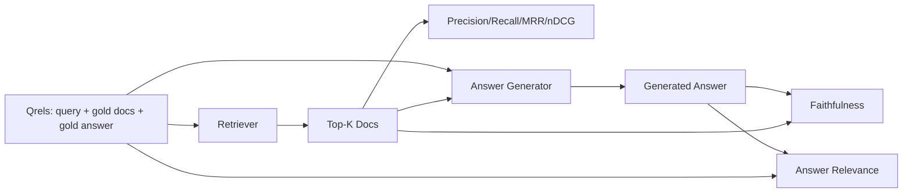

# RAG 评估：precision、recall、MRR、nDCG、faithfulness、answer relevance

> 如果你无法同时给检索和答案打分，你就无法上线这个系统。这两者不是同一个指标，同一个 prompt 在各自的维度上会以不同方式失败。

**Type:** Build
**Languages:** Python
**Prerequisites:** 第 11 阶段第 06 课（RAG）、第 10 课（evaluation）；第 19 阶段 Track B 基础（第 20 至 29 课）；第 19 阶段第 64、65、66、67 课
**Time:** ~90 分钟

## Learning Objectives
- 从 gold qrels 计算四个检索指标：precision@k、recall@k、MRR（mean reciprocal rank）和 nDCG@k。
- 计算两个答案级指标：faithfulness（每条 claim 都有检索上下文作为依据）和 answer relevance（答案回应了问题）。
- 构建一个 fixture qrels 文件（查询、gold 文档 id、gold 答案文本），让评估端到端读取它。
- 读懂指标数值，诊断 pipeline 在哪里失败：检索、排序、生成还是依据性。

## 问题场景

一个 RAG 系统至少有四个活动部件：chunker、retriever、reranker、generator。其中任何一个都可能是错误答案的成因。没有分阶段指标，你就是在盲飞。

用户报告了一个错误答案。是因为 chunker 把答案片段切断了？是因为 retriever 没有把该 chunk 放进 top-k？是因为 reranker 把正确的 chunk 挤到了第一位之后？是因为 generator 忽略了该 chunk 而凭空编造？仅凭答案你无法判断。你需要：

- 检索指标，为 retriever 输出的内容打分。
- 排序指标，为正确 chunk 在顺序中的位置打分。
- faithfulness，为 generator 是否停留在检索到的上下文之内打分。
- answer relevance，为答案究竟有没有回应问题打分。

本课在一个 fixture qrels 文件之上构建全部六个指标。评估是离线且确定性的；在生产环境中，你把 mock 的 LLM-as-judge 换成真实的模型调用。

## 核心概念



### Precision@k（精确率）

在 retriever 返回的 top-k 文档中，有多少比例落在 gold 集合里？如果 gold 有三个文档，而 top-3 返回了其中两个外加一个错误的，那么 precision@3 是 2 / 3。当检索到一个不相关 chunk 的代价很高时（generator 为它浪费 token，或者该 chunk 污染了答案），使用 precision。

### Recall@k（召回率）

在 gold 文档中，有多少比例落在 top-k 里？如果 gold 有三个文档，而 top-5 包含了全部三个，那么 recall@5 为 1.0。当漏掉答案的代价很高时（你宁愿多看到一个错误的 chunk，也不愿完全漏掉答案 chunk），使用 recall。

在生产 RAG 中，人们通常引用的指标是 recall@k。生成阶段可以轻易丢掉不相关的 chunk；它无法从它从未见过的 chunk 中编造出答案。

### MRR（平均倒数排名）

对每个查询，找到排序列表中第一个相关文档的位置。倒数排名是 1 / 位置。在查询集合上取平均。MRR 是用一个数字概括 retriever 把最佳答案放在最前面的能力。

MRR 对第 1 位给予很高的权重。gold 文档排在第 1 位的查询贡献 1.0。第 2 位贡献 0.5。第 10 位贡献 0.1。该指标被列表顶部主导。

### nDCG@k（归一化折损累计增益）

归一化折损累计增益。完整公式为每个检索到的文档分配一个增益（通常相关为 1、不相关为 0），按位置的对数折损，求和，再除以理想 DCG（如果排序完美时会得到的 DCG）。取值范围 0 到 1。

nDCG 支持分级相关性：gold 可以说"doc A 是 3，doc B 是 2，doc C 是 1"。MRR 和 recall@k 把所有东西压平成二值。当语料库中每个查询有多个部分相关的文档时，使用 nDCG。

### Faithfulness（忠实度）

对生成答案中的每条 claim，检查该 claim 是否被检索到的上下文所支持。标准实现使用一个 LLM-as-judge prompt，输入 (claim, context) 并返回 yes 或 no。该指标是判定通过的 claim 的比例。

faithfulness 抓到的是 generator 编造内容的失败模式。即使 retriever 返回了正确的 chunk，一个产生幻觉的 generator 也是有问题的。faithfulness 也被称为 groundedness、support、attribution。

本课用确定性的 mock judge 实现 faithfulness：按阈值检查每条 claim 的 token 与检索上下文的词元重叠程度。在生产环境中，你换成真实的模型调用。指标的形状是一样的。

### Answer relevance（答案相关性）

答案是否真的回应了问题？faithfulness 问的是"答案是否有上下文依据？"。answer relevance 问的是"答案是否有问题依据？"。一个忠实但跑题的答案在 faithfulness 上得分高、在 relevance 上得分低。一个简短、切题但忽略上下文的答案在 relevance 上得分高、在 faithfulness 上得分低。

标准实现同样使用 LLM-as-judge：输入 (question, answer)，询问答案是否回应了问题。本课实现了一个 token 重叠加 judge 的替代方案。

## fixture qrels（评测数据集）

```python
{
  "qid": "q1",
  "query": "what is the abort threshold for multipart uploads",
  "gold_doc_ids": ["d1", "d3"],
  "gold_answer_substring": "three failed parts",
  "graded_relevance": {"d1": 3, "d3": 2},
}
```

每个查询携带：
- 查询字符串，
- 一组 gold 文档 id（用于 precision / recall / MRR），
- 一个分级相关性字典（用于 nDCG），
- gold 答案子串（作为每个 qrel 上的参考元数据保留；本课中的 faithfulness 是通过将抽取出的 claim 与检索上下文对照判定来计算的，而非与此子串对照）。

在生产环境中，这些由你标注。本课提供一个手工构建的 fixture，使评估开箱即用。

```figure
ci-rag-metric-ladder
```

## Build It

`code/main.py` 实现了：

- `precision_at_k(retrieved, gold, k)` —— 字面定义。
- `recall_at_k(retrieved, gold, k)` —— 字面定义。
- `mean_reciprocal_rank(retrieved_list_of_lists, gold_list)` —— 在查询上取平均。
- `ndcg_at_k(retrieved, graded_relevance, k)` —— DCG / IDCG，支持二值或分级增益。
- `extract_claims(answer)` —— 把答案切分成句子形状的 claim。
- `faithfulness(claims, context_texts, judge)` —— 判定为有支持的 claim 的比例。
- `answer_relevance(question, answer, judge)` —— 由 judge 判断答案是否回应了问题。
- `MockJudge` —— 确定性的词元重叠 judge，使评估可离线运行。
- `evaluate_pipeline(pipeline_fn, qrels, ks)` —— 运行每一项指标的编排器。
- 一个 demo，针对 qrels 运行三个 pipeline 变体（chunker baseline、hybrid retrieval、hybrid + rerank），并打印一张指标表。

运行它：

```bash
python3 code/main.py
```

输出在一张指标表中展示每个变体的 precision@k、recall@k、MRR、nDCG@k、faithfulness 和 answer relevance。hybrid retrieval 那一行在 recall 上胜过 chunker baseline；rerank 那一行在 MRR 上胜过 hybrid。

## 阅读指标以诊断失败

| 症状 | 可能原因 | 需要修复的地方 |
|---------|-------------|-------------|
| recall@k 与 precision@k 都低 | chunker 切断了答案，或 retriever 找不到它 | chunker 边界（第 64 课）或 retriever 模态（第 65 课） |
| recall@k 尚可，MRR 低 | 正确的 chunk 在 top-k 中但不在第 1 位 | reranker（第 66 课） |
| MRR 高，faithfulness 低 | generator 在上下文正确的情况下编造内容 | 生成 prompt；强制引用或拒答 |
| faithfulness 高，relevance 低 | 答案有依据但跑题 | 查询改写器（第 67 课）或生成 prompt |
| 四项都高，用户仍在抱怨 | 评估集不具代表性 | 用真实用户查询扩充 qrels |

## 演示会掩盖的失败模式

**LLM-as-judge 偏差。** 模型会把自己的输出评判得比实际更忠实。让 judge 使用与 generator 不同的模型家族，或抽样进行人工评分。

**qrels 腐化。** 随着语料库变化，gold 答案会漂移。2024 年 1 月对 q1 是 gold 的文档，到 2024 年 10 月已不再是正确答案，因为团队重命名了函数。安排每季度一次的 qrels 复查。

**faithfulness 的微观检查会漏掉宏观论断。** 逐句的 faithfulness 可以通过，而整体答案的结构却有误导性。在自动指标之上再加一层样本级的定性审查。

**recall@k 会掩盖单查询失败。** 90% 的平均召回可以掩盖某一类查询总是失败的事实。按查询类别（字面、改写、多主题）切分 qrels 并按切片报告。

## Use It

生产实践：

- 每次 retriever 或 generator 变更都运行评估。把 recall@k 的回归当作测试失败处理。
- 持久化每个查询的指标轨迹。当用户投诉时，查找到匹配的 qrels 条目，看看这样的问题当初是否会被捕捉到。
- 对 qrels 分层：20 条查询的 smoke 集在 CI 中运行；200 条的 regression 集每晚运行；2000 条的 deep 集每周运行。

## Ship It

第 69 课把整条 pipeline（chunker、retriever、reranker、generator）串起来，并针对端到端系统运行本评估。

## Exercises

1. 新增第五个检索指标：hit-rate@k。把它与 recall@k 比较。解释它们何时会出现差异。
2. 实现分级 faithfulness：0（无支持）、1（部分支持）、2（完全支持）。相应地更新指标。
3. 用真实模型调用替换 mock judge。在 fixture 上测量 mock 与真实 judge 之间的分歧。
4. 新增查询类别切片（"字面"、"改写"、"多主题"）。按切片报告指标。
5. 新增一个"答案长度"指标，并将其与 faithfulness 关联。画出曲线。

## Key Terms

| 术语 | 人们常怎么说 | 实际含义 |
|------|-----------------|------------------------|
| Precision@k | "检索结果中的命中率" | top-k 中属于 gold 的比例 |
| Recall@k | "gold 中的命中率" | gold 中落在 top-k 的比例 |
| MRR | "首次命中位置" | 第一个相关文档排名的 1 / rank 的均值 |
| nDCG@k | "分级排序质量" | top-k 上的 DCG 除以理想 DCG |
| Faithfulness | "groundedness" | 答案 claim 中被检索上下文支持的比例 |
| Answer relevance | "它回应了问题吗？" | 答案是否匹配问题的意图 |
| Qrels | "gold 标签" | 带标注的查询集合及其 gold 文档与答案 |

## Further Reading

- Buckley, Voorhees, "Evaluating Evaluation Measure Stability", SIGIR 2000 —— 关于排序指标的经典论文
- Jarvelin, Kekalainen, "Cumulated Gain-based Evaluation of IR Techniques" —— nDCG 论文
- [Ragas: Automated Evaluation of RAG Pipelines](https://docs.ragas.io)
- [Anthropic, Introducing Contextual Retrieval](https://www.anthropic.com/engineering/contextual-retrieval) —— 用 1 减去 recall@20 来给检索打分
- 第 11 阶段第 10 课 —— 评估框架基础
- 第 19 阶段第 64 至 67 课 —— 此处被评估的组件
- 第 19 阶段第 69 课 —— 本评估所打分的端到端 pipeline
