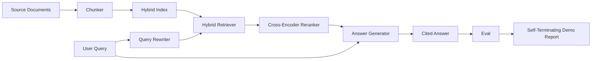

# 端到端 RAG 系统

> 六节课的组件。一条 pipeline。一个评估循环。一个自终止 demo。这就是你要上线的系统。

**Type:** Build
**Languages:** Python
**Prerequisites:** 第 11 阶段第 06 课（RAG）、第 10 课（evaluation）；第 19 阶段 Track B 基础（第 20 至 29 课）；第 19 阶段第 64、65、66、67、68 课
**Time:** ~90 分钟

## Learning Objectives
- 把 chunker、hybrid retriever、查询改写器、cross-encoder reranker 和答案生成器组合成一条端到端 pipeline。
- 实现一个答案生成器，用 chunk anchor 引用其 claim，并带有低置信度时拒答的兜底。
- 在组装好的 pipeline 上运行第 68 课的评估，证明分阶段构建在每一项指标上都胜过同样组件单独运行。
- 构建一个自终止的 CLI demo：摄取 fixture 语料库、运行固定查询集、以退出码零结束并输出汇总报告。

## 问题场景

六个组件单独存在证明不了什么。chunker 可以在语料库上的 recall@5 胜出，却在系统的 recall@5 上落败，因为 retriever 无法对 chunker 产出的内容排序。reranker 可以在合成候选池上提升 MRR，却在真实的 bi-encoder 候选上失败，因为 bi-encoder 在重排预算处的召回太低。查询改写器可以在单个查询上把 gold 文档提上来，却在下一个查询上崩掉，因为 LLM mock 返回了一个退化的假设文档。

集成测试就是把整条 pipeline 端到端地跑在同一个 fixture qrels 上，用同一套指标，由一个编排文件把一切串起来。这就是本课要构建的东西。如果集成 pipeline 上的指标胜过每个阶段各自 demo 的指标，你就证明了系统。

## 核心概念



### 接线选择

pipeline 是一张小图。每个阶段都是一个签名清晰的函数。

| 阶段 | 输入 | 输出 |
|-------|-------|--------|
| Chunker | 文档文本 | Chunk 记录列表 |
| Retriever | 查询字符串 | Top-N Chunk 记录 |
| Rewriter（可选） | 查询字符串 | 改写列表 + 假设文档 |
| Reranker | 查询、候选 | 带 cross 分数的 Top-K Chunk 记录 |
| Generator | 查询、Top-K Chunk 记录 | 带引用的答案字符串 |

当每个签名都稳定时，组合是直截了当的。本课的 `Pipeline` 类持有这五个阶段，以及一个按顺序运行它们的 `query` 方法。每个阶段都可替换：传入不同的 chunker、retriever、rewriter、reranker 或 generator，pipeline 依然能跑。

### 带引用的答案生成器

生成器是最后一个阶段，也最容易崩。本课提供一个确定性的 mock 生成器，它：

1. 接收重排后的 top-K chunk。
2. 选出至多两个与查询内容词元重叠最高的 chunk。
3. 输出一个答案，由每个被选 chunk 中取一句话拼接而成，每句后面跟一个 `[doc_id:chunk_index]` anchor。
4. 如果没有任何 chunk 的重叠超过拒答阈值，就输出 "I do not know"，不带引用。

在生产环境中，你把 mock 换成真实的 LLM 调用，使用这个 prompt 模板：

```
You are answering a question using only the snippets below.
Cite every claim with the anchor in parentheses.
If the snippets do not answer the question, say "I do not know".

Question: {query}

Snippets:
{enumerated chunks with anchors}

Answer:
```

低置信度拒答路径正是记录 cross-encoder rank-1 分数的全部理由。如果它低于语料库阈值，生成器就拒答。这是对抗幻觉答案的安全阀。

### 自终止 demo

demo 把所有东西端到端跑一遍。它针对一个查询打印分阶段拆解，在四个 fixture qrels 上运行评估，打印一张指标表，并且如果第 68 课的所有指标都达到 demo 中设定的阈值，就以状态零退出。若有任何指标低于阈值，demo 以非零状态退出，并给出指明失败指标的消息。

这就是 CI smoke 测试的形状。pipeline 离线、快速、确定性地运行。阈值在 fixture 上被刻意收紧，使得六节课中任何一处回归都会让 demo 失败。

```figure
rag-pipeline-flow
```

## Build It

`code/main.py` 实现了：

- `Chunk` —— 贯穿所有阶段的记录（在第 64 课形状的基础上增加了 chunk_index 和源 doc_id）。
- `Chunker` —— 从第 64 课选择一种策略（默认递归切分）。
- `HybridIndex` —— 打包第 65 课的 BM25 + dense + RRF。
- `Rewriter`（可选）—— 根据查询长度和连词的存在与否，从第 67 课的 HyDE、multi-query、decomposition 中选择一种。
- `Reranker` —— 第 66 课训练好的 cross-encoder，使用更小的 fixture 训练集使其几秒内收敛。
- `Generator` —— 带引用和低置信度拒答的确定性 mock 生成器。
- `Pipeline` —— 组合这五个阶段，其 `query(question)` 方法返回 `Result(answer, top_k, latency_ms_per_stage)`。
- `run_demo()` —— 摄取语料库、运行三个 fixture 查询、运行评估、打印结果、按阈值设置退出码。

运行它：

```bash
python3 code/main.py
```

输出是一条打印的查询轨迹、完整的评估表，以及最终通过/失败状态。在 fixture 上返回退出码 0。

## 演示会掩盖的失败模式

**chunker 边界漂移。** 如果你在评估 qrels 标注与 demo 之间切换 chunker 策略，gold 文档 id 就对不上了。把 chunker 策略锁定在 qrels 文件中。demo 包含一个指明 chunker 的头部。

**reranker 训练集泄漏进评估。** 第 66 课的 14 条训练三元组包含与评估查询相似的查询。在生产环境中，严格留出评估查询。demo 的评估查询与 rerank 训练集刻意不相交。

**mock 生成器掩盖了幻觉风险。** mock 无法产生幻觉，因为它只输出检索到的 chunk 中的文本。本课注明了这一点，并把生产替换路径指向真实模型。

**没有流式输出。** pipeline 在每个阶段结束时返回完整答案。生产系统会流式输出生成器的输出。流式超出本课范围；无论如何，答案级指标都作用于最终字符串。

**延迟是离线的。** mock LLM 调用是常数时间。真实 LLM 调用会占据主导。在请求范围内规划延迟预算；本课的分阶段计时只衡量 CPU 工作。

## Use It

生产实践：

- 把 pipeline 文件放在单个编排器下，各阶段接口显式。避免把接线散落到整个仓库。
- 每次触及任一阶段的合并前都运行评估。如果评估下降，该合并不予合入。
- 持久化每次 CI 运行的指标轨迹，以便把回归归因到某次阶段替换。
- 增加一个 20 条查询的 smoke 集（regression 集的子集），在 30 秒内跑完；完整的 regression 集每晚运行。

## Ship It

本课的 pipeline 文件就是第 19 阶段 Track F 其余课程所假定的形状。后续课程会在其上增加摄取自动化、增量重建索引、遥测和一层服务层。检索、重排、改写与评估这半边在这里已经完整。

## Exercises

1. 在改写器内部增加一个按查询选择策略的机制：用第 67 课的启发式（长度、连词、术语比例）在 HyDE、multi-query 或 decomposition 中选择。
2. 在环境变量开关后面为生成器增加真实 LLM 调用。默认使用 mock。测量延迟差额。
3. 扩展 demo，接受 `--corpus path` 标志来加载真实语料库。重新运行评估与阈值检查。
4. 为 chunker 增加 `--strategy` 标志。测量每种策略对端到端召回的贡献。
5. 增加一个流式生成器接口，并把它接入评估。确认 faithfulness 是在最终字符串上计算的，而不是在流式前缀上。

## Key Terms

| 术语 | 人们常怎么说 | 实际含义 |
|------|-----------------|------------------------|
| Pipeline | "RAG pipeline" | 从摄取到带引用答案的组合阶段 |
| Citation anchor | "来源链接" | 附加在每条 claim 上的 (doc_id, chunk_index) 引用 |
| Refuse-on-low-confidence | "I do not know" | 当 reranker 的 top-1 分数低于阈值时，生成器不返回答案 |
| Smoke set | "CI 评估" | 在每次 PR 检查中运行的最小 qrels 子集 |
| Stage interface | "函数签名" | 每个 pipeline 阶段稳定的输入与输出类型 |

## Further Reading

- [Anthropic, Building search and retrieval](https://www.anthropic.com/news/contextual-retrieval)
- [Pinterest, MCP internal search](https://medium.com/pinterest-engineering) —— 可用于参考的生产架构
- [Ragas: Automated Evaluation of RAG Pipelines](https://docs.ragas.io)
- 第 11 阶段第 06 课 —— RAG 基础
- 第 19 阶段第 64 至 68 课 —— 此处被组合的组件
