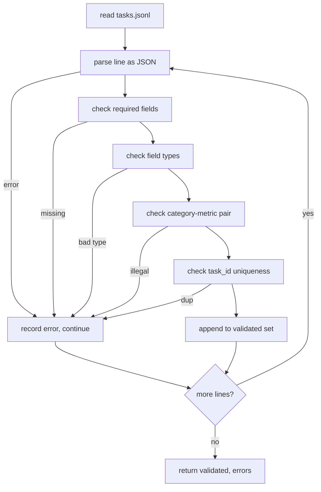

# Task Spec 格式

> 评估 harness 的好坏取决于其任务所遵守的契约。在写下第一个打分函数之前，先把 JSONL 形状和指标词表冻结下来。

**Type:** Build
**Languages:** Python
**Prerequisites:** 第 19 阶段 Track B 基础
**Time:** ~90 分钟

## Learning objectives

- 定义一个 JSONL 任务记录 schema，用一种形状覆盖算术、多项选择、代码执行、分类和自由文本摘要。
- 钉住一份封闭的指标名称词表，使下游课程（71 至 73）能基于单一字段进行分发。
- 把 few-shot 示例和后处理规则作为任务的一部分来规定，而不是 runner 的一部分，从而让同一个 prompt 在不同模型上产出同一个 target。
- 实现一个严格的 validator，在畸形记录到达 runner 之前就拒绝它们。
- 交付一套 10 个任务的 fixture，覆盖 spec 的每一个分支，让 validator 有真实内容可处理。

```figure
ci-task-spec-gate
```

## 为什么要有冻结的 spec

研究代码库积累评估脚本的速度会快过积累测试的速度。六个月后，每个 notebook 都有自己的一套 JSON 形状，每个指标都被重复实现两次，不同次运行之间的结果无法比较。解决办法很无聊：选定一个 schema。写一个 validator。拒绝其他一切。这就是本课所做的。

这个形状借鉴了 BIG-bench、HELM 和 lm-eval 风格 harness 的思路，但字段名是我们自己的。每个字段只有一个归属。runner 读取 task。metric 读取 targets。post-process 步骤归一化生成结果。没有任何字段会在 pipeline 中途被修改。

## 记录形状

一个 task 是单行上的一个 JSON 对象。harness 读取 `tasks.jsonl` 并独立校验每一行。一行出错只会中止该条记录，而不会中止整次运行。

```json
{
  "task_id": "arith_001",
  "category": "arithmetic",
  "prompt": "Compute the result. Question: 17 + 24\nAnswer:",
  "targets": ["41"],
  "metric_name": "exact_match",
  "few_shot_examples": [
    {"prompt": "Question: 2 + 2\nAnswer:", "completion": "4"}
  ],
  "post_process": "strip_whitespace",
  "metadata": {"difficulty": "easy"}
}
```

必填字段是 `task_id`、`category`、`prompt`、`targets`、`metric_name`、`post_process`。`few_shot_examples` 和 `metadata` 是可选的。未知的顶层字段会导致校验失败。

## 字段规则

`task_id` 是不含空白的字符串。validator 在整个文件中强制唯一性。

`category` 是 `arithmetic`、`mcq`、`code_exec`、`classification`、`summary` 之一。category 约束哪些 metric 与 post-process 配对是合法的。`code_exec` 任务必须使用 `metric_name = code_exec`，而 `mcq` 任务必须使用 `metric_name = exact_match` 对单个字母的 target。

`prompt` 是非空字符串。validator 禁止末尾空白，并拒绝 prompt 正文中已经包含 few-shot 块的记录。few-shot 渲染发生在 runner 中，而不是作者端。

`targets` 是非空字符串列表。对于 `exact_match`，任一元素匹配即算命中。对于 `f1` 和 `rouge_l`，得分最高的 target 胜出。对于 `mcq`，列表恰好包含一个元素。

`metric_name` 是 `exact_match`、`f1`、`bleu_4`、`rouge_l`、`accuracy`、`code_exec` 之一。该词表是封闭的。新增指标需要新增一课，并在此处新增一个条目。

`few_shot_examples` 是 `{prompt, completion}` 对的列表。validator 将该列表限制为至多八条，以保持 prompt 有界。

`post_process` 是 `none`、`strip_whitespace`、`lower`、`extract_letter`、`extract_code_block`、`extract_first_line` 之一。每条规则只有一种确定性的行为。validator 禁止组合规则。

## validator 的行为



validator 返回两个列表：已校验记录和错误记录，后者包含出错的行、被违反的规则以及出错的字段。如果错误列表非空，runner 拒绝启动，除非显式设置 `--allow-bad-tasks` 标志。

## few-shot 渲染

runner 将 few-shot 示例以空行分隔拼接到 prompt 之前。所有模型都走同一条代码路径，因此唯一的方差来源是模型本身。作者只写一次示例，而不是每个 provider 写一次。

```python
def render(task):
    parts = []
    for ex in task.get("few_shot_examples", []):
        parts.append(ex["prompt"] + " " + ex["completion"])
    parts.append(task["prompt"])
    return "\n\n".join(parts)
```

## post-process 规则

post-process 步骤在生成之后、metric 之前运行。它是确定性且无状态的。

- `none` 原样返回字符串。
- `strip_whitespace` 去掉首尾空白。
- `lower` 将字符串转为小写。
- `extract_letter` 返回第一个匹配 `[A-E]` 的字符，用于 MCQ。
- `extract_code_block` 返回第一个三重反引号围栏块的正文，用于 code-exec。
- `extract_first_line` 返回第一个非空行，用于摘要分类。

需要本列表之外规则的任务应该放到新的一课。

## 本课不做什么

它不打分。它不调用模型。它不运行代码。这些属于第 71、72 和 75 课。本课冻结它们都必须遵守的契约。

10 个任务的 fixture 覆盖两个算术条目、两个 MCQ 条目、两个 code-exec 条目、两个分类条目和两个摘要条目。validator 在全部 10 条上通过。另一个单独的 fixture（`tasks_bad.jsonl`）触发每一条规则，validator 返回的错误数量恰好与之对应。

## 如何阅读代码

`main.py` 定义了 `TaskSpec`、`validate_task`、`validate_file` 和一个 CLI 入口。fixture 加载器是 `load_fixtures`。渲染与 post-process 辅助函数与校验放在一起，这样第 75 课的 runner 只需导入一个模块。

从头到尾阅读 `main.py`。然后阅读 `code/tests/test_spec.py`。测试钉住每一条校验规则和每一种 post-process 行为。`main.py` 底部的 demo 校验随附的 fixture 并打印摘要。

## 更进一步

真实的评估套件增长 category 的方式，就像 schema 增长列一样。清醒的做法是：在没有同时新增一个 metric、一条 post-process 规则和至少一个 fixture 任务之前，拒绝新增 category。把 spec 当作数据库迁移来对待。每个变更都要经过评审、记录版本，并附带测试。本课的 validator 就是那道闸门。
