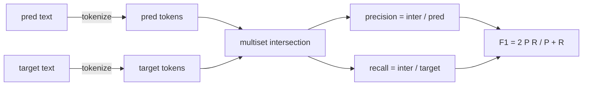
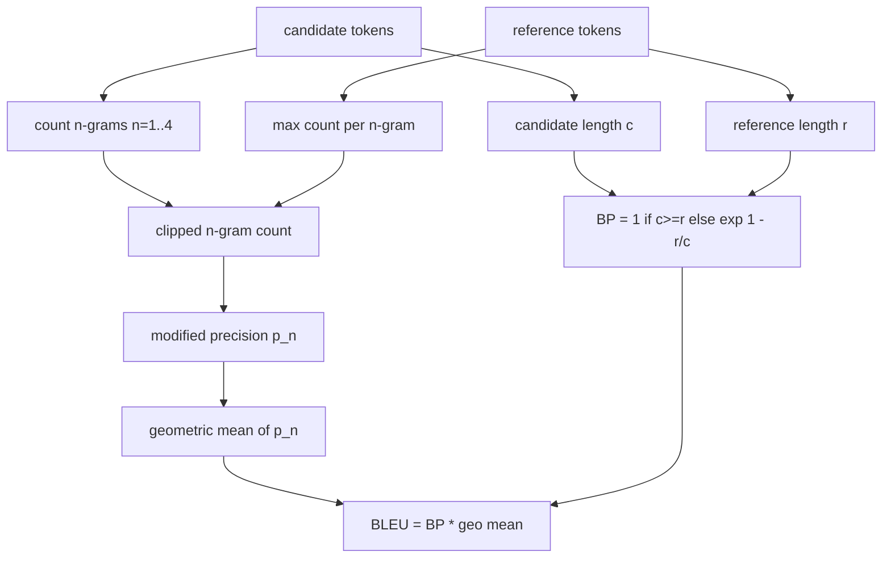

# 经典指标

> BLEU、ROUGE-L、F1、exact-match、accuracy。这五个指标仍然占据已发表 LLM 评估数字的大多数。从第一性原理实现每一个，这样你才知道这个数字意味着什么。

**Type:** Build
**Languages:** Python
**Prerequisites:** 第 19 阶段 Track B 基础、第 70 课
**Time:** ~90 分钟

## Learning objectives

- 用显式的分词规则实现词元级 exact-match、F1 和 accuracy。
- 从零实现 BLEU-4：modified n-gram precision、n 等于 1 到 4 的几何平均、brevity penalty。
- 用最长公共子序列实现 ROUGE-L，以 F-beta 组合 precision 和 recall。
- 基于第 70 课的 metric_name 字段分发，使 runner 保持指标无关。
- 用取自手算示例（而非第三方库）的参考向量钉住行为。

```figure
cd-bleu-overlap
```

## 为什么重新实现

你会读到报告 BLEU 28.3 的论文，也会读到报告 BLEU 0.283 的论文。你会发现两个库之间的 ROUGE-L 分数相差十个点，因为一个截断为小写而另一个没有。停止困惑的最快办法是自己写出这些指标，然后指出决定分词器的那一行和应用平滑的那一行。之后，跨论文比较数字就变成阅读指标设置的问题，而不是争论库的问题。

stdlib 加 numpy 就够了。BLEU 是计数加一个截断。ROUGE-L 是动态规划。F1 是词元上的集合交集。最难的部分是选定一个分词器并坚持它。

## 分词

分词器是 `re.findall(r"\w+", text.lower())`。转小写、字母数字串、丢弃标点。本课中的每个指标都使用这同一个分词器。runner 无权选择。如果你换了分词器，你跑的就是另一个基准。

```python
TOKEN_RE = re.compile(r"\w+", re.UNICODE)
def tokenize(text):
    return TOKEN_RE.findall(text.lower())
```

这是一处刻意的简化。生产环境会关心 CJK、缩写和代码标识符。本课的重点在于：分词器是一个契约，而不是一个旋钮。

## Exact match（精确匹配）

```python
def exact_match(pred, targets):
    return float(any(pred.strip() == t.strip() for t in targets))
```

它按任务返回 1.0 或 0.0。数据集上的聚合就是均值。这是算术、MCQ 和短分类任务的主力。

## Token-level F1（词元级 F1）

为预测和目标建立词元多重集。precision 是多重集交集除以预测的多重集。recall 是同一个交集除以目标的多重集。F1 是调和平均。实现要处理预测为空和目标为空的边界情况。



对于多目标任务，我们取目标列表中最好的 F1。这与文献中广泛报道的 SQuAD 风格行为一致。

## BLEU-4（机器翻译指标）

BLEU 是经典的机器翻译指标，至今仍出现在摘要工作中。我们使用的公式是语料库级的 BLEU-4，采用标准 brevity penalty，并对 modified n-gram 计数做加一平滑，使得单个缺失的 4-gram 不会把分数压到零。

对每个候选-参考对，我们为 n 等于 1、2、3、4 分别计算 modified n-gram precision。modified precision 用该 n-gram 在任一参考中的最大计数来裁剪候选的 n-gram 计数，因此候选无法通过重复某个短语来虚高。四个 precision 的几何平均再乘以 brevity penalty。



平滑规则就是 Lin 和 Och 所称的 method 1：在取对数之前，给每个 n-gram precision 的分子和分母都加一。这样当参考中没有匹配的 4-gram 时可以避免 `log 0`，并且在长候选上仍然接近未平滑的值。

## ROUGE-L（最长公共子序列）

ROUGE-L 比较候选与参考词元序列的最长公共子序列。LCS 捕捉词序而不强制连续，这正是它成为默认摘要指标的原因。我们用标准动态规划表计算 LCS 长度，然后推导 recall 为 `lcs / reference length`、precision 为 `lcs / candidate length`，并以 F-beta 组合，其中 beta 等于一即为对称的 F1 形式。

```python
def lcs_length(a, b):
    n, m = len(a), len(b)
    dp = numpy.zeros((n + 1, m + 1), dtype=int)
    for i in range(n):
        for j in range(m):
            if a[i] == b[j]:
                dp[i+1, j+1] = dp[i, j] + 1
            else:
                dp[i+1, j+1] = max(dp[i+1, j], dp[i, j+1])
    return int(dp[n, m])
```

numpy 表让实现更易读；纯 Python 列表也可以。选择 ROUGE-L 的任务要为每个任务付出 O(n m) 的代价。对于典型的摘要长度，这仍在一毫秒以内。

## Accuracy（准确率）

对于多目标分类任务，accuracy 退化为对单个归一化目标的 exact-match。我们把它暴露为单独的函数，这样分发器可以基于 `metric_name` 分发，而不必在 runner 内部做字符串比较。

## 分发契约

单一入口是 `score(metric_name, prediction, targets)`。它返回 `[0, 1]` 中的浮点数。runner 不对指标名分支。它把调用交出去并写入结果。这就是第 75 课将要粘接到第 70 课任务 spec 的接口面。

```python
def score(metric_name, pred, targets):
    if metric_name == "exact_match":
        return exact_match(pred, targets)
    if metric_name == "f1":
        return max(f1_score(pred, t) for t in targets)
    if metric_name == "bleu_4":
        return max(bleu4(pred, t) for t in targets)
    if metric_name == "rouge_l":
        return max(rouge_l(pred, t) for t in targets)
    if metric_name == "accuracy":
        return accuracy(pred, targets)
    raise ValueError(f"unknown metric_name: {metric_name}")
```

`code_exec` 在第 72 课处理，并在那里接入分发器。

## 本课不做什么

它不调用模型。它不做超出第 70 课 post-process 规则之外的生成归一化。它不计算置信区间。它不做 BLEURT 或 BERTScore（那些需要模型，属于另一课）。重点是底线：五个指标、一个分词器、一张分发表。

## 如何阅读代码

`main.py` 把每个指标定义为自由函数，外加分发器。参考向量位于文件底部的 `_reference_examples` 块中。demo 针对八个示例运行分发器并打印各指标分数。`code/tests/test_metrics.py` 中的测试钉住参考向量，并压测每一个边界情况（空预测、空参考、无共享词元、精确匹配、重复短语裁剪）。

从头到尾阅读 `main.py`。函数按复杂度排序。exact_match 和 accuracy 各占一行。F1 是六行。BLEU 和 ROUGE-L 是重头戏，它们包含关于平滑规则和 LCS 递推的详细注释。

## 更进一步

经典指标是必要的，但不充分。它们奖励表面重叠而错过语义。修复办法是在你信任经典底线之后，在其上叠加基于模型的指标（BLEURT、BERTScore、GEval）。那是后面的一课。就目前而言：让这五个指标工作起来，用测试钉住它们，你就有了一个可审计、快速、可复现的指标栈。
