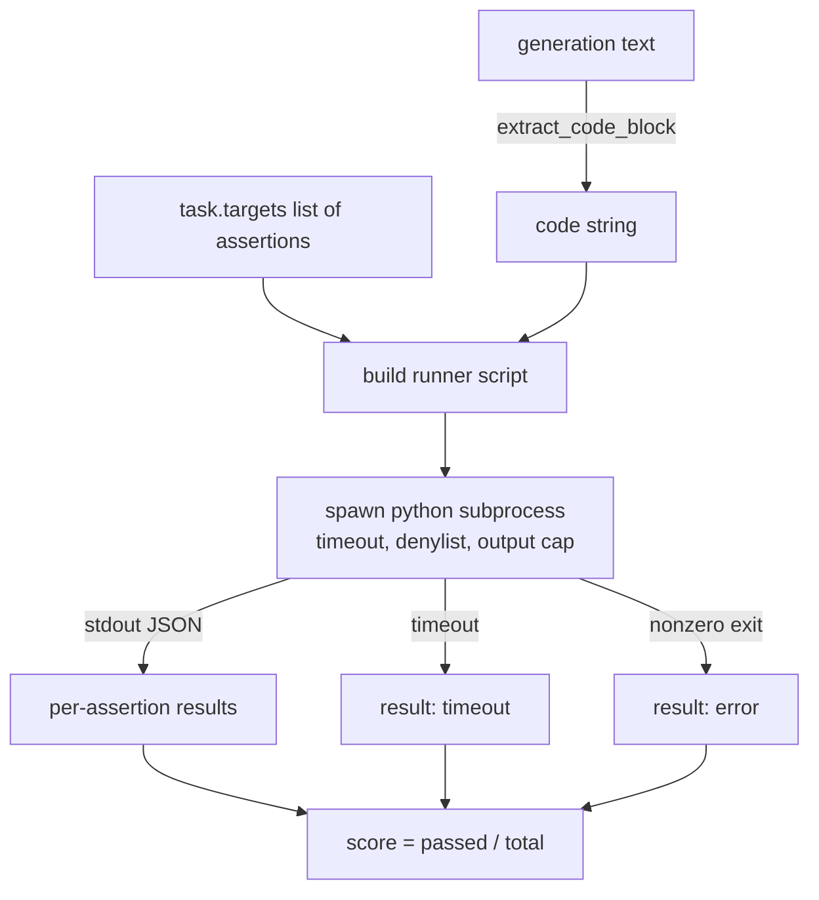
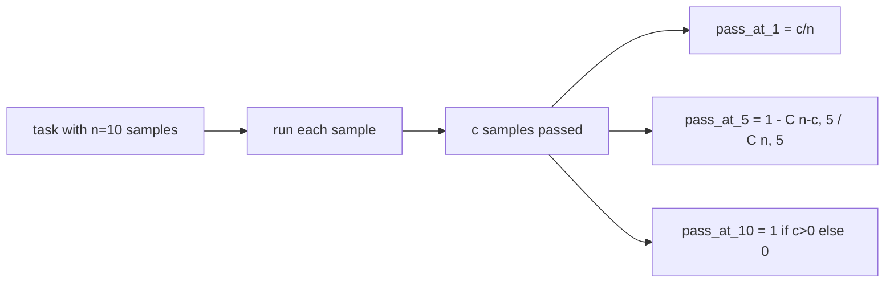

# Code Exec 指标

> 生成的代码只有在通过测试时才是正确的。评估 harness 必须抽取代码、在不搞崩宿主的情况下运行它，并诚实地统计通过率。本课构建这一接口面。

**Type:** Build
**Languages:** Python
**Prerequisites:** 第 19 阶段 Track B 基础、第 70 和 71 课
**Time:** ~90 分钟

## Learning objectives

- 以符合第 70 课 post-process 规则的方式，从自由形式的生成结果中抽取代码块。
- 在隔离子进程中执行候选代码，配有墙钟超时、输出上限和 import denylist。
- 把一个任务计分为所提供的断言字符串中针对候选通过的比例。
- 为从同一模型采样多次生成的任务计算 pass-at-k。
- 把沙箱崩溃、语法错误和超时视为一等失败模式，附带 runner 可以记录的独立退出码。

```figure
sandbox-runner
```

## 为什么用隔离子进程

内联 `exec` 是安全和稳定性的隐患。生成的 `while True: pass` 会让评估永远卡住。生成的 `import shutil; shutil.rmtree('/')` 会像它听起来那样灾难性。修复办法是为每个候选生成一个新 Python 解释器，把代码通过 stdin 传入，把断言结果写到 stdout，如果超时就杀掉进程。宿主评估进程继续运行。

像 HumanEval、MBPP、BigCodeBench 和 LiveCodeBench 这样的真实评估都使用子进程沙箱。有些在其上再叠加 Docker。我们停在子进程是有理由的：它可移植、属于 stdlib，并且能捕捉对教学评估而言重要的失败模式。生产部署会加上 seccomp、网络隔离和只读文件系统。关于加固的下一课不在本 track 内。

## code-exec 任务的形状

一个 `code_exec` 任务在 `targets` 中携带断言字符串。runner 从生成结果中抽取一个围栏代码块，围绕它构建测试 harness，并运行结果。



分数是 `[0, 1]` 中的比例。一个有三次断言、其中两次通过的任务得分为 0.667。无论什么失败，runner 都返回同样的形状：子进程崩溃被映射为归一化的错误码，而不是冒泡到 harness 的 Python traceback。

## denylist（拒绝列表）

denylist 基于 import。在运行候选代码之前，runner 脚本会把危险模块的 import 改写为一个抛出 `ImportError("denied")` 的 stub。该列表刻意保守：`os.system`、`subprocess`、`socket`、`requests`、`urllib`、`urllib.request`、`urllib.error`、`urllib.parse`、`ctypes`、`shutil`、`http.client`、`asyncio.subprocess`。

我们不假装这是滴水不漏的。坚定的对抗性代码可以逃出 Python 中的任何进程内沙箱。denylist 是一道后盾。墙钟超时和输出上限才是承重的控制措施。

```python
DENIED = {
    "os.system": True,
    "subprocess": True,
    "socket": True,
    "shutil": True,
    "requests": True,
    "urllib": True,
    "ctypes": True,
}
```

我们通过在候选代码前加上 `import sys` 以及一个把 `os.system` monkey-patch 为抛错的守卫来包装它。完整模板在 `main.py` 中。

## 墙钟超时

每个子进程获得三秒墙钟时间的默认预算。runner 使用 `subprocess.run(..., timeout=t)`。如果超时触发，runner 捕获 `TimeoutExpired`，杀掉进程，并为该任务记录 `timeout` 退出原因。该任务得分为零。runner 继续往下走。

超时可通过 `task.metadata.timeout_s` 按任务配置。运行较长的单元测试可以要求更多；第 70 课的 validator 把该值上限设为三十秒，以保持套件有界。

## 输出上限

子进程可能刷爆 stdout，耗尽宿主内存。runner 把 stdout 流式写入缓冲区，并在累计总量超过 256 KB 时立即杀掉子进程。结果记录为 `exit_code = error`，详情字符串为 `"output overflow"`。这在实践中会出现，当生成结果不小心写了一个会打印的无限循环时。

## Pass-at-k（通过率）

Pass-at-k 是 HumanEval 及其同类使用的无偏估计量。给定每个任务的 `n` 个独立样本，其中 `c` 个通过，则从 `n` 中抽取大小为 `k` 的样本至少包含一个通过解的概率是：

```
pass_at_k(n, c, k) = 1 - C(n - c, k) / C(n, k)
```

当 `n - c < k` 时，分子无定义，值为 `1`。实现直接处理这个边界情况。我们暴露 `pass_at_k(n, c, k)` 供第 74 课的排行榜层使用。



## 退出码

runner 为每个任务返回五种结果之一：

- `pass`：所有断言都通过。
- `assertion_fail`：代码运行了，但至少有一个断言失败。
- `syntax_error`：代码无法 import，或有 SyntaxError。
- `timeout`：墙钟时间耗尽。
- `error`：任何其他崩溃，包括 denylist 命中与输出溢出（溢出以详情 `"output overflow"` 呈现）。

分数仍然是一个比例。退出码是元数据。下游课程可以决定把超时算作零还是算作缺失数据。

## 本课不做什么

它不给你真正的沙箱。它不运行来自开放网络的不可信代码。它不处理有状态任务，例如文件 I/O 或网络调用。那些需要容器或 microVM。本课的重点是契约：隔离子进程、denylist、超时、输出上限、干净的退出码词表，以及 pass-at-k 数学。

## 如何阅读代码

`main.py` 定义了 `extract_code`、`run_candidate`、`score_code_exec` 和 `pass_at_k`。子进程 runner 脚本以字符串构建，并作为 `-c` 传给新的 Python 解释器。`code/tests/test_exec.py` 中的测试针对取自 HumanEval 风格的手算示例来压测四种退出码以及 pass-at-k。

从头到尾阅读 `main.py`。runner 模板是承重的部分。盯着断言循环，直到你能预测它写回父进程的 JSON 信封。

## 更进一步

一旦子进程形状工作起来，下一个关注点是可移植性。不同 Python 版本在 Windows 上对 SIGKILL 的处理不同。最干净的修复是把 runner 放进 Docker 镜像。再往后，是用真实单元测试文件替换断言字符串，使评估与生产 CI 所做的一致。到那时就不要再把断言字符串称为测试了；它们是玩具测试，具有玩具式的失败模式。
