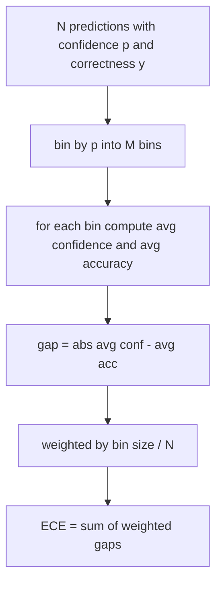
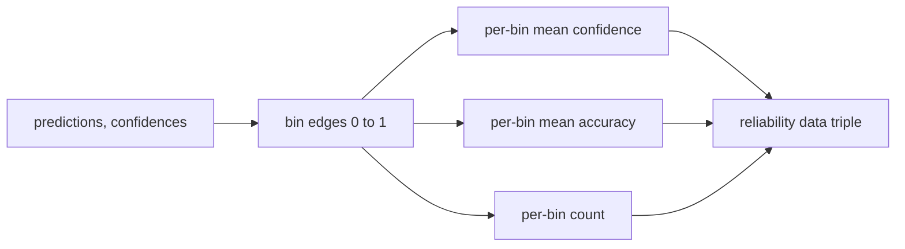

# Perplexity 与 Calibration

> 如果你的模型在一千个答案上都声称有 90% 的置信度，却只答对六百个，那它就没有校准好。calibration 是可信 eval 的一半，另一半是 perplexity——它告诉你模型到底觉不觉得那段留出文本是合理的。

**Type:** Build
**Languages:** Python
**Prerequisites:** 第 19 阶段 Track B 基础，第 70 课、第 71 课
**Time:** ~90 分钟

## Learning Objectives

- 从模型适配器提供的 token 负对数概率出发，在留出语料上计算 token 级 perplexity。
- 从分箱后的预测概率计算分类器或多选 eval 的期望校准误差（ECE）。
- 计算 Brier score（相对正确性指示变量的均方误差），并解释它在哪些场合能做到 ECE 做不到的事。
- 构建绘制置信度-准确率曲线所需的可靠性图数据。
- 把这三者接入 eval harness，使 runner 能把 `perplexity`、`ece` 和 `brier` 数字附加到模型报告中。

```figure
cd-reliability-diagram
```

## Perplexity 告诉你什么

Perplexity 是每个 token 平均负对数似然的指数。越低越好。perplexity 为 1 意味着模型给每个真实 token 都分配了概率 1。perplexity 等于词表大小意味着模型是均匀分布、什么也没学到。真实数字落在这两者之间：一个强大的 2026 年基础模型在 WikiText-103 上大约在 8 到 12 之间，一个糟糕的模型在同一段文本上则在 50 以上。

harness 本身不计算对数概率，那些来自模型适配器。harness 只做聚合：它接收一组逐 token 的对数概率、一组每个序列的 token 数，返回语料级 perplexity。

```python
def perplexity(neg_log_probs, token_counts):
    total_nll = sum(neg_log_probs)
    total_tokens = sum(token_counts)
    return math.exp(total_nll / total_tokens)
```

实现会处理零 token 的边界情况，并断言负对数概率非负。一个常见错误是忘记取负：适配器若返回 `log p` 而不是 `-log p`，就会得到小于 1 的 perplexity，而这是不可能的。函数会把它当作契约违规捕获。

## ECE 衡量什么

期望校准误差（ECE）按置信度把预测分到固定数量的箱中，再按箱大小加权，衡量各箱内置信度与准确率之间的平均差距。



标准形式在 `[0, 1]` 上使用十个等宽箱。实现支持任意正整数个箱。我们暴露 `bins` 参数，让 runner 能在发布惯例（10）与对比惯例（15）之间选择。

ECE 会受箱数和样本量影响而产生偏差。十个箱、一百个预测时，你无法把 0.02 的 ECE 与随机噪声区分开。实现会随 ECE 一并返回非空箱的数量，让 runner 可以在样本太少时拒绝只报一个数字。

## Brier score 能做而 ECE 做不到的事

ECE 只关心平均差距。一个在一半箱上过度自信、另一半箱上信心不足的模型，可以有很低的 ECE，却在局部校准得很差。Brier score 衡量的是每个预测相对真实结果的平方误差，因此它直接惩罚这种分布弥散。

对于二值结果，Brier 为 `mean((p_i - y_i)^2)`。它可以分解为 reliability、resolution 和 uncertainty 三部分。我们既计算分数也计算分解。runner 上报标量，但把分解记录进日志供 dashboard 使用。

```python
def brier(p, y):
    return float(np.mean((p - y) ** 2))
```

## 可靠性图数据

可靠性图在每个箱内把预测置信度对经验准确率作图，对角线即完美校准。函数返回三个数组：每箱平均置信度、每箱平均准确率、每箱计数。绘图代码在下游，本课只做到数据形状为止。



返回的元组正是调用层绘制图像或计算自定义 ECE 变体（adaptive ECE、sweep ECE 等）所需的东西。我们返回 numpy 数组，下游代码无需再做转换。

## 置信度来源

harness 不假设置信度来自 softmax。它接受每个预测在 `[0, 1]` 内的任意数字。对多选题，自然的置信度是 `softmax over option log-likelihoods`；对自由文本，自然的置信度是模型自报的概率，或平均对数似然的指数。eval 只消费这个数字，它从哪来是适配器的职责。

## 边界情况

- 全部预测都错：ECE 等于平均置信度，Brier 很高，perplexity 则是模型对文本的看法。
- 全部预测都正确且高置信：ECE 接近 0，Brier 接近 0。
- 完全不确定的预测器 p=0.5：ECE 是 0.5 减去准确率，Brier 是 0.25 减去一个修正项。
- 空输入：ECE、Brier 和可靠性数据都返回 `0.0`（或填零数组），perplexity 在零 token 情形下返回 `NaN`。这些路径都不发出警告；runner 检查取值后决定是上报还是跳过。

这些情况都已写进测试。真实模型在真实 benchmark 上不会碰到它们，但有 bug 的适配器或极小的样本会，而 runner 不应该崩溃。

## 调度分发

calibration 不像 F1 那样是逐任务指标，而是逐模型的报告。runner 在整个 eval 过程中累积 `(confidence, correct)` 对，最后一次性计算 ECE、Brier 和可靠性数据。perplexity 则在单独的留出文本语料上计算，与逐任务打分分开。

接口如下：

```python
report = CalibrationReport.from_predictions(confidences, correct)
report.ece          # float
report.brier        # float
report.reliability  # tuple of three numpy arrays
report.populated_bins  # int
```

`PerplexityResult.from_token_nll(neg_log_probs, token_counts)` 返回 perplexity 以及每个 token 的平均负对数似然。

## 本课不做什么

它不调用模型，不实现 softmax，也不从输出 token 估计置信度——那是适配器的职责。它不做 temperature scaling 或 Platt scaling，那些是事后修正，属于另一课。本课的要点是让这三个数字（perplexity、ECE、Brier）可信且可复现。

## 如何阅读代码

`main.py` 定义了 `perplexity`、`expected_calibration_error`、`brier_score`、`reliability_diagram`，以及 `CalibrationReport` / `PerplexityResult` 数据类。demo 运行在已知真值的合成预测上：一个校准良好的模型、一个过度自信的模型和一个信心不足的模型。`code/tests/test_calibration.py` 中的测试钉住了每个边界情况，外加合成预测器的参考值。

从上到下读 `main.py`。函数顺序是标量到向量再到报告。每个函数都有一段简短 docstring，写明数学和契约。

## 延伸探索

calibration 是已发表 eval 中最被忽视的维度。多数 leaderboard 只报一个准确率数字就收工。一个在准确率上胜出、在 Brier 上落败的模型，作为生产部署反而不如一个准确率低几分但能可靠汇报自身不确定性的模型。一旦把 calibration 的管线搭好，就在留出验证切片上加入 temperature scaling、重算 ECE，看着这个差距缩小。那是另一课，但地基在这里。
