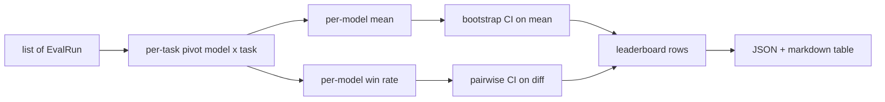
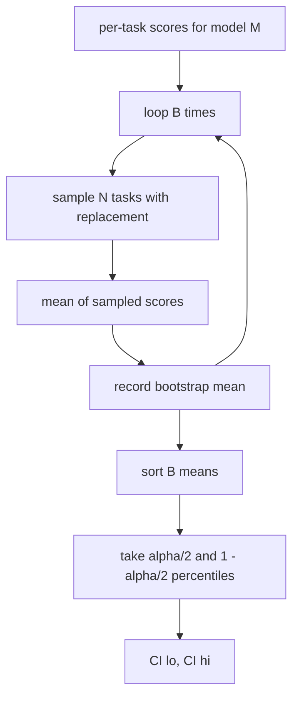

# Leaderboard 聚合

> 逐任务分数很容易。跨异构任务的逐模型排名就难得多。而在一千条预测的 leaderboard 上做统计显著性，是所有人都跳过的那一步。本课不跳过。

**Type:** Build
**Languages:** Python
**Prerequisites:** 第 19 阶段 Track B 基础，第 70 课、第 71 课、第 73 课
**Time:** ~90 分钟

## Learning Objectives

- 把多个模型、多个任务的逐任务分数聚合成整洁的逐模型行。
- 归一化异构分数，避免通过率和 BLEU 值过度影响聚合结果。
- 按均值和按胜率对模型排名，并说明各自适合什么场合。
- 计算每个模型均值的 bootstrap 置信区间，以及两两差异的置信区间。
- 把 leaderboard 输出为 JSON 报告和 markdown 表格，供第 75 课的 runner 直接粘进 CI 评论。

```figure
ci-leaderboard-ci
```

## 输入的形状

聚合器消费一组 `EvalRun` 记录：

```python
@dataclass
class EvalRun:
    model_id: str
    task_id: str
    metric_name: str
    score: float          # in [0, 1]
    category: str
```

第 75 课的 runner 为每个 `(model, task)` 对输出一条记录。聚合器不关心分数是怎么产生的，它期望归一化已经完成：每个分数都在 `[0, 1]` 内。

## 输出

最终产出三张表：



leaderboard 行包含：`model_id`、`mean_score`、`mean_ci_lo`、`mean_ci_hi`、`win_rate`、`tasks_completed`，以及一个可选的 `categories` 映射用于逐类别均值。

## 归一化

如果一个任务的分数在 `[0, 1]`，另一个在 `[0, 100]`，后者会悄悄主导均值。聚合器会校验每个输入分数都在 `[0, 1]` 内，否则拒绝这次运行。修复在上游：指标本身就该返回比例。第 71 至 73 课强制执行这个契约。

## 均值与胜率

这两种排名方案服务于不同目标。

均值分数是一个模型逐任务分数的平均，是 leaderboard 上报的头条数字。它对离群值和任务不均衡很敏感。

胜率统计一个模型在同一任务上击败所有其他模型的频率。对每个任务，得分最高的模型获胜（并列则均分）。胜率等于胜场数除以该模型有分数的任务数。它对离群值和量纲差异不那么敏感，但会丢失信息。

```python
def win_rate(model_id, runs_by_task, all_models):
    wins, total = 0, 0
    for task_id, runs in runs_by_task.items():
        scores = {r.model_id: r.score for r in runs if r.model_id in all_models}
        if model_id not in scores:
            continue
        total += 1
        best = max(scores.values())
        if scores[model_id] >= best:
            wins += 1
    return wins / total if total else 0.0
```

harness 两者都上报。第 75 课的 runner 默认按均值排名；胜率的 markdown 列就摆在那里，用户偏好时可以取用。

## Bootstrap 置信区间

每个模型的均值都配一个由任务上 bootstrap 重采样估计出的置信区间。我们对任务 id 有放回重采样，在重采样集合上算均值，重复 `B` 次，然后取 `alpha` 水平的百分位区间。



对两两比较，我们对逐任务差值 `score_A - score_B` 做 bootstrap，取百分位区间并上报。用户由此读出区间是否排除零。若排除，则差异在 alpha 水平上显著；若不排除，leaderboard 就把这两个模型视为并列。

底层辅助函数（`bootstrap_mean_ci`、`bootstrap_pairwise_diff`）默认 `B=1000`；对外聚合器（`aggregate`、`pairwise_diffs`）默认 `b=500`，以便 demo 和测试保持快速。默认 alpha 为 0.05。本课的 bootstrap 保持纯 numpy，不用 scipy。

## 类别

如果设置了 `EvalRun.category`，聚合器还会上报逐类别均值。这就是每个 leaderboard 上标着 `math`、`reasoning`、`code`、`safety` 的那一列。它让 runner 看出某个模型是否整体不错但在 code 上偏弱，而这类信息是头条均值所掩盖的。

## Markdown 渲染

leaderboard 渲染为 markdown 表格：

```text
| Rank | Model | Mean | 95% CI | Win rate | Tasks |
|------|-------|------|--------|----------|-------|
| 1    | gpt   | 0.78 | 0.74-0.82 | 0.62 | 50 |
| 2    | claude| 0.75 | 0.71-0.79 | 0.34 | 50 |
| 3    | random| 0.10 | 0.07-0.13 | 0.04 | 50 |
```

表格按均值分数排序。CI 渲染为两位小数。过长的模型 id 截断到二十个字符。

## 本课不做什么

它不运行模型，不调用指标层，也不实现 adaptive ECE 或其他 calibration 变体——那些在第 73 课。它不实现任务加权，这里每个任务权重相同。生产环境的 leaderboard 会给任务加权；我们通过 `weight` 字段留了这个钩子，但聚合器里忽略它。需要的话在后续课程里加上。

## 如何阅读代码

`main.py` 定义了 `EvalRun`、`LeaderboardRow`、`aggregate`、`bootstrap_mean_ci`、`bootstrap_pairwise_diff` 和 `render_markdown`。demo 构造一个三模型、十二任务的合成套件，做聚合，打印 leaderboard 和两两差异表。`code/tests/test_leaderboard.py` 中的测试钉住了 bootstrap、markdown 渲染、胜率边界情况和空输入行为。

从上到下读 `main.py`。先是数据形状（EvalRun、LeaderboardRow），然后是聚合器，接着是 bootstrap，最后是渲染。每个函数都有聚焦的契约。

## 延伸探索

自然的下一步是用配对任务显著性代替非配对 bootstrap。如果模型 A 和 B 都跑了同样的那一百个任务，合适的检验就是对逐任务差值做配对 bootstrap，我们已经实现了。再往前，你会想要一个尊重任务族的层次化 bootstrap（数学题彼此并不独立；一个算术错误模式会同时影响其中十道题）。那是后续工作。本课的要点是把地基打对，让 eval 报出一个你站得住脚的数字。
