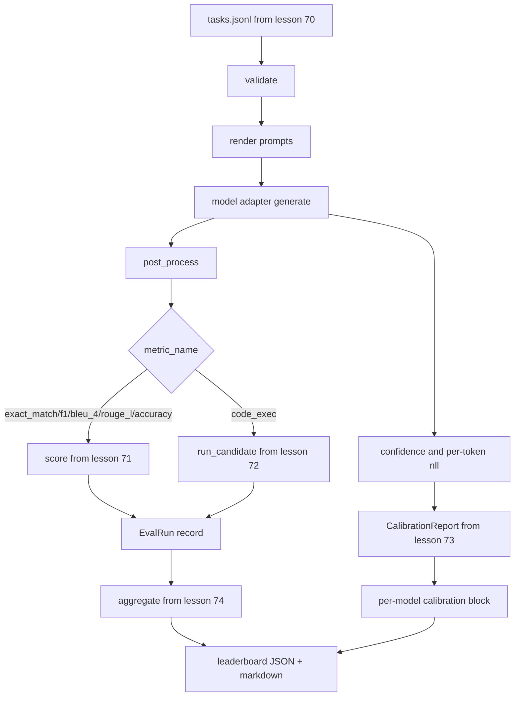

# 端到端 Eval Runner

> 五节课的管线，一节课把它们粘起来。runner 从第 70 课读取任务规范，通过适配器调用模型，用第 71、72 课打分，挂上第 73 课的 calibration 报告，再输出第 74 课的 leaderboard。demo 会自行终止。

**Type:** Build
**Languages:** Python
**Prerequisites:** 第 19 阶段 Track B 基础，第 70 至 74 课
**Time:** ~90 分钟

## Learning Objectives

- 定义一个 `ModelAdapter` 接口，让任何模型（mock、本地、API）都能用很小的方法面满足它。
- 在 fixture JSONL 文件上运行 eval，通过 worker 池并行执行任务。
- 在一趟流程中把指标层（exact_match、F1、BLEU-4、ROUGE-L、code_exec）与 calibration 层组合起来。
- 输出逐模型的 `EvalRun` 记录，并直接喂给 leaderboard 聚合器。
- 同时输出 JSON 报告和 markdown 表格；干净运行以零退出码自行结束，校验或运行时失败则以非零退出码结束。

```figure
eval-grid
```

## 流水线



runner 是集成点。第 70 至 74 课各自拥有一个模块，由 runner 组合。runner 不复制那些模块里的任何逻辑：它直接导入它们。

## 适配器接口

适配器是 runner 与任何模型之间的接缝。接口刻意做得很小。

```python
class ModelAdapter:
    model_id: str

    def generate(self, prompt: str, task: TaskSpec) -> Generation: ...
```

`Generation` 是一个数据类，包含：

- `text`：模型的自由形式输出
- `confidence`：`[0, 1]` 内的浮点数，表示模型自报的答案概率
- `token_nll`：可选，生成 token 上负对数似然之和
- `token_count`：可选，生成的 token 数量

runner 里的 mock 适配器提供三种口味：`RuleBasedAdapter`（确定性、近乎完美）、`NoisyAdapter`（过度自信、经常出错）和 `BiasedAdapter`（擅长某一类别、另一类别极差）。demo 用第 70 课的 fixture 跑这三个。

## 并行执行

runner 用 `concurrent.futures.ThreadPoolExecutor` 按模型并行运行任务。worker 数默认取八与任务数中的较小者。线程足够，因为真实模型调用的瓶颈是网络 I/O。code-exec 路径在任务内部自行拉起子进程，executor 只负责调度等待。

为了测试的确定性，runner 暴露 `run_eval(adapters, tasks, parallel=False)`，让测试能钉住执行顺序。

## 单趟打分循环

对每个任务：

1. 渲染 prompt（few-shot 前缀加 prompt 正文）。
2. 调用适配器并计时。
3. 按任务规则对生成结果做后处理。
4. 分派到指标层。
5. 用分数和指标元数据构建 `EvalRun` 记录。
6. 把 `(confidence, correct)` 对追加到 calibration 缓冲区。

对 exact_match 类指标（`exact_match`、`accuracy`、`code_exec`），`correct` 信号是 `score >= 1.0`；对分级指标则是 `score >= 0.5`。阈值写在 `_correct_from_score` 里，runner 不暴露公开的覆盖方式。

## 聚合

所有任务都有结果后，runner 调用第 74 课的 `aggregate` 和 `pairwise_diffs`，以及第 73 课的 `CalibrationReport.from_predictions`。输出是一个 JSON 信封：

```json
{
  "leaderboard": [...],
  "pairwise": [...],
  "calibration": {
    "model_id_a": {"ece": 0.04, "brier": 0.10, "populated_bins": 8, ...},
    ...
  },
  "summary": {
    "tasks": 10,
    "models": 3,
    "wall_seconds": 1.2
  }
}
```

runner 还会把 markdown 表格写到 stdout，方便用户把结果粘进 PR review。

## 自行终止的 demo

demo 用三个 mock 适配器跑第 70 课的十个 fixture 任务。墙钟时间应在十秒以内。干净运行下退出码为零。

干净运行的标准是：

- 每个任务都通过第 70 课的校验。
- 每个任务都按第 71、72 课打分。
- calibration 报告按第 73 课聚合无错误。
- leaderboard 把 rule-based 适配器严格排在 random 适配器之上。

其中任何一条不成立，runner 就以非零退出码结束，并在 JSON 信封里给出结构化错误。

## 本课不做什么

它不调用真实模型，不实现 API key 流程或限流处理，不实现流式或部分生成——适配器每次调用返回一个 generation。它不做重试或缓存。这些关注点都在适配器层；runner 对指标和供应商都无感知。

## 如何阅读代码

`main.py` 是集成层。它通过一个小的 `_load_sibling` 辅助函数按相对路径解析并导入另外五个课程模块。数据类 `Generation`、`EvalReport` 和 `ModelAdapter` 在本地定义。mock 适配器在文件底部。

从上到下读 `main.py`。先略读 import，再看 `run_eval`，然后看 `_score_one`，最后看适配器。结尾的 demo 是入口。

`code/tests/test_runner.py` 中的测试钉住了适配器接口、单趟循环、并行与串行的等价性、calibration 缓冲区以及 JSON 信封形状。

## 延伸探索

这个 runner 是地基。生产级 eval 系统还会加上：以 `(task_id, model_id, model_version)` 为键的结果缓存、逐运行追踪美元和 token 的成本账本、在限流时退避的重试层、面向 pass-at-k 任务的采样策略，以及面向长套件的流式输出格式。每一项都是包裹 runner 的单一关注点，不改变指标层或聚合层。这种分离正是契约的意义。

mock 跑通后，为真实供应商加一个适配器。挑一个有免费额度的，写三十行胶水代码，看 leaderboard 亮起来。然后加第二个供应商，让 harness 干活。
