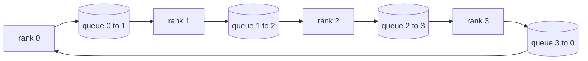

# 从零实现 Collective Ops

> 支撑分布式训练的四个 collective 操作是 allreduce、broadcast、allgather 和 reduce_scatter。训练框架提供的其他所有原语都是它们的包装。在 `multiprocessing.Queue` 网格上把它们实现一次，再对照参考实现验证，这条路线剩下的就都是管线活了。

**Type:** Build
**Languages:** Python
**Prerequisites:** 第 19 阶段 Track C，第 42 至 49 课
**Time:** ~90 分钟

## Learning Objectives

- 用两趟（先 reduce-scatter 再 allgather）实现 ring allreduce，并证明每 rank 的通信量为每元素 2(N-1)/N 字节。
- 在 `multiprocessing.Queue` 之上的点对点发送之上构建 broadcast、allgather 和 reduce_scatter。
- 对同一输入，把每个原语与 `torch.distributed` 的 gloo 参考实现逐一比对验证。
- 从集群形状、latency 下限和带宽上限出发，为 ring 与 tree 的取舍辩护。

## 问题场景

朴素地在 N 个 rank 上做 allreduce，是把张量发给一个 root 共 N 次，再广播回来 N 次。带宽按每 rank O(N) 增长，root 成为瓶颈，墙钟下限是最慢链路乘以 N。ring allreduce 把它摊平成 2(N-1) 个大小为 T/N 的块，于是每 rank 字节数降到 2T(N-1)/N，与集群规模无关。tree allreduce 在小 N 和高 latency 链路上胜出，因为深度是 log2(N) 跳而非 2(N-1) 跳。为集群形状选错拓扑，最慢的 GPU 就会决定 step 时间。

这条路线里你会读到的每个分布式训练框架都依赖这四个原语。PyTorch DDP 用每个参数 bucket 一次 allreduce 来同步梯度。ZeRO 用 reduce_scatter 分片优化器状态，用 allgather 广播更新后的参数。FSDP 把完整前向变成 allgather 加 reduce_scatter。pipeline parallel 需要 broadcast 在 stage 组之间传递 activation。如果你实现不了这四个 collective，就无法推理训练为何停滞、梯度不一致为何在第 3 个 rank 冒出来，或者为什么换拓扑后 pipeline bubble 翻倍。

## 核心概念



### 两趟 ring allreduce

把张量切成 N 个等大小的块，编号 0..N-1。每个 rank 拥有与自己 rank 相同的块编号。第 1 趟 reduce-scatter 运行 N-1 步。在第 s 步，rank r 把块 (r - s) mod N 发给 rank (r + 1) mod N，并从 rank (r - 1) mod N 接收块 (r - s - 1) mod N，把收到的块累加进本地副本。N-1 步之后，rank r 拥有块 r 的完整求和。第 2 趟 allgather 再运行 N-1 步，把已完成的块沿环轮转，直到每个 rank 都持有每个块的完整求和。

| 原语 | 每 rank 字节数 | 步数 | 使用时机 |
|-----------|---------------|-------|-------------|
| Ring allreduce | 2T(N-1)/N | 2(N-1) | 大 T、胖管道同构集群 |
| Tree allreduce | T log2(N) | 2 log2(N) | 小 T 或高 latency 链路 |
| Broadcast | T | log2(N) tree | 参数初始化、标量配置 |
| Allgather | T(N-1)/N | N-1 | 分片前向、ZeRO unshard |
| Reduce_scatter | T(N-1)/N | N-1 | ZeRO 梯度分片 |

### 用 Queue 网格替代 NCCL

NCCL 跑在 PCIe 和 NVLink 上，归约由硬件卸载。在 CPU 上你没有这些。每条环边一个 `multiprocessing.Queue` 就能提供单生产者、单消费者的有序点对点投递。归约发生在用户态，所以要付 Python 开销，但线缆上的模式与 NCCL ring allreduce 完全一致。在 queue 版本上把正确性推理清楚，集群里的行为自然也就清楚了。

### 对照 gloo 验证

每个原语落地时都配一个单元测试，在相同 world size 下把它的输出与用 gloo 后端初始化的 `torch.distributed` 在同一张量上的结果比对。如果你的 ring allreduce 与 gloo 的偏差超过 float32 epsilon，测试就失败。对照参考实现做验证没有商量余地；没有它，原语看起来一直是对的，直到真实训练的第 10000 步。

```figure
ci-ring-allreduce
```

## Build It

`code/main.py` 实现了：

- `Mesh` 类，把 N 个 `multiprocessing.Queue` 实例连成一个环，并按 rank 暴露 `send(dst, tensor)` 和 `recv(src)`。
- `ring_allreduce(mesh, rank, world_size, tensor)`，运行两趟算法。
- `broadcast(mesh, rank, world_size, tensor, src)`，基于对数树。
- `allgather(mesh, rank, world_size, tensor)`，使用 N-1 次轮转。
- `reduce_scatter(mesh, rank, world_size, tensor)`，作为 allreduce 的前一半。
- `_gloo_reference(op, world_size, tensor)`，把同一输入跑过使用 gloo 的 `torch.distributed`，做逐字节比对。

运行它：

```bash
python3 code/main.py
```

输出：逐原语的验证表，对比 queue 网格与 gloo 的输出，随后是证明 2T(N-1)/N 伸缩性的每 rank 字节计数器。

## 生产环境中的模式

有三种模式能把原语加固到可上线的程度。

**在 allreduce 前对梯度分桶。** 一个 10 亿参数的模型有数万个梯度张量。每个张量一次 allreduce 就要付 N 次 latency 下限。DDP 把梯度分成约 25 MB 的桶，每桶发一次 allreduce；小张量搭在大张量的顺风车上。不分桶的话，latency 开销会主导整个 step。

**让通信与计算重叠。** 反向传播按逆序逐层计算梯度。最后一层的梯度一就绪，就启动它的 allreduce，同时下一层继续计算。PyTorch DDP 用 bucket-ready 钩子接上这一机制。网络有余量时，这种重叠能把可见通信时间减半。

**按消息大小选 ring 还是 tree，而不是靠信仰。** NCCL 自带拓扑探测器，消息大于约 1 MB 时选 ring，小于则选 tree。交叉点取决于带宽与 latency 的权衡：大于 1 MB 时带宽项 2T(N-1)/N 主导，ring 胜出；小于 1 MB 时 log2(N) 的跳数胜出。硬编码一种拓扑会在错误的消息大小上损失 throughput。

## Use It

生产中的用法：

- **PyTorch DDP。** 在反向传播后对分桶的梯度调用 `dist.all_reduce`。桶大小可调；对 100Gbit 以太网，默认 25 MB 是合理的。
- **DeepSpeed ZeRO。** 发 reduce_scatter 来分片梯度，在前向前用 allgather 重建完整参数。本课的原语正是 ZeRO 所做的调用。
- **FSDP。** 前向以 allgather 展开该层开始，计算完再用 reduce_scatter 归约并丢弃展开的部分。同样的原语，不同的调度。

## Ship It

在第 77 至 81 课中使用这套 queue 网格原语。第 77 课把 allreduce 接进 DDP。第 78 课把 reduce_scatter 接进 ZeRO。第 79 课把 broadcast 接进 pipeline activation。第 81 课把四者组合成端到端 demo。

## Exercises

1. 加一个 tree allreduce 变体，按消息大小在 ring 与 tree 之间切换。测出交叉点。
2. 加一个 `recv_timeout_ms`，让卡住的 rank 暴露超时错误而不是永远挂起。
3. 把四个原语的 `multiprocessing.Queue` 换成 TCP socket。同样的测试，真实的线缆。
4. 加一个带宽插桩钩子，让每 rank 字节计数器写入 JSONL。
5. 在 4 个 rank 上比较 ring 与 tree 对 1KB、1MB、16MB 张量的墙钟时间。用实证为交叉点辩护。

## Key Terms

| 术语 | 人们常怎么说 | 实际含义 |
|------|----------------|------------------------|
| Allreduce | “跨 rank 求和” | 调用后每个 rank 持有相同的归约结果张量 |
| Ring | “快拓扑” | N-1 个大小 T/N 的块绕环流动两遍 |
| Tree | “对数拓扑” | 归约沿二叉树进行；深度为 log2(N) 跳 |
| Allgather | “拼接分片” | 每个 rank 最终都拥有其他所有 rank 的分片 |
| Reduce_scatter | “拆分求和” | 每个 rank 最终只拥有一个块的求和 |
| Bucket | “融合小张量” | 把 N 次小 allreduce 合并成一次大 allreduce |

## Further Reading

- [PyTorch Distributed: NCCL collectives](https://pytorch.org/docs/stable/distributed.html#collective-functions)
- [Horovod ring allreduce 论文](https://arxiv.org/abs/1802.05799)
- [NCCL 拓扑与算法选择](https://docs.nvidia.com/deeplearning/nccl/user-guide/docs/index.html)
- [Patarasuk and Yuan，带宽最优的 allreduce 算法](https://www.cs.fsu.edu/~xyuan/paper/09jpdc.pdf)
- 第 10 阶段第 05 课 - 分布式训练概览
- 第 19 阶段第 77 课 - 基于这些原语接上的 DDP
