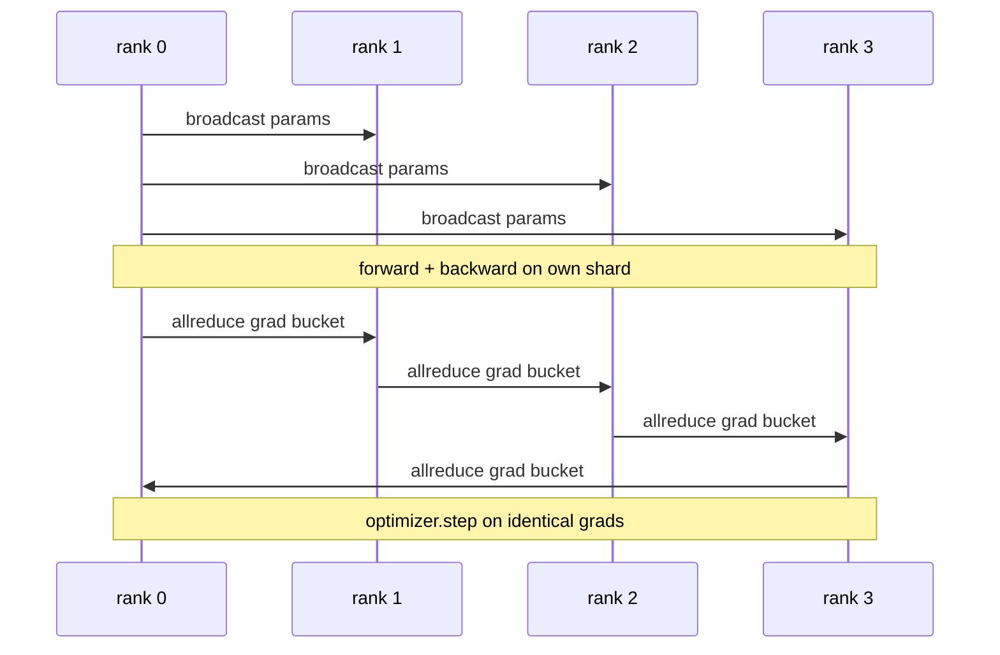

# 从零实现数据并行 DDP

> DistributedDataParallel 本质上是架在 allreduce 之上的一层 hook。把模型包起来，从 rank 0 broadcast 初始参数，让每个 rank 的起点完全一致；再给每个参数装一个 backward hook，在反向传播时对 gradient 发起 allreduce；剩下的就是梯度下降。整个模式只有 200 行。

**Type:** Build
**Languages:** Python
**Prerequisites:** 第 19 阶段 Track C 第 42 至 49 课
**Time:** ~90 分钟

## Learning Objectives

- 搭出一个形如 `DistributedDataParallel` 的 wrapper：broadcast 初始参数，并在 backward 之后 allreduce gradient。
- 通过基于文件的 rendezvous，在 gloo 后端上用 `torch.multiprocessing.spawn` 拉起 N 个 CPU rank。
- 用同一份数据顺序训练同一个模型，并逐步骤展示参数等价，以此证明 gradient 同步的正确性。
- 论证分桶（gradient 融合）与 overlap（backward 期间通信）这两项改动，是如何把一个能跑的 DDP 变成生产级 DDP 的。

## 问题场景

一个拥有 12 GB 激活值的 10 亿参数模型塞不进单张消费级 GPU。即便塞得进，训练也要花上数周。数据并行把 batch 切分到 N 个 rank 上，每个 rank 在自己的分片上做 forward 和 backward，每一步都把各 rank 的 gradient 求和，让 N 份副本保持一致。优化器步进所用的正是这个求和后的 gradient。

没有 gradient 同步，N 个副本在第 2 步就会分叉。此时它不再是"在更多数据上训练出的一个模型"，而是 N 个恰好共享初始权重的独立模型。如果 gradient 同步做得很糟（每个参数一次 allreduce、没有 overlap、没有分桶），网络就会成为瓶颈，GPU 空转等着链路。DDP 的功夫就在于让 gradient 同步相对于计算几乎免费。PyTorch 的官方 DDP 通过给 gradient 分桶、把 allreduce 与下一层的 backward overlap、以及在 NVLink 上使用 NCCL 来实现这一点。我们可以用 gloo 在 CPU 上把这三件事都做一遍，学到同样的东西。

## 核心概念



### DDP 需要的三种操作

| 阶段 | Collective | 原因 |
|-------|-----------|-----|
| 初始化 | 从 rank 0 broadcast | 每个 rank 以相同参数起步 |
| backward 之后 | 对每个 gradient 做 allreduce | 优化器步进所用的是平均 gradient |
| 有时 | broadcast buffer | Batchnorm 的 running stats 保持同步 |

### 为什么取均值而不是求和

Allreduce-SUM 除以 world_size 就得到平均 gradient。均值对 world_size 是不变的：单 rank 上调好的学习率在四个 rank 上同样适用，因为单步 gradient 的量级没有变化。若只做 Allreduce-SUM 而不除以 world_size，那么每次改变集群规模你都得重新调学习率。DDP 在 SUM 外面包了一层并做除法；本课也照做。

### 为什么要对 gradient 分桶

一个 transformer 有成千上万个参数张量。每个张量一次 allreduce，就要把 gloo 的 latency 底线重复支付上千次。DDP 把 gradient 归并成约 25 MB 的 bucket，每个 bucket 发一次 allreduce。传输的总字节数不变，但 latency 被摊薄到整个 bucket 上。本课的小模型把所有内容归到一个 bucket 里；真正可迁移的是这个结构。

### 为什么固定随机种子

每个 rank 在打乱数据时必须调用 `torch.manual_seed(seed + rank)`，而在参数初始化时必须调用 `torch.manual_seed(seed)`。共用一个种子意味着每个 rank 看到相同的 batch 顺序（数据并行因此失效）；而给参数用按 rank 区分的种子，则会让初始参数相差一个 float epsilon，gradient 同步再也无法让副本保持一致。种子模式必须正确，否则参数等价性测试在第 1 步就会失败。

```figure
ci-ddp-grad-sync
```

## Build It

`code/main.py` 实现了：

- `MiniMLP`：一个 3 层 MLP，小到能在几秒内收敛，大到足以暴露接线方式。
- `DistributedDataParallel(model, world_size)`：在构造时 broadcast 参数，返回一个 wrapper，其 `sync_grads` 会把累积的 allreduce-summed gradient 除以 world_size。
- `worker(rank, world_size, ...)`：完整的训练循环，在 gloo 上初始化 `torch.distributed`，依次做 forward、backward、sync、step。
- `_reference_single_process_loop(...)`：在单个 rank 上顺序地用同一份数据训练同一个模型，供测试在每个 step 之后比对参数是否逐字节等价。

运行它：

```bash
python3 code/main.py
```

输出：一张逐步骤训练表，把单进程的 loss 与参数校验和同 4 个 rank 上的 DDP 运行结果作对比。两条路径的 loss 曲线在 float epsilon 范围内完全一致，从而证明 gradient 同步是正确的。

## 实战中的生产模式

三种模式让 DDP 达到可以上线的程度。

**发现未使用的参数。** 有些 forward 路径会按条件跳过参数（early exit、mixture-of-experts router）。被跳过的参数没有 gradient，但 DDP 那个等待 bucket 就绪的 hook 仍然会等它们，于是 allreduce 死锁。`find_unused_parameters=True` 让 DDP 在 reduce 之前先看哪些参数拿到了 gradient。代价是每步都要遍历一次计算图，所以除非你的 forward 会分支，否则不要打开它。

**静态图优化。** 当 forward 在各步之间保持稳定时，`static_graph=True` 允许 DDP 预先计算 bucket 调度。这个优化在规模上才有意义：预计算每步省下几毫秒，累积到 10000 步就很可观。

**Gradient 累积需要小心处理。** 在 K 个 microbatch 上累积 gradient，而不对每个 microbatch 都做同步，能带来 10 倍的 throughput 提升。DDP 提供了 `no_sync()` 这个上下文管理器，用来暂停 backward 之后的 allreduce。忘了用它，你就会白白 allreduce K 次，throughput 直接掉到谷底。

## Use It

生产实现：

- **PyTorch DDP。** 官方标准实现。`torch.nn.parallel.DistributedDataParallel(model)` 一次性接好了分桶、overlap 和 no_sync 上下文。
- **HuggingFace Accelerate。** 额外提供一个 launcher，负责处理 `torchrun` 的环境变量和模型包装。底层还是同一个 DDP。
- **Megatron-LM 的数据并行。** 为大模型把 DDP 与 tensor parallel 结合使用；其中数据并行部分仍是 backward 之后 allreduce 的同一套模式。

## Ship It

第 78 课（ZeRO sharding）用 reduce_scatter 取代逐参数 allreduce，使每个 rank 只保存自己那一份 optimizer state。第 81 课把 DDP 与 ZeRO 组合进端到端 demo。

## Exercises

1. 加入可配置大小的 gradient bucket，在更深的模型上测量相对"每参数一次 allreduce"的加速比。
2. 把 `no_sync()` 实现为上下文管理器，并验证在 K 个 microbatch 上累积的 gradient 与单进程基线一致。
3. 加一个 `find_unused_parameters` 模式，让 forward 有时跳过 MLP 中的某一层；不加这个标志时运行应当死锁。
4. 把 gloo 换成只用 `torch.distributed.barrier()` 的同步方式，体会基于 allreduce 的同步与基于 barrier 的同步之间的差别。
5. 在 batch size 为 1、16、256 时测量 gradient 同步开销占单步时间的比例，并解释其伸缩规律。

## Key Terms

| 术语 | 人们常怎么说 | 实际含义 |
|------|----------------|------------------------|
| DDP | "数据并行" | 每步 broadcast 参数并对 gradient 做 allreduce 的 wrapper |
| Bucket | "融合 gradient" | 把 N 次小 allreduce 合并成一次大的 |
| Overlap | "隐藏通信" | 在后续层还在计算 backward 时就发起 allreduce |
| no_sync | "累积" | 为 gradient 累积而跳过 backward 之后的 allreduce |
| find_unused | "分支式 forward" | 在 reduce 之前检测出没有 gradient 的参数 |

## Further Reading

- [PyTorch DistributedDataParallel docs](https://pytorch.org/docs/stable/generated/torch.nn.parallel.DistributedDataParallel.html)
- [PyTorch DDP internals tutorial](https://pytorch.org/tutorials/intermediate/ddp_tutorial.html)
- [Li et al, PyTorch Distributed: Experiences on Accelerating Data Parallel Training](https://arxiv.org/abs/2006.15704)
- 第 19 阶段第 76 课 —— DDP 构建于其上的 collectives
- 第 19 阶段第 78 课 —— ZeRO sharding 用 reduce_scatter 取代逐参数 allreduce
