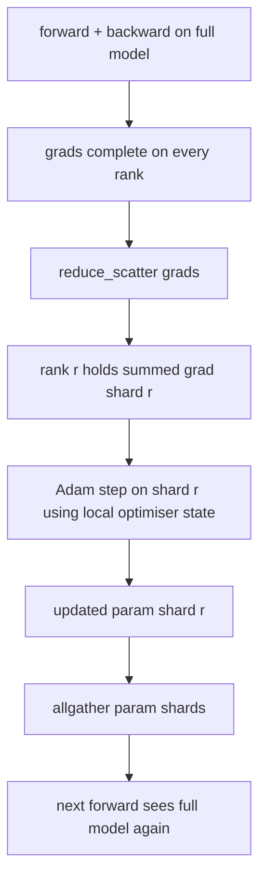

# ZeRO 优化器状态 sharding

> Adam 为每个参数保存两个 moment 估计，都是 float32。一个 7B 参数模型因此背负 56 GB 的优化器状态。ZeRO 阶段 1 把它分片到 N 个 rank 上，每个 rank 拥有优化器的 1/N。本地 step 之后，更新过的参数分片 broadcast 回去，每个 rank 重建完整模型，然后开始下一步。收益是训练栈中最大的一笔单项分配实现线性内存下降。

**Type:** Build
**Languages:** Python
**Prerequisites:** 第 19 阶段 Track C 第 42 至 49 课
**Time:** ~90 分钟

## Learning Objectives

- 把优化器状态（first moment、second moment、fp32 master copy）分片到 N 个 rank 上，使每个 rank 只拥有 1/N。
- 用 reduce_scatter 只把一个分片的 gradient 求和送到对应 rank，再用 allgather 把更新后的参数分片 broadcast 回去。
- 计算阶段 1、阶段 2、阶段 3 相对原生 DDP 的内存节省表。
- 从模型规模和带宽预算出发，论证阶段 1、阶段 2、阶段 3 之间的取舍。

## 问题场景

原生 DDP 复制一切：参数、gradient 和优化器状态在每个 rank 上都是完整的一份。对 fp16 的 7B 参数模型来说，这意味着每个 rank 上有 14 GB 参数、14 GB gradient 和 28 GB 优化器状态。优化器状态是最大的一项，也是最容易分片的一项，因为它只在 step 时被访问，forward 和 backward 期间都不碰。

ZeRO 阶段 1 分片优化器状态。每个 rank 持有 Adam moment 的 1/N。backward 之后，不再是对完整 gradient 做 allreduce 再本地 step，而是 reduce_scatter，让每个 rank 只收到自己分片的 gradient 之和。该 rank 对 master 参数的分片执行优化器 step。更新后的参数分片随后 allgather 回去，使每个 rank 在下次 forward 时都有完整模型。优化器内存下降为 1/N。每步的链路流量与 DDP 相同：一次 reduce_scatter 加一次 allgather，在带宽上等于一次 allreduce。内存赢了，throughput 不丢。

## 核心概念



### ZeRO 阶段

| 阶段 | 分片对象 | 每个 rank 的内存 | 每步通信 |
|-------|----------------|------------------|---------------|
| DDP | 无 | params + grads + optim | 1x allreduce |
| ZeRO-1 | 优化器状态 | params + grads + optim/N | 1x reduce_scatter + 1x allgather |
| ZeRO-2 | optim + grads | params + grads/N + optim/N | 1x reduce_scatter + 1x allgather |
| ZeRO-3 | optim + grads + params | params/N + grads/N + optim/N | 每层 1x allgather + 每层 1x reduce_scatter |

阶段 1 是最便宜的一笔收益，因为优化器状态在预算中占大头。阶段 2 需要 gradient 分片的累积逻辑，但带宽不变。阶段 3（FSDP）为每次 forward 和 backward 都要付逐层通信，换来参数分片的内存下降。本课完整实现阶段 1。

### 内存账本：真实数字

对于一个有 P 个参数、用 Adam 以混合精度训练的模型：

| 项目 | 原生 | ZeRO-1 | 原因 |
|------|---------|--------|-----|
| fp16 参数 | 2P bytes | 2P bytes | forward 需要 |
| fp16 gradient | 2P bytes | 2P bytes | backward 需要 |
| fp32 master copy | 4P bytes | 4P/N bytes | 只有优化器用 |
| fp32 first moment | 4P bytes | 4P/N bytes | 只有优化器用 |
| fp32 second moment | 4P bytes | 4P/N bytes | 只有优化器用 |
| 合计 | 16P bytes | 4P + 12P/N bytes |   |

在 N=8 时：原生 16P，ZeRO-1 5.5P，下降 65%。在 N=64 时：原生 16P，ZeRO-1 4.19P，下降 74%。

### 为什么 reduce_scatter 优于先 allreduce 再分片

Allreduce 让每个 rank 都拿到完整的求和 gradient。如果你只需要分片 r，那么被 reduce 的 gradient 中有 (N-1)/N 在 rank r 上是浪费的。Reduce_scatter 正好只把每个 rank 拥有的分片送达；每个 rank 的字节数与 allreduce 相同（因为 allreduce 就是 reduce_scatter + allgather），只是后半段被稍后的参数分片 allgather 替代了。净链路流量与 DDP 一致，内存却做了除法。

```figure
cd-zero-shard
```

## Build It

`code/main.py` 实现了：

- `flatten_params(module)` 与 `unflatten_into(module, flat)`：把模型的参数打包成一个连续张量，再解包回去。正是这种扁平布局让按 rank 分片变成一次简单的切片。
- `ZeroOptimizer(model, world_size, rank, lr)`：持有本 rank 那一份 master copy 与 Adam moment 分片。
- `step()`：对扁平 gradient 执行 reduce_scatter，对本 rank 的分片应用 Adam，再 allgather 回更新后的参数。
- 一个 demo：训练 3 层 MLP 共 20 步，并打印每步的内存预算，与原生 DDP 基线对照。

运行它：

```bash
python3 code/main.py
```

输出：每步 loss，以及一张内存表，显示 ZeRO-1 在每个 rank 上只持有 1/N 的优化器状态，而 DDP 持有完整副本。

## 实战中的生产模式

三种模式让 ZeRO 达到可以上线的程度。

**分片的 checkpoint 很重要。** ZeRO-1 的优化器状态被拆散到各 rank 上，checkpoint 必须记录哪个 rank 拥有哪一部分。第 80 课构建了分片 checkpoint 的 manifest，用来在同一 world size 上续跑一次 ZeRO 训练。没有它，保存下来的状态在重启时无法读取。

**混合精度才是重点。** ZeRO 是一种混合精度技术，被分片的是 fp32 master copy。不配合混合精度而运行 ZeRO，等于为 fp32 master 付了内存税，却没有拿到 fp16 forward 对应的收益。生产运行总是把 ZeRO 与 autocast 或 bf16 权重搭配。

**阶段 1 是近乎免费的收益。** 通信在带宽上与 DDP 完全一致，内存节省随 N 线性增长，唯一成本是优化器分片的记账。生产栈默认用阶段 1，除非参数分片的内存同样成为问题；那时才用阶段 2 或阶段 3 以通信换内存。

## Use It

生产实现：

- **DeepSpeed ZeRO。** 参考实现。`deepspeed_config.json` 用于选择阶段 1/2/3 以及分区大小。
- **PyTorch FSDP。** PyTorch 原生的等价物。`ShardingStrategy.SHARD_GRAD_OP` 对应 ZeRO-2，`FULL_SHARD` 对应 ZeRO-3。
- **HuggingFace Accelerate。** 用统一的配置同时包装 DeepSpeed 和 FSDP。

## Ship It

第 79 课（pipeline parallel）是正交的另一条分片轴：它不在同一个模型上分片优化器状态，而是把层分片到各 rank 上。第 81 课在端到端 demo 中把 DDP + ZeRO 组合起来。

## Exercises

1. 扩展出 ZeRO-2，把 gradient 也分片：在 backward 之后把非本分片的部分清零，使每个 rank 只存自己分片的 gradient。
2. 加一个内存 profiler，打印 rank 0 上实际的 fp32 字节占用，与公式预测作对照。
3. 测量原生 DDP 与 ZeRO-1 的每步墙钟时间，并拆解为 forward、backward、通信三部分。
4. 在 ZeRO-1 下实现 gradient clipping：L2 范数必须通过 allreduce 各分片局部范数的平方，在全部分片上汇总计算。
5. 实现一个用 allreduce 代替 reduce_scatter 的"朴素 ZeRO"，测量链路时间差，并用数字论证选择 reduce_scatter 的理由。

## Key Terms

| 术语 | 人们常怎么说 | 实际含义 |
|------|----------------|------------------------|
| ZeRO-1 | "分片优化器" | 每个 rank 持有 fp32 master + Adam moment 的 1/N |
| ZeRO-2 | "gradient 也分片" | 每个 rank 在 reduce_scatter 之后还丢掉非本分片的 gradient |
| ZeRO-3 | "分片参数" | 每个 rank 持有 fp16 参数的 1/N，forward 时逐层 allgather |
| Master copy | "fp32 权重" | 优化器所更新的高精度参数副本 |
| Reduce_scatter | "切分求和结果" | 只把每个 rank 自己那份分片的求和 gradient 送达 |

## Further Reading

- [Rajbhandari et al, ZeRO: Memory Optimizations Toward Training Trillion Parameter Models](https://arxiv.org/abs/1910.02054)
- [DeepSpeed ZeRO documentation](https://www.deepspeed.ai/tutorials/zero/)
- [PyTorch FSDP documentation](https://pytorch.org/docs/stable/fsdp.html)
- 第 19 阶段第 76 课 —— 本课赖以建立的 reduce_scatter 与 allgather
- 第 19 阶段第 80 课 —— ZeRO 状态必须使用的分片 checkpoint
