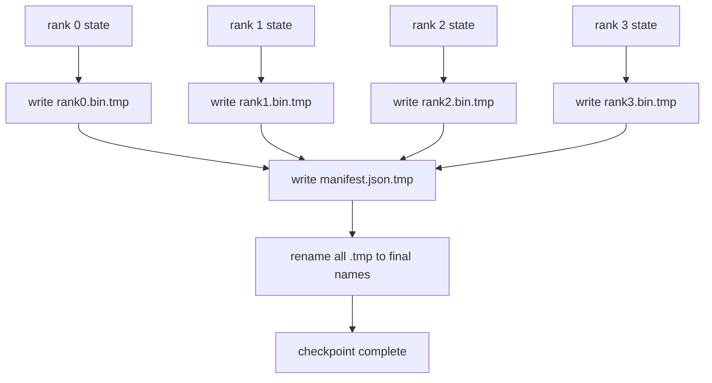

# Sharded Checkpoint 与原子化续训

> 一个 70B 参数的训练任务每隔几小时就会被一次节点故障打断。checkpoint 的格式决定了你损失的是 30 分钟还是 30 小时。分片 checkpoint 并行写出每个 rank 的分片，并在 manifest 中记录归属。续训时每个 rank 从自己的文件加载自己的分片，在相同 world size 上重建状态，优化器照常步进，仿佛什么都没发生。原子写入则防止一个写了一半的 checkpoint 污染下一次续训。

**Type:** Build
**Languages:** Python
**Prerequisites:** 第 19 阶段 Track C 第 42 至 49 课
**Time:** ~90 分钟

## Learning Objectives

- 把多 rank 的 checkpoint 保存为每个 rank 一个分片文件，外加一个记录归属的 manifest。
- 使用原子写入模式（先写临时路径再重命名），使写入中途的崩溃永远不会留下半成品 checkpoint。
- 从 manifest 续训，并验证每个 rank 上 fp16 参数与 ZeRO 优化器状态都逐字节一致。
- 让 manifest schema 抵御三种故障模式：world size 变化、分片数量不匹配，以及部分写入。

## 问题场景

原生 checkpoint 把所有参数和优化器状态读入 rank 0，汇集之后写成一个文件。对 70B 模型来说，这是 1.1 TB 的状态挤过单个 rank 的网络端口。写入会阻塞其他所有 rank，因为它们只能空转等待 gather。IO 带宽取决于最慢的那张 GPU 的网卡，而不是聚合带宽。在真实集群上，先 gather 再写这一步可能比之前一小时的训练还慢，这意味着任务一天连一个 checkpoint 都保存不完。

分片 checkpoint 把模式反过来：每个 rank 并行地把自己的分片写进自己的文件。manifest 记录哪个 rank 拥有哪个分片，续训时就能把每个分片放回原位。聚合写入带宽随集群规模伸缩：一个经单个 rank 要 4 小时的 1 TB checkpoint，经 64 个 rank 只要 4 分钟。此外，manifest 给了你一份不兼容续训的契约：world size 变化可被检测，部分写入可被检测，加载路径可以大声报错，而不是悄悄用上陈旧数据。

## 核心概念



### Manifest 结构

```json
{
  "world_size": 4,
  "step": 1234,
  "wall_clock_seconds": 4521,
  "shards": [
    {"rank": 0, "path": "rank0.bin", "sha256": "...", "param_shard_offset": 0, "param_shard_numel": 65536},
    {"rank": 1, "path": "rank1.bin", "sha256": "...", "param_shard_offset": 65536, "param_shard_numel": 65536}
  ],
  "schema_version": 1
}
```

有三个字段是承重的。`world_size` 让在不同规模上的续训大声失败，而不是悄悄损坏。每个分片的 `sha256` 能抓住不完整或损坏的写入。每个分片的 `param_shard_offset` 与 `param_shard_numel` 让加载器在正确位置重建扁平参数张量。

### 原子写入

标准模式：把每个分片写到 `<name>.tmp`，把 manifest 写到 `manifest.json.tmp`，逐个 fsync，然后重命名。同一文件系统内的 POSIX rename 是原子的；要么新文件完整存在，要么旧文件原封不动。在最后一次 rename 之前崩溃，留下的仍是上一个 checkpoint 作为生效版本。没有原子写入，崩溃可能留下一个残缺分片，而 manifest 已经指向它，续训加载时就会损坏优化器状态。

### schema 必须抵御的三种故障模式

| 故障 | 症状 | 防御 |
|---------|---------|---------|
| world size 变化 | 用 N=4 的 manifest 在 N=8 上续训 | manifest 中 world_size 不匹配，大声失败 |
| 分片数量不匹配 | 续训时看到的 rank*.bin 文件少于 manifest 中的分片数 | 枚举分片，逐一确认存在 |
| 部分写入 | 分片文件在 flush 中途被截断 | 加载时做 sha256 校验 |

每种防御都能在早期拒绝坏加载；否则就是静默损坏，直到 100 步之后 loss 变成 NaN 才暴露。

### 为什么每 rank 一个文件，而不是一个大文件

在 POSIX 上用 `O_APPEND` 并发写同一个文件，对字节对齐的写入是可行的，但实践中一个分片内的偏移会跨越 MB 级区间，锁竞争成为主导。每 rank 一个文件没有争用，而且当底层文件系统是并行文件系统（Lustre、GPFS）时还能享受条带化带来的好处。生产栈（DeepSpeed、FSDP、NeMo）都出于这个原因采用每 rank 一个文件。

```figure
ci-sharded-checkpoint
```

## Build It

`code/main.py` 实现了：

- `ShardManifest` dataclass：承载上面那套 schema，并提供 `to_json`/`from_json`。
- `save_sharded(state_dict_per_rank, dir, step)`：用原子的"先临时后重命名"模式把每个 rank 的二进制状态写进各自的文件，然后写出 manifest。
- `load_sharded(dir, expected_world_size)`：读取 manifest，校验每个分片的 sha256，返回每个 rank 的 state dict。
- 一个往返测试：构造每 rank 状态，保存，加载，断言逐字节一致。

运行它：

```bash
python3 code/main.py
```

输出：写出 4 个分片文件加上 manifest，随后重新加载并逐字节校验。

## 实战中的生产模式

三种模式让 checkpoint 达到可以上线的程度。

**异步写入。** 生产栈把 checkpoint 写入放到单独的线程或进程中，让训练继续。屏障设在下一次 checkpoint：上一次保存没完成，就不开始下一次。DeepSpeed 的 `async_io` 开关正是这么做的。本课保持同步写入，以便看清每一步。

**先写本地快盘，再异步上传。** 先写到本地 NVMe（快），再异步上传到 S3 或 GCS。这种两层模式让集群内的 checkpoint 保持快速、便于续训，同时把一份持久副本送出集群归档。manifest 记录本地路径；上传 manifest 记录远端路径。

**轮转很重要。** 生产运行保留最近 K 个 checkpoint（通常是 3 到 5 个）并轮转掉最旧的。没有轮转，磁盘会在运行中途写满，下一次 checkpoint 就失败。有了轮转，下一次保存先删掉最旧的，腾出预算。

## Use It

生产实现：

- **DeepSpeed checkpointing。** `deepspeed.save_checkpoint(tag=step)` 写出每 rank 文件，并写一个指向当前生效 tag 的 `latest` 文件。
- **PyTorch FSDP checkpointing。** `torch.distributed.checkpoint` 用 `Planner` 决定每 rank 布局并保存分片状态。
- **NeMo。** 用统一的 `save_to_checkpoint` API 包装 DeepSpeed 和 FSDP，并附加元数据。

## Ship It

第 81 课为端到端 DDP+ZeRO 运行保存分片 checkpoint，并在相同 world size 上重新加载，以证明续训契约成立。

## Exercises

1. 加入异步写入：在线程里启动保存并让训练继续，同时阻塞下一次保存直到上一次完成。
2. 加入 `last_5_steps` 轮转：保留最近 5 个 checkpoint，在保存新的之前删掉最旧的。
3. 为内循环的重新加载加一条只做 CRC 的快速校验路径（轮转时把一个 checkpoint 升为新的生效版本，不必做完整 sha256）。
4. 加入跨 world size 的加载：读取 manifest、拼接、重新分片，实现从 N=4 到 N=8 的分片再平衡。
5. 加入上传到假 S3（第二个目录）并写出上传 manifest，论证这种两层存储策略。

## Key Terms

| 术语 | 人们常怎么说 | 实际含义 |
|------|----------------|------------------------|
| Sharded checkpoint | "每 rank 保存" | 每个 rank 并行地写自己的分片文件 |
| Manifest | "索引" | 记录分片路径、偏移和 sha256 的 JSON 文件 |
| Atomic write | "先 tmp 再 rename" | 先写 .tmp 再 POSIX rename，崩溃时上一个文件仍然生效 |
| Partial write | "被截断的分片" | 写入期间的崩溃会产生损坏的分片；sha256 能抓住它 |
| Rotation | "只留最近 K 个" | 写新 checkpoint 前删掉最旧的，以限制磁盘占用 |

## Further Reading

- [DeepSpeed checkpointing](https://deepspeed.readthedocs.io/en/latest/model-checkpointing.html)
- [PyTorch torch.distributed.checkpoint](https://pytorch.org/docs/stable/distributed.checkpoint.html)
- [POSIX rename atomicity](https://pubs.opengroup.org/onlinepubs/9699919799/functions/rename.html)
- 第 19 阶段第 78 课 —— 本 checkpoint 为之定形的 ZeRO 状态
- 第 19 阶段第 81 课 —— 端到端 demo 会对保存的状态做往返验证
