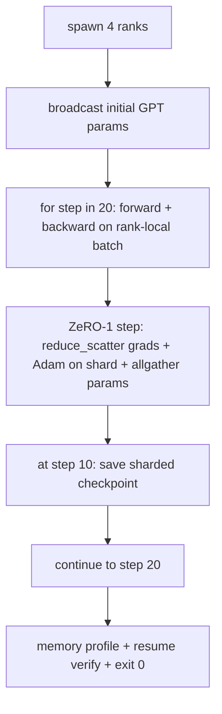

# 端到端分布式训练

> 第 76 到 80 课各自搭建了一个部件。这里做的是装配：一个极小的 GPT 在 4 个模拟 rank 上训练，用 DDP 做 gradient 同步、用 ZeRO-1 做优化器状态分片，并在中途保存一份分片 checkpoint。demo 跑 20 步，自行终止，打印 loss 曲线和内存 profile，并写出一个可续训的 checkpoint。

**Type:** Build
**Languages:** Python
**Prerequisites:** 第 19 阶段 Track C 第 42 至 49 课
**Time:** ~90 分钟

## Learning Objectives

- 把 DDP（第 77 课）、ZeRO-1（第 78 课）与分片 checkpoint（第 80 课）组合进一个训练循环。
- 在 4 个模拟 rank 上，用一个小型合成语料把一个 2 层 transformer 语言模型训练 20 步。
- 打印逐步 loss 表、每 rank 的内存 profile，以及一份能在相同 world size 上逐字节续训的 checkpoint manifest。
- 论证这套组合：每个部件在先前课程中都可独立测试，本课则证明它们能组合起来。

## 问题场景

Capstone 就是各部件能拼合在一起的证明。第 76 课实现了 collectives。第 77 课把它们封装成 DDP。第 78 课用 reduce_scatter 分片优化器状态。第 79 课分析了 pipeline。第 80 课保存了分片 checkpoint。每课都独立成立，各有自己的测试。而真实训练一次就要同时用上每一种原语；一旦组合出错，loss 会发散，checkpoint 会拒绝续训，或者每 rank 的内存本应下降却在增长。

本课运行端到端 demo，并验证四条不变量：(a) 在浮点噪声范围内，loss 在 20 步中单调下降；(b) 每一步每个 rank 都持有相同的参数范数；(c) 每 rank 的优化器内存等于 ZeRO-1 公式 12P/N 字节；(d) 第 10 步的 checkpoint 在重启时逐字节重载。demo 会自行终止：20 步，一条命令，退出码 0。

## 核心概念



### 这个 mini GPT

模型是刻意做小的：2 个 transformer block、embed 维度 32、4 个 attention head、词表 64、序列长度 16、batch 4。总共几千个参数。它大到足以检验每一个接线决策（multi-head attention 走标准 masked 路径；LayerNorm 有权重需要同步；LM head 是单独一个线性投影回到词表），又小到让 4 个 CPU rank 上的 20 步在几秒内完成。

### 组合规则

| 课程组件 | 负责什么 | 留给循环做什么 |
|--------------|--------------|----------------------------|
| DDP broadcast | 初始参数同步 | 构造时调用一次 |
| ZeRO-1 step | Gradient 同步、master copy 更新、参数 broadcast | 每步调用一次，取代 optimiser.step |
| 分片 checkpoint | 持久化每 rank 状态、带 sha256 的 manifest | 在 rank 0 上调用，状态经 allgather 汇集 |
| 训练循环 | Forward、backward、loss 记录 | 按顺序调用上面三者 |

循环本身并不知道 reduce_scatter 或 rendezvous 文件。ZeRO 与 checkpoint 模块只暴露狭窄的接口，由循环来组合。

### 为什么用极小的 GPT，而不只是 MLP

第 77 课的 MLP 足以验证 gradient 同步。极小的 GPT 额外带来三样东西：一个独立的词表 LM head（本课为了清晰不做权重绑定；完整 GPT 通常把 head 与 token embedding 绑在一起）、以 softmax+cross-entropy 作为 loss（数值边界情况比 MSE 多）、以及非对称的 forward（先是 embedding，再是 attention，然后每层 MLP）。如果 capstone 只用 MLP，就掩盖了这套组合能否正确处理 LayerNorm 或 embedding 层的 gradient 形状。

### 自行终止意味着退出码 0

循环跑固定的 20 步然后退出。没有 `while True`，没有人工介入，也不从外部状态续训。一个可以放着无人值守运行、结束后就能拿到完整日志的 capstone，才是一个证明系统接线正确的 capstone。任何一个部件死锁，demo 就永远不会返回，测试装置立刻能发现。

```figure
ci-distributed-assembly
```

## Build It

`code/main.py` 实现了：

- `MiniGPT`：2 层 transformer，带 masked self-attention 和独立的 LM head。
- `make_corpus(seed, total_tokens)`：确定性的 next-token-prediction 数据。
- `_train_worker`：每个 rank 拉起一份；broadcast 初始参数，跑训练循环，调用 ZeRO step，在第 10 步写出分片 checkpoint。
- `verify_resume`：主运行结束后，在进程内重新加载第 10 步的 checkpoint，断言保存的 master 分片与内存快照逐字节一致。
- `main`：编排整个 demo，打印 loss 表、内存 profile 和校验结果。

运行它：

```bash
python3 code/main.py
```

输出：一张 20 行的 loss 表、一份 4 行的每 rank 内存 profile、一个 checkpoint manifest，以及成功时的 "RESUME VERIFIED" 一行。

## 实战中的生产模式

三种模式让这套组合在真实运行中收尾完整。

**按分钟而不是按步数做 checkpoint。** 步耗时随序列长度和 microbatch 数量变化。10 分钟一次的 checkpoint 节奏在任何模型规模下捕获的是同样多的计算。本课为简单起见按步数触发；生产上按墙钟时间触发。

**尽早检测发散。** 生产运行会在 backward 之后加 NaN 守卫和 loss 尖峰检测器；如果 loss 在一步内跳变超过 2 倍，就回滚到上一个 checkpoint，而不是让优化器一路走进退化状态。本课的 loss 曲线是平滑的，因此守卫用不上，但钩子保留着。

**跨 rank 聚合内存 profile。** 在真实运行中，每 rank 内存因 rank 而异（持有最大 pipeline 阶段的 rank 会保存更多激活值）。生产日志会记录跨 rank 的最大值和均值；本课按 rank 打印，以展示公式吻合。

## Use It

生产实现：

- **DeepSpeed。** 在一份配置下组合 DDP + ZeRO + pipeline + 激活 checkpointing。本课的组合就是 DeepSpeed 形态的缩影。
- **PyTorch FSDP。** 原生等价物。搭配 `ShardingStrategy.SHARD_GRAD_OP` 的 `FullyShardedDataParallel` 就是 ZeRO-2。
- **NeMo 与 Megatron-LM。** 为最大的模型再加 tensor parallel；除此之外组合形态相同。

## Ship It

完整的一条 track 到此结束。这 6 课合起来，就是一个真实团队在采用 DeepSpeed 之前会自建的分布式训练子系统；其中的抽象已在 gloo 上验证过，各种故障模式也都被演练过。第 17 阶段（基础设施与生产）是把这套东西搬到真实集群的地方。

## Exercises

1. 加入 attention head 的 tensor parallel 拆分，验证 loss 与单 rank 基线一致。两个 rank：每 rank 一半的 head，对 attention 输出做 allreduce。
2. 加入跨 4 个 microbatch 的 gradient 累积，并证明所得 gradient 等于一个大 batch 的 gradient。
3. 加入从第 10 步续训的路径，真正把训练继续到第 20 步，并产出与原始运行相同的最终 loss。
4. 把指标（loss、grad norm、step time）导出为 JSONL，以便事后可视化这次运行。
5. 加入一个在 loss 尖峰时回滚到上一个 checkpoint 的 NaN 守卫，并用一步的 LR 倍率人为制造尖峰来演练回滚。

## Key Terms

| 术语 | 人们常怎么说 | 实际含义 |
|------|----------------|------------------------|
| End-to-end | "全接起来" | 一次运行组合所有部件，而不是每部件一个单元测试 |
| Memory profile | "每 rank 多少 GB" | 每个 rank 为 params、grads、优化器状态所占的字节 |
| Resume contract | "存下来再读回来" | 一趟 checkpoint 往返后每 rank 状态逐字节一致 |
| Self-terminating | "有界运行" | 固定步数，完成后退出码 0，循环中无人工介入 |

## Further Reading

- [DeepSpeed end-to-end training tutorial](https://www.deepspeed.ai/getting-started/)
- [PyTorch FSDP advanced tutorial](https://pytorch.org/tutorials/intermediate/FSDP_advanced_tutorial.html)
- [Megatron-LM training script reference](https://github.com/NVIDIA/Megatron-LM)
- 第 19 阶段第 76 至 80 课 —— 本课所组合的各个组件
- 第 17 阶段 —— 把这套组合搬到真实集群
