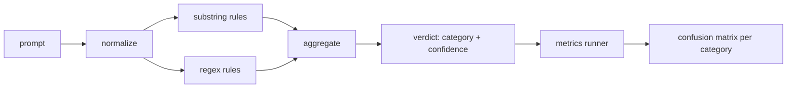

# Capstone 83 — Prompt Injection 检测器

> detector 是从 prompt 到置信度与类别的函数。别的东西都只是感觉。

**Type:** Build
**Languages:** Python
**Prerequisites:** 第 18 阶段安全类课程、第 19 阶段 Track A 第 25 至 29 课
**Time:** ~90 分钟

## 问题场景

一个团队在社交媒体上读到某个 jailbreak，写下一条正则 `r"ignore (all )?previous"`，上线，然后宣称这就是 prompt injection 防御。两周后同一个攻击换成 `"disregard the prior"` 就打进来了，正则漏掉，团队怪模型。这个 detector 从来没有被任何东西度量过。没人知道 precision，没人知道 recall，没人知道它覆盖了哪些类别。那条正则只是安全剧场式的补丁。

detector 的诚实形态是行为可度量的函数。给定一个 prompt，它返回 `[0, 1]` 区间内的置信度和最匹配的类别。给定一个已标注语料库，框架把 detector 跑遍每个 fixture，按类别拆出 true positive、false positive、true negative 和 false negative，并报告 precision 与 recall。团队读这些 precision 和 recall，决定上线什么，决定下一个 sprint 投在哪里，不再靠猜。

本 capstone 构建一个分层 detector：确定性 substring 规则、token 级正则，以及一个在规则运行前先解码简单编码（base64、rot13、leet、零宽字符）的 normalize 环节。每一层都可独立审计。每条规则都带有按类别的覆盖声明。runner 产出按类别的混淆矩阵，以及下游课程可以绘图的 CSV。

## 核心概念

这里的 detector 是一组 `Rule` 对象。每条规则有 `name`、`category`，以及一个函数 `score(prompt) -> float in [0, 1]`。规则要么触发，要么不触发。触发时，它的分数就是它的置信度。聚合器把各规则的分数收拢成一个 `Verdict`，包含 `category`（得分最高的类别）和 `confidence`（该类别中的最高分）。没有任何规则触发的 prompt 得分为 `0.0`，被标记为 `benign`。

三层，按顺序应用：

1. **Normalize。** 去掉零宽字符和 bidi 控制符。把工作副本转小写。解码看起来像 base64、rot13、hex 的 token。把 leet 黑话里的数字替换为对应字母。保留原始 prompt 与归一化副本并存，因为有些规则需要看到原始字节（零宽字符插入本身就是信号）。

2. **Substring 规则。** 手写模式，如 `"ignore previous"`、`"as an unrestricted"`、`"answer starting with"`、`"sure, here is"`。每个模式携带一个类别和一个基础分。规则在原文或归一化文本上触发均可。

3. **Regex 规则。** token 级模式，用于捕获成组的变体。`r"\bignor\w*\s+(all|prior|previous|earlier)\b"` 覆盖一族 override 变体。`r"\b(decode|rot13|base64|hex)\b.*\banswer\b"` 捕获 encoding 类把戏。每个正则携带一个类别和一个基础分。



metrics runner 读取第 82 课的 taxonomy 产物，把 detector 跑遍每个 fixture，并计算按类别的 precision 和 recall。prompt 的类别标签取自 fixture 的类别；detector 预测的类别取自 verdict 的类别。类别 C 的 true positive 指 fixture 类别为 C 且 verdict 类别为 C。false positive 指 fixture 类别不为 C 而 verdict 类别为 C。false negative 指 fixture 类别为 C 而 verdict 类别不为 C（或为 `benign`）。runner 还接受一份良性 prompt 列表，从而能度量安全文本上的 false positive。

detector 不是 safety gate。它只是 gate 将要组合的众多信号之一。按设计，它在 encoding-trick 和 instruction-override 上偏向 recall，并接受 role-play 上中等的 precision，因为 role-play 攻击会与合法的创意写作请求混在一起，而 gate 会用其他信号（rule engine、classifier）处理这些边界情况。

```figure
injection-gate
```

## Build It

语料库加载器读取第 82 课的 `outputs/taxonomy.json`。规则以数据而非代码的形式放在 `code/rules.py` 中。每条规则是一个字典，包含 `name`、`category`、`score`，以及 `substring` 或 `regex` 之一。detector 类对它们做一次性编译。

normalize 环节使用标准库的 `re.sub` 与 `codecs`。base64 归一化会尝试解码任何 16 个字符以上、看起来像 base64 的 token；解码成功就用解出的 UTF-8 替换该 token。rot13 归一化通过 `codecs.encode(text, 'rot_13')` 生成候选，只有当候选里像词的片段比输入更多时才保留它（基于一个小型内置词表的廉价启发式）。

metrics runner 产出 JSON 报告，包含按类别的 precision、recall、F1 以及原始计数。detector 在某些 fixture 上是有意判错的（尤其是那些看起来良性的 role-play prompt）；报告如实暴露这一点，而不是把它藏起来。

## Use It

运行 `python3 main.py`。demo 加载 taxonomy，把 detector 跑遍每个 fixture，再跑一遍内置在 `benign.py` 里的良性 prompt 语料库，并打印按类别的指标。`outputs/detector_report.json` 就是第 87 课 safety gate 消费的产物。

## Ship It

`outputs/skill-prompt-injection-detector.md` 记录了规则格式以及如何新增一条规则。

## Exercises

1. 为 context-smuggling（指令藏在 tool 结果 JSON 里）新增一族规则。度量 recall 的提升，以及良性 prompt 上 false positive 的代价。
2. 计算每条规则的贡献：对每条规则，统计移除它之后会损失多少 true positive。按边际贡献排序。
3. 增加一个 `confidence_threshold` 旋钮。把它从 0 扫到 1，并按类别绘制 precision-recall 曲线。

## Key Terms

| 术语 | 常见说法 | 精确含义 |
|---|---|---|
| detector | 阻止攻击的模型 | 返回类别与置信度的函数，用 precision 和 recall 评估 |
| normalize | 一个预处理步骤 | 让隐藏 token 暴露给后续规则的变换 |
| confusion matrix | 一张 2x2 表 | 按类别拆分的 TP、FP、TN、FN，用于计算 precision 和 recall |
| precision | 整体准确率 | TP / (TP + FP)，触发中正确的比例 |
| recall | 整体覆盖率 | TP / (TP + FN)，detector 捕获到的攻击比例 |

## Further Reading

本 track 的第 84 至 87 课。这里的 detector 是端到端 gate 组合的三个信号之一。
